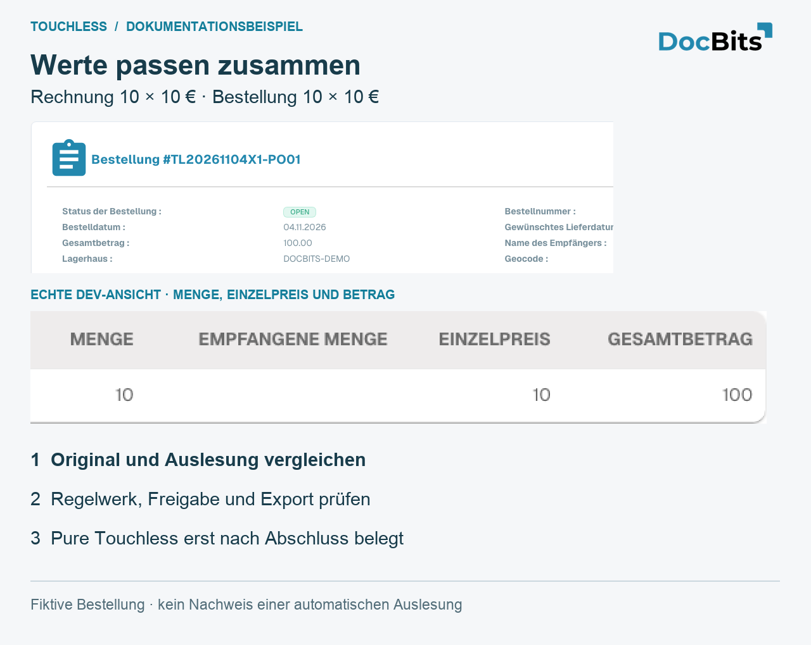
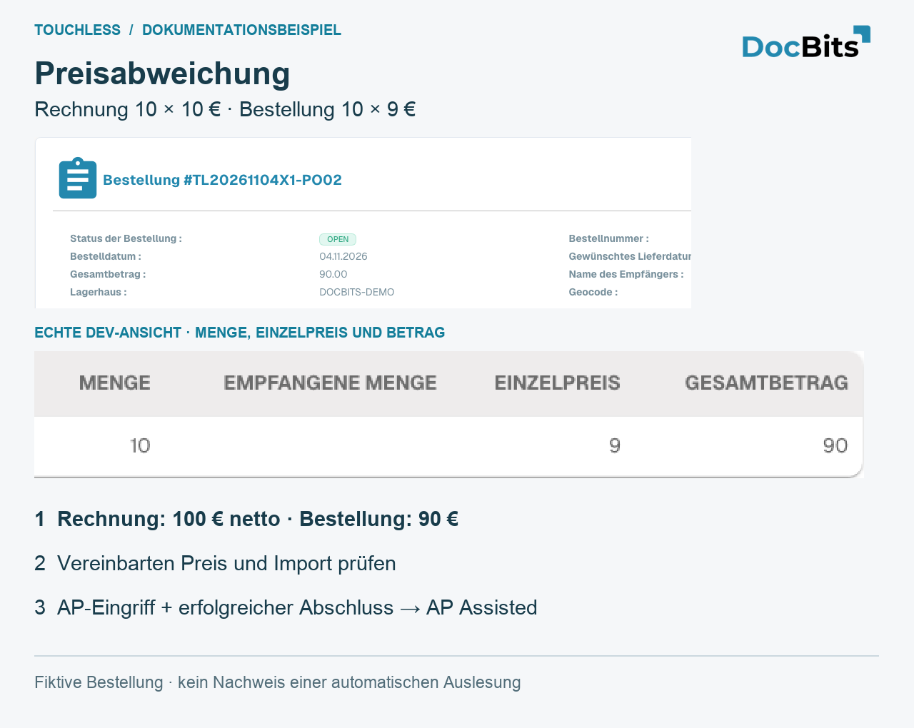
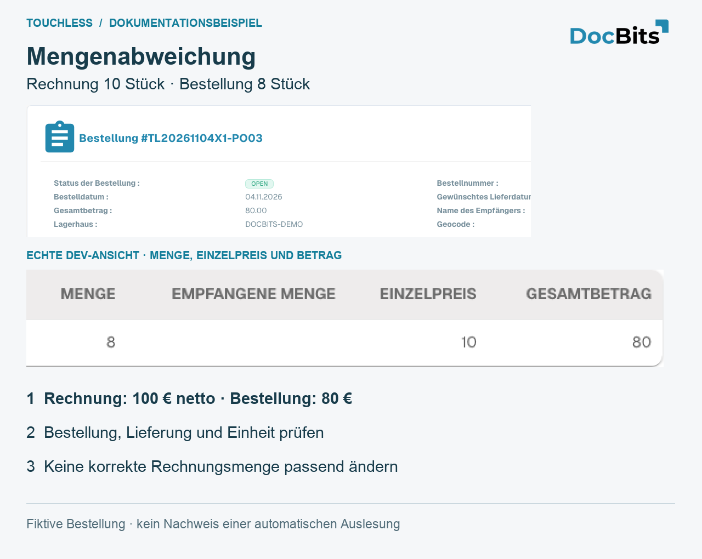

# Praxisbeispiele: Preis und Menge

<!-- touchless-admin-video-v2-20261104:start -->
**Video-Kapitel (Prüffassung):** [Einen Beleg nachverfolgen](https://docbits-videos.fra1.cdn.digitaloceanspaces.com/settings-assistant/touchless-intelligence-preview-admin/v2/de.html#chapter=07).
<!-- touchless-admin-video-v2-20261104:end -->

## Durchgängiges Beispiel: korrekte Auslesung, andere Infor-Daten

Dies ist ein Veranschaulichungsfall, getrennt von den Screenshots. Die Rechnung zeigt **10 Stück zu je 10,00 €**, insgesamt **100,00 €**. DocBits liest alle drei Werte korrekt aus. Die importierte Infor-Bestellung zeigt **10 Stück zu je 9,00 €**, insgesamt **90,00 €**. Angenommen, die konfigurierten Abgleichprüfungen blockieren diesen Preisunterschied.

1. **Auslesung prüfen:** Vergleichen Sie die Originalrechnung mit der ausgelesenen Menge, dem Stückpreis und dem Positionsbetrag. Sie stimmen überein; für diese Werte ist kein Auslesefehler belegt.
2. **Quelle prüfen:** Vergleichen Sie die importierte Bestellung mit der aktuellen Infor-Bestellung, einschließlich Preiseinheit und Importzeitpunkt. Ein veralteter Import und eine falsche Infor-Bestellung erfordern unterschiedliche Behebungen.
3. **Den fachlichen Wert klären:** In diesem Beispiel bestätigt der Einkauf, dass 10,00 € vereinbart waren, und korrigiert die Infor-Bestellung. Wären 9,00 € der vereinbarte Preis, müsste stattdessen die Lieferantenrechnung geklärt werden.
4. **Den korrigierten Import prüfen:** Kontrollieren Sie vor einem neuen Versuch, ob die richtigen Bestellwerte tatsächlich in DocBits angekommen sind.
5. **Die AP-Aktion festhalten:** AP startet diese Rechnung in DocBits manuell neu; nach erfolgreichem Abschluss ist sie **AP assisted**. Korrekte Auslesung und ein nicht touchless abgeschlossener Prozess können gleichzeitig zutreffen.
6. **Spätere Rechnungen prüfen:** Kontrollieren Sie, ob Abgleich und Export jetzt ohne weitere Korrektur oder weiteren Neustart abschließen. Die bereits bearbeitete Rechnung bleibt bearbeitet; spätere Rechnungen liefern den Nachweis der Verbesserung.


Ändern Sie einen korrekt ausgelesenen Wert von 10,00 € nicht auf 9,00 €, nur damit er zu einer falschen Bestellung passt, und erweitern Sie keine Toleranz allein, um die Abweichung zu verdecken. Bestätigen Sie den vereinbarten Wert und korrigieren Sie die verantwortlichen Daten oder die Konfiguration. Ein Abgleichblocker zeigt, wo der Prozess gestoppt hat, nicht wer die Ursache gesetzt hat.


Die getrennte Betrachtung der Auslesequalität und die AP-Touchless-Berechnung finden Sie unter [Touchless Intelligence](./), die zu vergleichenden Nachweise unter [Document Trace](touchless-document-trace.md).

## Drei eigene Demo-Bestellungen: passende Werte, Preis und Menge

Diese Bestellungen wurden eigens in **Dev** angelegt. Lieferant, Artikel und Rechnungen sind fiktiv. Jede Rechnung enthält **10 Stück × 10 € = 100 € netto**. Die Karten enthalten echte Ausschnitte der englischen Oberfläche und vergrößerte numerische Details. Sie zeigen keine Live-Verbindung zu einem Kunden-Infor, keine belegte Auslesung und keinen erfolgreich abgeschlossenen automatischen Rechnungsprozess.

| Fall | Rechnung | Importierte Bestellung | Was der Vergleich belegt |
| --- | --- | --- | --- |
| PO01 / RE01: passende Werte | 10 × 10 € = 100 € | 10 × 10 € = 100 € | Die Quellwerte stimmen überein; Pure Touchless erfordert trotzdem eine korrekte Auslesung und einen bestätigten Abschluss ohne Eingriff oder Freigabe |
| PO02 / RE02: Preisabweichung | 10 × 10 € = 100 € | 10 × 9 € = 90 € | 10 € Unterschied in der Position; der Stückpreis weicht um etwa 11,11 % vom Bestellpreis ab. Ob das blockiert, entscheiden die tatsächlich aktiven Regeln |
| PO03 / RE03: Mengenabweichung | 10 × 10 € = 100 € | 8 × 10 € = 80 € | 2 Stück zusätzlich, 25 % bezogen auf die bestellte Menge. Prüfen Sie offene beziehungsweise erhaltene Menge und die konfigurierte Vergleichsmenge |

<figure><figcaption>
Passende Werte in der fiktiven Bestellung PO01. Die vergrößerte native Zeile zeigt Menge, Stückpreis und Betrag. Übereinstimmung allein belegt weder eine korrekte Auslesung noch Pure Touchless.
</figcaption></figure>

<figure><figcaption>
Preisbeispiel PO02: Die importierte Bestellung zeigt tatsächlich 10 × 9 = 90, die fiktive Rechnung 10 × 10 = 100. Prüfen Sie vereinbarten Preis, Preiseinheit und Import. Ein aufgezeichneter menschlicher Eingriff mit anschließend erfolgreichem Abschluss ist AP Assisted.
</figcaption></figure>

<figure><figcaption>
Mengenbeispiel PO03: Die importierte Bestellung enthält 8 Stück, die Rechnung 10. Die erhaltene Menge ist in diesem Test leer und belegt keine Lieferung. Diese Karten erklären den Vergleich; sie belegen keinen erfolgreichen Abgleich.
</figcaption></figure>

## Weiterführende Seiten

* [Touchless Intelligence](./)
* [Kennzahlen und Berechnung](touchless-metrics.md)
* [Dashboard bedienen](touchless-dashboard.md)
* [Lieferantendiagnose und Fehlermuster](touchless-supplier-diagnosis.md)
* [Bestellabgleich-Diagnose](touchless-po-matching-diagnosis.md)
* [Dokumentverlauf](touchless-document-trace.md)
* [Änderungsvorschläge und Berichte](touchless-change-proposals.md)
* [Touchless mit MCP erklären und verbessern](touchless-mcp.md)

<!-- Documentation review 2026-11-04: extraction quality vs process outcomes; KPI and terminal-outcome definitions checked against DocBits_API c51f350c728acb8ac964098d15f7b006bce273f4, module/automation_intelligence/kpi.py and bucket.py. Existing native screenshots retained and checked separately from illustrative examples. -->
<!-- Completion review 2026-11-04: owned synthetic PO examples, MCP schema/read evidence, human-action classification, KPI labels and screenshot proof limits. -->
