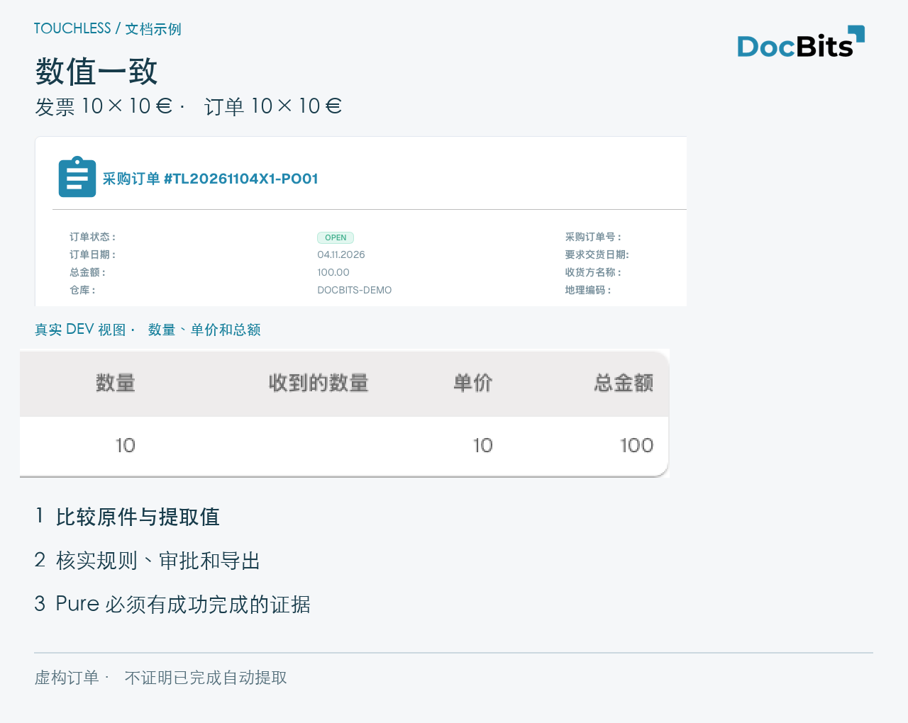
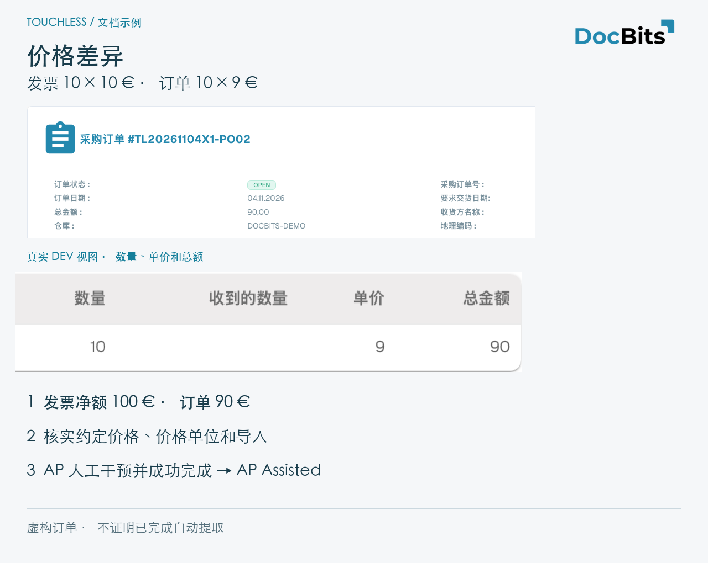
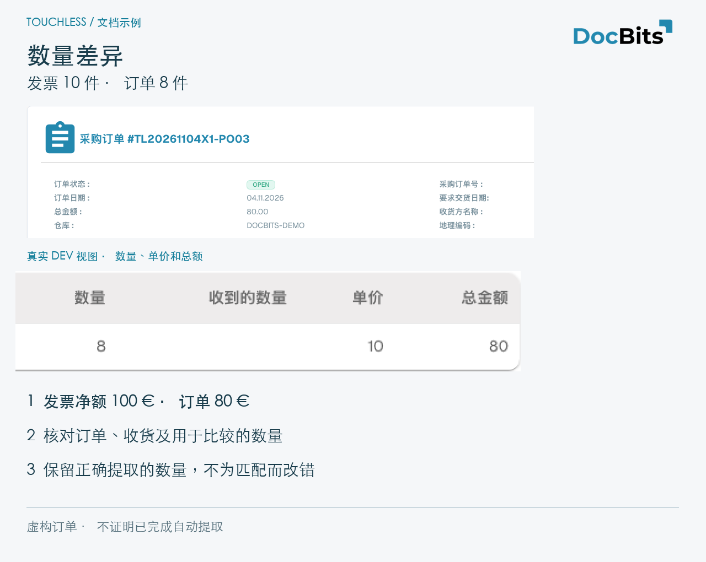

# 示例：价格与数量

## 完整示例：提取正确，Infor 数据不同

说明性案例：发票 **10 件 × 10 € = 100 €**，提取正确；导入订单 **10 × 9 € = 90 €**。假设有效规则会阻止该差异。

1. 核对原件与提取，确认一致。
2. 检查导入、当前 Infor、价格单位及时间。源系统错误与旧副本是不同问题。
3. 采购确认约定价为 10 € 并更正订单；若约定价是 9 €，则需与供应商澄清发票。
4. 确认更正值已经导入 DocBits。
5. AP 人工重新启动；成功后为 **AP Assisted**，即使提取完全正确。
6. 用新发票检查能否无干预完成；先前文档的历史仍保留。

不要修改正确的提取值，也不要扩大容差来掩盖错误。修复已确认的原因。截图本身不证明这一整条流程。

## 三个演示订单：一致、价格和数量

只在 **Dev** 创建的虚构供应商、物料和发票。每张发票都是 **10 件 × 10 € = 100 € 净额**。说明卡保留真实中文界面并放大数字；不证明客户 Infor 连接、正确提取或自动处理成功。自定义物料名称和技术 ID 保留原值，状态 OPEN 是原始系统值。

| 案例 | 发票 | 导入订单 | 能证明什么 |
| --- | --- | --- | --- |
| PO01 / RE01 | 10 × 10 € = 100 € | 10 × 10 € = 100 € | 源值一致；Pure 仍需正确提取且无干预/审批完成 |
| PO02 / RE02 | 10 × 10 € = 100 € | 10 × 9 € = 90 € | 行金额差 10 €，单价相对订单差约 11.11 %；有效规则决定是否阻塞 |
| PO03 / RE03 | 10 × 10 € = 100 € | 8 × 10 € = 80 € | 多两件，为订购数量的 25 %；核对未结/收货数量及比较基础 |

<figure><figcaption>
虚构 PO01 的值一致。真实放大区域显示数量、单价和总额；仅此不能证明提取正确或 Pure Touchless。
</figcaption></figure>

<figure><figcaption>
PO02：导入订单显示 10 × 9 = 90，虚构发票为 10 × 10 = 100。核实约定价格、价格单位和导入。已记录人工干预并成功完成则为 AP Assisted。
</figcaption></figure>

<figure><figcaption>
PO03：订购 8 件、开票 10 件。收货数量为空不证明已收货。说明卡显示比较，不证明匹配成功。
</figcaption></figure>

## 相关页面

* [Touchless Intelligence](./)
* [指标与计算](touchless-metrics.md)
* [使用仪表板](touchless-dashboard.md)
* [供应商诊断与问题集群](touchless-supplier-diagnosis.md)
* [采购订单匹配诊断](touchless-po-matching-diagnosis.md)
* [文档追踪](touchless-document-trace.md)
* [变更提案和报告](touchless-change-proposals.md)
* [通过 MCP 解释和改善 Touchless](touchless-mcp.md)

<!-- Alignment 2026-11-04: correct extraction is distinct from process Touchless; KPI numerator and denominator verified. -->
<!-- Completion 2026-11-04: localized MCP examples, AP actions, original-value evidence and owned synthetic PO cards. -->
