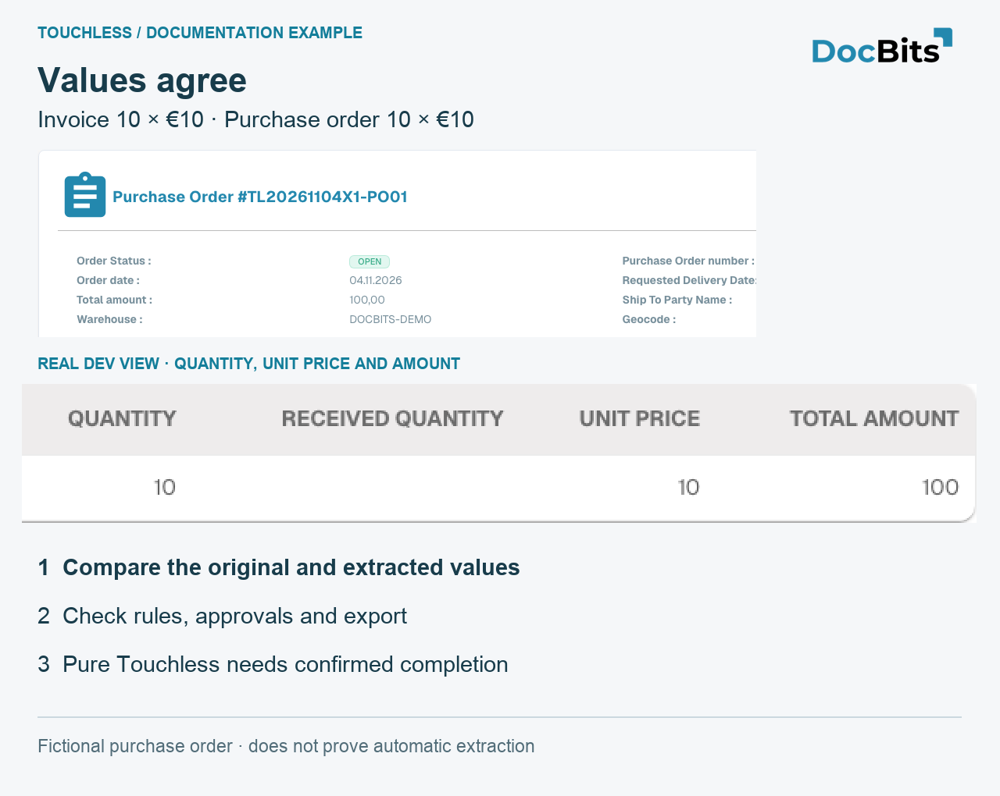
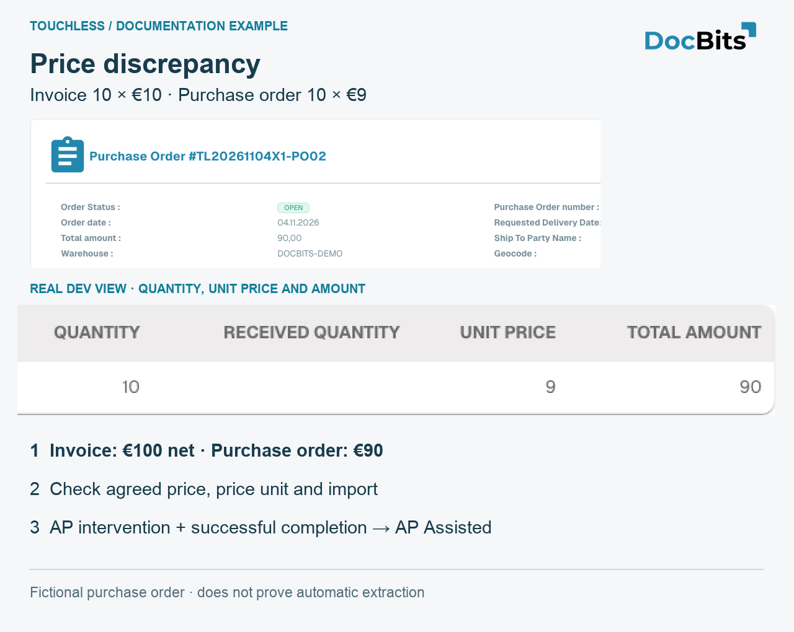
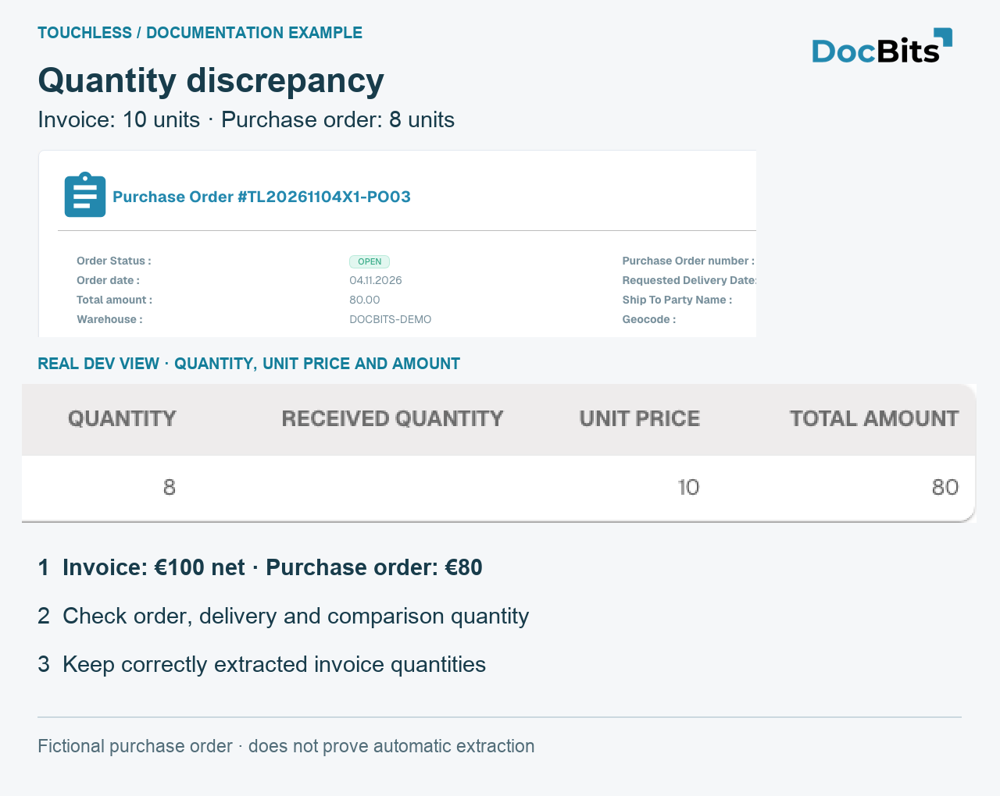

# Worked examples: price and quantity

## Worked example: correct extraction, different Infor data

This is an illustrative case, separate from the screenshots. The invoice shows **10 units at €10.00 each**, total **€100.00**. DocBits extracts all three values correctly. The imported Infor order shows **10 units at €9.00 each**, total **€90.00**. Assume the configured matching checks block this price difference.

1. **Check extraction:** compare the original invoice with the extracted quantity, unit price and line amount. They match, so there is no demonstrated extraction error for these values.
2. **Check the source:** compare the imported order with the current Infor order, including price unit and import time. An outdated import and an incorrect Infor order require different fixes.
3. **Clarify the business value:** in this example, purchasing confirms that €10.00 was agreed and corrects the Infor order. If €9.00 were the agreed price, the supplier's invoice would need clarification instead.
4. **Verify the corrected import:** check that the correct order values have actually reached DocBits before retrying.
5. **Record the AP action:** AP manually restarts this invoice in DocBits; after successful completion it is **AP assisted**. Correct extraction and a non-touchless process can both be true.
6. **Check later invoices:** verify that matching and export now complete without another correction or restart. The previously touched invoice remains touched; later invoices provide evidence of improvement.


Do not change a correctly extracted €10.00 to €9.00 just to match an incorrect order, or widen a tolerance solely to hide the discrepancy. Confirm the agreed value and correct the responsible data or configuration. A matching blocker identifies where the process stopped, not who caused it.


See [Touchless Intelligence](./) for the separate extraction-quality example and the AP touchless calculation, and [Document Trace](touchless-document-trace.md) for the evidence to compare.

## Three owned demo POs: matching values, price and quantity

These POs were created specifically in **Dev**. The supplier, item and invoices are fictional. Each invoice contains **10 units × €10 = €100 net**. The cards contain genuine English UI crops and enlarged numeric details. They do not show a live customer Infor connection, proven extraction or a successfully completed automatic invoice process.

| Case | Invoice | Imported PO | What the comparison establishes |
| --- | --- | --- | --- |
| PO01 / RE01: matching values | 10 × €10 = €100 | 10 × €10 = €100 | Source values agree; Pure Touchless still needs correct extraction and confirmed completion without intervention or approval |
| PO02 / RE02: price discrepancy | 10 × €10 = €100 | 10 × €9 = €90 | €10 line difference; unit price differs by about 11.11% relative to the PO price. Actual active rules decide whether it blocks |
| PO03 / RE03: quantity discrepancy | 10 × €10 = €100 | 8 × €10 = €80 | 2 additional units, 25% relative to ordered quantity. Check open/received quantity and the configured comparison quantity |

<figure><figcaption>
Matching values in fictional PO01. The enlarged native row shows quantity, unit price and amount. Agreement alone proves neither correct extraction nor Pure Touchless.
</figcaption></figure>

<figure><figcaption>
Price example PO02: the imported order actually shows 10 × 9 = 90, compared with 10 × 10 = 100 on the fictional invoice. Check agreed price, price unit and import. A recorded human intervention followed by successful completion is AP Assisted.
</figcaption></figure>

<figure><figcaption>
Quantity example PO03: the imported PO contains 8 units, the invoice 10. Received quantity is empty in this test and proves no delivery. These cards explain comparison; they do not prove a successful match.
</figcaption></figure>

## Related pages

* [Touchless Intelligence](./)
* [Metrics and calculation](touchless-metrics.md)
* [Use the dashboard](touchless-dashboard.md)
* [Supplier Diagnosis and Issue Clusters](touchless-supplier-diagnosis.md)
* [PO Matching Diagnosis](touchless-po-matching-diagnosis.md)
* [Document Trace](touchless-document-trace.md)
* [Change Proposals and Reports](touchless-change-proposals.md)
* [Explain and improve Touchless with MCP](touchless-mcp.md)

<!-- Documentation review 2026-11-04: extraction quality vs process outcomes; KPI and terminal-outcome definitions checked against DocBits_API c51f350c728acb8ac964098d15f7b006bce273f4, module/automation_intelligence/kpi.py and bucket.py. Existing native screenshots retained and checked separately from illustrative examples. -->
<!-- Completion review 2026-11-04: owned synthetic PO examples, MCP schema/read evidence, human-action classification, KPI labels and screenshot proof limits. -->
