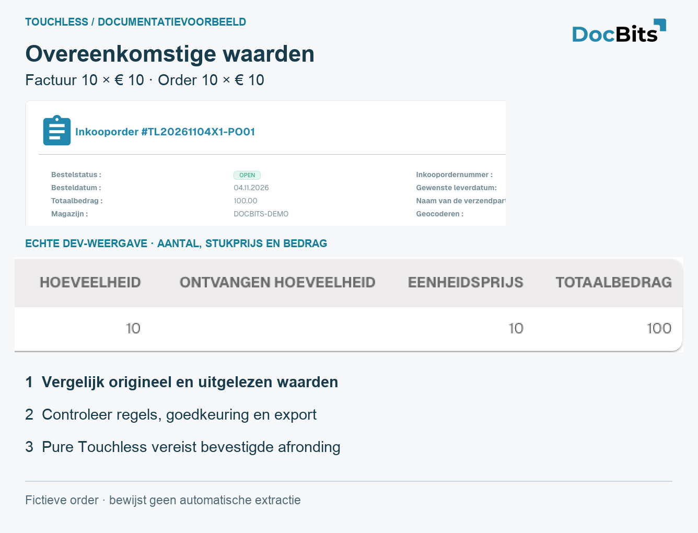
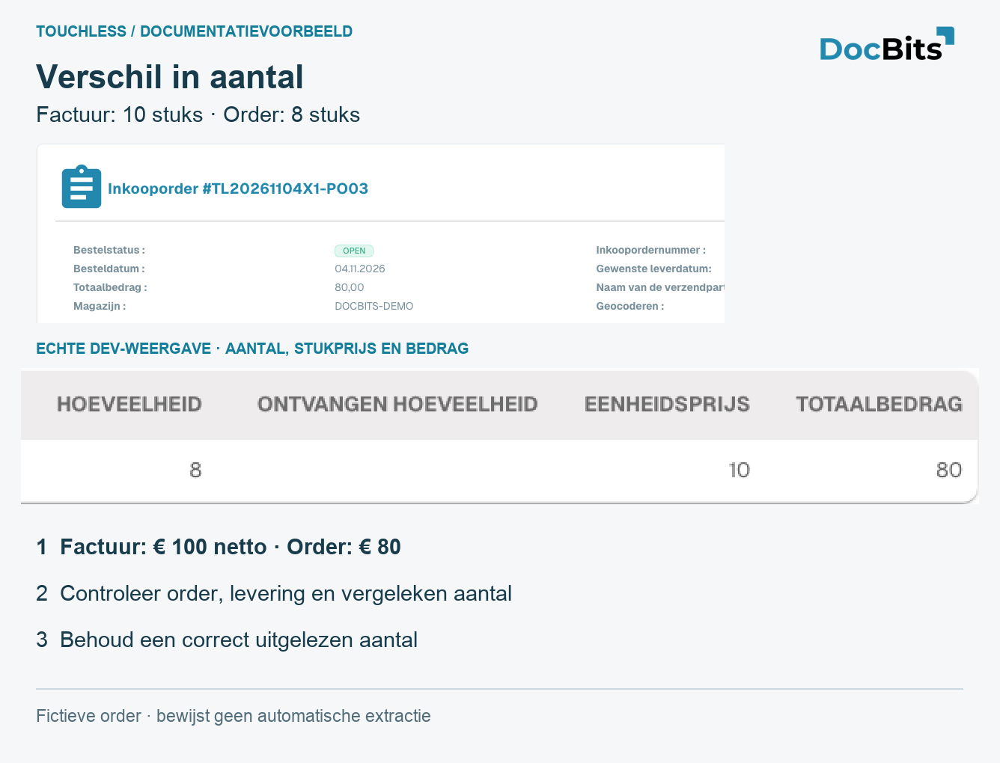

# Uitgewerkte voorbeelden: prijs en aantal

<!-- touchless-admin-video-v2-20261104:start -->
**Videohoofdstuk (controleversie):** [Een document volgen](https://docbits-videos.fra1.cdn.digitaloceanspaces.com/settings-assistant/touchless-intelligence-preview-admin/v2/nl.html#chapter=07).
<!-- touchless-admin-video-v2-20261104:end -->

## Uitgewerkt voorbeeld: correcte extractie, andere Infor-gegevens

Dit is een illustratief geval, los van de schermopnamen. De factuur toont **10 eenheden van €10,00 per stuk**, totaal **€100,00**. DocBits leest alle drie de waarden correct uit. De geïmporteerde Infor-order toont **10 eenheden van €9,00 per stuk**, totaal **€90,00**. Ga ervan uit dat de geconfigureerde matchingcontroles dit prijsverschil blokkeren.

1. **Controleer de extractie:** vergelijk de originele factuur met de geëxtraheerde hoeveelheid, eenheidsprijs en regelbedrag. Ze komen overeen, dus voor deze waarden is er geen extractiefout aangetoond.
2. **Controleer de bron:** vergelijk de geïmporteerde order met de actuele Infor-order, inclusief prijseenheid en importtijdstip. Een verouderde import en een onjuiste Infor-order vragen om verschillende oplossingen.
3. **Verhelder de zakelijke waarde:** in dit voorbeeld bevestigt inkoop dat €10,00 is afgesproken en corrigeert de Infor-order. Was €9,00 de afgesproken prijs, dan zou juist de factuur van de leverancier opheldering vragen.
4. **Controleer de gecorrigeerde import:** controleer dat de juiste orderwaarden DocBits daadwerkelijk hebben bereikt voordat u het opnieuw probeert.
5. **Leg de AP-actie vast:** AP herstart deze factuur handmatig in DocBits; na een geslaagde afronding is ze **AP assisted**. Een correcte extractie en een niet-touchless proces kunnen beide waar zijn.
6. **Controleer latere facturen:** controleer dat matching en export nu zonder nieuwe correctie of herstart worden afgerond. De eerder aangeraakte factuur blijft aangeraakt; latere facturen leveren bewijs van verbetering.


Wijzig een correct geëxtraheerde €10,00 niet in €9,00 alleen om bij een onjuiste order te passen, en verbreed een tolerantie niet louter om de afwijking te verbergen. Bevestig de afgesproken waarde en corrigeer de verantwoordelijke gegevens of configuratie. Een matchingblokkade wijst aan waar het proces stopte, niet wie de oorzaak is.


Zie [Touchless Intelligence](./) voor het afzonderlijke voorbeeld van extractiekwaliteit en de berekening van AP touchless, en [Document Trace](touchless-document-trace.md) voor het bewijs dat u vergelijkt.

## Drie eigen demo-PO's: overeenkomende waarden, prijs en aantal

Deze PO's zijn speciaal in **Dev** aangemaakt. De leverancier, het artikel en de facturen zijn fictief. Elke factuur bevat **10 eenheden × €10 = €100 netto**. De kaarten bevatten echte Engelse UI-uitsneden en vergrote numerieke details. Ze tonen geen live Infor-verbinding van een klant, geen bewezen extractie en geen geslaagd afgerond automatisch factuurproces.

| Geval | Factuur | Geïmporteerde PO | Wat de vergelijking vaststelt |
| --- | --- | --- | --- |
| PO01 / RE01: overeenkomende waarden | 10 × €10 = €100 | 10 × €10 = €100 | De bronwaarden komen overeen; Pure Touchless vraagt nog steeds om een correcte extractie en een bevestigde afronding zonder ingreep of goedkeuring |
| PO02 / RE02: prijsafwijking | 10 × €10 = €100 | 10 × €9 = €90 | €10 verschil op de regel; de eenheidsprijs wijkt circa 11,11% af ten opzichte van de PO-prijs. De werkelijk actieve regels bepalen of dit blokkeert |
| PO03 / RE03: quantiteitsafwijking | 10 × €10 = €100 | 8 × €10 = €80 | 2 eenheden extra, 25% ten opzichte van de bestelde hoeveelheid. Controleer de openstaande/ontvangen hoeveelheid en de geconfigureerde vergelijkingshoeveelheid |

<figure><figcaption>
Overeenkomende waarden in de fictieve PO01. De vergrote oorspronkelijke rij toont hoeveelheid, eenheidsprijs en bedrag. Overeenkomst alleen bewijst noch een correcte extractie noch Pure Touchless.
</figcaption></figure>

<figure><figcaption>
Prijsvoorbeeld PO02: de geïmporteerde order toont werkelijk 10 × 9 = 90, vergeleken met 10 × 10 = 100 op de fictieve factuur. Controleer de afgesproken prijs, de prijseenheid en de import. Een vastgelegde menselijke ingreep gevolgd door een geslaagde afronding is AP assisted.
</figcaption></figure>

<figure><figcaption>
Aantalvoorbeeld PO03: de geïmporteerde PO bevat 8 eenheden, de factuur 10. De ontvangen hoeveelheid is leeg in deze test en bewijst geen levering. Deze kaarten verklaren de vergelijking; ze bewijzen geen geslaagde match.
</figcaption></figure>

## Gerelateerde pagina's

* [Touchless Intelligence](./)
* [Metrieken en berekening](../../touchless-metrics.md)
* [Het dashboard gebruiken](touchless-dashboard.md)
* [Leveranciersdiagnose en probleemclusters](../../touchless-supplier-diagnosis.md)
* [PO-matchingdiagnose](../../touchless-po-matching-diagnosis.md)
* [Document Trace](touchless-document-trace.md)
* [Wijzigingsvoorstellen en rapporten](touchless-change-proposals.md)
* [Touchless uitleggen en verbeteren met MCP](touchless-mcp.md)

<!-- Documentation review 2026-11-04: extraction quality vs process outcomes; KPI and terminal-outcome definitions checked against DocBits_API c51f350c728acb8ac964098d15f7b006bce273f4, module/automation_intelligence/kpi.py and bucket.py. Existing native screenshots retained and checked separately from illustrative examples. -->
<!-- Completion review 2026-11-04: owned synthetic PO examples, MCP schema/read evidence, human-action classification, KPI labels and screenshot proof limits. -->
