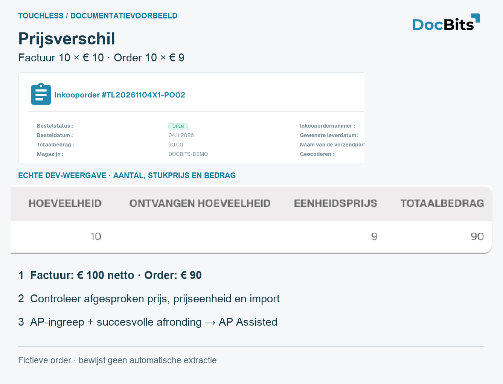

# Touchless uitleggen en verbeteren met MCP

<!-- touchless-admin-video-v2-20261104:start -->
**Videohoofdstuk (controleversie):** [Cijfers opvragen met MCP](https://docbits-videos.fra1.cdn.digitaloceanspaces.com/settings-assistant/touchless-intelligence-preview-admin/v2/nl.html#chapter=12).
<!-- touchless-admin-video-v2-20261104:end -->

De volgende werkwijzen gebruiken tools die DocBits MCP werkelijk aanbiedt. Onderscheid lezen en uitleggen van schrijven. Controleer organisatie, rol, documenttype, periode en gegevenstijdstip; verzin geen ontbrekend bewijs.

<figure><figcaption>
Werkelijke Engelse Dev-weergave van een eigen fictieve PO: 10 × 9 = 90. Dit is bronvergelijking voor MCP-diagnose, geen schermopname van een MCP-client en geen bewijs van geslaagde extractie of verwerking.
</figcaption></figure>

## Touchless uitleggen via MCP

> Leg Pure Touchless, uitkomsten met alleen goedkeuring en het gecombineerde AP-percentage uit voor facturen over de laatste 30 dagen. Vermeld de teller, de noemer, de documenten in behandeling en de uitgesloten documenten, de scope en het gegevenstijdstip. Houd de correctheid van de extractie gescheiden.

Gebruik `touchless_get_summary` met `period: "30d"` en `doc_type: "INVOICE"`. Gebruik voor een deelproces alleen segmentvelden en -waarden die `touchless_list_segments` werkelijk teruggeeft. Vergelijk het dashboard en MCP met dezelfde organisatie, hetzelfde documenttype, hetzelfde segment en dezelfde periode; lees `data_as_of`.

**Geverifieerd Dev-tegenvoorbeeld:** Drie nieuw geüploade testfacturen stonden nog op `IN_PROGRESS`. De samenvatting gaf `population.total: 3`, `population.in_progress: 3`, `population.eligible: 0` en `official_touchless_rate.ap_pct: null`. Er was nog geen percentage meetbaar. Dat is noch 0% extractienauwkeurigheid noch 100% Touchless. De geschiktheid in de samenvatting verwijst hier naar de afgeronde KPI-populatie; één afzonderlijke trace kan tegelijk `eligible: true` en `bucket_final: false` tonen.

De MCP-voorbeelden op deze vijf pagina's gebruiken directe DocBits MCP-tools die op Dev zijn gecontroleerd. De organisatie en rol van uw verbonden account gelden; beschikbaarheid in een andere interface of een extra allowlist van tools is met die test niet vastgesteld.

## FAQ

**DocBits heeft alles correct geëxtraheerd. Waarom is de factuur AP assisted?**
Touchless meet het hele proces. Onjuiste of verouderde Infor-gegevens kunnen een vastgelegde correctie of handmatige herstart vereisen, ook bij een correcte extractie. Controleer de originele factuur, de waarden die DocBits heeft geëxtraheerd en de geïmporteerde brongegevens afzonderlijk.

**Zegt AP assisted of DocBits of Infor het werk heeft veroorzaakt?**
Nee. Het legt de ingreep vast, niet de verantwoordelijkheid. Gebruik de documenttrace en de onderliggende document- en brongegevens om de oorzaak te bevestigen.

**De percentages tonen een streepje (—).** In de periode heeft geen document een definitieve uitkomst bereikt, of er zijn minder documenten dan het minimum gemeten. Documenten die nog in behandeling zijn, tellen niet mee.

**Het tabblad ontbreekt.** Vraag uw beheerder de module in te schakelen en uw rol het tabblad **Analytics dashboard** toe te kennen.

**Een document telt als aangeraakt, maar deze keer liep het zonder iemand door.** Het is in een eerdere uitvoering aangeraakt (een correctie of een herstart). Het percentage telt het werk dat is gebeurd.

**Waarom verandert het cijfer na een paar uur?** Het ERP kan een export uren na verzending bevestigen. De uitkomst wordt elke 15 minuten opnieuw berekend.

**Verandert de AI zelf iets?** Nee. AI schrijft alleen uitleg. Een instelling verandert pas nadat een beheerder die heeft voorvertoond en toegepast.

## Afwijkingen onderzoeken via MCP

> Controleer het PO-nummer, de importstatus en de werkelijk actieve matchingregels van deze factuur. Onderscheid extractie, een verouderde import, onjuiste brongegevens en ontbrekende configuratie. Wijzig nog niets.

1. Vergelijk het origineel, `get_extracted_fields` en `get_extracted_tables` voordat u een correcte extractie claimt.
2. Gebruik `get_po_sync_status` met `po_number: "TL20261104X1-PO02"` en `language: "en"`. De Dev-test bevestigde een verwerkte import en een bestaande PO. Dat bewijst aankomst, niet zakelijke correctheid of het actuele Infor-record.
3. Gebruik `touchless_get_document_trace` en `touchless_explain_po_match` met hetzelfde `doc_id`. Lees de werkelijke engine, de actieve regelversie, de kolommen en de effectieve toleranties. Gebruik voor een werkelijk teruggegeven cluster de bijbehorende `issue_signature` in `touchless_get_po_match_evidence`.
4. Bewaar ontbrekend bewijs: ons nieuwe testtype gaf `state: "none_published"` en `parse_error: "no published rule set"`, evenals lege extractievelden. Er is geen prijs-/hoeveelheidsblokkade en geen geslaagde match bewezen. Een algemene beslissingsstroom kan die ontbrekende controles niet vervangen.
5. Herstel de bevestigde oorzaak en controleer nieuwe facturen. Menselijke correctie of herstart blijft na succes relevant; een definitieve ERP-fout heeft voorrang als uitzondering, en een onafgerond document valt buiten de noemer van het percentage.

Bewaar voor een volledig geval het origineel, de extractie vóór correctie, de geïmporteerde/actuele bronwaarden en het importtijdstip, de werkelijke regels, de AP-actie en het eindresultaat. Ontbrekend bewijs blijft open.

## Het bewijs lezen via MCP

> Onderzoek deze factuur zonder die te wijzigen. Vergelijk het origineel met de huidige velden en tabellen. Verklaar de vastgelegde fasen en uitvoeringen en benoem ontbrekend historisch extractiebewijs.

| Tool, met hetzelfde `doc_id` | Bewijs en beperking |
| --- | --- |
| `get_extracted_fields` | Huidige kopwaarden en betrouwbaarheid; geen historische momentopname |
| `get_extracted_tables` | Werkelelijke tabellen en rijen; geen bewijs dat ze met het origineel overeenkomen |
| `touchless_get_document_trace` | Vastgelegde uitkomsten, ingrepen, fasen en uitvoeringen |
| `touchless_explain_pipeline` | Uitleg van het bewezen verwerkingspad; vult ontbrekend bewijs niet aan |

**Waargenomen negatieve controle:** Onze nieuwe testfactuur had een `passed` fase voor headextractie, maar `extracted_field_count: 0`, acht lege verplichte velden en geen tabel. Veldvalidatie blokkeerde met `REQUIRED_FIELD_MISSING`. De assistent moet ontbrekende extractie/configuratie onderzoeken, in plaats van een correcte extractie te claimen op grond van een groene fase of een bewezen PO-prijsblokkade op grond van afwijkende bronwaarden.

### Telt een MCP-actie als menselijke aanraking?

Alleen-lezen onderzoek wijzigt een factuur niet. Andere MCP-tools kunnen velden schrijven, valideren of herstarten. De classificatie hangt af van de vastgelegde gebeurtenis en of de actor daarvan een mens of een systeemaccount is. Een API-sleutel kan als systeemaccount handelen; "uitgevoerd via MCP" alleen bewijst noch een menselijke aanraking noch Pure Touchless. Gebruik nooit systeemreferenties om menselijk nawerk te verbergen.

Controleer na een documentactie `human_touched`, `human_touch_source`, `human_restart_count`, `business_approval_touched`, de eindstatus en de uitvoeringen. Alleen zakelijke goedkeuring verschilt van een opgeslagen correctie, handmatige validatie of menselijke herstart.

## Leveranciers prioriteren en een blijvende verbetering verifiëren via MCP

> Rangschik de leveranciers die de meeste Touchless-facturen verliezen. Onderscheid extractiefouten, afwijkingen in geïmporteerde bronnen en procesinstellingen. Stel per bevestigde oorzaak één actie en één verifieerbare succescontrole voor; wijzig nog niets.

1. Gebruik `touchless_rank_supplier_opportunities` met `period: "30d"`, `doc_type: "INVOICE"`, `order_by_field: "lost_docs"`, `order_by_direction: "desc"`. Gebruik `search` voor een leveranciersnummer of -naam; `limit` en `offset` pagineren de resultaten.
2. Geef de teruggegeven `supplier_key` ongewijzigd door aan `touchless_diagnose_supplier`. Gebruik `window: 30` voor actuele problemen of 90 om terugkerende problemen te onderzoeken.
3. Geef een werkelijk teruggegeven `issue_signature` door aan `touchless_get_issue_cluster`. Beoordeel voorbeelddocumenten en ontbrekend bewijs voordat u de oorzaak bevestigt. Verzin geen identificatoren.
4. Gebruik `touchless_get_recommendations` om een ondersteunde actie uit te leggen. De verwachte stijging is een schatting; overlappende clusters mogen niet zonder meer worden opgeteld.
5. Controleer na de oplossing nieuwe vergelijkbare facturen en de [wijzigingsmeting](touchless-change-proposals.md). Eerder aangeraakte facturen worden niet met terugwerkende kracht Pure Touchless.

Herstel voor een correcte extractie met verouderde PO's de bron-/importgegevens. Onderzoek voor een verschil tussen origineel en extractie de extractieconfiguratie. Goedkeuring die het beleid vereist, is een afzonderlijke geslaagde AP Touchless-uitkomst. Een lege rangschikking is geen bewijs dat er geen problemen zijn: onze drie testfacturen in behandeling leverden nog geen gerangschikte leveranciersuitkomst op. Controleer scope, gegevenstijdstip, leveranciersidentificatie en afgerond volume.

## Voorvertonen, toepassen en meten via MCP

> Leg de bevestigde oorzaak uit en noem de ondersteunde voorstellen. Toon een voorvertoning van de gekozen wijziging, de scope en de risico's. Pas alleen die gekozen wijziging toe en verifieer daarna de opgeslagen instelling, de wijzigingshistorie en het meetbare effect.

| Stap | Tool en werkelijk teruggegeven identificatoren | Wat het bewijst |
| --- | --- | --- |
| List | `touchless_list_change_proposals`, optioneel `issue_signature`, `window: "30d"`, `lang: "en"` | Beschikbare voorstellen; geen opgeslagen instelling |
| Preview | `touchless_preview_change` met de teruggegeven `proposal_id` en bijbehorende `issue_signature` | Concrete scope en een gebonden `preview_token` wanneer toegestaan |
| Apply selected change | `touchless_apply_change` met dezelfde ID's, `preview_token`, `overrides` en `window` | **Schrijft** de ondersteunde instelling; een geslaagd antwoord geeft een `change_id` |
| Read effect | `touchless_verify_change` met dat `change_id` en dezelfde `window` | Meting voor/na; nog steeds ten minste 20 meetellende afgeronde documenten per periode vereist |

Kopieer ID's en tokens uit werkelijke antwoorden. Een token dat één waarde voorvertoont, kan geen andere waarde toepassen. Een verlopen, verboden of onvolledige voorvertoning is geen bewijs van een toegepaste wijziging. Alleen-lezen tools en toepassen mogen niet als gelijkwaardig worden beschreven. Deze tabel verklaart de volgorde van de tools; ze beweert niet dat de demo een voorstel heeft uitgevoerd of een winst heeft gemeten.

**Configuratievoorbeeld:** Controleer na een bevestigde configuratiecorrectie de werkelijk opgeslagen waarde en nieuwe facturen. 52% voor en 61% na is een waargenomen verschil van 9 procentpunten, geen bewijs dat alleen deze wijziging het heeft veroorzaakt. **Bronvoorbeeld:** Een onjuiste Infor-PO vraagt om een zakelijke correctie en een geverifieerde import. `touchless_apply_change` is geen algemene tool om Infor te schrijven. Verbreed toleranties niet om onjuiste brongegevens te verbergen.

De schermopname van het rapport toont aanbevelingen en geschatte impact, niet toepassing of terugdraaien. Een geslaagde toepassing vraagt om een succesantwoord en een regel in de historie. Undo is alleen beschikbaar waar het gekozen voorstel dat ondersteunt; verifieer de werkelijk herstelde instelling. Historie herladen past geen instelling toe, en terugdraaien verwijdert eerdere ingrepen in documenten niet.

## Gerelateerde pagina's

* [Touchless Intelligence](./)
* [Metrieken en berekening](touchless-metrics.md)
* [Het dashboard gebruiken](touchless-dashboard.md)
* [Uitgewerkte voorbeelden: prijs en aantal](touchless-examples.md)
* [Leveranciersdiagnose en probleemclusters](touchless-supplier-diagnosis.md)
* [PO-matchingdiagnose](touchless-po-matching-diagnosis.md)
* [Document Trace](touchless-document-trace.md)
* [Wijzigingsvoorstellen en rapporten](touchless-change-proposals.md)

<!-- Documentation review 2026-11-04: extraction quality vs process outcomes; KPI and terminal-outcome definitions checked against DocBits_API c51f350c728acb8ac964098d15f7b006bce273f4, module/automation_intelligence/kpi.py and bucket.py. Existing native screenshots retained and checked separately from illustrative examples. -->
<!-- Completion review 2026-11-04: owned synthetic PO examples, MCP schema/read evidence, human-action classification, KPI labels and screenshot proof limits. -->
