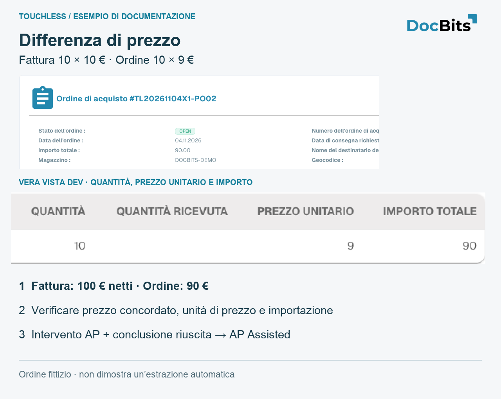

# Spiegare e migliorare Touchless con MCP

<!-- touchless-admin-video-v2-20261104:start -->
**Capitolo video (versione di verifica):** [Consultare gli indicatori con MCP](https://docbits-videos.fra1.cdn.digitaloceanspaces.com/settings-assistant/touchless-intelligence-preview-admin/v2/it.html#chapter=12).
<!-- touchless-admin-video-v2-20261104:end -->

I percorsi seguenti usano strumenti realmente pubblicizzati da DocBits MCP. Distingui la lettura e la spiegazione dalla scrittura. Controlla organizzazione, ruolo, tipo di documento, periodo e data dei dati; non inventare prove mancanti.

<figure><figcaption>
Vista Dev inglese reale di un PO fittizio proprio: 10 × 9 = 90. È un confronto della fonte per la diagnosi MCP, non una schermata di un client MCP né una prova di estrazione o elaborazione riuscita.
</figcaption></figure>

## Spiegare Touchless tramite MCP

> Spiega Pure Touchless, gli esiti con sola approvazione e il tasso AP combinato per le fatture degli ultimi 30 giorni. Indica numeratore, denominatore, documenti in corso ed esclusi, ambito e data dei dati. Mantieni separata la correttezza dell'estrazione.

Usa `touchless_get_summary` con `period: "30d"` e `doc_type: "INVOICE"`. Per un sottoprocesso, usa soltanto campi di segmento e valori realmente restituiti da `touchless_list_segments`. Confronta pannello e MCP con la stessa organizzazione, tipo di documento, segmento e periodo; leggi `data_as_of`.

**Controesempio verificato su Dev:** tre nuove fatture di test erano ancora `IN_PROGRESS`. Il riepilogo restituiva `population.total: 3`, `population.in_progress: 3`, `population.eligible: 0` e `official_touchless_rate.ap_pct: null`. Nessun tasso era ancora misurabile. Non è né una precisione di estrazione dello 0% né un Touchless del 100%. Qui l'idoneità nel riepilogo si riferisce alla popolazione KPI conclusa; una singola traccia può mostrare contemporaneamente `eligible: true` e `bucket_final: false`.

Gli esempi MCP in queste cinque pagine usano strumenti DocBits MCP diretti verificati su Dev. Valgono l'organizzazione e il ruolo del tuo account collegato; la disponibilità in un'altra interfaccia o in un ulteriore elenco di strumenti consentiti non è stabilita da quel test.

## FAQ

**DocBits ha estratto tutto correttamente. Perché la fattura è AP assisted?**
Touchless misura l'intero processo. Dati Infor errati o obsoleti possono richiedere una correzione registrata o un riavvio manuale anche con un'estrazione corretta. Controlla separatamente la fattura originale, i valori estratti da DocBits e i dati di origine importati.

**AP assisted mi dice se il lavoro è stato causato da DocBits o da Infor?**
No. Registra l'intervento, non la responsabilità. Usa la traccia del documento e i dati del documento e della fonte sottostanti per confermare la causa.

**I tassi mostrano un trattino (—).** Nel periodo nessun documento ha raggiunto un esito finale, oppure sono stati misurati meno documenti del minimo. I documenti ancora in corso non vengono conteggiati.

**La scheda manca.** Chiedi al tuo amministratore di abilitare il modulo e di concedere al tuo ruolo la scheda **Analytics dashboard**.

**Un documento è conteggiato come trattato, ma questa volta è passato senza nessuno.** È stato trattato in un'esecuzione precedente (una correzione o un riavvio). Il tasso conta il lavoro che è avvenuto.

**Perché il numero cambia dopo qualche ora?** L'ERP può confermare un'esportazione ore dopo l'invio. L'esito viene ricalcolato ogni 15 minuti.

**L'IA modifica qualcosa da sola?** No. L'IA scrive solo spiegazioni. Un'impostazione cambia solo dopo che un amministratore l'ha vista in anteprima e applicata.

## Indagare sulle discrepanze tramite MCP

> Controlla numero d'ordine, stato dell'importazione e regole di abbinamento attive effettive di questa fattura. Separa estrazione, importazione obsoleta, dati di origine errati e configurazione mancante. Non modificare ancora nulla.

1. Confronta l'originale, `get_extracted_fields` e `get_extracted_tables` prima di dichiarare corretta l'estrazione.
2. Usa `get_po_sync_status` con `po_number: "TL20261104X1-PO02"` e `language: "en"`. Il test su Dev ha confermato un'importazione elaborata e un PO esistente. Questo dimostra l'arrivo, non la correttezza aziendale né il record Infor attuale.
3. Usa `touchless_get_document_trace` e `touchless_explain_po_match` con lo stesso `doc_id`. Leggi motore effettivo, versione delle regole attiva, colonne e tolleranze effettive. Per un cluster realmente restituito, usa il suo `issue_signature` in `touchless_get_po_match_evidence`.
4. Conserva le prove mancanti: il nostro nuovo tipo di test restituiva `state: "none_published"` e `parse_error: "no published rule set"`, oltre a campi di estrazione vuoti. Non sono stati dimostrati bloccanti di prezzo/quantità né un abbinamento riuscito. Un flusso decisionale generico non può sostituire quei controlli mancanti.
5. Correggi la causa confermata e controlla le nuove fatture. La correzione o il riavvio umano restano rilevanti dopo il successo; un errore ERP definitivo prevale come eccezione, e un documento non concluso è fuori dal denominatore del tasso.

Per un caso completo conserva l'originale, l'estrazione precedente alle correzioni, i valori di origine importati/attuali e il momento dell'importazione, le regole effettive, l'azione AP e il risultato finale. Le prove mancanti restano aperte.

## Leggere le prove tramite MCP

> Ispeziona questa fattura senza modificarla. Confronta l'originale, i campi e le tabelle attuali. Spiega le fasi e le esecuzioni registrate e individua le prove di estrazione storiche mancanti.

| Strumento, con lo stesso `doc_id` | Prova e limite |
| --- | --- |
| `get_extracted_fields` | Valori attuali dell'intestazione e affidabilità; non un'istantanea storica |
| `get_extracted_tables` | Tabelle e righe effettive; non la prova che concordino con l'originale |
| `touchless_get_document_trace` | Esiti, interventi, fasi ed esecuzioni registrati |
| `touchless_explain_pipeline` | Spiegazione del percorso documentato; non colma le prove mancanti |

**Controllo negativo osservato:** la nostra nuova fattura di test aveva una fase di estrazione dell'intestazione `passed` ma `extracted_field_count: 0`, otto campi obbligatori vuoti e nessuna tabella. La convalida dei campi si è bloccata con `REQUIRED_FIELD_MISSING`. L'assistente deve indagare su estrazione/configurazione mancanti, invece di dichiarare un'estrazione corretta da una fase verde o un bloccante del prezzo del PO da valori di origine differenti.

### Un'azione MCP conta come intervento umano?

L'ispezione in sola lettura non modifica una fattura. Altri strumenti MCP possono scrivere campi, convalidare o riavviare. La classificazione dipende dall'evento registrato e dal fatto che il suo autore sia un account umano o di sistema. Una chiave API può agire come account di sistema; "eseguito tramite MCP" da solo non dimostra né un intervento umano né Pure Touchless. Non usare mai credenziali di sistema per nascondere lavoro umano.

Dopo un'azione sul documento ispeziona `human_touched`, `human_touch_source`, `human_restart_count`, `business_approval_touched`, lo stato finale e le esecuzioni. La sola approvazione aziendale è diversa da una correzione salvata, da una convalida manuale o da un riavvio umano.

## Dare priorità ai fornitori e verificare un miglioramento duraturo tramite MCP

> Classifica i fornitori che perdono più fatture Touchless. Separa errori di estrazione, discrepanze dei dati di origine importati e impostazioni del processo. Proponi un'azione e una verifica di successo verificabile per ogni causa confermata; non modificare ancora nulla.

1. Usa `touchless_rank_supplier_opportunities` con `period: "30d"`, `doc_type: "INVOICE"`, `order_by_field: "lost_docs"`, `order_by_direction: "desc"`. Usa `search` per un numero o un nome di fornitore; `limit` e `offset` paginano i risultati.
2. Passa il `supplier_key` restituito invariato a `touchless_diagnose_supplier`. Usa `window: 30` per i problemi attuali o 90 per indagare sui problemi ricorrenti.
3. Passa un `issue_signature` realmente restituito a `touchless_get_issue_cluster`. Esamina i documenti di esempio e le prove mancanti prima di confermare la causa. Non inventare identificativi.
4. Usa `touchless_get_recommendations` per spiegare un'azione supportata. L'incremento atteso è una stima; i cluster sovrapposti non vanno semplicemente sommati.
5. Controlla le nuove fatture comparabili dopo la correzione e la [misurazione della modifica](touchless-change-proposals.md). Le fatture già trattate non diventano Pure Touchless retroattivamente.

Per estrazioni corrette e PO obsoleti, correggi i dati di origine/di importazione. Per una discrepanza tra originale ed estrazione, indaga sulla configurazione dell'estrazione. Un'approvazione richiesta dalle regole è un esito AP Touchless riuscito e distinto. Una classificazione vuota non è prova che non ci siano problemi: le nostre tre fatture di test in corso non producevano ancora alcun esito fornitore classificato. Controlla ambito, data dei dati, identificazione del fornitore e volume concluso.

## Anteprima, applicazione e misurazione tramite MCP

> Spiega la causa confermata ed elenca le proposte supportate. Mostra l'anteprima della modifica selezionata, del suo ambito e dei rischi. Applica solo quella modifica scelta, poi verifica l'impostazione salvata, la cronologia delle modifiche e l'effetto misurabile.

| Passo | Strumento e identificativi realmente restituiti | Che cosa dimostra |
| --- | --- | --- |
| Elenco | `touchless_list_change_proposals`, con `issue_signature` opzionale, `window: "30d"`, `lang: "en"` | Proposte disponibili; nessuna impostazione salvata |
| Anteprima | `touchless_preview_change` con il `proposal_id` restituito e l'`issue_signature` corrispondente | Ambito concreto e un `preview_token` vincolato, quando consentito |
| Applicare la modifica scelta | `touchless_apply_change` con gli stessi ID, `preview_token`, `overrides` e `window` | **Scrive** l'impostazione supportata; una risposta di successo restituisce un `change_id` |
| Leggere l'effetto | `touchless_verify_change` con quel `change_id` e lo stesso `window` | Misurazione prima/dopo; servono ancora almeno 20 documenti conclusi idonei per periodo |

Copia ID e token dalle risposte reali. Un token che mostra in anteprima un valore non può applicarne un altro. Un'anteprima scaduta, vietata o incompleta non è prova di una modifica applicata. Gli strumenti in sola lettura e l'applicazione non vanno descritti come equivalenti. Questa tabella spiega la sequenza degli strumenti; non afferma che la dimostrazione abbia eseguito una proposta o misurato un guadagno.

**Esempio di configurazione:** dopo una correzione di configurazione confermata, ispeziona il valore salvato effettivo e le nuove fatture. 52% prima e 61% dopo è una differenza osservata di 9 punti percentuali, non la prova che questa modifica da sola l'abbia causata. **Esempio di dati di origine:** un PO Infor errato richiede una correzione aziendale e un'importazione verificata. `touchless_apply_change` non è uno strumento generico di scrittura su Infor. Non allargare le tolleranze per occultare dati di origine errati.

La schermata del report mostra raccomandazioni e impatto stimato, non l'applicazione o l'annullamento. Un'applicazione riuscita richiede una risposta di successo e una voce nella cronologia. Undo è disponibile solo dove la proposta selezionata lo supporta; verifica l'effettiva impostazione ripristinata. Ricaricare la cronologia non applica un'impostazione, e l'annullamento non elimina gli interventi passati sui documenti.

## Pagine correlate

* [Touchless Intelligence](./)
* [Metriche e calcolo](touchless-metrics.md)
* [Usare il pannello](touchless-dashboard.md)
* [Esempi pratici: prezzo e quantità](touchless-examples.md)
* [Diagnosi del fornitore e cluster di problemi](touchless-supplier-diagnosis.md)
* [Diagnosi dell'abbinamento ordini](touchless-po-matching-diagnosis.md)
* [Tracciamento del documento](touchless-document-trace.md)
* [Proposte di modifica e report](touchless-change-proposals.md)

<!-- Documentation review 2026-11-04: extraction quality vs process outcomes; KPI and terminal-outcome definitions checked against DocBits_API c51f350c728acb8ac964098d15f7b006bce273f4, module/automation_intelligence/kpi.py and bucket.py. Existing native screenshots retained and checked separately from illustrative examples. -->
<!-- Completion review 2026-11-04: owned synthetic PO examples, MCP schema/read evidence, human-action classification, KPI labels and screenshot proof limits. -->
