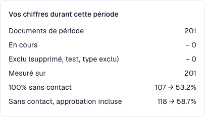

# Indicateurs et calcul

<!-- touchless-admin-video-v2-20261104:start -->
**Chapitre vidéo (version de contrôle):** [Calculer les taux](https://docbits-videos.fra1.cdn.digitaloceanspaces.com/settings-assistant/touchless-intelligence-preview-admin/v2/fr.html#chapter=03).
<!-- touchless-admin-video-v2-20261104:end -->

### Une extraction correcte et un processus sans intervention sont deux choses différentes

**DocBits peut lire correctement toutes les valeurs d'une facture et la facture peut malgré tout nécessiter une intervention AP, parce que les données du système source diffèrent.** AP désigne Accounts Payable, l'équipe qui traite les factures fournisseurs. Examinez ces deux questions séparément :

| Question | Comparaison | Ce que le résultat vous dit |
| --- | --- | --- |
| **DocBits a-t-il lu le document correctement ?** | La facture d'origine comparée aux champs d'en-tête et aux lignes de tableau extraits, avant toute correction manuelle | Qualité de l'extraction : la valeur extraite correspond-elle à ce qui figure réellement sur la facture ? |
| **Le processus pouvait-il aboutir sans intervention ?** | La facture correctement extraite comparée au bon de commande et aux données de référence fournies par Infor ERP, ainsi qu'à l'historique de traitement enregistré | Automatisation du processus : les contrôles configurés, le rapprochement et l'export pouvaient-ils aboutir sans correction ni redémarrage ? |

Une valeur différente dans Infor ne dit pas en soi quel côté est erroné. Vérifiez la facture, la commande convenue et les données réellement importées dans DocBits. La source peut être incorrecte, l'import peut être périmé, ou le fournisseur peut avoir facturé une autre valeur.


**Le taux touchless mesure le processus, pas la précision de l'extraction.** Un document en AP assisted ne prouve pas une erreur d'extraction de DocBits. Inversement, une étape d'extraction réussie ou un score de confiance élevé ne prouve pas que chaque valeur est correcte. Pour l'établir, comparez le document d'origine aux valeurs extraites.


Chaque document se termine par exactement **un** résultat :

| Résultat              | Signification                                                                                       | Compte dans le taux                                                                         |
| --------------------- | --------------------------------------------------------------------------------------------------- | ------------------------------------------------------------------------------------------ |
| **Pure touchless**    | Traité de l'import à l'export **sans aucune intervention humaine**                                  | Oui, comme un succès                                                                        |
| **AP touchless**      | Exécuté automatiquement, et une personne a seulement donné l'**approbation métier**. Aucune correction n'a été nécessaire | Oui, comme un succès                                                                        |
| **AP assisted**       | Terminé avec succès, mais une personne a dû **corriger un champ, redémarrer le document** ou intervenir d'une autre manière ; cela peut être nécessaire même lorsque l'extraction était correcte | Oui, hors du numérateur touchless ; cela n'identifie pas la cause à soi seul |
| **Process exception** | Terminé par une **erreur**, a été **rejeté**, a été **refusé par l'ERP** ou s'est **bloqué** dans le pipeline | Oui, comme un échec                                                                         |
| **In progress**       | Pas encore terminé                                                                                  | **Non**. Il n'a pas encore de résultat                                                      |
| **Not eligible**      | Supprimé, archivé, document de test ou type de document exclu                                       | **Non**                                                                                     |

Le **AP touchless rate**, y compris les documents avec approbation seule, est :

```
rate = (Pure touchless + AP touchless)
       ÷ (Pure touchless + AP touchless + AP assisted + Process exception)
```

Ici, **AP touchless** au numérateur correspond au résultat de document « approbation seule ». Le **AP touchless percentage** du tableau de bord est le taux combiné : documents purement automatiques plus documents avec approbation seule. **N'additionnez pas les deux pourcentages affichés.** Le taux pur n'utilise que les documents purs au numérateur, avec le même dénominateur.

Les documents encore **in progress** ou **not eligible** n'entrent jamais dans le calcul. Cela protège le taux : un document arrivé il y a cinq minutes ne peut pas le faire baisser.


**Une intervention compte définitivement.** Dès qu'une personne a touché un document, il reste compté comme touché, même si une exécution automatique ultérieure n'aurait eu besoin de personne. **Redémarrer un document ne le rend pas à nouveau touchless.** Le taux reflète le travail qui a eu lieu.


### Exemple de calcul (chiffres illustratifs)

En 30 jours, 200 documents sont arrivés :

| Résultat                      | Documents |
| ----------------------------- | --------- |
| Pure touchless                | 120       |
| AP touchless                  | 30        |
| AP assisted                   | 30        |
| Process exception             | 10        |
| In progress                   | 8         |
| Not eligible (documents de test) | 2      |

* Dénominateur : 120 + 30 + 30 + 10 = **190**. Les 8 documents in progress et les 2 documents not eligible sont exclus.
* **Pure touchless** : 120 ÷ 190 = **63,2 %**
* Part avec **approbation seule** : 30 ÷ 190 = **15,8 %**. C'est la part de ce résultat, pas le taux AP touchless combiné.
* **AP touchless rate** : (120 + 30) ÷ 190 = **78,9 %**

L'onglet affiche un **objectif** (70 % sauf si votre organisation en utilise un autre). Dans cet exemple, le taux AP combiné dépasse 70 %, tandis que le taux pur de 63,2 % reste en dessous. Comparez l'objectif au taux identifié par la carte ou le graphique concerné.

Cliquez sur **Comment le touchless est calculé** (How touchless is calculated) en haut à droite pour ouvrir cette explication dans DocBits, avec les chiffres de votre propre période (documents de la période, encore in progress, exclus, mesurés).

<figure><figcaption><p>Population de formation actuelle : 201 factures terminées et éligibles, aucune encore en traitement ni exclue. Les 107 factures entièrement automatiques donnent 53,2 % ; en ajoutant 11 factures avec approbation seule, on obtient 118 et 58,7 %. Ces taux de processus ne mesurent pas la précision de l'extraction.</p></figcaption></figure>

### Exemple : extraction correcte à 100 %, AP touchless à 80 %

Supposons qu'un contrôle des factures d'origine et de leurs valeurs extraites confirme que **les 100 factures terminées et éligibles ont été extraites correctement**. Leurs résultats de traitement sont :

| Ce qui s'est passé | Documents | Résultat |
| --- | --- | --- |
| Facture et données source concordaient ; tout le processus a abouti automatiquement | 70 | Pure touchless |
| Facture et données source concordaient ; seule une approbation métier était nécessaire | 10 | AP touchless (résultat approbation seule) |
| Les données de la facture ont été extraites correctement, mais les données Infor importées différaient. AP a clarifié l'écart et a redémarré manuellement les documents dans DocBits après correction des données source ; ils ont ensuite abouti avec succès | 20 | AP assisted |

* **Documents correctement extraits dans cet échantillon contrôlé :** 100 ÷ 100 = **100 %**.
* **Pure touchless rate :** 70 ÷ 100 = **70 %**.
* **AP touchless rate :** (70 + 10) ÷ 100 = **80 %**.

Il n'y a pas de contradiction : l'extraction était correcte sur toutes les factures, tandis que 20 ont nécessité une intervention de traitement en raison des données source. Le **chiffre de 100 % d'extraction est un résultat illustratif d'un contrôle de documents distinct**, et non un indicateur supplémentaire affiché par ce tableau de bord. Ne le calculez pas à partir des seuls résultats touchless.

### Exemples : que devait réellement faire AP ?

Les cas suivants sont illustratifs et ne sont pas les documents individuels derrière les captures. Les résultats réussis supposent que le traitement est terminé, y compris la confirmation ERP lorsqu'elle est requise.

| Cas | Facture d'origine / extraction DocBits / données source | Action et résultat AP | Où enquêter |
| --- | --- | --- | --- |
| **Erreur d'extraction** | Numéro de BC `45001234` / extrait par erreur comme `45001284` / la commande correcte `45001234` existe dans Infor | AP corrige le numéro extrait ; la facture se termine en **AP assisted** | Extraction pour ce fournisseur |
| **Écart de données source** | Prix unitaire 10,00 € / correctement extrait 10,00 € / la commande Infor importée indique 9,00 €, hors de la tolérance configurée | AP confirme que 10,00 € est le prix convenu, organise la correction de la commande et redémarre manuellement la facture dans DocBits ; elle se termine en **AP assisted** | Données de commande Infor et leur import |
| **Retard d'import** | Le numéro de BC est correct sur la facture et dans DocBits / la commande existe dans Infor mais n'a pas atteint DocBits | Si un import et une reprise ultérieurs aboutissent automatiquement sans intervention humaine ni approbation enregistrée, le résultat peut rester **Pure touchless**. Un redémarrage manuel suivi d'un succès donne **AP assisted** | Moment de l'import et historique réel des exécutions |
| **Refus ERP** | L'extraction est correcte, mais l'ERP refuse le document exporté | **Process exception** tant que le cas est classé comme refus ERP définitif, même si quelqu'un est intervenu auparavant | Refus ERP et preuve d'export |

**Même une petite correction enregistrée ou un redémarrage manuel compte comme une intervention.** AP assisted signifie « une personne a aidé à traiter le document » ; ce n'est pas le nom d'un assistant IA distinct. Un problème de données source et un problème d'extraction peuvent donc avoir le même résultat tout en exigeant des correctifs différents.

La classification utilise les événements que DocBits enregistre. Ne partez pas du principe qu'un travail effectué uniquement dans Infor, sans événement DocBits correspondant, est automatiquement compté comme une intervention AP. Conservez ce travail dans le diagnostic également.

### Quelles actions AP comptent comme une intervention ?

Ce qui suit suppose un achèvement réussi, y compris la confirmation ERP requise. L'action enregistrée et son auteur comptent, pas la durée du travail.

| Action | Effet sur le résultat du document |
| --- | --- |
| Ouvrir, lire, filtrer, comparer ou prévisualiser | Ne crée pas en soi une intervention de traitement ; Pure Touchless reste possible |
| Donner une approbation métier, y compris une seconde approbation | AP Touchless, s'il n'y a pas eu d'intervention de traitement |
| Modifier et enregistrer un champ d'en-tête ou une cellule de tableau | AP Assisted ; une seule correction enregistrée suffit |
| Valider et faire avancer un document manuellement, même sans corriger de valeur | AP Assisted ; la validation manuelle se distingue de l'approbation seule |
| Redémarrer manuellement le traitement ou l'export | AP Assisted ; une exécution automatique ultérieure n'efface pas l'intervention |
| Reprise automatique du système ou écriture automatique par un workflow | Ne crée pas en soi une intervention humaine ; les interventions humaines antérieures persistent |
| Corriger des données uniquement dans Infor | Un travail externe n'est pas automatiquement un événement DocBits enregistré ; documentez-le séparément et examinez l'action DocBits suivante |
| Refus ERP définitif après une correction | Process exception prioritaire ; l'intervention reste dans l'historique |

Un clic sur Save sans preuve d'une valeur modifiée ne prouve pas une correction. Vérifiez s'il a également déclenché une validation manuelle ou un redémarrage.

### L'étiquette AP a deux significations

| Emplacement | Signification |
| --- | --- |
| Pourcentage AP en tête | Combiné Pure + approbation seule : (120 + 30) / 190 = 78,9 % |
| Nombre de documents sous ce pourcentage dans le rapport actuel | Combiné Pure + approbation seule : 150 = 120 + 30 |
| Catégorie de résultat AP Touchless, comme le groupe MCP `AP_TOUCHLESS` | Catégorie distincte d'approbation seule : 30 / 190 = 15,8 % |
| Ligne AP bleue dans la [capture actuelle de la tendance du tableau de bord](touchless-dashboard.md) | Taux combiné Pure + approbation seule à chaque point, avec la population de ce point |

Les catégories de résultat final totalisent 100 % de la population mesurée. Les pourcentages en tête Pure et AP combiné se recouvrent et ne doivent pas être additionnés.

### Quelle est l'actualité des chiffres

Les résultats sont **recalculés toutes les 15 minutes**. Le résultat d'un document peut encore changer après sa première apparition : l'ERP peut confirmer un export plusieurs heures plus tard. La ligne **Data as of …** en bas de l'onglet indique quand les chiffres ont été calculés pour la dernière fois.


## Pages connexes

* [Touchless Intelligence](./)
* [Utiliser le tableau de bord](touchless-dashboard.md)
* [Exemples concrets : prix et quantité](touchless-examples.md)
* [Supplier Diagnosis et clusters de problèmes](touchless-supplier-diagnosis.md)
* [Diagnostic du rapprochement avec le BC](touchless-po-matching-diagnosis.md)
* [Document Trace](touchless-document-trace.md)
* [Change Proposals et rapports](touchless-change-proposals.md)
* [Expliquer et améliorer Touchless avec MCP](touchless-mcp.md)

<!-- Documentation review 2026-11-04: extraction quality vs process outcomes; KPI and terminal-outcome definitions checked against DocBits_API c51f350c728acb8ac964098d15f7b006bce273f4, module/automation_intelligence/kpi.py and bucket.py. Existing native screenshots retained and checked separately from illustrative examples. -->
<!-- Completion review 2026-11-04: owned synthetic PO examples, MCP schema/read evidence, human-action classification, KPI labels and screenshot proof limits. -->
