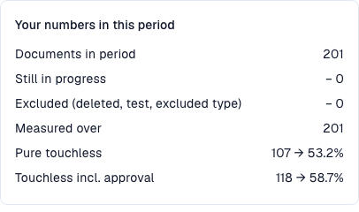

# Metrics and calculation

<!-- touchless-admin-video-v2-20261104:start -->
**Video chapter (review version):** [Calculate the rates](https://docbits-videos.fra1.cdn.digitaloceanspaces.com/settings-assistant/touchless-intelligence-preview-admin/v2/en.html#chapter=03).
<!-- touchless-admin-video-v2-20261104:end -->

### Correct extraction and a touchless process are different

**DocBits can read every invoice value correctly and the invoice can still need AP attention because the source-system data differs.** AP means Accounts Payable, the team processing supplier invoices. Check these two questions separately:

| Question | Compare | What the result tells you |
| --- | --- | --- |
| **Did DocBits read the document correctly?** | The original invoice against the extracted header fields and table lines, before any manual correction | Extraction quality: does the extracted value match what is actually on the invoice? |
| **Could the process finish without an intervention?** | The correctly extracted invoice against the purchase order and master data supplied by Infor ERP, together with the recorded processing history | Process automation: could the configured checks, matching and export complete without a correction or restart? |

A different value in Infor does not by itself tell you which side is wrong. Check the invoice, the agreed order and the data actually imported into DocBits. The source may be incorrect, the import may be outdated, or the supplier may have invoiced a different value.


**The touchless rate measures the process, not extraction accuracy.** An AP-assisted document does not prove a DocBits extraction error. Conversely, a passed extraction stage or a high confidence score does not prove every value is correct. Compare the original document with the extracted values to establish that.


Every document ends in exactly **one** outcome:

| Outcome               | Meaning                                                                                             | Counts in the rate                                                                         |
| --------------------- | --------------------------------------------------------------------------------------------------- | ------------------------------------------------------------------------------------------ |
| **Pure touchless**    | Processed from import to export with **no human involvement at all**                                | Yes, as a success                                                                          |
| **AP touchless**      | Ran automatically, and a person only gave the **business approval**. No correction was needed       | Yes, as a success                                                                          |
| **AP assisted**       | Finished successfully, but a person had to **correct a field, restart the document** or otherwise step in; this can be needed even when extraction was correct | Yes, outside the touchless numerator; it does not by itself identify the cause |
| **Process exception** | Ended in an **error**, was **rejected**, was **refused by the ERP**, or **stalled** in the pipeline | Yes, as a miss                                                                             |
| **In progress**       | Not finished yet                                                                                    | **No**. It has no outcome yet                                                              |
| **Not eligible**      | Deleted, archived, a test document, or an excluded document type                                    | **No**                                                                                     |

The **AP touchless rate**, including documents with approval only, is:

```
rate = (Pure touchless + AP touchless)
       ÷ (Pure touchless + AP touchless + AP assisted + Process exception)
```

Here **AP touchless** in the numerator is the document outcome "approval only". The dashboard's **AP touchless percentage** is the combined rate: pure plus approval-only documents. **Do not add the two displayed percentages.** The pure rate uses only pure documents in the numerator, with the same denominator.

Documents that are still **in progress** or **not eligible** are never in the calculation. This protects the rate: a document that arrived five minutes ago cannot pull it down.


**One touch counts for good.** Once a person has touched a document, it stays counted as touched, even if a later automatic run would have needed nobody. **Restarting a document does not make it touchless again.** The rate reflects the work that happened.


### Example calculation (illustrative numbers)

In 30 days, 200 documents arrived:

| Outcome                       | Documents |
| ----------------------------- | --------- |
| Pure touchless                | 120       |
| AP touchless                  | 30        |
| AP assisted                   | 30        |
| Process exception             | 10        |
| In progress                   | 8         |
| Not eligible (test documents) | 2         |

* Denominator: 120 + 30 + 30 + 10 = **190**. The 8 in-progress and 2 not-eligible documents are left out.
* **Pure touchless**: 120 ÷ 190 = **63.2 %**
* Share with **approval only**: 30 ÷ 190 = **15.8 %**. This is the share of that outcome, not the combined AP touchless rate.
* **AP touchless rate**: (120 + 30) ÷ 190 = **78.9 %**

The tab shows a **target** (70 % unless your organisation uses a different one). In this example the combined AP rate is above 70%, while the pure rate of 63.2% is below it. Compare the target with the rate identified by the relevant card or chart.

Click **How touchless is calculated** at the top right to open this explanation inside DocBits, with the numbers of your own period (documents in period, still in progress, excluded, measured).

<figure><figcaption><p>Current training population: 201 eligible completed invoices, with none still processing or excluded. The 107 fully automatic invoices give 53.2%; adding 11 approval-only invoices gives 118 and 58.7%. These process rates do not measure extraction accuracy.</p></figcaption></figure>

### Example: 100% correct extraction, 80% AP touchless

Suppose a review of the original invoices and their extracted values confirms that **all 100 completed, eligible invoices were extracted correctly**. Their processing outcomes are:

| What happened | Documents | Outcome |
| --- | --- | --- |
| Invoice and source data matched; the whole process completed automatically | 70 | Pure touchless |
| Invoice and source data matched; only business approval was needed | 10 | AP touchless (approval-only outcome) |
| Invoice data was extracted correctly, but the imported Infor data differed. AP clarified the discrepancy and manually restarted the documents in DocBits after the source data was corrected; they then completed successfully | 20 | AP assisted |

* **Correctly extracted documents in this reviewed sample:** 100 ÷ 100 = **100%**.
* **Pure touchless rate:** 70 ÷ 100 = **70%**.
* **AP touchless rate:** (70 + 10) ÷ 100 = **80%**.

There is no contradiction: extraction was correct on all invoices, while 20 needed a processing intervention because of source data. The **100% extraction figure is an illustrative result of a separate document review**, not an additional KPI shown by this dashboard. Do not calculate it from the touchless outcomes alone.

### Examples: what did AP actually have to do?

The following cases are illustrative, not the individual documents behind the screenshots. The successful outcomes assume processing has finished, including ERP confirmation where required.

| Case | Original invoice / DocBits extraction / source data | AP action and outcome | Where to investigate |
| --- | --- | --- | --- |
| **Extraction error** | PO number `45001234` / incorrectly extracted as `45001284` / correct order `45001234` exists in Infor | AP corrects the extracted number; the invoice finishes as **AP assisted** | Extraction for this supplier |
| **Source-system discrepancy** | Unit price €10.00 / correctly extracted €10.00 / imported Infor order says €9.00, outside the configured tolerance | AP confirms €10.00 is the agreed price, arranges correction of the order and manually restarts the invoice in DocBits; it finishes as **AP assisted** | Infor order data and its import |
| **Import delay** | PO number is correct on the invoice and in DocBits / the order exists in Infor but has not reached DocBits | If a later import and retry finish automatically without a recorded human intervention or approval, the result can remain **Pure touchless**. A manual restart followed by success gives **AP assisted** | Import timing and the actual run history |
| **ERP rejection** | Extraction is correct, but the ERP refuses the exported document | **Process exception** while classified as a terminal ERP rejection, even if someone previously intervened | ERP rejection and export evidence |

**Even a small recorded correction or manual restart counts as an intervention.** AP assisted means "a person helped process the document"; it is not the name of a separate AI assistant. A source-data problem and an extraction problem can therefore have the same outcome but require different fixes.

The classification uses the events DocBits records. Do not assume that work performed only in Infor, without a corresponding recorded DocBits event, is automatically counted as an AP intervention. Keep that work in the diagnosis as well.

### Which AP actions count as intervention?

The following assumes successful completion, including the required ERP confirmation. The recorded action and its actor matter, not how long the work took.

| Action | Effect on the document outcome |
| --- | --- |
| Open, read, filter, compare or preview | Does not by itself create a processing intervention; Pure Touchless remains possible |
| Give business approval, including a second approval | AP Touchless, if there was no processing intervention |
| Change and save a header field or table cell | AP Assisted; even one saved correction counts |
| Manually validate and advance a document, even without correcting a value | AP Assisted; manual validation is distinct from approval only |
| Manually restart processing or export | AP Assisted; a later automatic run does not remove the intervention |
| Automatic system retry or automatic workflow write | Does not by itself create a human intervention; earlier human touches persist |
| Correct data only in Infor | External work is not automatically a recorded DocBits event; document it separately and inspect the subsequent DocBits action |
| Final ERP rejection after a correction | Process exception takes precedence; the intervention remains in the history |

A click on Save without evidence of a changed value does not prove a correction. Check whether it also triggered manual validation or a restart.

### The AP label has two meanings

| Location | Meaning |
| --- | --- |
| AP headline percentage | Combined Pure + approval-only: (120 + 30) / 190 = 78.9% |
| Document count beneath that percentage in the current report | Combined Pure + approval-only: 150 = 120 + 30 |
| AP Touchless outcome category, such as the MCP bucket `AP_TOUCHLESS` | Separate approval-only category: 30 / 190 = 15.8% |
| Blue AP line in the current [dashboard trend screenshot](touchless-dashboard.md) | Combined Pure + approval-only rate at each point, using that point's population |

The final outcome categories sum to 100% of the measured population. The Pure and combined AP headline percentages overlap and must not be added.

### How current are the numbers

Outcomes are **recalculated every 15 minutes**. A document's outcome can still change after it first appears: the ERP may confirm an export hours later. The line **Data as of …** at the bottom of the tab shows when the numbers were last computed.


## Related pages

* [Touchless Intelligence](./)
* [Use the dashboard](touchless-dashboard.md)
* [Worked examples: price and quantity](touchless-examples.md)
* [Supplier Diagnosis and Issue Clusters](touchless-supplier-diagnosis.md)
* [PO Matching Diagnosis](touchless-po-matching-diagnosis.md)
* [Document Trace](touchless-document-trace.md)
* [Change Proposals and Reports](touchless-change-proposals.md)
* [Explain and improve Touchless with MCP](touchless-mcp.md)

<!-- Documentation review 2026-11-04: extraction quality vs process outcomes; KPI and terminal-outcome definitions checked against DocBits_API c51f350c728acb8ac964098d15f7b006bce273f4, module/automation_intelligence/kpi.py and bucket.py. Existing native screenshots retained and checked separately from illustrative examples. -->
<!-- Completion review 2026-11-04: owned synthetic PO examples, MCP schema/read evidence, human-action classification, KPI labels and screenshot proof limits. -->
