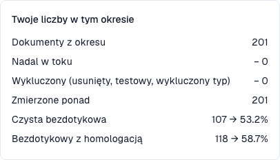

# Wskaźniki i obliczanie

<!-- touchless-admin-video-v2-20261104:start -->
**Rozdział wideo (wersja do przeglądu):** [Obliczanie wskaźników](https://docbits-videos.fra1.cdn.digitaloceanspaces.com/settings-assistant/touchless-intelligence-preview-admin/v2/en.html#chapter=03).
<!-- touchless-admin-video-v2-20261104:end -->

### Poprawna ekstrakcja i proces touchless to dwie różne rzeczy

**DocBits może odczytać każdą wartość faktury poprawnie, a faktura i tak może wymagać uwagi AP, ponieważ dane systemu źródłowego są inne.** AP oznacza Accounts Payable, zespół przetwarzający faktury dostawców. Sprawdź te dwa pytania osobno:

| Pytanie | Porównaj | Co mówi wynik |
| --- | --- | --- |
| **Czy DocBits odczytał dokument poprawnie?** | Oryginalną fakturę z wyodrębnionymi polami nagłówka i wierszami tabeli, przed jakąkolwiek ręczną korektą | Jakość ekstrakcji: czy wyodrębniona wartość zgadza się z tym, co faktycznie jest na fakturze? |
| **Czy proces mógł zakończyć się bez interwencji?** | Poprawnie wyodrębnioną fakturę z zamówieniem zakupu i danymi podstawowymi dostarczonymi przez Infor ERP, wraz z zapisaną historią przetwarzania | Automatyzacja procesu: czy skonfigurowane kontrole, dopasowanie i eksport mogły się zakończyć bez korekty lub ponownego uruchomienia? |

Inna wartość w Infor sama z siebie nie mówi, która strona się myli. Sprawdź fakturę, uzgodnione zamówienie i dane faktycznie zaimportowane do DocBits. Źródło może być błędne, import może być nieaktualny albo dostawca mógł zafakturować inną wartość.


**Wskaźnik touchless mierzy proces, a nie dokładność ekstrakcji.** Dokument obsłużony jako AP assisted nie dowodzi błędu ekstrakcji DocBits. Odwrotnie: zaliczony etap ekstrakcji lub wysoki wynik pewności nie dowodzi, że każda wartość jest poprawna. Ustal to, porównując oryginalny dokument z wyodrębnionymi wartościami.


Każdy dokument kończy się dokładnie **jednym** wynikiem:

| Wynik                 | Znaczenie                                                                                           | Liczy się we wskaźniku                                                                     |
| --------------------- | --------------------------------------------------------------------------------------------------- | ------------------------------------------------------------------------------------------ |
| **Pure touchless**    | Przetworzony od importu do eksportu **bez żadnego udziału człowieka**                                | Tak, jako sukces                                                                           |
| **AP touchless**      | Przebiegł automatycznie, a osoba udzieliła tylko **akceptacji biznesowej**. Korekta nie była potrzebna | Tak, jako sukces                                                                        |
| **AP assisted**       | Zakończony sukcesem, ale osoba musiała **poprawić pole, ponownie uruchomić dokument** lub w inny sposób wkroczyć; może być potrzebne nawet wtedy, gdy ekstrakcja była poprawna | Tak, poza licznikiem touchless; sam z siebie nie wskazuje przyczyny |
| **Wyjątek procesu**   | Zakończony **błędem**, **odrzucony**, **odrzucony przez ERP** lub **zatrzymany** w potoku           | Tak, jako porażka                                                                          |
| **W toku**            | Jeszcze niezakończony                                                                               | **Nie**. Nie ma jeszcze wyniku                                                             |
| **Nie kwalifikuje się** | Usunięty, zarchiwizowany, dokument testowy lub wykluczony typ dokumentu                           | **Nie**                                                                                    |

**Wskaźnik AP touchless**, obejmujący dokumenty z samą akceptacją, to:

```
rate = (Pure touchless + AP touchless)
       ÷ (Pure touchless + AP touchless + AP assisted + Process exception)
```

Tutaj **AP touchless** w liczniku to wynik dokumentu „tylko akceptacja”. **Procent AP touchless** na dashboardzie to wskaźnik łączony: dokumenty pure plus dokumenty z samą akceptacją. **Nie dodawaj dwóch wyświetlanych wartości procentowych.** Wskaźnik pure używa w liczniku tylko dokumentów pure, z tym samym mianownikiem.

Dokumenty, które są jeszcze **w toku** lub **nie kwalifikują się**, nigdy nie wchodzą do obliczenia. To chroni wskaźnik: dokument, który dotarł pięć minut temu, nie może go obniżyć.


**Jedno dotknięcie liczy się na stałe.** Gdy osoba dotknęła dokumentu, pozostaje on liczony jako dotknięty, nawet jeśli późniejszy przebieg automatyczny nie wymagałby nikogo. **Ponowne uruchomienie dokumentu nie czyni go ponownie touchless.** Wskaźnik odzwierciedla pracę, która się wydarzyła.


### Przykładowe obliczenie (liczby poglądowe)

W ciągu 30 dni napłynęło 200 dokumentów:

| Wynik                         | Dokumenty |
| ----------------------------- | --------- |
| Pure touchless                | 120       |
| AP touchless                  | 30        |
| AP assisted                   | 30        |
| Wyjątek procesu               | 10        |
| W toku                        | 8         |
| Nie kwalifikuje się (dokumenty testowe) | 2 |

* Mianownik: 120 + 30 + 30 + 10 = **190**. Dokumenty 8 w toku i 2 niekwalifikujące się są pomijane.
* **Pure touchless**: 120 ÷ 190 = **63.2 %**
* Udział **tylko akceptacji**: 30 ÷ 190 = **15.8 %**. To udział tego wyniku, a nie łączny wskaźnik AP touchless.
* **Wskaźnik AP touchless**: (120 + 30) ÷ 190 = **78.9 %**

Zakładka pokazuje **cel** (70 %, chyba że Twoja organizacja używa innego). W tym przykładzie łączny wskaźnik AP jest powyżej 70%, a wskaźnik pure 63.2% jest poniżej. Porównaj cel ze wskaźnikiem wskazanym przez odpowiednią kartę lub wykres.

Kliknij **How touchless is calculated** w prawym górnym rogu, aby otworzyć to objaśnienie wewnątrz DocBits, z liczbami z Twojego okresu (dokumenty w okresie, nadal w toku, wykluczone, zmierzone).

<figure><figcaption><p>Bieżąca populacja szkoleniowa: 201 kwalifikujących się zakończonych faktur, z czego żadna nie jest jeszcze przetwarzana ani wykluczona. 107 w pełni automatycznych faktur daje 53.2%; dodanie 11 faktur z samą akceptacją daje 118 i 58.7%. Te wskaźniki procesu nie mierzą dokładności ekstrakcji.</p></figcaption></figure>

### Przykład: 100% poprawnej ekstrakcji, 80% AP touchless

Załóżmy, że przegląd oryginalnych faktur i ich wyodrębnionych wartości potwierdza, że **wszystkie 100 zakończonych, kwalifikujących się faktur zostały wyodrębnione poprawnie**. Ich wyniki przetwarzania to:

| Co się stało | Dokumenty | Wynik |
| --- | --- | --- |
| Faktura i dane źródłowe się zgadzały; cały proces zakończył się automatycznie | 70 | Pure touchless |
| Faktura i dane źródłowe się zgadzały; potrzebna była tylko akceptacja biznesowa | 10 | AP touchless (wynik „tylko akceptacja”) |
| Dane faktury zostały wyodrębnione poprawnie, ale zaimportowane dane Infor się różniły. AP wyjaśniło rozbieżność i ręcznie ponownie uruchomiło dokumenty w DocBits po poprawieniu danych źródłowych; następnie zakończyły się one sukcesem | 20 | AP assisted |

* **Poprawnie wyodrębnione dokumenty w tej badanej próbie:** 100 ÷ 100 = **100%**.
* **Wskaźnik pure touchless:** 70 ÷ 100 = **70%**.
* **Wskaźnik AP touchless:** (70 + 10) ÷ 100 = **80%**.

Nie ma tu sprzeczności: ekstrakcja była poprawna na wszystkich fakturach, a 20 dokumentów wymagało interwencji w przetwarzaniu z powodu danych źródłowych. **Wartość 100% ekstrakcji jest poglądowym wynikiem odrębnego przeglądu dokumentów**, a nie dodatkowym KPI pokazywanym przez ten dashboard. Nie obliczaj jej wyłącznie z wyników touchless.

### Przykłady: co AP musiało faktycznie zrobić?

Poniższe przypadki są poglądowe i nie są poszczególnymi dokumentami ze zrzutów ekranu. Pomyślne wyniki zakładają zakończone przetwarzanie, w tym wymagane potwierdzenie ERP.

| Przypadek | Oryginalna faktura / ekstrakcja DocBits / dane źródłowe | Działanie AP i wynik | Gdzie szukać przyczyny |
| --- | --- | --- | --- |
| **Błąd ekstrakcji** | Numer PO `45001234` / niepoprawnie wyodrębniony jako `45001284` / poprawne zamówienie `45001234` istnieje w Infor | AP poprawia wyodrębniony numer; faktura kończy się jako **AP assisted** | Ekstrakcja dla tego dostawcy |
| **Rozbieżność w systemie źródłowym** | Cena jednostkowa €10.00 / poprawnie wyodrębniona €10.00 / zaimportowane zamówienie Infor podaje €9.00, poza skonfigurowaną tolerancją | AP potwierdza, że €10.00 to uzgodniona cena, organizuje korektę zamówienia i ręcznie ponownie uruchamia fakturę w DocBits; kończy się jako **AP assisted** | Dane zamówienia w Infor i ich import |
| **Opóźnienie importu** | Numer PO jest poprawny na fakturze i w DocBits / zamówienie istnieje w Infor, ale nie dotarło do DocBits | Jeśli późniejszy import i ponowna próba zakończą się automatycznie bez zapisanej interwencji człowieka lub akceptacji, wynik może pozostać **Pure touchless**. Ręczne ponowne uruchomienie zakończone sukcesem daje **AP assisted** | Moment importu i rzeczywista historia przebiegów |
| **Odrzucenie przez ERP** | Ekstrakcja jest poprawna, ale ERP odrzuca wyeksportowany dokument | **Wyjątek procesu**, dopóki jest klasyfikowany jako trwałe odrzucenie przez ERP, nawet jeśli ktoś wcześniej interweniował | Odrzucenie przez ERP i dowody eksportu |

**Nawet niewielka zapisana korekta lub ręczne ponowne uruchomienie liczy się jako interwencja.** AP assisted oznacza „osoba pomogła przetworzyć dokument”; to nie nazwa osobnego asystenta AI. Problem z danymi źródłowymi i problem z ekstrakcją mogą więc mieć ten sam wynik, ale wymagać różnych poprawek.

Klasyfikacja korzysta ze zdarzeń zapisanych przez DocBits. Nie zakładaj, że praca wykonana wyłącznie w Infor, bez odpowiadającego jej zdarzenia zapisanego w DocBits, jest automatycznie liczona jako interwencja AP. Uwzględnij ją również w diagnozie.

### Które działania AP liczą się jako interwencja?

Poniższe zakłada pomyślne zakończenie, w tym wymagane potwierdzenie ERP. Liczy się zapisane działanie i jego wykonawca, a nie to, ile pracy zajęło.

| Działanie | Wpływ na wynik dokumentu |
| --- | --- |
| Otwarcie, odczyt, filtrowanie, porównanie lub podgląd | Samo w sobie nie tworzy interwencji w przetwarzaniu; Pure Touchless pozostaje możliwy |
| Udzielenie akceptacji biznesowej, w tym drugiej akceptacji | AP Touchless, jeśli nie było interwencji w przetwarzaniu |
| Zmiana i zapisanie pola nagłówka lub komórki tabeli | AP Assisted; liczy się nawet jedna zapisana korekta |
| Ręczna walidacja i przejście dokumentu dalej, nawet bez poprawiania wartości | AP Assisted; ręczna walidacja różni się od samej akceptacji |
| Ręczne ponowne uruchomienie przetwarzania lub eksportu | AP Assisted; późniejszy przebieg automatyczny nie usuwa interwencji |
| Automatyczna ponowna próba systemu lub automatyczny zapis przez workflow | Samo w sobie nie tworzy interwencji człowieka; wcześniejsze dotknięcia przez człowieka pozostają |
| Poprawienie danych tylko w Infor | Praca zewnętrzna nie jest automatycznie zdarzeniem zapisanym w DocBits; udokumentuj ją osobno i sprawdź późniejsze działanie w DocBits |
| Końcowe odrzucenie przez ERP po korekcie | Wyjątek procesu ma pierwszeństwo; interwencja pozostaje w historii |

Kliknięcie Save bez dowodu zmienionej wartości nie dowodzi korekty. Sprawdź, czy wywołało ono również ręczną walidację lub ponowne uruchomienie.

### Etykieta AP ma dwa znaczenia

| Miejsce | Znaczenie |
| --- | --- |
| Procent AP w nagłówku | Łącznie Pure + tylko akceptacja: (120 + 30) / 190 = 78.9% |
| Liczba dokumentów pod tym procentem w bieżącym raporcie | Łącznie Pure + tylko akceptacja: 150 = 120 + 30 |
| Kategoria wyniku AP Touchless, na przykład kubełek MCP `AP_TOUCHLESS` | Osobna kategoria tylko akceptacji: 30 / 190 = 15.8% |
| Niebieska linia AP w bieżącym [zrzucie trendu dashboardu](touchless-dashboard.md) | Łączny wskaźnik Pure + tylko akceptacja w każdym punkcie, przy populacji z tego punktu |

Ostateczne kategorie wyników sumują się do 100% zmierzonej populacji. Procenty Pure i łączny procent AP w nagłówku nakładają się i nie wolno ich dodawać.

### Jak aktualne są liczby

Wyniki są **przeliczane co 15 minut**. Wynik dokumentu może się jeszcze zmienić po tym, jak pojawi się po raz pierwszy: ERP może potwierdzić eksport dopiero po kilku godzinach. Wiersz **Data as of …** na dole zakładki pokazuje, kiedy liczby zostały ostatnio obliczone.


## Powiązane strony

* [Touchless Intelligence](./)
* [Korzystanie z dashboardu](touchless-dashboard.md)
* [Przykłady obliczeń: cena i ilość](touchless-examples.md)
* [Supplier Diagnosis i klastry problemów](touchless-supplier-diagnosis.md)
* [PO Matching Diagnosis](touchless-po-matching-diagnosis.md)
* [Document Trace](touchless-document-trace.md)
* [Change Proposals i raporty](touchless-change-proposals.md)
* [Wyjaśnianie i poprawa Touchless z MCP](touchless-mcp.md)

<!-- Documentation review 2026-11-04: extraction quality vs process outcomes; KPI and terminal-outcome definitions checked against DocBits_API c51f350c728acb8ac964098d15f7b006bce273f4, module/automation_intelligence/kpi.py and bucket.py. Existing native screenshots retained and checked separately from illustrative examples. -->
<!-- Completion review 2026-11-04: owned synthetic PO examples, MCP schema/read evidence, human-action classification, KPI labels and screenshot proof limits. -->
