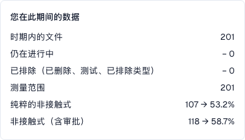

# 指标与计算

<!-- touchless-admin-video-v2-20261104:start -->
**视频章节（审核版）：** [计算各项比率](https://docbits-videos.fra1.cdn.digitaloceanspaces.com/settings-assistant/touchless-intelligence-preview-admin/v2/zh.html#chapter=03).
<!-- touchless-admin-video-v2-20261104:end -->

### 正确提取与无接触流程是两回事

**DocBits 可以把发票上的每个值都正确读出，而发票仍可能需要 AP 关注，因为源系统数据不同。** AP 指 Accounts Payable，即处理供应商发票的团队。请分别检查以下两个问题：

| 问题 | 比较什么 | 结果告诉您什么 |
| --- | --- | --- |
| **DocBits 是否正确读取了文档？** | 在任何人工更正之前，将原始发票与提取的标题字段和表格行进行比较 | 提取质量：提取出的值是否与发票上的实际内容一致？ |
| **流程能否在没有干预的情况下完成？** | 将正确提取的发票与 Infor ERP 提供的采购订单和主数据，连同记录的处理历史进行比较 | 流程自动化：配置的检查、匹配和导出能否在无需更正或重新启动的情况下完成？ |

Infor 中的值不同，本身并不能说明哪一侧有错。请检查发票、约定的订单以及实际导入 DocBits 的数据。源数据可能不正确，导入可能已过期，或者供应商开具了不同的金额。


**无接触率衡量的是流程，而不是提取准确率。** 一份 AP assisted 文档并不能证明 DocBits 提取有误。反过来，通过的提取阶段或较高的置信度分数也不能证明每个值都正确。要确认这一点，请将原始文档与提取的值进行比较。


每份文档最终只会落入**一个**结果：

| 结果               | 含义                                                                                             | 是否计入比率                                                                         |
| --------------------- | --------------------------------------------------------------------------------------------------- | ------------------------------------------------------------------------------------------ |
| **Pure touchless**    | 从导入到导出全程**完全没有任何人工参与**                                                | 是，计为成功                                                                          |
| **AP touchless**      | 自动运行，人员只给出了**业务审批**。无需任何更正       | 是，计为成功                                                                          |
| **AP assisted**       | 成功完成，但人员必须**更正某个字段、重新启动文档**或以其他方式介入；即使提取正确，也可能需要这样做 | 是，但不计入无接触分子；它本身不能说明原因 |
| **Process exception** | 以**错误**结束、被**驳回**、被 **ERP 拒绝**或在流水线中**停滞** | 是，计为失败                                                                             |
| **In progress**       | 尚未结束                                                                                    | **否**。它还没有结果                                                              |
| **Not eligible**      | 已删除、已归档、测试文档，或被排除的文档类型                                    | **否**                                                                                     |

**AP touchless 率**（包含仅有审批的文档）为：

```
rate = (Pure touchless + AP touchless)
       ÷ (Pure touchless + AP touchless + AP assisted + Process exception)
```

这里分子中的 **AP touchless** 指的是文档结果“仅审批”。仪表板的 **AP touchless percentage** 是综合比率：pure 加仅审批的文档。**不要把显示的两个百分比相加。** pure 比率的分子只使用 pure 文档，分母相同。

仍处于 **in progress** 或 **not eligible** 的文档永远不计入计算。这保护了比率：五分钟前到达的文档不会把它拉低。


**一次接触即永久计入。** 一旦有人接触过某份文档，它就会一直被计为已接触，即使之后的自动运行本来不需要任何人。**重新启动文档不会让它重新变成无接触。** 比率反映的是实际发生的工作。


### 计算示例（说明性数字）

30 天内到达了 200 份文档：

| 结果                       | 文档数 |
| ----------------------------- | --------- |
| Pure touchless                | 120       |
| AP touchless                  | 30        |
| AP assisted                   | 30        |
| Process exception             | 10        |
| In progress                   | 8         |
| Not eligible（测试文档）      | 2         |

* 分母：120 + 30 + 30 + 10 = **190**。8 份 in progress 和 2 份 not eligible 文档被排除在外。
* **Pure touchless**：120 ÷ 190 = **63.2 %**
* **仅审批**的占比：30 ÷ 190 = **15.8 %**。这是该结果的占比，不是综合 AP touchless 率。
* **AP touchless 率**：(120 + 30) ÷ 190 = **78.9 %**

该选项卡显示一个**目标值**（除非您的组织使用其他值，否则为 70 %）。在此示例中，综合 AP 率高于 70%，而 63.2% 的 pure 率低于它。请将目标值与相关卡片或图表所标示的比率进行比较。

点击右上角的 **How touchless is calculated**，即可在 DocBits 中打开这段说明，并显示您自己期间的数字（期间文档数、仍在处理中的、已排除的、已计量的）。

<figure><figcaption><p>当前培训总体：201份已完成且符合统计条件的发票，没有仍在处理或被排除的案例。107份完全自动处理的发票占53.2%；加上11份仅审批的发票，共118份，占58.7%。这些流程比率不衡量提取准确率。</p></figcaption></figure>

### 示例：提取正确率 100%，AP touchless 80%

假设对原始发票及其提取值的复核确认，**全部 100 份已完成且符合条件的发票都提取正确**。它们的处理结果为：

| 发生了什么 | 文档数 | 结果 |
| --- | --- | --- |
| 发票与源数据一致；整个流程自动完成 | 70 | Pure touchless |
| 发票与源数据一致；仅需业务审批 | 10 | AP touchless（仅审批结果） |
| 发票数据提取正确，但导入的 Infor 数据不同。AP 澄清了差异，并在源数据更正后手动重新启动 DocBits 中的文档；随后文档成功完成 | 20 | AP assisted |

* **该复核样本中正确提取的文档：** 100 ÷ 100 = **100%**。
* **Pure touchless 率：** 70 ÷ 100 = **70%**。
* **AP touchless 率：** (70 + 10) ÷ 100 = **80%**。

这并不矛盾：所有发票的提取都正确，而其中 20 份因源数据而需要流程干预。**100% 的提取数字是独立文档复核的说明性结果**，不是此仪表板显示的另一个 KPI。不要仅凭无接触结果来计算它。

### 示例：AP 实际需要做什么？

以下案例是说明性的，并非截图背后的那些单独文档。成功结果假定处理已经结束，包括在需要时获得的 ERP 确认。

| 案例 | 原始发票 / DocBits 提取 / 源数据 | AP 的操作与结果 | 在哪里排查 |
| --- | --- | --- | --- |
| **提取错误** | 采购订单编号 `45001234` / 被错误提取为 `45001284` / Infor 中存在正确的订单 `45001234` | AP 更正值被错误提取的编号；发票以 **AP assisted** 结束 | 该供应商的提取 |
| **源系统差异** | 单价 €10.00 / 正确提取 €10.00 / 导入的 Infor 订单显示 €9.00，超出配置的容差 | AP 确认 €10.00 是约定价格，安排更正该订单，并手动重新启动 DocBits 中的发票；发票以 **AP assisted** 结束 | Infor 订单数据及其导入 |
| **导入延迟** | 发票和 DocBits 中的采购订单编号都正确 / 订单存在于 Infor 中，但尚未到达 DocBits | 如果之后的导入和重试在没有记录在案的人工干预或审批的情况下自动完成，结果仍可为 **Pure touchless**。手动重新启动后成功则属于 **AP assisted** | 导入时机与实际运行历史 |
| **ERP 拒绝** | 提取正确，但 ERP 拒绝导出的文档 | 在被归类为最终 ERP 拒绝时属于 **Process exception**，即使此前有人干预过 | ERP 拒绝与导出证据 |

**即使是很小的一次已记录更正或手动重新启动，也算作干预。** AP assisted 的意思是“有人协助处理了这份文档”；它并不是某个独立 AI 助手的名称。因此，源数据问题和提取问题可能有相同的结果，却需要不同的修复。

分类依据 DocBits 记录的事件。不要假定仅在 Infor 中完成、没有相应 DocBits 记录事件的工作会自动计为 AP 干预。也要把这项工作保留在诊断中。

### 哪些 AP 操作算作干预？

以下假定成功完成，包括所需的 ERP 确认。起作用的是记录的操作及其执行者，而不是工作持续了多久。

| 操作 | 对文档结果的影响 |
| --- | --- |
| 打开、阅读、筛选、比较或预览 | 本身不构成处理干预；仍可能是 Pure Touchless |
| 给出业务审批，包括第二次审批 | 如果没有处理干预，则为 AP Touchless |
| 更改并保存标题字段或表格单元格 | AP Assisted；即使只保存一处更正也算 |
| 手动验证并推进文档，即使没有更正任何值 | AP Assisted；手动验证不同于仅审批 |
| 手动重新启动处理或导出 | AP Assisted；之后的自动运行不会消除该干预 |
| 系统自动重试或自动工作流写入 | 本身不构成人工干预；先前的人工接触仍然保留 |
| 仅在 Infor 中更正数据 | 外部工作不会自动成为 DocBits 记录的事件；请单独记录，并检查随后的 DocBits 操作 |
| 更正之后的最终 ERP 拒绝 | Process exception 优先；该干预仍保留在历史中 |

在没有值被更改的证据的情况下点击 Save，不能证明发生了更正。请检查它是否还触发了手动验证或重新启动。

### AP 标签有两层含义

| 位置 | 含义 |
| --- | --- |
| AP 主标题百分比 | Pure + 仅审批的综合：(120 + 30) / 190 = 78.9% |
| 当前报告中该百分比下方的文档数 | Pure + 仅审批的综合：150 = 120 + 30 |
| AP Touchless 结果类别，例如 MCP 分组 `AP_TOUCHLESS` | 单独的仅审批类别：30 / 190 = 15.8% |
| 当前[仪表板趋势截图](touchless-dashboard.md)中的蓝色 AP 线 | 每个点上使用该点总体的 Pure + 仅审批综合率 |

最终结果类别合计为已计量总体的 100%。Pure 与综合 AP 的主标题百分比相互重叠，不能相加。

### 这些数字有多新

结果**每 15 分钟重新计算一次**。文档的结果在首次出现后仍可能变化：ERP 可能在数小时后才确认导出。选项卡底部的 **Data as of …** 一行显示数字最后一次计算的时间。


## 相关页面

* [Touchless Intelligence](./)
* [使用仪表板](touchless-dashboard.md)
* [示例：价格与数量](touchless-examples.md)
* [供应商诊断和问题簇](touchless-supplier-diagnosis.md)
* [采购订单匹配诊断](touchless-po-matching-diagnosis.md)
* [文档追踪](touchless-document-trace.md)
* [变更提案和报告](touchless-change-proposals.md)
* [通过 MCP 解释和改善 Touchless](touchless-mcp.md)

<!-- Documentation review 2026-11-04: extraction quality vs process outcomes; KPI and terminal-outcome definitions checked against DocBits_API c51f350c728acb8ac964098d15f7b006bce273f4, module/automation_intelligence/kpi.py and bucket.py. Existing native screenshots retained and checked separately from illustrative examples. -->
<!-- Completion review 2026-11-04: owned synthetic PO examples, MCP schema/read evidence, human-action classification, KPI labels and screenshot proof limits. -->
