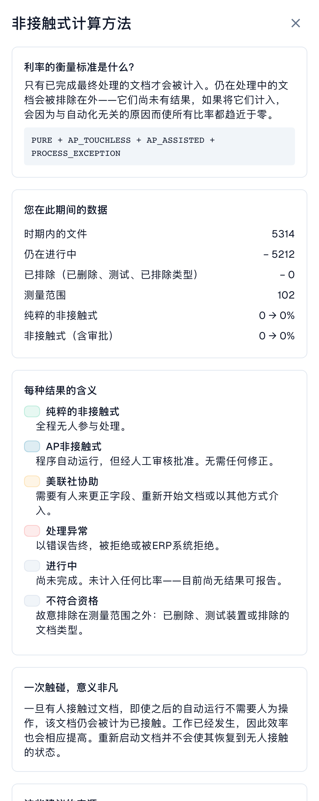

# 指标与计算

### 正确提取与流程自动化是两回事

 **DocBits 可以正确读取发票，但 Infor 数据不同仍可能需要人工处理。**  AP 指人工应付账款团队，不是 AI 助手。先比较原件与更正前的提取值，再比较导入的源数据。绿色步骤或高置信度不能证明每个值都正确；已经更正的值也不能证明最初的提取结果。

## “无接触”的含义

每份已完成且符合 KPI 统计条件的文档只有一个最终类别：

| 类别 | 含义 | 算作无接触？ |
| --- | --- | --- |
| **Pure Touchless（纯无接触）** | 成功完成，无人工干预，也无审批 | 是 |
| **AP Touchless（仅需业务审批）** | 成功完成，只有业务审批，没有其他处理操作 | 是 |
| **AP Assisted（AP 人工辅助）** | 更正、手动验证或人工重新启动后成功完成 | 否 |
| **流程异常** | 最终错误、拒绝或被归为异常的 ERP 拒收 | 否 |

处理中及排除的文档不进入分母。最终异常优先于成功类别；即使之前有人工处理，最终仍可能归为异常。AP Assisted 描述实际操作，不代表提取出错。

```
rate = (Pure touchless + AP touchless)
       ÷ (Pure touchless + AP touchless + AP assisted + Process exception)
```

公式里的 AP touchless 是 **仅审批类别** 。 **顶部 AP 综合率** 包含 Pure 与仅审批。Pure 与 AP 综合率有重叠，不能相加；供应商结果中的类别则互不重叠。

### 200 份文档的说明性计算

| 结果 | 数量 |
| --- | --- |
| Pure | 120 |
| 仅业务审批 | 30 |
| AP Assisted | 30 |
| 异常 | 10 |
| 处理中 | 8 |
| 排除 | 2 |

分母： **190** 。Pure：120 / 190 = **63.2 %** 。仅审批：30 / 190 = **15.8 %** 。AP 综合率：(120 + 30) / 190 = **78.9 %** 。若目标为 70 %，AP 综合率高于目标，而 Pure 低于目标。必须明确比较的是哪一项。

### 提取正确率 100 %，AP 综合率仍为 80 %

假设独立核对原件和更正前的值，确认 **100 份已完成、符合统计条件的发票全部提取正确** 。其中 70 份自动成功完成（Pure）；10 份仅需业务审批（AP Touchless）；20 份与 Infor 数据不同。确认约定价格后更正源系统，检查导入，再由人工在 DocBits 重新启动，最终成功（AP Assisted）。

这份样本的提取正确率为 **100 %** ，Pure 为 **70 %** ，AP 综合率为 **80 %** 。100 % 来自有明确范围的独立核查，不是仪表板的另一个 KPI。若缺少初始值，应标记为无法评估。只在 Infor 中操作不会自动成为 DocBits 事件。

 **人工操作记录会保留。**  后续自动执行不会抹去之前的更正或人工重启。阅读和预览本身不算处理干预；手动验证、人工重启算。只有审批的情况保持独立。

<figure><figcaption><p>真实中文计算窗口：5314 份文档减去 5212 份处理中，统计范围为 102。顶部 AP 综合率包含 Pure 与仅审批，衡量流程而非提取准确性。界面“利率”指处理率，“美联社协助”应理解为 AP 人工辅助；截图不是说明性 200 份样本。</p></figcaption></figure>

### 哪些 AP 操作算人工干预？

以下成功类别均要求成功完成及所需的 ERP 确认。看已记录的事件及执行者，而非耗时长短。

| 操作 | 影响 |
| --- | --- |
| 阅读、筛选、比较或预览 | 本身不排除 Pure |
| 仅业务审批，包括第二次审批 | 无其他干预时为 AP Touchless |
| 更正并保存字段或表格单元格 | AP Assisted；一次更正也算 |
| 手动验证或人工重启处理/导出 | 成功后为 AP Assisted；后续自动运行不会清除 |
| 系统自动重试或工作流 | 本身不产生人工干预；先前干预仍保留 |
| 只在 Infor 更正 | 不会自动记录为 DocBits 事件；单独记录并检查后续步骤 |
| ERP 最终拒收 | 异常优先于成功类别 |

没有证明值变化的保存操作不能证明发生更正；还应检查是否触发手动验证或重启。

### AP 的两种含义

 **顶部 AP 百分比** 包括 Pure 与仅审批：150 / 190 = 78.9 %。 **下面的数量** 仅是 30 份审批。供应商类别和本指南中的蓝色 AP 趋势线表示仅审批：15.8 %。Pure 与 AP 综合率有重叠，不能相加。

### 数据更新时间

每 15 分钟重新计算结果。检查数据截至时间并等待更新；ERP 确认可能稍后到达，发送成功本身不能证明整个流程已完成。

## 常见问题

 **无接触率显示破折号（—）。** 统计期间内没有文档达到最终结果，或者经过计量的文档少于最低数量。仍在处理中的文档不计入。

 **看不到此标签页。** 请管理员启用该模块，并为您的角色授予 **分析仪表板** 标签页权限。

 **某份文档被计为人工处理，但这次处理过程中没有人介入。** 它在较早的运行中由人员处理过（例如更正或重新启动）。无接触率反映实际发生的工作。

 **为什么数字几小时后会发生变化？** ERP 可能会在导出发送数小时后才予以确认。处理结果每 15 分钟重新计算一次。

 **AI 会自行更改任何内容吗？** 不会。AI 只会生成说明。只有管理员预览并应用更改后，设置才会发生变化。

## 相关页面

* [Touchless Intelligence](./)
* [使用仪表板](touchless-dashboard.md)
* [示例：价格与数量](touchless-examples.md)
* [供应商诊断与问题集群](touchless-supplier-diagnosis.md)
* [采购订单匹配诊断](touchless-po-matching-diagnosis.md)
* [文档追踪](touchless-document-trace.md)
* [变更提案和报告](touchless-change-proposals.md)
* [通过 MCP 解释和改善 Touchless](touchless-mcp.md)

<!-- Alignment 2026-11-04: correct extraction is distinct from process Touchless; KPI numerator and denominator verified. -->
<!-- Completion 2026-11-04: localized MCP examples, AP actions, original-value evidence and owned synthetic PO cards. -->
