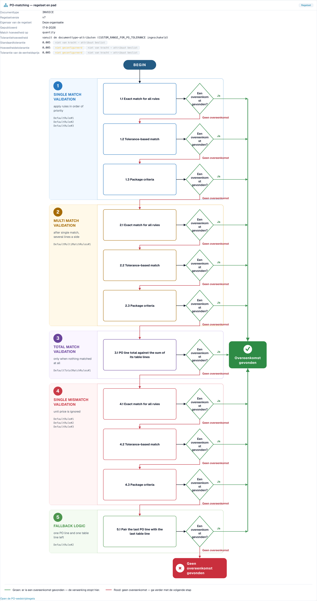

# PO-matchingdiagnose

<!-- touchless-admin-video-v2-20261104:start -->
**Videohoofdstuk (controleversie):** [Een document volgen](https://docbits-videos.fra1.cdn.digitaloceanspaces.com/settings-assistant/touchless-intelligence-preview-admin/v2/en.html#chapter=07).
<!-- touchless-admin-video-v2-20261104:end -->

## Overzicht

Veel facturen blijven steken bij de inkooporder. De factuur zegt iets anders dan de purchase order (PO), en de geconfigureerde controles kunnen het verschil niet automatisch oplossen. **Een correcte extractie kan nog steeds tot een geblokkeerde PO-match leiden wanneer de gegevens van het bronsysteem afwijken.** Een tijdelijke stop is nog geen definitieve uitkomst: latere automatische verwerking kan slagen, terwijl een vastgelegde handmatige correctie of herstart verhindert dat een succesvol document touchless is.

Touchless Intelligence laat je zien **waarom** een PO-match mislukte en **hoe** DocBits heeft geprobeerd te matchen. Deze pagina legt de twee betrokken pipelinefasen uit, de redenen die je zult zien en de **beslisstroom van de PO-matching**, een diagram dat de matchingstappen na elkaar toont.

### Waar je PO-matching in Touchless Intelligence ziet

| Waar                                                                                        | Wat je ziet                                                                                                                                                                     |
| ------------------------------------------------------------------------------------------- | ------------------------------------------------------------------------------------------------------------------------------------------------------------------------------- |
| **Where touchless is lost first** (tabblad Overzicht)                                       | Een staaf zoals _PO line match: PO item mismatch_. Die vertelt je hoeveel documenten daar stopten                                                                                |
| **Supplier opportunities**                                                                  | Een leverancier met de hoofdoorzaak **PO matching**                                                                                                                             |
| **Supplier Diagnosis**, sectie **How this organisation matches** en het **issue cluster**   | De beslisstroom met de regelset van jouw organisatie                                                                                                                            |
| **Document Trace**                                                                          | De fase **PO Line Match** met de status **blocked** en de reden                                                                                                                 |
| **Settings → Document Types → More Settings → Purchase Order**                              | De matchingregels zelf. Zie [Purchase Order Matching Rules](../../settings/global-settings/document-types/more-settings/purchase-order/purchase-order-matching-rules.md)      |

## De twee PO-fasen

| Fase                   | Vraag                                         | Stopt met                                                                                                             |
| ---------------------- | --------------------------------------------- | --------------------------------------------------------------------------------------------------------------------- |
| **9 · PO Lookup**      | Is er een inkooporder voor deze factuur?      | _Purchase order not found_                                                                                            |
| **10 · PO Line Match** | Komt elke factuurregel overeen met een PO-regel? | _PO item mismatch_, _PO line identifier mismatch_, _Unit price outside PO tolerance_, _Quantity outside PO tolerance_ |

Een document dat bij fase 9 of 10 stopt, verschijnt in de leverancierswachtrij met de eerste blokkade **PO matching**.

## Redenen waarom een PO-match mislukt

| Reden die je ziet                   | Wat het betekent                                                                                           | Typische oorzaak                                                                                          | Wat je moet wijzigen                                                                                                                                                 |
| ----------------------------------- | ---------------------------------------------------------------------------------------------------------- | --------------------------------------------------------------------------------------------------------- | -------------------------------------------------------------------------------------------------------------------------------------------------------------------- |
| **Purchase order not found**        | DocBits vond geen inkooporder bij het PO-nummer op de factuur                                              | Het PO-nummer wordt verkeerd gelezen of ontbreekt; de PO is nog niet geïmporteerd; de PO hoort bij een andere leverancier | Controleer de extractie van het PO-nummer voor deze leverancier, de import van de PO-stamgegevens en de koppeling met de leverancier                                  |
| **PO item mismatch**                | De factuurregels kwamen niet overeen met de PO-regels                                                      | De leverancier gebruikt eigen artikelnummers; de omschrijving verschilt; regels zijn samengevoegd of gesplitst | Controleer de mapping van artikelnummers en de **rule priorities** in de matchingregels; voeg een regel toe voor de manier waarop de leverancier regels identificeert |
| **PO line identifier mismatch**     | Het regelnummer of de identificatie op de factuur komt niet overeen met de PO                              | De leverancier nummert regels opnieuw                                                                     | Match op artikel en hoeveelheid in plaats van op regelnummer                                                                                                          |
| **Unit price outside PO tolerance** | De prijs wijkt meer af dan de toegestane tolerantie                                                       | Een echte prijswijziging, een afrondingsverschil of een andere prijseenheid                               | Controleer de **Unit price tolerance** in de regelset; corrigeer de PO of vraag het de leverancier                                                                    |
| **Quantity outside PO tolerance**   | De hoeveelheid wijkt meer af dan de toegestane tolerantie                                                 | Deellevering, overlevering                                                                                | Controleer **Match quantity on** en de **Quantity tolerance**                                                                                                         |
| **PO matching service error**       | De matchingservice kon niet antwoorden                                                                    | Een tijdelijk technisch probleem                                                                          | Start de documenten opnieuw; neem contact op met support als het zich herhaalt                                                                                        |
| **Automatic PO export disabled**    | De instelling **Auto export if PO matched 100%** staat uit, dus gematchte documenten worden niet automatisch geëxporteerd | De instelling staat uit                                                                                   | Schakel de instelling in als je automatische export wilt. Zie [Auto Export if PO Matched 100%](../../settings/document-processing/module/auto-export-if-po-matched-100.md) |


Niet elke reden voor PO-matching is in DocBits op te lossen. Als de leverancier een verkeerd PO-nummer stuurt, zegt de kaart **Supplier action only**: de leverancier moet het document corrigeren en opnieuw sturen.


De afzonderlijke prijs- en aantalgevallen met hun bewijs staan bij de [uitgewerkte voorbeelden](touchless-examples.md).

## De beslisstroom van de PO-matching

De beslisstroom toont hoe DocBits een factuurregel aan een PO-regel probeert te koppelen. Hij heeft **vijf fasen**, en de eerste match wint:

1. **Single match validation**: pas de regels toe in volgorde van prioriteit. Dit is het normale geval, één factuurregel en één PO-regel
2. **Multi match validation**: na een enkelvoudige match, wanneer aan één kant meerdere regels betrokken zijn
3. **Total match validation**: alleen wanneer er helemaal niets matchte. Het totaal van de PO-regel wordt vergeleken met de som van de tabelregels
4. **Single mismatch validation**: de stukprijs wordt genegeerd, zodat een regel op artikel en hoeveelheid kan worden gematcht, ook als de prijs verschilt
5. **Fallback logic**: er blijven één PO-regel en één tabelregel over, die dan worden gekoppeld

Binnen de fasen probeert DocBits in deze volgorde:

* **Exact match for all rules**: elke vergeleken waarde is identiek
* **Tolerance-based match**: numerieke waarden mogen binnen de tolerantie afwijken
* **Package criteria**: de laatste ronde, gebaseerd op de verpakkingsgerelateerde criteria van de regelset

Elke stap vraagt **Match found?** Het antwoord **Yes** (groen) leidt naar **Match found** en het document gaat verder. Het antwoord **No match** (rood) gaat door naar de volgende stap, en na de laatste stap is het resultaat **No match found**: het document stopt en heeft een persoon nodig.

<figure><figcaption>
De beslisstroom van de PO-matching, geopend via <strong>How this organisation matches</strong> op de pagina Supplier Diagnosis. De kop toont de regelset (versie 7, eigendom van deze organisatie) en de toleranties. Daaronder lopen de vijf fasen met hun rondes van boven naar beneden. Groen leidt naar <strong>Match found</strong>, rood gaat door naar de volgende stap en eindigt in <strong>No match found</strong>. Voorbeeldorganisatie met demogegevens.
</figcaption></figure>

### Wat de kop van het diagram je vertelt

| Veld                                              | Betekenis                                                                                              |
| ------------------------------------------------- | ------------------------------------------------------------------------------------------------------ |
| **Document type**                                 | Het documenttype waartoe de regelset behoort, bijvoorbeeld INVOICE                                      |
| **Rule set version**                              | De versie van de matchingregels, bijvoorbeeld v3                                                       |
| **Rule set owner**                                | **This organisation** (je eigen regels) of **Shipped default rule set** (de standaardregels van DocBits) |
| **Published**                                     | Wanneer de versie is gepubliceerd                                                                      |
| **Match quantity on**                             | Welke hoeveelheid wordt vergeleken (bestelde hoeveelheid, openstaande hoeveelheid)                     |
| **Tolerance amount**                              | Of de toleranties uit de attributen van het documenttype komen of uit de regelset                      |
| **Unit price tolerance** / **Quantity tolerance** | Hoeveel een prijs of een hoeveelheid mag afwijken                                                      |
| **Default tolerance**                             | De tolerantie voor alle andere numerieke waarden                                                       |

In het voorbeeld hierboven tonen de toleranties **not configured** en **not in force: attribute decides**. Dat betekent: de regelset zelf heeft geen eigen tolerantie, en de regel **Tolerance amount** zegt dat de toleranties uit de **document type attributes** komen. Een tolerantie beslist alleen als ze van kracht is. Lees deze regel eerst wanneer een prijs- of hoeveelheidsverschil documenten blokkeert: ze vertelt je **waar** je de tolerantie moet wijzigen.

De status van de regelset wordt als opmerking getoond: **Active version** (deze regels beslissen), **Approved, not active**, **Draft, not yet in force** of **Version state unknown**. Alleen de actieve versie beslist.

Als transformatieregels een document vóór de matching hebben gewijzigd, zegt het diagram dat, bijvoorbeeld _2 applied: (names)_ of _"(rule)" rebuilt (table): the PO match was lost here_. Dat is een veelvoorkomende verborgen oorzaak: een regel die een tabel opnieuw opmaakt, kan een match breken die eerder werkte.

## Voorbeelden

De cijfers in de voorbeelden zijn illustratief.

### Voorbeeld 1: Prijs binnen de tolerantie

Een factuurregel heeft een stukprijs van **10.40**. De PO-regel zegt **10.00**. De tolerantie voor de stukprijs is **5 %**.

* **Exact match** mislukt (10.40 is niet 10.00).
* **Tolerance-based match** slaagt: het verschil is **4 %**, en dat valt binnen 5 %.
* De regel is gematcht. **Match found.**

Bij een tolerantie van **3 %** mislukt ook de match op basis van tolerantie. Na alle fasen stopt het document met **Unit price outside PO tolerance**. Het diagram toont precies dit pad, en de oplossing is ofwel de tolerantie (als 4 % acceptabel is voor je bedrijf) ofwel een correctie bij de leverancier.

### Voorbeeld 2: De artikelnummers van de leverancier verschillen van de jouwe

Een leverancier factureert artikel **"A-4711-X"**, jouw PO zegt **"4711"**. Geen enkele regel vergelijkt de twee, dus er wordt geen match gevonden, en Touchless Intelligence groepeert alle facturen van deze leverancier in één cluster: **PO line match, PO item mismatch**, 27 documenten.

* In het cluster lees je _27 affected, 27 recoverable_, verwachte stijging bijvoorbeeld **+8.7 pp**.
* De oplossing ligt aan jouw kant: voeg een regel toe of wijzig de volgorde van regels zodat op het artikelnummer van de leverancier of op de omschrijving wordt gematcht, of onderhoud de artikelnummers van de leverancier in de stamgegevens.
* Pas de wijziging na je aanpassing toe met een [change proposal](touchless-change-proposals.md) en lees twee weken later de **Change history**: AP touchless-percentage voor en na.

### Voorbeeld 3: De inkooporder is er nog niet

Facturen komen binnen voordat de PO is geïmporteerd. Ze stoppen bij **PO Lookup** met **Purchase order not found**. Het cluster toont een korte piek. De oplossing is de volgorde van je processen of het schema van de PO-import, niet de matchingregels. Kijk bij **Where touchless is lost first**: een staaf _PO lookup: Purchase order not found_ die na elke importpauze groeit, wijst op deze oorzaak.

### Voorbeeld 4: Eén regel heeft de tabel opnieuw opgebouwd

Nadat een transformatieregel voor de tabel van een leverancier live ging, daalde het matchingpercentage van deze leverancier sterk. Het diagram van een getroffen document zegt _"(rule)" rebuilt (table): the PO match was lost here_. De oplossing is de transformatieregel aan te passen of ongedaan te maken, niet de matchingregels.

## Een routine voor problemen met PO-matching

1. Open **Where touchless is lost first**. Staat een PO-matchingfase in de top drie?
2. Open **Supplier opportunities** en sorteer op **Expected lift**. Neem de leverancier met de hoofdoorzaak **PO matching** en de status **RECOVERABLE**.
3. Open de **Supplier Diagnosis** en lees het cluster: reden, getroffen documenten, **What to change**, **Missing evidence**.
4. Open **How this organisation matches** en controleer de regelset: versie, eigenaar en toleranties.
5. Open één **sample document** en het bijbehorende [Document Trace](touchless-document-trace.md): welke fase, welke reden?
6. Wijzig **één** ding (regelvolgorde, tolerantie, artikelmapping) met een voorvertoning, zodat de **Change history** het kan meten.

## Gerelateerde pagina's

* [Touchless Intelligence](./)
* [Leveranciersdiagnose en probleemclusters](touchless-supplier-diagnosis.md)
* [Document Trace](touchless-document-trace.md)
* [Change Proposals en rapporten](touchless-change-proposals.md)
* [Purchase Order Matching Rules](../../settings/global-settings/document-types/more-settings/purchase-order/purchase-order-matching-rules.md)
* [PO Matching Cards: Complete Guide](../../workflow/cards-overview/po-matching-complete-guide.md)

<!-- Documentation review 2026-11-04: extraction quality vs process outcomes; KPI and terminal-outcome definitions checked against DocBits_API c51f350c728acb8ac964098d15f7b006bce273f4, module/automation_intelligence/kpi.py and bucket.py. Existing native screenshots retained and checked separately from illustrative examples. -->

<!-- Completion review 2026-11-04: owned synthetic PO examples, MCP schema/read evidence, human-action classification, KPI labels and screenshot proof limits. -->
