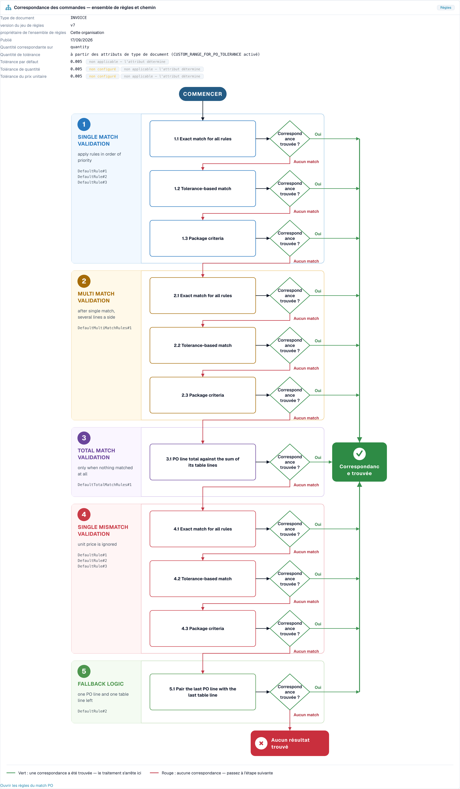

# Diagnostic du rapprochement avec le BC

<!-- touchless-admin-video-v2-20261104:start -->
**Chapitre vidéo (version de contrôle):** [Suivre un document](https://docbits-videos.fra1.cdn.digitaloceanspaces.com/settings-assistant/touchless-intelligence-preview-admin/v2/fr.html#chapter=07).
<!-- touchless-admin-video-v2-20261104:end -->

## Vue d'ensemble

De nombreuses factures s'arrêtent au bon de commande. La facture dit une chose, le bon de commande (BC) en dit une autre, et les contrôles configurés ne peuvent pas résoudre l'écart automatiquement. **Une extraction correcte peut malgré tout conduire à un rapprochement avec le BC bloqué lorsque les données du système source diffèrent.** Un arrêt temporaire n'est pas encore un résultat final : un traitement automatique ultérieur peut réussir, tandis qu'une correction ou un redémarrage manuel enregistré empêche un document réussi d'être touchless.

Touchless Intelligence vous montre **pourquoi** un rapprochement avec le BC a échoué et **comment** DocBits a tenté de le réaliser. Cette page explique les deux étapes du pipeline concernées, les motifs que vous verrez et le **flux de décision du rapprochement avec le BC**, un schéma qui montre les étapes de rapprochement l'une après l'autre.

### Où vous voyez le rapprochement avec le BC dans Touchless Intelligence

| Où                                                                                          | Ce que vous voyez                                                                                                                                                               |
| ------------------------------------------------------------------------------------------- | ------------------------------------------------------------------------------------------------------------------------------------------------------------------------------- |
| **Where touchless is lost first** (onglet de vue d'ensemble)                                | Une barre telle que _PO line match: PO item mismatch_. Elle indique combien de documents se sont arrêtés là                                                                     |
| **Supplier opportunities**                                                                  | Un fournisseur dont la cause racine est **PO matching**                                                                                                                         |
| **Supplier Diagnosis**, section **How this organisation matches** et **issue cluster**      | Le flux de décision avec le jeu de règles de votre organisation                                                                                                                 |
| **Document Trace**                                                                          | L'étape **PO Line Match** avec le statut **blocked** et le motif                                                                                                                |
| **Settings → Document Types → More Settings → Purchase Order**                              | Les règles de rapprochement elles-mêmes. Voir [Règles de correspondance des bons de commande](../../settings/global-settings/document-types/more-settings/purchase-order/purchase-order-matching-rules.md) |

## Les deux étapes du BC

| Étape                  | Question                                    | S'arrête avec                                                                                                         |
| ---------------------- | ------------------------------------------- | --------------------------------------------------------------------------------------------------------------------- |
| **9 · PO Lookup**      | Existe-t-il un bon de commande pour cette facture ? | _Purchase order not found_                                                                                    |
| **10 · PO Line Match** | Chaque ligne de facture correspond-elle à une ligne de BC ? | _PO item mismatch_, _PO line identifier mismatch_, _Unit price outside PO tolerance_, _Quantity outside PO tolerance_ |

Un document qui s'arrête à l'étape 9 ou 10 apparaît dans la file des fournisseurs avec le premier bloqueur **PO matching**.

## Motifs d'échec d'un rapprochement avec le BC

| Motif affiché                      | Signification                                                                                              | Cause typique                                                                                             | Que modifier                                                                                                                                                        |
| ----------------------------------- | ---------------------------------------------------------------------------------------------------------- | --------------------------------------------------------------------------------------------------------- | -------------------------------------------------------------------------------------------------------------------------------------------------------------------- |
| **Purchase order not found**        | DocBits n'a trouvé aucun bon de commande pour le numéro de BC figurant sur la facture                      | Le numéro de BC est mal lu ou absent ; le BC n'a pas encore été importé ; le BC appartient à un autre fournisseur | Vérifiez l'extraction du numéro de BC pour ce fournisseur, l'import des données de base des BC et le lien avec le fournisseur                                        |
| **PO item mismatch**                | Les lignes de facture ne correspondaient pas aux lignes de BC                                              | Le fournisseur utilise ses propres numéros d'article ; la description diffère ; des lignes ont été fusionnées ou scindées | Vérifiez le mappage des numéros d'article et les **priorités des règles** dans les règles de rapprochement ; ajoutez une règle pour la façon dont le fournisseur identifie les lignes |
| **PO line identifier mismatch**     | Le numéro ou l'identifiant de ligne de la facture ne correspond pas au BC                                  | Le fournisseur renumérote les lignes                                                                      | Rapprochez par article et quantité plutôt que par numéro de ligne                                                                                                    |
| **Unit price outside PO tolerance** | Le prix diffère de plus que la tolérance autorisée                                                         | Une vraie modification de prix, un écart d'arrondi ou une unité de prix différente                        | Vérifiez la **Unit price tolerance** dans le jeu de règles ; corrigez le BC ou interrogez le fournisseur                                                             |
| **Quantity outside PO tolerance**   | La quantité diffère de plus que la tolérance autorisée                                                     | Livraison partielle, sur-livraison                                                                        | Vérifiez **Match quantity on** et la **Quantity tolerance**                                                                                                          |
| **PO matching service error**       | Le service de rapprochement n'a pas pu répondre                                                           | Un problème technique temporaire                                                                          | Redémarrez les documents ; contactez le support si cela se répète                                                                                                     |
| **Automatic PO export disabled**    | Le paramètre **Auto export if PO matched 100%** est désactivé, les documents rapprochés ne sont donc pas exportés automatiquement | Le paramètre est désactivé                                                                                | Activez le paramètre si vous souhaitez l'export automatique. Voir [Auto Export if PO Matched 100%](../../settings/document-processing/module/auto-export-if-po-matched-100.md) |


Tous les motifs de rapprochement avec le BC ne peuvent pas être corrigés dans DocBits. Si le fournisseur envoie un mauvais numéro de BC, la carte indique **Supplier action only** : le fournisseur doit corriger le document et le renvoyer.


Retrouvez les cas distincts de prix et de quantité, avec leurs preuves, dans [Exemples concrets](touchless-examples.md).

## Le flux de décision du rapprochement avec le BC

Le flux de décision montre comment DocBits tente de rapprocher une ligne de facture d'une ligne de BC. Il comporte **cinq étapes**, et la première correspondance l'emporte :

1. **Single match validation** : appliquer les règles par ordre de priorité. C'est le cas normal, une ligne de facture et une ligne de BC
2. **Multi match validation** : après une correspondance simple, lorsque plusieurs lignes sont concernées d'un côté
3. **Total match validation** : uniquement lorsque rien n'a correspondu. Le total de la ligne de BC est comparé à la somme de ses lignes de tableau
4. **Single mismatch validation** : le prix unitaire est ignoré, de sorte qu'une ligne peut être rapprochée par article et quantité même si le prix diffère
5. **Fallback logic** : il reste une ligne de BC et une ligne de tableau, elles sont donc appariées

À l'intérieur des étapes, DocBits essaie, dans cet ordre :

* **Exact match for all rules** : chaque valeur comparée est identique
* **Tolerance-based match** : les valeurs numériques peuvent s'écarter dans la limite de la tolérance
* **Package criteria** : la dernière passe, basée sur les critères liés à l'emballage du jeu de règles

Chaque étape pose la question **Match found?** La réponse **Yes** (vert) mène à **Match found** et le document continue. La réponse **No match** (rouge) passe à l'étape suivante, et après la dernière étape le résultat est **No match found** : le document s'arrête et nécessite une personne.

<figure><figcaption>
Le flux de décision du rapprochement avec le BC, ouvert depuis <strong>How this organisation matches</strong> sur la page Supplier Diagnosis. L'en-tête montre le jeu de règles (version 7, propriété de cette organisation) et les tolérances. En dessous, les cinq étapes avec leurs passes se déroulent de haut en bas. Le vert mène à <strong>Match found</strong>, le rouge passe à l'étape suivante et aboutit à <strong>No match found</strong>. Organisation d'exemple avec données de démonstration.
</figcaption></figure>

### Ce que vous apprend l'en-tête du schéma

| Champ                                             | Signification                                                                                          |
| ------------------------------------------------- | ------------------------------------------------------------------------------------------------------ |
| **Document type**                                 | Le type de document auquel appartient le jeu de règles, par exemple INVOICE                             |
| **Rule set version**                              | La version des règles de rapprochement, par exemple v3                                                 |
| **Rule set owner**                                | **This organisation** (vos propres règles) ou **Shipped default rule set** (les règles standard de DocBits) |
| **Published**                                     | Quand la version a été publiée                                                                         |
| **Match quantity on**                             | Quelle quantité est comparée (quantité commandée, quantité ouverte)                                   |
| **Tolerance amount**                              | Si les tolérances proviennent des attributs du type de document ou du jeu de règles                    |
| **Unit price tolerance** / **Quantity tolerance** | De combien un prix ou une quantité peut s'écarter                                                      |
| **Default tolerance**                             | La tolérance pour toutes les autres valeurs numériques                                                 |

Dans l'exemple ci-dessus, les tolérances affichent **not configured** et **not in force: attribute decides**. Cela signifie : le jeu de règles n'a pas de tolérance propre, et la ligne **Tolerance amount** indique que les tolérances proviennent des **attributs du type de document**. Une tolérance ne décide que lorsqu'elle est en vigueur. Lisez cette ligne en premier lorsqu'un écart de prix ou de quantité bloque des documents : elle vous dit **où** modifier la tolérance.

L'état du jeu de règles est affiché sous forme de note : **Active version** (ces règles décident), **Approved, not active**, **Draft, not yet in force** ou **Version state unknown**. Seule la version active décide.

Si des règles de transformation ont modifié un document avant le rapprochement, le schéma l'indique, par exemple _2 applied: (names)_ ou _"(rule)" rebuilt (table): the PO match was lost here_. C'est une cause cachée fréquente : une règle qui reformate un tableau peut casser un rapprochement qui fonctionnait auparavant.

## Exemples

Les chiffres des exemples sont illustratifs.

### Exemple 1 : Prix dans la tolérance

Une ligne de facture a un prix unitaire de **10,40**. La ligne de BC indique **10,00**. La tolérance du prix unitaire est de **5 %**.

* La **correspondance exacte** échoue (10,40 n'est pas 10,00).
* La **correspondance avec tolérance** réussit : l'écart est de **4 %**, ce qui reste dans les 5 %.
* La ligne est rapprochée. **Match found.**

Avec une tolérance de **3 %**, la correspondance avec tolérance échoue aussi. Après toutes les étapes, le document s'arrête avec **Unit price outside PO tolerance**. Le schéma montre exactement ce chemin, et la solution est soit la tolérance (si 4 % est acceptable pour votre activité), soit une correction chez le fournisseur.

### Exemple 2 : Les numéros d'article du fournisseur diffèrent des vôtres

Un fournisseur facture l'article **« A-4711-X »**, votre BC indique **« 4711 »**. Aucune règle ne compare les deux, donc aucune correspondance n'est trouvée, et Touchless Intelligence regroupe toutes les factures de ce fournisseur dans un seul cluster : **PO line match, PO item mismatch**, 27 documents.

* Dans le cluster, vous lisez _27 affected, 27 recoverable_, avec un gain attendu par exemple **+8,7 pp**.
* La solution est de votre côté : ajoutez ou réordonnez une règle qui rapproche sur le numéro d'article du fournisseur ou sur la description, ou maintenez les numéros d'article du fournisseur dans les données de base.
* Après avoir modifié la règle, appliquez la modification avec une [proposition de modification](touchless-change-proposals.md) et lisez le **Change history** deux semaines plus tard : taux AP touchless avant et après.

### Exemple 3 : Le bon de commande n'est pas encore disponible

Les factures arrivent avant l'import du BC. Elles s'arrêtent à **PO Lookup** avec **Purchase order not found**. Le cluster montre un bref pic. La solution réside dans l'ordre de vos processus, ou dans le calendrier de l'import des BC, pas dans les règles de rapprochement. Vérifiez **Where touchless is lost first** : une barre _PO lookup: Purchase order not found_ qui grandit après chaque interruption d'import indique cette cause.

### Exemple 4 : Une règle a reconstruit le tableau

Après la mise en service d'une règle de transformation pour le tableau d'un fournisseur, le taux de rapprochement de ce fournisseur a fortement chuté. Le schéma d'un document concerné indique _"(rule)" rebuilt (table): the PO match was lost here_. La solution est d'ajuster ou d'annuler la règle de transformation, pas les règles de rapprochement.

## Une routine pour les problèmes de rapprochement avec le BC

1. Ouvrez **Where touchless is lost first**. Une étape de rapprochement avec le BC figure-t-elle parmi les trois premières ?
2. Ouvrez **Supplier opportunities** et triez par **Expected lift**. Prenez le fournisseur dont la cause racine est **PO matching** et le statut **RECOVERABLE**.
3. Ouvrez la **Supplier Diagnosis** et lisez le cluster : motif, documents concernés, **What to change**, **Missing evidence**.
4. Ouvrez **How this organisation matches** et vérifiez le jeu de règles : version, propriétaire et tolérances.
5. Ouvrez un **document d'exemple** et sa [Document Trace](touchless-document-trace.md) : quelle étape, quel motif ?
6. Modifiez **une seule** chose (ordre des règles, tolérance, mappage des articles) avec un aperçu, afin que le **Change history** puisse la mesurer.

## Pages connexes

* [Touchless Intelligence](./)
* [Supplier Diagnosis et clusters de problèmes](touchless-supplier-diagnosis.md)
* [Document Trace](touchless-document-trace.md)
* [Change Proposals et rapports](touchless-change-proposals.md)
* [Règles de correspondance des bons de commande](../../settings/global-settings/document-types/more-settings/purchase-order/purchase-order-matching-rules.md)
* [PO Matching Cards : guide complet](../../workflow/cards-overview/po-matching-complete-guide.md)

<!-- Documentation review 2026-11-04: extraction quality vs process outcomes; KPI and terminal-outcome definitions checked against DocBits_API c51f350c728acb8ac964098d15f7b006bce273f4, module/automation_intelligence/kpi.py and bucket.py. Existing native screenshots retained and checked separately from illustrative examples. -->

<!-- Completion review 2026-11-04: owned synthetic PO examples, MCP schema/read evidence, human-action classification, KPI labels and screenshot proof limits. -->
