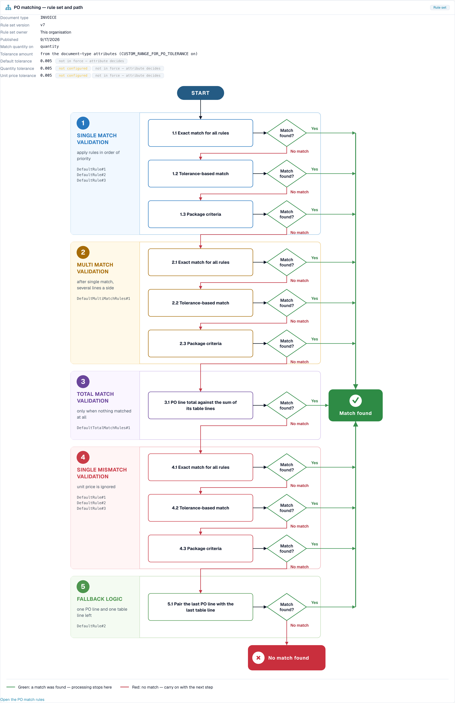

# PO Matching Diagnosis

<!-- touchless-admin-video-v2-20261104:start -->
**Videokapitel (Prüffassung):** [Einem Dokument folgen](https://docbits-videos.fra1.cdn.digitaloceanspaces.com/settings-assistant/touchless-intelligence-preview-admin/v2/en.html#chapter=07).
<!-- touchless-admin-video-v2-20261104:end -->

## Überblick

Viele Rechnungen bleiben an der Bestellung hängen. Die Rechnung sagt das eine, die Bestellung (Purchase Order, PO) das andere, und die konfigurierten Prüfungen können die Abweichung nicht automatisch auflösen. **Eine korrekte Extraktion kann trotzdem zu einem blockierten PO-Abgleich führen, wenn die Daten des Quellsystems abweichen.** Ein vorübergehender Stopp ist noch kein endgültiges Ergebnis: Eine spätere automatische Verarbeitung kann erfolgreich sein, während eine aufgezeichnete manuelle Korrektur oder ein Neustart verhindert, dass ein erfolgreiches Dokument touchless bleibt.

Touchless Intelligence zeigt Ihnen, **warum** ein PO-Abgleich fehlgeschlagen ist und **wie** DocBits den Abgleich versucht hat. Diese Seite erklärt die beiden beteiligten Pipeline-Stufen, die Gründe, die Sie sehen werden, und den **PO-Abgleich-Entscheidungsfluss**, ein Diagramm, das die Abgleichschritte nacheinander zeigt.

### Wo Sie den PO-Abgleich in Touchless Intelligence sehen

| Wo                                                                                          | Was Sie sehen                                                                                                                                                                  |
| ------------------------------------------------------------------------------------------- | ------------------------------------------------------------------------------------------------------------------------------------------------------------------------------- |
| **Where touchless is lost first** (Übersichts-Tab)                                          | Ein Balken wie _PO line match: PO item mismatch_. Er sagt Ihnen, wie viele Dokumente dort stehen geblieben sind                                                                |
| **Supplier opportunities**                                                                  | Ein Lieferant mit der Grundursache **PO matching**                                                                                                                              |
| **Supplier Diagnosis**, Abschnitt **How this organisation matches** und der **Issue-Cluster** | Der Entscheidungsfluss mit dem Regelsatz Ihrer Organisation                                                                                                                    |
| **Document Trace**                                                                          | Die Stufe **PO Line Match** mit dem Status **blocked** und dem Grund                                                                                                            |
| **Settings → Document Types → More Settings → Purchase Order**                              | Die Abgleichsregeln selbst. Siehe [Purchase Order Matching Rules](../../settings/global-settings/document-types/more-settings/purchase-order/purchase-order-matching-rules.md) |

## Die beiden PO-Stufen

| Stufe                  | Frage                                        | Bleibt stehen mit                                                                                                     |
| ---------------------- | -------------------------------------------- | --------------------------------------------------------------------------------------------------------------------- |
| **9 · PO Lookup**      | Gibt es zu dieser Rechnung eine Bestellung?  | _Purchase order not found_                                                                                            |
| **10 · PO Line Match** | Passt jede Rechnungsposition zu einer PO-Position? | _PO item mismatch_, _PO line identifier mismatch_, _Unit price outside PO tolerance_, _Quantity outside PO tolerance_ |

Ein Dokument, das auf Stufe 9 oder 10 stehen bleibt, erscheint in der Lieferantenwarteschlange mit dem ersten Blocker **PO matching**.

## Gründe, warum ein PO-Abgleich fehlschlägt

| Grund, den Sie sehen                | Was er bedeutet                                                                                            | Typische Ursache                                                                                          | Was Sie ändern sollten                                                                                                                                               |
| ----------------------------------- | ---------------------------------------------------------------------------------------------------------- | --------------------------------------------------------------------------------------------------------- | -------------------------------------------------------------------------------------------------------------------------------------------------------------------- |
| **Purchase order not found**        | DocBits hat zur Bestellnummer auf der Rechnung keine Bestellung gefunden                                   | Die Bestellnummer wird falsch gelesen oder fehlt; die Bestellung wurde noch nicht importiert; die Bestellung gehört zu einem anderen Lieferanten | Prüfen Sie die Extraktion der Bestellnummer für diesen Lieferanten, den Import der Bestellstammdaten und die Lieferantenverknüpfung                                  |
| **PO item mismatch**                | Die Rechnungspositionen passten nicht zu den PO-Positionen                                                 | Der Lieferant verwendet eigene Artikelnummern; die Beschreibung weicht ab; Positionen wurden zusammengeführt oder geteilt | Prüfen Sie das Mapping der Artikelnummern und die **rule priorities** in den Abgleichsregeln; ergänzen Sie eine Regel für die Art, wie der Lieferant Positionen kennzeichnet |
| **PO line identifier mismatch**     | Die Positionsnummer oder Kennung auf der Rechnung passt nicht zur Bestellung                               | Der Lieferant nummeriert Positionen neu                                                                   | Gleichen Sie über Artikel und Menge statt über die Positionsnummer ab                                                                                                 |
| **Unit price outside PO tolerance** | Der Preis weicht stärker ab als die zulässige Toleranz                                                     | Eine echte Preisänderung, eine Rundungsdifferenz oder eine andere Preiseinheit                            | Prüfen Sie die **Unit price tolerance** im Regelsatz; korrigieren Sie die Bestellung oder fragen Sie den Lieferanten                                                  |
| **Quantity outside PO tolerance**   | Die Menge weicht stärker ab als die zulässige Toleranz                                                     | Teillieferung, Überlieferung                                                                              | Prüfen Sie **Match quantity on** und die **Quantity tolerance**                                                                                                      |
| **PO matching service error**       | Der Abgleichsdienst konnte nicht antworten                                                                 | Ein vorübergehendes technisches Problem                                                                   | Starten Sie die Dokumente neu; wenden Sie sich an den Support, wenn es sich wiederholt                                                                                |
| **Automatic PO export disabled**    | Die Einstellung **Auto export if PO matched 100%** ist aus, daher werden abgeglichene Dokumente nicht automatisch exportiert | Die Einstellung ist aus                                                                                   | Schalten Sie die Einstellung ein, wenn Sie den automatischen Export wünschen. Siehe [Auto Export if PO Matched 100%](../../settings/document-processing/module/auto-export-if-po-matched-100.md) |


Nicht jeder PO-Abgleichsgrund lässt sich in DocBits beheben. Wenn der Lieferant eine falsche Bestellnummer sendet, zeigt die Karte **Supplier action only**: Der Lieferant muss das Dokument korrigieren und erneut senden.


Die separaten Preis- und Mengenfälle mit ihren Nachweisen finden Sie unter [Durchgerechnete Beispiele](touchless-examples.md).

## Der PO-Abgleich-Entscheidungsfluss

Der Entscheidungsfluss zeigt, wie DocBits versucht, eine Rechnungsposition einer PO-Position zuzuordnen. Er hat **fünf Stufen**, und der erste Treffer gewinnt:

1. **Single match validation**: die Regeln in der Reihenfolge ihrer Priorität anwenden. Das ist der Normalfall, eine Rechnungsposition und eine PO-Position
2. **Multi match validation**: nach einem Einzeltreffer, wenn auf einer Seite mehrere Positionen beteiligt sind
3. **Total match validation**: nur wenn überhaupt nichts gepasst hat. Die Summe der PO-Position wird mit der Summe ihrer Tabellenzeilen verglichen
4. **Single mismatch validation**: der Stückpreis wird ignoriert, sodass eine Position über Artikel und Menge zugeordnet werden kann, auch wenn der Preis abweicht
5. **Fallback logic**: eine PO-Position und eine Tabellenzeile sind übrig, also werden sie einander zugeordnet

Innerhalb der Stufen versucht DocBits in dieser Reihenfolge:

* **Exact match for all rules**: jeder verglichene Wert ist identisch
* **Tolerance-based match**: numerische Werte dürfen innerhalb der Toleranz abweichen
* **Package criteria**: der letzte Durchgang, basierend auf den paketbezogenen Kriterien des Regelsatzes

Jeder Schritt fragt **Match found?** Die Antwort **Yes** (grün) führt zu **Match found**, und das Dokument läuft weiter. Die Antwort **No match** (rot) geht zum nächsten Schritt über, und nach dem letzten Schritt lautet das Ergebnis **No match found**: Das Dokument bleibt stehen und braucht eine Person.

<figure><figcaption>
Der PO-Abgleich-Entscheidungsfluss, geöffnet über <strong>How this organisation matches</strong> auf der Seite Supplier Diagnosis. Der Kopf zeigt den Regelsatz (Version 7, Eigentümer ist diese Organisation) und die Toleranzen. Darunter laufen die fünf Stufen mit ihren Durchgängen von oben nach unten. Grün führt zu <strong>Match found</strong>, Rot geht zum nächsten Schritt über und endet in <strong>No match found</strong>. Beispielorganisation mit Demodaten.
</figcaption></figure>

### Was der Kopf des Diagramms Ihnen sagt

| Feld                                              | Bedeutung                                                                                              |
| ------------------------------------------------- | ------------------------------------------------------------------------------------------------------ |
| **Document type**                                 | Der Dokumenttyp, zu dem der Regelsatz gehört, zum Beispiel INVOICE                                      |
| **Rule set version**                              | Die Version der Abgleichsregeln, zum Beispiel v3                                                       |
| **Rule set owner**                                | **This organisation** (eigene Regeln) oder **Shipped default rule set** (die Standardregeln von DocBits) |
| **Published**                                     | Wann die Version veröffentlicht wurde                                                                  |
| **Match quantity on**                             | Welche Menge verglichen wird (bestellte Menge, offene Menge)                                           |
| **Tolerance amount**                              | Ob die Toleranzen aus den Attributen des Dokumenttyps oder aus dem Regelsatz kommen                    |
| **Unit price tolerance** / **Quantity tolerance** | Um wie viel ein Preis oder eine Menge abweichen darf                                                   |
| **Default tolerance**                             | Die Toleranz für alle anderen numerischen Werte                                                        |

Im obigen Beispiel zeigen die Toleranzen **not configured** und **not in force: attribute decides**. Das heißt: Der Regelsatz selbst hat keine eigene Toleranz, und die Zeile **Tolerance amount** sagt, dass die Toleranzen aus den **document type attributes** kommen. Eine Toleranz entscheidet erst, wenn sie in Kraft ist. Lesen Sie diese Zeile zuerst, wenn eine Preis- oder Mengenabweichung Dokumente blockiert: Sie sagt Ihnen, **wo** Sie die Toleranz ändern.

Der Zustand des Regelsatzes wird als Hinweis angezeigt: **Active version** (diese Regeln entscheiden), **Approved, not active**, **Draft, not yet in force** oder **Version state unknown**. Nur die aktive Version entscheidet.

Wenn Transformationsregeln ein Dokument vor dem Abgleich verändert haben, sagt das Diagramm das, zum Beispiel _2 applied: (names)_ oder _„(rule)“ rebuilt (table): the PO match was lost here_. Das ist eine häufige versteckte Ursache: Eine Regel, die eine Tabelle neu formatiert, kann einen Abgleich brechen, der vorher funktioniert hat.

## Beispiele

Die Zahlen in den Beispielen sind illustrativ.

### Beispiel 1: Preis innerhalb der Toleranz

Eine Rechnungsposition hat einen Stückpreis von **10,40**. Die PO-Position sagt **10,00**. Die Toleranz für den Stückpreis beträgt **5 %**.

* **Exact match** scheitert (10,40 ist nicht 10,00).
* **Tolerance-based match** gelingt: Die Differenz beträgt **4 %**, was innerhalb von 5 % liegt.
* Die Position ist zugeordnet. **Match found.**

Bei einer Toleranz von **3 %** scheitert auch der Toleranzabgleich. Nach allen Stufen bleibt das Dokument mit **Unit price outside PO tolerance** stehen. Das Diagramm zeigt genau diesen Weg, und die Korrektur ist entweder die Toleranz (wenn 4 % für Ihr Geschäft akzeptabel sind) oder eine Korrektur beim Lieferanten.

### Beispiel 2: Die Artikelnummern des Lieferanten weichen von Ihren ab

Ein Lieferant stellt Artikel **„A-4711-X“** in Rechnung, Ihre Bestellung sagt **„4711“**. Keine Regel vergleicht die beiden, also wird keine Übereinstimmung gefunden, und Touchless Intelligence fasst alle Rechnungen dieses Lieferanten in einem Cluster zusammen: **PO line match, PO item mismatch**, 27 Dokumente.

* Im Cluster lesen Sie _27 affected, 27 recoverable_, erwarteter Gewinn zum Beispiel **+8,7 pp**.
* Die Korrektur liegt auf Ihrer Seite: Ergänzen oder ordnen Sie eine Regel, die auf die Artikelnummer des Lieferanten oder die Beschreibung abgleicht, oder pflegen Sie die Artikelnummern des Lieferanten in den Stammdaten.
* Nachdem Sie die Regel geändert haben, bringen Sie die Änderung über einen [Change Proposal](touchless-change-proposals.md) ein und lesen Sie zwei Wochen später die **Change history**: AP-Touchless-Quote vorher und nachher.

### Beispiel 3: Die Bestellung ist noch nicht da

Rechnungen kommen an, bevor die Bestellung importiert wurde. Sie bleiben bei **PO Lookup** mit **Purchase order not found** stehen. Der Cluster zeigt eine kurze Spitze. Die Korrektur betrifft die Reihenfolge Ihrer Prozesse oder den Zeitplan des Bestellimports, nicht die Abgleichsregeln. Prüfen Sie **Where touchless is lost first**: Ein Balken _PO lookup: Purchase order not found_, der nach jeder Importlücke wächst, deutet auf diese Ursache hin.

### Beispiel 4: Eine Regel hat die Tabelle neu aufgebaut

Nachdem eine Transformationsregel für die Tabelle eines Lieferanten live ging, fiel die Abgleichsquote dieses Lieferanten stark. Das Diagramm eines betroffenen Dokuments sagt _„(rule)“ rebuilt (table): the PO match was lost here_. Die Korrektur besteht darin, die Transformationsregel anzupassen oder zurückzunehmen, nicht die Abgleichsregeln.

## Eine Routine für PO-Abgleichsprobleme

1. Öffnen Sie **Where touchless is lost first**. Steht eine PO-Abgleichsstufe unter den ersten drei?
2. Öffnen Sie **Supplier opportunities** und sortieren Sie nach **Expected lift**. Nehmen Sie den Lieferanten mit der Grundursache **PO matching** und dem Status **RECOVERABLE**.
3. Öffnen Sie die **Supplier Diagnosis** und lesen Sie den Cluster: Grund, betroffene Dokumente, **What to change**, **Missing evidence**.
4. Öffnen Sie **How this organisation matches** und prüfen Sie den Regelsatz: Version, Eigentümer und Toleranzen.
5. Öffnen Sie ein **Beispieldokument** und dessen [Document Trace](touchless-document-trace.md): welche Stufe, welcher Grund?
6. Ändern Sie **eine** Sache (Regelreihenfolge, Toleranz, Artikel-Mapping) mit einer Vorschau, damit die **Change history** sie messen kann.

## Verwandte Seiten

* [Touchless Intelligence](./)
* [Supplier Diagnosis and Issue Clusters](touchless-supplier-diagnosis.md)
* [Document Trace](touchless-document-trace.md)
* [Change Proposals and Reports](touchless-change-proposals.md)
* [Purchase Order Matching Rules](../../settings/global-settings/document-types/more-settings/purchase-order/purchase-order-matching-rules.md)
* [PO Matching Cards: Complete Guide](../../workflow/cards-overview/po-matching-complete-guide.md)

<!-- Documentation review 2026-11-04: extraction quality vs process outcomes; KPI and terminal-outcome definitions checked against DocBits_API c51f350c728acb8ac964098d15f7b006bce273f4, module/automation_intelligence/kpi.py and bucket.py. Existing native screenshots retained and checked separately from illustrative examples. -->

<!-- Completion review 2026-11-04: owned synthetic PO examples, MCP schema/read evidence, human-action classification, KPI labels and screenshot proof limits. -->
