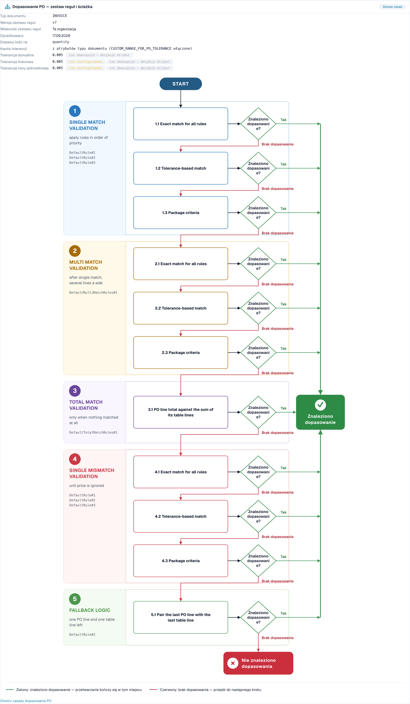

# PO Matching Diagnosis

<!-- touchless-admin-video-v2-20261104:start -->
**Rozdział wideo (wersja do przeglądu):** [Śledzenie dokumentu](https://docbits-videos.fra1.cdn.digitaloceanspaces.com/settings-assistant/touchless-intelligence-preview-admin/v2/en.html#chapter=07).
<!-- touchless-admin-video-v2-20261104:end -->

## Przegląd

Wiele faktur zatrzymuje się na zamówieniu zakupu. Faktura mówi jedno, zamówienie zakupu (PO) mówi co innego, a skonfigurowane kontrole nie potrafią same rozstrzygnąć różnicy. **Poprawna ekstrakcja wciąż może prowadzić do zablokowanego dopasowania PO, gdy dane systemu źródłowego się różnią.** Chwilowe zatrzymanie nie jest jeszcze ostatecznym wynikiem: późniejsze automatyczne przetwarzanie może się powieść, natomiast zapisana ręczna korekta lub ponowne uruchomienie sprawia, że zakończony sukcesem dokument nie jest touchless.

Touchless Intelligence pokazuje, **dlaczego** dopasowanie PO się nie powiodło i **jak** DocBits próbował dopasować. Ta strona objaśnia dwa etapy potoku, których to dotyczy, przyczyny, które zobaczysz, oraz **schemat decyzyjny dopasowania PO** — diagram pokazujący kroki dopasowania po kolei.

### Gdzie w Touchless Intelligence widzisz dopasowanie PO

| Gdzie                                                                                       | Co widzisz                                                                                                                                                                      |
| ------------------------------------------------------------------------------------------- | ------------------------------------------------------------------------------------------------------------------------------------------------------------------------------- |
| **Where touchless is lost first** (zakładka przeglądu)                                      | Słupek taki jak _PO line match: PO item mismatch_. Mówi, ile dokumentów się tam zatrzymało                                                                                  |
| **Supplier opportunities**                                                                  | Dostawca z główną przyczyną **PO matching**                                                                                                                                     |
| **Supplier Diagnosis**, sekcja **How this organisation matches** oraz **klaster problemów** | Schemat decyzyjny z zestawem reguł Twojej organizacji                                                                                                                          |
| **Document Trace**                                                                          | Etap **PO Line Match** ze statusem **blocked** i przyczyną                                                                                                                      |
| **Settings → Document Types → More Settings → Purchase Order**                              | Same reguły dopasowania. Zobacz [Purchase Order Matching Rules](../../settings/global-settings/document-types/more-settings/purchase-order/purchase-order-matching-rules.md) |

## Dwa etapy PO

| Etap                   | Pytanie                                        | Zatrzymuje się na                                                                                                     |
| ---------------------- | ---------------------------------------------- | --------------------------------------------------------------------------------------------------------------------- |
| **9 · PO Lookup**      | Czy istnieje zamówienie zakupu dla tej faktury? | _Purchase order not found_                                                                                            |
| **10 · PO Line Match** | Czy każda pozycja faktury pasuje do pozycji PO? | _PO item mismatch_, _PO line identifier mismatch_, _Unit price outside PO tolerance_, _Quantity outside PO tolerance_ |

Dokument, który zatrzymuje się na etapie 9 lub 10, pojawia się w kolejce dostawców z pierwszym blokerem **PO matching**.

## Przyczyny nieudanego dopasowania PO

| Przyczyna, którą widzisz             | Co oznacza                                                                                                 | Typowa przyczyna                                                                                          | Co zmienić                                                                                                                                                           |
| ------------------------------------ | ---------------------------------------------------------------------------------------------------------- | --------------------------------------------------------------------------------------------------------- | -------------------------------------------------------------------------------------------------------------------------------------------------------------------- |
| **Purchase order not found**         | DocBits nie znalazł żadnego zamówienia zakupu dla numeru PO z faktury                                      | Numer PO jest odczytany błędnie lub go brakuje; PO nie zostało jeszcze zaimportowane; PO należy do innego dostawcy | Sprawdź ekstrakcję numeru PO dla tego dostawcy, import danych podstawowych PO i powiązanie z dostawcą                                                                 |
| **PO item mismatch**                 | Pozycje faktury nie pasują do pozycji PO                                                                   | Dostawca używa własnych numerów artykułów; opis się różni; pozycje zostały scalone lub rozdzielone        | Sprawdź mapowanie numerów artykułów i **priorytety reguł** w regułach dopasowania; dodaj regułę dla sposobu identyfikacji pozycji przez dostawcę                       |
| **PO line identifier mismatch**      | Numer pozycji lub identyfikator na fakturze nie zgadza się z PO                                            | Dostawca przenumerowuje pozycje                                                                            | Dopasowuj po artykule i ilości, a nie po numerze pozycji                                                                                                             |
| **Unit price outside PO tolerance**  | Cena różni się bardziej niż pozwala tolerancja                                                             | Rzeczywista zmiana ceny, różnica zaokrągleń lub inna jednostka ceny                                       | Sprawdź **Unit price tolerance** w zestawie reguł; popraw PO lub zapytaj dostawcę                                                                                   |
| **Quantity outside PO tolerance**    | Ilość różni się bardziej niż pozwala tolerancja                                                            | Dostawa częściowa, dostawa nadwyżkowa                                                                      | Sprawdź **Match quantity on** i **Quantity tolerance**                                                                                                               |
| **PO matching service error**        | Usługa dopasowania nie mogła odpowiedzieć                                                                  | Chwilowy problem techniczny                                                                                | Uruchom dokumenty ponownie; skontaktuj się z pomocą techniczną, jeśli problem się powtarza                                                                            |
| **Automatic PO export disabled**     | Ustawienie **Auto export if PO matched 100%** jest wyłączone, więc dopasowane dokumenty nie są eksportowane automatycznie | Ustawienie jest wyłączone                                                                       | Włącz ustawienie, jeśli chcesz automatycznego eksportu. Zobacz [Auto Export if PO Matched 100%](../../settings/document-processing/module/auto-export-if-po-matched-100.md) |


Nie każdą przyczynę nieudanego dopasowania PO można naprawić w DocBits. Jeśli dostawca przysyła błędny numer PO, karta pokazuje **Supplier action only**: dostawca musi poprawić dokument i wysłać go ponownie.


Osobne przypadki dotyczące ceny i ilości oraz ich dowody znajdziesz w [Przykładach obliczeń](touchless-examples.md).

## Schemat decyzyjny dopasowania PO

Schemat decyzyjny pokazuje, jak DocBits próbuje dopasować pozycję faktury do pozycji PO. Ma **pięć etapów**, a wygrywa pierwsze dopasowanie:

1. **Single match validation**: reguły są stosowane w kolejności priorytetów. To zwykły przypadek, jedna pozycja faktury i jedna pozycja PO
2. **Multi match validation**: po dopasowaniu pojedynczym, gdy po jednej stronie występuje kilka pozycji
3. **Total match validation**: tylko wtedy, gdy nic nie zostało dopasowane. Suma pozycji PO jest porównywana z sumą jej pozycji tabeli
4. **Single mismatch validation**: cena jednostkowa jest pomijana, więc pozycję można dopasować po artykule i ilości, nawet jeśli cena się różni
5. **Fallback logic**: zostaje jedna pozycja PO i jedna pozycja tabeli, więc są łączone w parę

Wewnątrz etapów DocBits próbuje w tej kolejności:

* **Exact match for all rules**: każda porównywana wartość jest identyczna
* **Tolerance-based match**: wartości liczbowe mogą się różnić w granicach tolerancji
* **Package criteria**: ostatnie przejście, oparte na kryteriach powiązanych z paczką z zestawu reguł

Każdy krok pyta **Match found?** Odpowiedź **Yes** (zielona) prowadzi do **Match found** i dokument idzie dalej. Odpowiedź **No match** (czerwona) przechodzi do następnego kroku, a po ostatnim kroku wynik to **No match found**: dokument się zatrzymuje i potrzebuje człowieka.

<figure><figcaption>
Schemat decyzyjny dopasowania PO, otwierany z sekcji <strong>How this organisation matches</strong> na stronie Supplier Diagnosis. Nagłówek pokazuje zestaw reguł (wersja 7, należący do tej organizacji) oraz tolerancje. Poniżej, od góry do dołu, pięć etapów z ich przejściami. Zielony prowadzi do <strong>Match found</strong>, czerwony przechodzi do następnego kroku i kończy się w <strong>No match found</strong>. Organizacja przykładowa z danymi demonstracyjnymi.
</figcaption></figure>

### Co mówi nagłówek diagramu

| Pole                                              | Znaczenie                                                                                              |
| ------------------------------------------------- | ------------------------------------------------------------------------------------------------------ |
| **Document type**                                 | Typ dokumentu, do którego należy zestaw reguł, na przykład INVOICE                                      |
| **Rule set version**                              | Wersja reguł dopasowania, na przykład v3                                                               |
| **Rule set owner**                                | **This organisation** (Twoje własne reguły) lub **Shipped default rule set** (standardowe reguły DocBits) |
| **Published**                                     | Kiedy wersja została opublikowana                                                                      |
| **Match quantity on**                             | Która ilość jest porównywana (ilość zamówiona, ilość otwarta)                                          |
| **Tolerance amount**                              | Czy tolerancje pochodzą z atrybutów typu dokumentu, czy z zestawu reguł                                |
| **Unit price tolerance** / **Quantity tolerance** | O ile może różnić się cena lub ilość                                                                   |
| **Default tolerance**                             | Tolerancja dla wszystkich pozostałych wartości liczbowych                                              |

W powyższym przykładzie tolerancje pokazują **not configured** oraz **not in force: attribute decides**. To znaczy: sam zestaw reguł nie ma własnej tolerancji, a wiersz **Tolerance amount** mówi, że tolerancje pochodzą z **atrybutów typu dokumentu**. Tolerancja decyduje tylko wtedy, gdy obowiązuje. Czytaj ten wiersz jako pierwszy, gdy różnica ceny lub ilości blokuje dokumenty: mówi, **gdzie** zmienić tolerancję.

Stan zestawu reguł jest pokazany jako notatka: **Active version** (te reguły decydują), **Approved, not active**, **Draft, not yet in force** lub **Version state unknown**. Decyduje tylko wersja aktywna.

Jeśli reguły transformacji zmieniły dokument przed dopasowaniem, diagram to sygnalizuje, na przykład _2 applied: (nazwy)_ lub _„(reguła)” rebuilt (table): the PO match was lost here_. To częsta ukryta przyczyna: reguła, która przeformatowuje tabelę, może zepsuć dopasowanie, które wcześniej działało.

## Przykłady

Liczby w przykładach są poglądowe.

### Przykład 1: cena w granicach tolerancji

Pozycja faktury ma cenę jednostkową **10.40**. Pozycja PO podaje **10.00**. Tolerancja ceny jednostkowej wynosi **5 %**.

* **Exact match** się nie udaje (10.40 to nie 10.00).
* **Tolerance-based match** się udaje: różnica wynosi **4 %**, czyli mieści się w 5 %.
* Pozycja jest dopasowana. **Match found.**

Przy tolerancji **3 %** również dopasowanie oparte na tolerancji się nie udaje. Po wszystkich etapach dokument zatrzymuje się z **Unit price outside PO tolerance**. Diagram pokazuje dokładnie tę ścieżkę, a poprawką jest albo tolerancja (jeśli 4 % jest akceptowalne w Twojej firmie), albo korekta u dostawcy.

### Przykład 2: numery artykułów dostawcy różnią się od Twoich

Dostawca fakturuje artykuł **„A-4711-X”**, Twoje PO podaje **„4711”**. Żadna reguła nie porównuje tych dwóch wartości, więc dopasowanie nie zostaje znalezione, a Touchless Intelligence grupuje wszystkie faktury tego dostawcy w jeden klaster: **PO line match, PO item mismatch**, 27 dokumentów.

* W klastrze czytasz _27 affected, 27 recoverable_, przewidywany wzrost na przykład **+8.7 pp**.
* Poprawka jest po Twojej stronie: dodaj lub zmień kolejność reguły, która dopasowuje po numerze artykułu dostawcy albo po opisie, lub utrzymuj numery artykułów dostawcy w danych podstawowych.
* Po zmianie reguły zastosuj ją przez [change proposal](touchless-change-proposals.md) i odczytaj **Change history** dwa tygodnie później: wskaźnik AP touchless przed zmianą i po niej.

### Przykład 3: zamówienia zakupu jeszcze nie ma

Faktury przychodzą, zanim PO został zaimportowany. Zatrzymują się na **PO Lookup** z **Purchase order not found**. Klaster pokazuje krótki szczyt. Poprawką jest kolejność Twoich procesów albo harmonogram importu PO, a nie reguły dopasowania. Sprawdź **Where touchless is lost first**: słupek _PO lookup: Purchase order not found_, który rośnie po każdej luce w importach, wskazuje na tę przyczynę.

### Przykład 4: jedna reguła przebudowała tabelę

Po włączeniu reguły transformacji tabeli jednego dostawcy wskaźnik dopasowania tego dostawcy gwałtownie spadł. Diagram dotkniętego dokumentu mówi _„(reguła)” rebuilt (table): the PO match was lost here_. Poprawką jest dostosowanie lub wycofanie reguły transformacji, a nie reguł dopasowania.

## Rutyna dla problemów z dopasowaniem PO

1. Otwórz **Where touchless is lost first**. Czy któryś etap dopasowania PO jest w pierwszej trójce?
2. Otwórz **Supplier opportunities** i posortuj po **Expected lift**. Weź dostawcę z główną przyczyną **PO matching** i statusem **RECOVERABLE**.
3. Otwórz **Supplier Diagnosis** i odczytaj klaster: przyczyna, dotknięte dokumenty, **What to change**, **Missing evidence**.
4. Otwórz **How this organisation matches** i sprawdź zestaw reguł: wersja, właściciel i tolerancje.
5. Otwórz jeden **sample document** i jego [Document Trace](touchless-document-trace.md): który etap, która przyczyna?
6. Zmień **jedną** rzecz (kolejność reguł, tolerancję, mapowanie artykułów) z podglądem, aby **Change history** mogła to zmierzyć.

## Powiązane strony

* [Touchless Intelligence](./)
* [Supplier Diagnosis i klastry problemów](touchless-supplier-diagnosis.md)
* [Document Trace](touchless-document-trace.md)
* [Change Proposals i raporty](touchless-change-proposals.md)
* [Purchase Order Matching Rules](../../settings/global-settings/document-types/more-settings/purchase-order/purchase-order-matching-rules.md)
* [PO Matching Cards: Complete Guide](../../workflow/cards-overview/po-matching-complete-guide.md)

<!-- Documentation review 2026-11-04: extraction quality vs process outcomes; KPI and terminal-outcome definitions checked against DocBits_API c51f350c728acb8ac964098d15f7b006bce273f4, module/automation_intelligence/kpi.py and bucket.py. Existing native screenshots retained and checked separately from illustrative examples. -->

<!-- Completion review 2026-11-04: owned synthetic PO examples, MCP schema/read evidence, human-action classification, KPI labels and screenshot proof limits. -->
