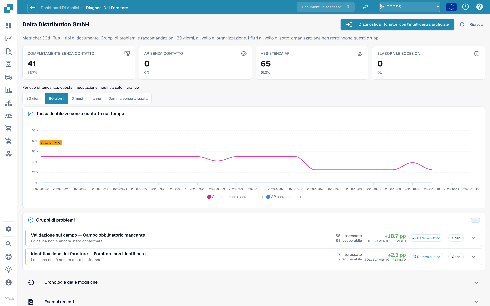
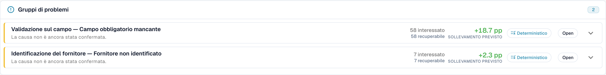

# Touchless Intelligence: Diagnosi del fornitore e cluster di problemi

<!-- touchless-admin-video-v2-20261104:start -->
**Capitolo video (versione di verifica):** [Esaminare problemi ricorrenti](https://docbits-videos.fra1.cdn.digitaloceanspaces.com/settings-assistant/touchless-intelligence-preview-admin/v2/it.html#chapter=06).
<!-- touchless-admin-video-v2-20261104:end -->

Fai clic su un fornitore nella coda per aprire la sua pagina di diagnosi.

<figure><figcaption>
La pagina Diagnosi del fornitore: riquadri degli esiti, andamento con selettore del periodo e due cluster di problemi ordinati per incremento atteso. Organizzazione di esempio con dati demo; i nomi dei fornitori sono fittizi.
</figcaption></figure>

La pagina mostra:

* **Quattro riquadri degli esiti finali**: Pure Touchless, AP Touchless, AP Assisted ed eccezione di processo; ciascuno collega i documenti.
* **L'andamento** con un proprio selettore del periodo: 30 giorni, 90 giorni, 6 mesi, 1 anno o un intervallo personalizzato (fino a due anni). Questo modifica solo il grafico.
* **Cluster di problemi** (vedi sotto).
* **Cronologia delle modifiche** (Change history): le modifiche che hai applicato per questo fornitore e cosa hanno ottenuto.
* **Esempi recenti** (Recent examples): documenti di esempio, in due schede: **Needed attention** e **Went touchless**.
* **Diagnose supplier with AI**: analizza tutti i cluster del fornitore (amministratori).

Una breve nota spiega una pagina vuota, ad esempio: *5 documenti di questo fornitore sono ancora in fase di elaborazione e non hanno ancora risultati di analisi.* oppure *Tutti i 40 documenti completati di questo fornitore sono stati eseguiti senza intervento: non c'è nulla da diagnosticare.*

### Cluster di problemi

Un **cluster** raggruppa i documenti di un fornitore che si sono fermati per lo **stesso primo motivo**. Invece di 40 problemi singoli vedi "3 problemi".

<figure><figcaption>
La scheda di un cluster aperto: il primo blocco, <strong>What to change</strong> e una <strong>Change proposal</strong> con rischio, ambito e domande aperte. Qui il cluster riguarda 58 documenti e vale +18,7 pp. Organizzazione di esempio con dati demo; i nomi dei fornitori sono fittizi.
</figcaption></figure>

**Esempio di cluster (illustrativo).**

* **Headline**: *Required field missing* alla fase *Field Validation*
* **Affected**: 28 documenti. **Recoverable**: 28 documenti. **Expected lift**: +2,8 pp
* **Suspected cause**: il fornitore stampa il numero d'ordine sotto la tabella, dove l'estrazione non cerca
* **What to check next**: confrontate numero d’ordine stampato ed estratto, poi la configurazione di estrazione prima di proporre modifiche
* **Owner**: Consultant. **Confidence**: Medium. **Source**: Hypothesis

Cosa mostra la scheda di un cluster:

| Parte | Significato |
| --- | --- |
| **First blocker** e **stage** | Il motivo e la fase della pipeline in cui i documenti si fermano. I motivi sono più di 30, ad esempio *Supplier not identified*, *Purchase order not found*, *Unit price outside PO tolerance*, *Rejected by the ERP*, *E-invoice validation failed* |
| **Affected / Recoverable / Expected lift** | Quanti documenti, quanti si possono recuperare, quanti punti percentuali si otterrebbero |
| **Suspected cause / Confirmed cause** | Cosa ritiene DocBits (o cosa ha confermato una persona) essere il motivo |
| **Evidence** e **Missing evidence** | Su cosa si basa il risultato e cosa DocBits **non** ha potuto stabilire. Leggi le **Missing evidence** prima di fidarti del resto |
| **What to change** | Passi concreti con link **Open** alle impostazioni. Un'etichetta indica il tipo: *Configuration change*, *Master data change*, *Supplier template change*, *Process change*, *Supplier action needed*, *Not fixable* |
| **Owner** | DocBits, Cliente, Consulente, Fornitore o Non assegnato |
| **Sample documents** | Documenti reali del cluster da guardare |

**Fixable in DocBits** e **Supplier action only** sono mostrati in due gruppi. Per *Supplier action only* nulla in DocBits cambia il risultato: il fornitore deve correggere il documento e inviarlo di nuovo.

### Da dove nasce una raccomandazione

Ogni causa mostra la sua **source**, così puoi distinguere un risultato derivato da un'ipotesi:

| Fonte | Significato |
| --- | --- |
| **Deterministic** / **Rule-based** | Una regola l'ha derivata dalle prove registrate nella pipeline. Non è stato coinvolto alcun modello linguistico |
| **Hypothesis** | Un modello linguistico l'ha proposta a partire dalle prove del cluster. Consideralo uno spunto e verificalo prima di agire |
| **Confirmed** | Una persona ha esaminato le prove e ha confermato la causa |

I testi dell'IA sono scritti nella lingua della tua organizzazione. Se un cluster è stato analizzato in un'altra lingua, usa **Analyse in this language**.

## Cluster di abbinamento ordini

Se il primo blocco di un cluster è un motivo di abbinamento ordini (ad esempio *PO item mismatch* o *Purchase order not found*), la scheda del cluster mostra come DocBits cerca di abbinare la fattura all'ordine d'acquisto. Vedi [Diagnosi dell'abbinamento ordini](touchless-po-matching-diagnosis.md).

## Chi deve correggere i dati?

| Evidenza | Dove intervenire |
| --- | --- |
| Originale ed estrazione differiscono | Estrazione o configurazione del fornitore |
| Estrazione corretta, prezzo/quantità/unità Infor confermati errati | Fonte; AP coordina acquisti o responsabili delle anagrafiche |
| Infor corretto, copia importata vecchia o incompleta | Importazione o integrazione ERP |
| Valori diversi ma accordo non ancora noto | Chiarimento aziendale; causa non confermata |

Il riquadro AP del fornitore conta sola approvazione; il tasso AP in intestazione include anche Pure. Registrate rimedio immediato e correzione duratura: un piccolo intervento può terminare la fattura senza eliminare la causa ricorrente. Un cluster da solo non dimostra il contenuto storico di Infor. Vedi [l'esempio pratico su Infor](touchless-po-matching-diagnosis.md#worked-example-correct-extraction-different-infor-data).

Strumenti e classificazione delle azioni umane sono spiegati in [Touchless con MCP](touchless-mcp.md).

## Pagine correlate

* [Touchless Intelligence](../../touchless-intelligence.md)
* [Diagnosi dell'abbinamento ordini](touchless-po-matching-diagnosis.md)
* [Tracciamento del documento](touchless-document-trace.md)
* [Proposte di modifica e report](touchless-change-proposals.md)

<!-- Documentation review 2026-11-04: extraction quality vs process outcomes; KPI and terminal-outcome definitions checked against DocBits_API c51f350c728acb8ac964098d15f7b006bce273f4, module/automation_intelligence/kpi.py and bucket.py. Existing native screenshots retained and checked separately from illustrative examples. -->

<!-- Completion review 2026-11-04: owned synthetic PO examples, MCP schema/read evidence, human-action classification, KPI labels and screenshot proof limits. -->
