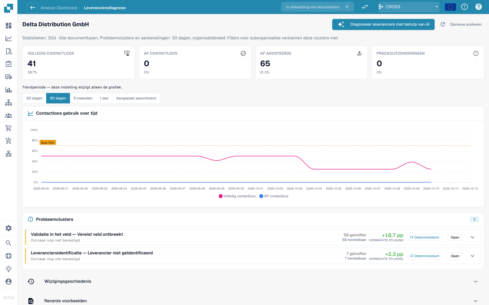
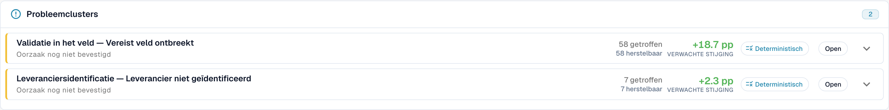

# Touchless Intelligence: Leveranciersdiagnose en probleemclusters

<!-- touchless-admin-video-v2-20261104:start -->
**Videohoofdstuk (controleversie):** [Terugkerende problemen onderzoeken](https://docbits-videos.fra1.cdn.digitaloceanspaces.com/settings-assistant/touchless-intelligence-preview-admin/v2/nl.html#chapter=06).
<!-- touchless-admin-video-v2-20261104:end -->

Klik op een leverancier in de wachtrij om de diagnosepagina te openen.

<figure><figcaption>
De pagina Leveranciersdiagnose: uitkomsttegels, trend met periodekiezer en twee probleemclusters, gesorteerd op verwachte stijging. Voorbeeldorganisatie met demogegevens; de namen van leveranciers zijn fictief.
</figcaption></figure>

De pagina toont:

* **Vier tegels met eindresultaten**: Pure Touchless, AP Touchless, AP Assisted en procesuitzondering; elke tegel opent de documenten.
* **De trend** met een eigen periodekiezer: 30 dagen, 90 dagen, 6 maanden, 1 jaar of een zelfgekozen bereik (tot twee jaar). Dit wijzigt alleen de grafiek.
* **Probleemclusters** (zie hieronder).
* **Wijzigingsgeschiedenis** (Change history): de wijzigingen die u voor deze leverancier hebt toegepast en wat ze hebben gedaan.
* **Recente voorbeelden** (Recent examples): voorbeelddocumenten, in twee tabbladen: **Aandacht nodig** (Needed attention) en **Werd touchless** (Went touchless).
* **Leverancier diagnosticeren met AI** (Diagnose supplier with AI): analyseert alle clusters van de leverancier (beheerders).

Een korte opmerking verklaart een lege pagina, bijvoorbeeld: *5 documenten van deze leverancier worden nog verwerkt en hebben nog geen analyseresultaat.* of *Alle 40 voltooide documenten van deze leverancier liepen touchless door: er valt niets te diagnosticeren.*

### Probleemclusters

Een **cluster** groepeert de documenten van één leverancier die om dezelfde **eerste reden** stopten. In plaats van 40 afzonderlijke problemen ziet u "3 problemen".

<figure><figcaption>
Een geopende clusterkaart: de eerste blokkade, <strong>Wat te wijzigen</strong> en een <strong>Wijzigingsvoorstel</strong> met risico, bereik en open vragen. Hier omvat het cluster 58 documenten en is het +18,7 pp waard. Voorbeeldorganisatie met demogegevens; de namen van leveranciers zijn fictief.
</figcaption></figure>

**Voorbeeldcluster (illustratief).**

* **Kop**: *Required field missing* (verplicht veld ontbreekt) in fase *Field Validation* (veldvalidatie)
* **Getroffen**: 28 documenten. **Herstelbaar**: 28 documenten. **Verwachte stijging**: +2,8 pp
* **Vermoedelijke oorzaak**: de leverancier drukt het PO-nummer onder de tabel af, waar de extractie niet kijkt
* **Volgende controle**: vergelijk het gedrukte en uitgelezen ordernummer en daarna de extractieconfiguratie voordat u een wijziging voorstelt
* **Eigenaar**: Consultant. **Betrouwbaarheid**: Gemiddeld. **Bron**: Hypothese

Wat een clusterkaart toont:

| Onderdeel | Betekenis |
| --- | --- |
| **Eerste blokkade** en **fase** | De reden en de pipelinefase waar de documenten stoppen. Er zijn meer dan 30 redenen, bijvoorbeeld *Supplier not identified* (leverancier niet geïdentificeerd), *Purchase order not found* (inkooporder niet gevonden), *Unit price outside PO tolerance* (stukprijs buiten PO-tolerantie), *Rejected by the ERP* (afgewezen door het ERP), *E-invoice validation failed* (validatie van de e-factuur mislukt) |
| **Getroffen / Herstelbaar / Verwachte stijging** | Hoeveel documenten, hoeveel er kunnen worden teruggewonnen, hoeveel procentpunten dat oplevert |
| **Vermoedelijke oorzaak / Bevestigde oorzaak** | Wat DocBits denkt (of wat een persoon heeft bevestigd) dat de reden is |
| **Bewijs** en **Ontbrekend bewijs** | Waarop de bevinding is gebaseerd, en wat DocBits **niet** kon vaststellen. Lees **Ontbrekend bewijs** voordat u de rest vertrouwt |
| **Wat te wijzigen** | Concrete stappen met **Openen**-links naar de instellingen. Een label geeft het type aan: *Configuratiewijziging*, *Wijziging van stamgegevens*, *Wijziging van leverancierssjabloon*, *Procesaanpassing*, *Actie van leverancier nodig*, *Niet op te lossen* |
| **Eigenaar** | DocBits, Klant, Consultant, Leverancier of Niet toegewezen |
| **Voorbeelddocumenten** | Echte documenten uit het cluster om te bekijken |

**In DocBits op te lossen** en **Alleen actie van leverancier** worden in twee groepen getoond. Bij *Alleen actie van leverancier* verandert niets in DocBits het resultaat: de leverancier moet het document corrigeren en opnieuw sturen.

### Waar komt een aanbeveling vandaan

Elke oorzaak toont zijn **bron**, zodat u een afgeleide bevinding van een gok kunt onderscheiden:

| Bron | Betekenis |
| --- | --- |
| **Deterministisch** / **Regelgebaseerd** | Een regel heeft het afgeleid uit het vastgelegde pipelinebewijs. Er was geen taalmodel bij betrokken |
| **Hypothese** | Een taalmodel heeft het voorgesteld op basis van het clusterbewijs. Beschouw het als een aanwijzing en controleer het voordat u handelt |
| **Bevestigd** | Een persoon heeft het bewijs beoordeeld en de oorzaak bevestigd |

AI-teksten worden geschreven in de taal van uw organisatie. Als een cluster in een andere taal is geanalyseerd, gebruikt u **Analyseren in deze taal** (Analyse in this language).

## PO-matchingclusters

Als de eerste blokkade van een cluster een reden voor PO-matching is (bijvoorbeeld *PO item mismatch* of *Purchase order not found*), toont de clusterkaart hoe DocBits probeert de factuur aan de inkooporder te koppelen. Zie [PO-matchingdiagnose](touchless-po-matching-diagnosis.md).

## Wie corrigeert de gegevens?

| Bewijs | Waar onderzoeken of oplossen? |
| --- | --- |
| Origineel en extractie verschillen | Extractie of leveranciersconfiguratie |
| Extractie correct, Infor-prijs/hoeveelheid/eenheid aantoonbaar onjuist | Bron; AP stemt af met inkoop of stamdatabeheer |
| Infor correct, importkopie oud of onvolledig | Import of ERP-integratie |
| Waarden verschillen, afspraak nog onbekend | Inhoudelijke afstemming; oorzaak niet bevestigd |

De AP-tegel bij de leverancier telt alleen goedkeuring; het AP-koppercentage omvat ook Pure. Leg de directe actie en blijvende oplossing apart vast. Een kleine ingreep kan de factuur afronden terwijl de terugkerende oorzaak blijft bestaan. Eén cluster bewijst de historische inhoud van Infor niet. Zie het [uitgewerkte Infor-voorbeeld](touchless-po-matching-diagnosis.md#worked-example-correct-extraction-different-infor-data).

Tools en menselijke acties worden uitgelegd bij [Touchless met MCP](touchless-mcp.md).

## Gerelateerde pagina's

* [Touchless Intelligence](../../touchless-intelligence.md)
* [PO-matchingdiagnose](touchless-po-matching-diagnosis.md)
* [Documentspoor](touchless-document-trace.md)
* [Wijzigingsvoorstellen en rapporten](touchless-change-proposals.md)

<!-- Documentation review 2026-11-04: extraction quality vs process outcomes; KPI and terminal-outcome definitions checked against DocBits_API c51f350c728acb8ac964098d15f7b006bce273f4, module/automation_intelligence/kpi.py and bucket.py. Existing native screenshots retained and checked separately from illustrative examples. -->

<!-- Completion review 2026-11-04: owned synthetic PO examples, MCP schema/read evidence, human-action classification, KPI labels and screenshot proof limits. -->
