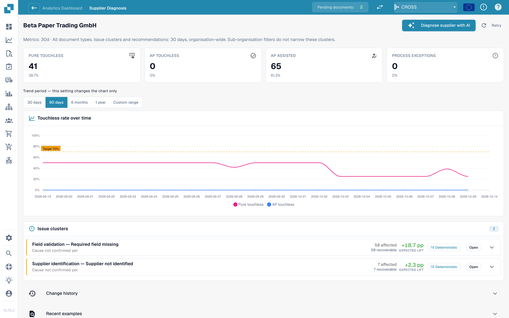
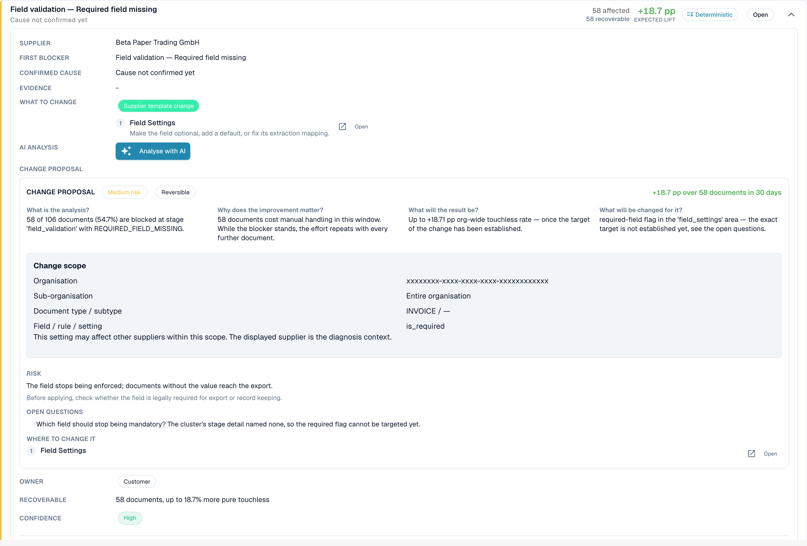

# 供应商诊断与问题集群

<!-- touchless-admin-video-v2-20261104:start -->
**视频章节（审核版）:** [调查重复问题](https://docbits-videos.fra1.cdn.digitaloceanspaces.com/settings-assistant/touchless-intelligence-preview-admin/v2/zh.html#chapter=06).
<!-- touchless-admin-video-v2-20261104:end -->

点击队列中的供应商即可打开其诊断页面。

<figure><figcaption>
供应商诊断页面：结果卡片、带时间范围选择器的趋势，以及按预期提升幅度排序的两个问题集群。示例组织使用演示数据；供应商名称为虚构。
</figcaption></figure>

页面显示：

* **四个最终结果卡片** ：Pure Touchless、AP Touchless、AP assisted、流程异常；均可打开对应文档。
* **趋势图** 及其独立的时间范围选择器：30 天、90 天、6 个月、1 年或自定义范围（最长两年）。这只会更改图表。
* **问题集群** （见下文）。
* **变更历史** ：你为该供应商应用的变更及其影响。
* **近期示例** ：示例文档分为两个选项卡： **Needed attention** 和 **Went touchless** 。
* **Diagnose supplier with AI** ：分析该供应商的所有集群（管理员）。

简短说明会解释页面为空的原因，例如： _该供应商的 5 份文档仍在处理中，尚无分析结果。_ 或 _该供应商已完成的 40 份文档均实现了自动处理：没有需要诊断的问题。_

### 问题集群

 **集群** 会将某个供应商因 **相同的首要原因** 而停止处理的文档归为一组。你看到的是“3 个问题”，而不是 40 个单独的问题。

<figure><figcaption>
已打开的问题集群卡片：首个阻碍因素、<strong>What to change</strong> 和带有风险、范围及未决问题的 <strong>Change proposal</strong>。此处该集群涉及 58 份文档，价值 +18.7 pp。示例组织使用演示数据；供应商名称为虚构。
</figcaption></figure>

 **集群示例（仅供说明）。**

* **Headline** ：阶段 _Field Validation_ 中的 _Required field missing_
* **Affected** ：28 份文档。 **Recoverable** ：28 份文档。 **Expected lift** ：+2.8 个百分点
* **Suspected cause** ：供应商将采购订单编号打印在表格下方，提取时不会查看该位置
* **What to check next** ：先比较原件及提取的订单号，再检查提取配置后提出修改
* **Owner** ：Consultant。 **Confidence** ：Medium。 **Source** ：Hypothesis

集群卡片显示的内容：

| 部分 | 含义 |
| ------------------------------------------ | ------------------------------------------------------------------------------------------------------------------------------------------------------------------------------------------------------------------------------------------------------ |
| **First blocker** 和 **stage** | 文档停止处理的原因及其所在的流水线阶段。原因超过 30 种，例如 _Supplier not identified_ 、 _Purchase order not found_ 、 _Unit price outside PO tolerance_ 、 _Rejected by the ERP_ 、 _E-invoice validation failed_ |
| **Affected / Recoverable / Expected lift** | 受影响的文档数量、能够挽回的文档数量，以及可带来的百分点提升幅度 |
| **Suspected cause / Confirmed cause** | DocBits 推测的原因（或人员确认的原因） |
| **Evidence** 和 **Missing evidence** | 该发现的依据，以及 DocBits **无法** 确认的内容。请先阅读 **Missing evidence** ，再决定是否采信其余内容 |
| **What to change** | 具体步骤及指向相关设置的 **Open** 链接。标签会说明类型： _Configuration change_ 、 _Master data change_ 、 _Supplier template change_ 、 _Process change_ 、 _Supplier action needed_ 、 _Not fixable_ |
| **Owner** | DocBits、Customer、Consultant、Supplier 或 Unassigned |
| **Sample documents** | 可供查看的集群实际文档 |

 **Fixable in DocBits** 和 **Supplier action only** 会分组显示。对于标为 _Supplier action only_ 的情况，应先核实外部文档问题及证据，再联系供应商更正或补发；该分类不是对所有配置变更效果的绝对保证。

### 建议的来源

每个原因都会显示其 **source** ，以便你区分推导出的发现和猜测：

| 来源 | 含义 |
| ---------------------------------- | ------------------------------------------------------------------------------------------------------ |
| **Deterministic** / **Rule-based** | 根据记录的流水线证据推导出的规则。未使用语言模型 |
| **Hypothesis** | 语言模型根据集群证据提出的建议。请将其视为线索，并在采取行动前核实 |
| **Confirmed** | 人员审查证据后确认了原因 |

已有分析可能使用生成时的语言，不会因为切换界面语言就自动重写。先检查来源与缺失证据；具备权限且确有需要时，可使用 **Analyse in this language** 重新生成。本次检查只查看已有结果，没有触发该操作。

## 采购订单匹配集群

如果集群的首要阻碍因素属于采购订单匹配原因（例如 _采购订单行项目不匹配_ 或 _Purchase order not found_ ），集群卡片会显示 DocBits 如何尝试将发票与采购订单匹配。请参阅[采购订单匹配诊断](touchless-po-matching-diagnosis.md)。

## 应由谁修复数据？

| 证据 | 应处理的位置 |
| --- | --- |
| 原件与提取不同 | 提取或供应商配置 |
| 提取正确，已确认 Infor 价格、数量或单位错误 | 源系统；AP 协调采购或主数据负责人 |
| Infor 正确，导入副本旧或不完整 | 导入或 ERP 集成 |
| 值不同但约定不清楚 | 业务澄清；原因未确认 |

供应商 AP 类别仅为审批，顶部 AP 综合率还包括 Pure。区分解决当前发票与长期修复：小操作能完成发票，但未必消除重复原因。单个集群并不能证明 Infor 的历史内容。参见 [Infor 示例](touchless-po-matching-diagnosis.md#worked-example-correct-extraction-different-infor-data)。

工具及人工操作分类见[Touchless 与 MCP](touchless-mcp.md)。

## 相关页面

* [自动处理智能分析](./)
* [采购订单匹配诊断](touchless-po-matching-diagnosis.md)
* [文档追踪](touchless-document-trace.md)
* [变更提案与报告](touchless-change-proposals.md)

<!-- Documentation review 2026-11-04: extraction quality vs process outcomes; KPI and terminal-outcome definitions checked against DocBits_API c51f350c728acb8ac964098d15f7b006bce273f4, module/automation_intelligence/kpi.py and bucket.py. Existing native screenshots retained and checked separately from illustrative examples. -->

<!-- Completion review 2026-11-04: owned synthetic PO examples, MCP schema/read evidence, human-action classification, KPI labels and screenshot proof limits. -->
