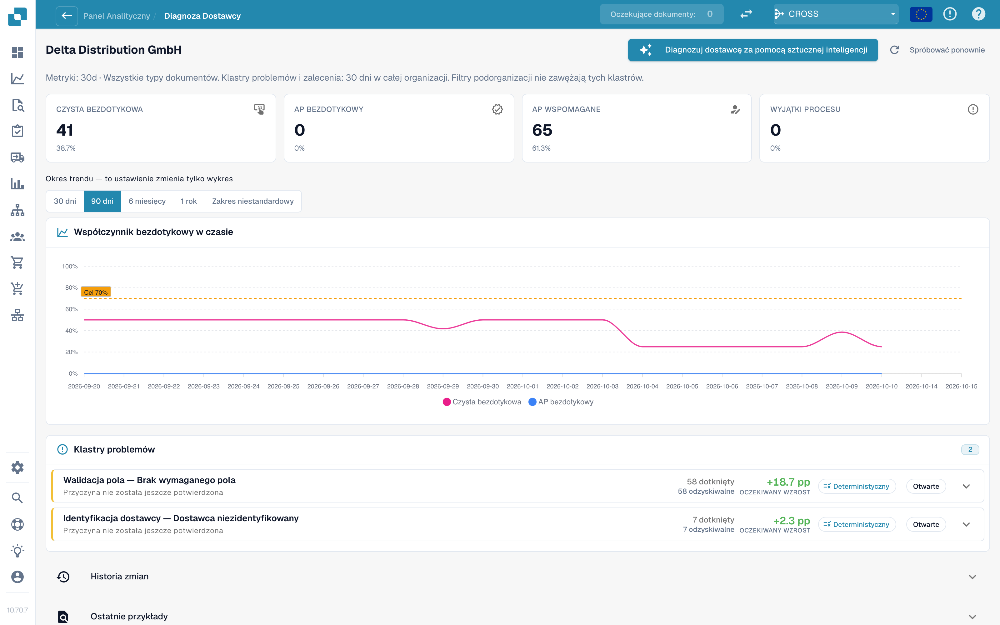
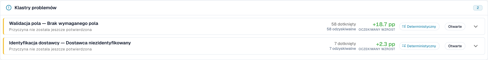

# Touchless Intelligence: Diagnoza dostawcy i klastry problemów

<!-- touchless-admin-video-v2-20261104:start -->
**Rozdział filmu (wersja do oceny):** [Badanie powtarzalnych problemów](https://docbits-videos.fra1.cdn.digitaloceanspaces.com/settings-assistant/touchless-intelligence-preview-admin/v2/pl.html#chapter=06).
<!-- touchless-admin-video-v2-20261104:end -->

Kliknij dostawcę w kolejce, aby otworzyć stronę jego diagnozy.

<figure><figcaption>
Strona Diagnoza dostawcy (Supplier Diagnosis): kafelki wyników, trend z wyborem okresu i dwa klastry problemów uporządkowane według oczekiwanego wzrostu. Przykładowa organizacja z danymi demonstracyjnymi; nazwy dostawców są fikcyjne.
</figcaption></figure>

Strona pokazuje:

* **Cztery kafelki wyników końcowych**: Pure Touchless, AP Touchless, AP assisted i wyjątek procesu; każdy otwiera dokumenty.
* **Trend** z własnym wyborem okresu: 30 dni, 90 dni, 6 miesięcy, 1 rok lub zakres niestandardowy (do dwóch lat). Zmienia to tylko wykres.
* **Klastry problemów** (patrz niżej).
* **Historia zmian** (Change history): zmiany zastosowane dla tego dostawcy i ich efekt.
* **Ostatnie przykłady** (Recent examples): przykładowe dokumenty w dwóch kartach: **Needed attention** i **Went touchless**.
* **Diagnose supplier with AI**: analizuje wszystkie klastry dostawcy (administratorzy).

Krótka notatka wyjaśnia pustą stronę, na przykład: *5 dokumentów tego dostawcy jest jeszcze przetwarzanych i nie ma jeszcze wyniku analizy* lub *Wszystkie 40 zakończonych dokumentów tego dostawcy przeszło touchless: nie ma czego diagnozować.*

### Klastry problemów

**Klaster** (cluster) grupuje dokumenty jednego dostawcy, które zatrzymały się z **tego samego pierwszego powodu**. Zamiast 40 pojedynczych problemów widzisz „3 problemy".

<figure><figcaption>
Otwarta karta klastra: pierwsza blokada, <strong>What to change</strong> i <strong>Change proposal</strong> z ryzykiem, zakresem i otwartymi pytaniami. Tutaj klaster obejmuje 58 dokumentów i jest wart +18,7 pp. Przykładowa organizacja z danymi demonstracyjnymi; nazwy dostawców są fikcyjne.
</figcaption></figure>

**Przykładowy klaster (poglądowy).**

* **Headline**: *Required field missing* na etapie *Field Validation*
* **Affected**: 28 dokumentów. **Recoverable**: 28 dokumentów. **Expected lift**: +2,8 pp
* **Suspected cause**: dostawca drukuje numer PO pod tabelą, gdzie ekstrakcja nie szuka
* **What to check next**: porównaj numer zamówienia na oryginale i w odczycie, następnie konfigurację ekstrakcji przed proponowaniem zmian
* **Owner**: Consultant. **Confidence**: Medium. **Source**: Hypothesis

Co pokazuje karta klastra:

| Część | Znaczenie |
| --- | --- |
| **First blocker** i **stage** | Powód i etap potoku, na którym dokumenty się zatrzymują. Powodów jest ponad 30, na przykład *Supplier not identified*, *Purchase order not found*, *Unit price outside PO tolerance*, *Rejected by the ERP*, *E-invoice validation failed* |
| **Affected / Recoverable / Expected lift** | Ile dokumentów, ile można odzyskać, ile punktów procentowych by to dało |
| **Suspected cause / Confirmed cause** | Co według DocBits (lub według człowieka, który to potwierdził) jest powodem |
| **Evidence** i **Missing evidence** | Na czym opiera się ustalenie i czego DocBits **nie** mógł ustalić. Przeczytaj **Missing evidence**, zanim zaufasz reszcie |
| **What to change** | Konkretne kroki z linkami **Open** do ustawień. Etykieta podaje rodzaj: *Configuration change*, *Master data change*, *Supplier template change*, *Process change*, *Supplier action needed*, *Not fixable* |
| **Owner** | DocBits, Customer, Consultant, Supplier or Unassigned |
| **Sample documents** | Prawdziwe dokumenty klastra do obejrzenia |

**Fixable in DocBits** i **Supplier action only** są pokazane w dwóch grupach. W przypadku *Supplier action only* nic w DocBits nie zmienia wyniku: dostawca musi poprawić dokument i wysłać go ponownie.

### Skąd pochodzi rekomendacja

Każda przyczyna pokazuje swoje **source**, dzięki czemu odróżnisz ustalenie wyprowadzone od domysłu:

| Źródło | Znaczenie |
| --- | --- |
| **Deterministic** / **Rule-based** | Wyprowadziła je reguła z zarejestrowanych dowodów potoku. Nie użyto modelu językowego |
| **Hypothesis** | Zaproponował ją model językowy na podstawie dowodów klastra. Traktuj ją jako trop i sprawdź, zanim zadziałasz |
| **Confirmed** | Człowiek przejrzał dowody i potwierdził przyczynę |

Teksty AI są pisane w języku Twojej organizacji. Jeśli klaster został przeanalizowany w innym języku, użyj **Analyse in this language**.

## Klastry dopasowania PO

Jeśli pierwszą blokadą klastra jest powód związany z dopasowaniem PO (na przykład *Niezgodność pozycji PO* lub *Purchase order not found*), karta klastra pokazuje, jak DocBits próbuje dopasować fakturę do zamówienia zakupu. Zobacz [Diagnoza dopasowania PO](touchless-po-matching-diagnosis.md).

## Kto powinien poprawić dane?

| Dowód | Miejsce działania |
| --- | --- |
| Oryginał różni się od odczytu | Ekstrakcja lub konfiguracja dostawcy |
| Odczyt poprawny, potwierdzony błąd ceny/ilości/jednostki Infor | Źródło; AP koordynuje zakupy lub właściciela danych |
| Infor poprawny, importowana kopia stara/niepełna | Import lub integracja ERP |
| Różne wartości, uzgodnienie nieznane | Wyjaśnienie biznesowe; przyczyna niepotwierdzona |

Kategoria AP dostawcy to samo zatwierdzenie, a łączny AP obejmuje też Pure. Oddziel doraźne zakończenie faktury od trwałego usunięcia przyczyny. Sam klaster nie dowodzi historycznej zawartości Infor. Zobacz [przykład praktyczny dla Infor](touchless-po-matching-diagnosis.md#worked-example-correct-extraction-different-infor-data).

Narzędzia i klasyfikację działań opisuje [Touchless przez MCP](touchless-mcp.md).

## Powiązane strony

* [Touchless Intelligence](../../touchless-intelligence.md)
* [Diagnoza dopasowania PO](touchless-po-matching-diagnosis.md)
* [Ślad dokumentu](touchless-document-trace.md)
* [Propozycje zmian i raporty](touchless-change-proposals.md)

<!-- Documentation review 2026-11-04: extraction quality vs process outcomes; KPI and terminal-outcome definitions checked against DocBits_API c51f350c728acb8ac964098d15f7b006bce273f4, module/automation_intelligence/kpi.py and bucket.py. Existing native screenshots retained and checked separately from illustrative examples. -->

<!-- Completion review 2026-11-04: owned synthetic PO examples, MCP schema/read evidence, human-action classification, KPI labels and screenshot proof limits. -->
