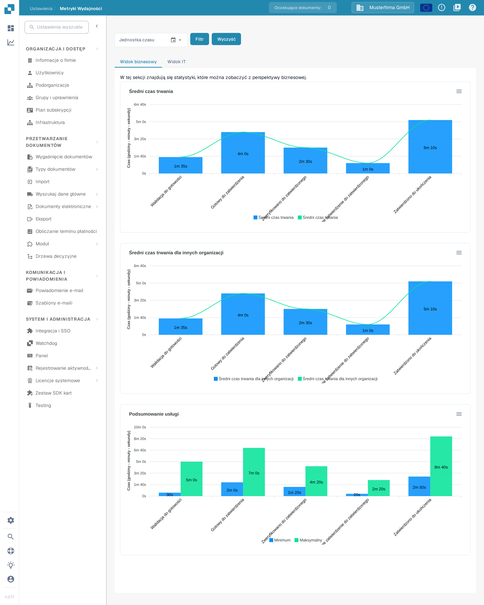

# Metryki wydajności

<figure><figcaption>
Strona Metryki wydajności otwiera się na karcie Widok biznesowy. Wartości pochodzą z przykładowej, syntetycznej organizacji i będą inne w Twojej organizacji.
</figcaption></figure>

**Metryki wydajności** pokazują, ile czasu dokumenty spędzają na każdym etapie przetwarzania i jak często uruchamiana jest każda usługa. Dzięki nim odpowiesz na pytania typu „Który etap po walidacji jest najwolniejszy?” albo „Jak zmienił się nasz wolumen przetwarzania w ostatnich tygodniach?”.

## Jak uzyskać dostęp

Strona Metryki wydajności nie ma wpisu w pasku bocznym Ustawienia. Otwórz ją na jeden z tych sposobów:

1. **Mapa Witryny**: kliknij ikonę lupy na dole lewego paska bocznego, wpisz w polu wyszukiwania „Wydajność” i kliknij wpis **Metryki wydajności** w sekcji **Ustawienia — Zaawansowane**. Zobacz [Mapa Witryny](../end-user-and-partner-section/end-user-section/sitemap.md).
2. **Globalne Szybkie Wyszukiwanie**: naciśnij **Ctrl+K** (lub **Cmd+K** na Macu) w dowolnym miejscu aplikacji, wpisz „Wydajność” i otwórz wpis klawiszem **Enter**. Zobacz [Globalne Szybkie Wyszukiwanie](../end-user-and-partner-section/end-user-section/global-quick-search.md).
3. Bezpośrednio przez adres `/settings/performance-metrics`. Starszy adres `/performance_report` nadal otwiera tę samą stronę.

Strona wymaga uprawnień administratora. Wartości na zrzutach ekranu pochodzą z przykładowej, syntetycznej organizacji i będą inne w Twojej organizacji.

## Filtry

Filtry nad kartami określają okres, a na karcie Widok IT także usługi, których liczby chcesz zobaczyć.

| Filtr | Opis |
|-------|------|
| **Jednostka czasu** | Wybierz okres: **Ostatnie 7 dni**, **Ostatnie 30 dni** lub **Wybierz zakres czasu** dla własnego okresu. W przypadku własnego okresu kliknij ikonę kalendarza, wybierz pierwszy i ostatni dzień, a następnie potwierdź przyciskiem **Ok**. |
| **Mikrousługa** | Widoczny tylko na karcie **Widok IT**. Wybierz jedną usługę (na przykład OCR), aby zobaczyć tylko jej liczby. Pozostaw puste, aby zobaczyć wszystkie usługi. |
| **Grupy czasowe (tylko dla częstotliwości)** | Widoczny tylko na karcie **Widok IT**. Grupuje wykres Częstotliwość procesu według godziny, dnia, tygodnia lub miesiąca. |
| **Filtr** | Zastosowuje wybrane filtry i ponownie rysuje wykresy. |
| **Wyczyść** | Usuwa wszystkie filtry i pokazuje ponownie widok domyślny. |

Wykresy nie odświeżają się same po zmianie filtra — po zmianie kliknij **Filtr**.

## Widok biznesowy

Karta **Widok biznesowy** odpowiada na pytanie biznesowe: jak długo dokument czeka na każdym etapie przetwarzania? Pokazuje trzy wykresy:

| Wykres | Opis |
|--------|------|
| **Średni czas trwania** | Średni czas każdego etapu w Twojej organizacji — kolejno: **Walidacja do gotowości**, **Gotowy do zatwierdzenia**, **Zweryfikowano do zatwierdzonego**, **Drugie zatwierdzenie do zatwierdzonego** i **Zatwierdzono do ukończenia**. |
| **Średni czas trwania dla innych organizacji** | Te same etapy dla innych organizacji, dzięki czemu możesz porównać swoje czasy z ich czasami. |
| **Podsumowanie usługi** | Najkrótszy (**Minimum**) i najdłuższy (**Maksymalny**) czas każdego etapu — przydatne do wychwytywania wartości odstających. |

Czasy są podawane w godzinach, minutach i sekundach. To wartości średnie — pojedynczy dokument może być szybszy lub wolniejszy.

## Widok IT

<figure><figcaption>
Karta Widok IT pokazuje te same dane w podziale na usługi. Użyj filtra Mikrousługa, aby skupić się na jednej usłudze.
</figcaption></figure>

Karta **Widok IT** odpowiada na pytanie techniczne: która usługa zużywa ile czasu i jak często jest uruchamiana? Pokazuje trzy wykresy:

| Wykres | Opis |
|--------|------|
| **Średni czas trwania** | Średni czas przetwarzania dla każdej usługi: **OCR**, **Klasyfikacja**, **Ekstrakcja** i **Eksport**. |
| **Częstotliwość procesu** | Liczba dokumentów przetworzonych przez każdą usługę w wybranym okresie, pogrupowana zgodnie z ustawieniem **Grupy czasowe**. |
| **Podsumowanie usługi** | Najkrótszy (**Minimum**) i najdłuższy (**Maksymalny**) czas przetwarzania dla każdej usługi — przydatne do wychwytywania wartości odstających. |

Każdy wykres ma w prawym górnym rogu menu pobierania (Download SVG, Download PNG, Download CSV), więc możesz wyeksportować wykres do raportu lub zgłoszenia do pomocy technicznej.

## Wskazówki

* Zacznij od karty **Widok biznesowy**, aby zobaczyć, gdzie dokumenty czekają najdłużej; następnie przełącz na **Widok IT**, aby sprawdzić, która usługa jest tego przyczyną.
* Długi czas **Walidacja do gotowości** lub **Zweryfikowano do zatwierdzonego** zwykle oznacza pracę ręczną (dokumenty czekające na weryfikację), natomiast długi czas OCR lub Ekstrakcja oznacza przetwarzanie po stronie systemu.
* Jeśli wykres nie pokazuje danych, rozszerz okres w polu **Jednostka czasu** albo kliknij **Wyczyść** i spróbuj ponownie.

## Powiązane strony

* [Panel Analityczny](analytics-dashboard.md) — szczegółowe czasy przepływu według dokumentu, dostawcy i typu dokumentu.
* [Dziennik aktywności](settings/log-settings/README.md) — bazowy dziennik zdarzeń z filtrami i eksportem.
* [Strona Raportu](report-page.md) — liczby dokumentów, zmienione pola i statystyki eksportu.
