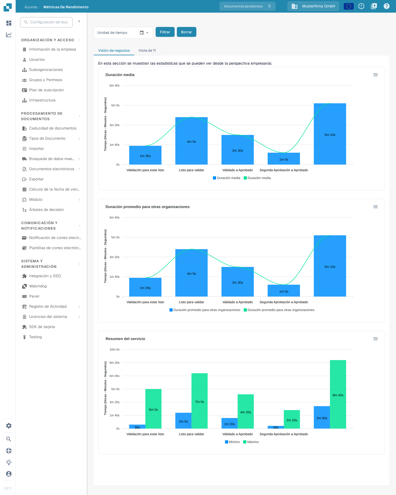

# Métricas de rendimiento

<figure><figcaption>
La página Métricas de rendimiento se abre en la pestaña Visión de negocios. Las cifras mostradas provienen de una organización de ejemplo sintética y variarán en su organización.
</figcaption></figure>

**Métricas de rendimiento** muestra cuánto tiempo permanece un documento en cada paso del procesamiento y con qué frecuencia se ejecuta cada servicio. Sirve para responder preguntas como «¿qué paso es el más lento después de la validación?» o «¿cómo ha cambiado nuestro volumen de procesamiento en las últimas semanas?».

## Cómo acceder

Métricas de rendimiento no tiene entrada en la barra lateral de Ajustes. Abra la página de una de estas formas:

1. **Mapa del sitio**: pulse el icono de lupa al final de la barra lateral izquierda, escriba «Métricas» en el campo de búsqueda y haga clic en la entrada **Métricas de rendimiento** del grupo **Configuración — Avanzada**. Consulte [Mapa del sitio](../end-user-and-partner-section/end-user-section/sitemap.md).
2. **Búsqueda Rápida Global**: pulse <kbd>Ctrl</kbd> + <kbd>K</kbd> (o <kbd>Cmd</kbd> + <kbd>K</kbd> en un Mac) en cualquier punto de la aplicación, escriba «Métricas» y abra la entrada con <kbd>Enter</kbd>. Consulte [Búsqueda Rápida Global](../end-user-and-partner-section/end-user-section/global-quick-search.md).
3. Directamente mediante la dirección `/settings/performance-metrics`. La dirección anterior `/performance_report` sigue abriendo la misma página.

La página requiere derechos de administrador. Las cifras mostradas provienen de una organización de ejemplo sintética y variarán en su organización.

## Filtros

Los filtros situados encima de las pestañas definen el periodo y —en la pestaña Vista de TI— los servicios cuyas cifras desea ver.

| Filtro | Descripción |
|--------|-------------|
| **Unidad de tiempo** | Elija el periodo: **Últimos 7 días**, **Últimos 30 días** o **Seleccionar intervalo de tiempo** para un periodo propio. Para un periodo propio, haga clic en el icono del calendario, elija el primer y el último día y confirme con **Ok**. |
| **Microservicio** | Solo aparece en la pestaña **Vista de TI**. Elija un único servicio (por ejemplo OCR) para ver solo sus cifras. Déjelo vacío para ver todos los servicios. |
| **Grupos de tiempo (solo para frecuencia)** | Solo aparece en la pestaña **Vista de TI**. Agrupa el gráfico Frecuencia del proceso por hora, día, semana o mes. |
| **Filtrar** | Aplica los filtros seleccionados y vuelve a dibujar los gráficos. |
| **Borrar** | Elimina todos los filtros y muestra de nuevo la vista predeterminada. |

Los gráficos no se actualizan por sí solos al cambiar un filtro — pulse **Filtrar** a continuación.

## Visión de negocios

La pestaña **Visión de negocios** responde a la pregunta de negocio: ¿cuánto espera un documento en cada paso del procesamiento? Muestra tres gráficos:

| Gráfico | Descripción |
|---------|-------------|
| **Duración media** | Tiempo medio por paso en su organización, desde **Validación para estar listo** pasando por **Listo para validar**, **Validado a Aprobado** y **Segunda Aprobación a Aprobado** hasta la finalización del documento. |
| **Duración promedio para otras organizaciones** | Los mismos pasos en otras organizaciones, para comparar sus duraciones con las de ellas. |
| **Resumen del servicio** | Tiempo más corto (**Mínimo**) y más largo (**Máximo**) por paso — útil para detectar valores atípicos. |

Los tiempos se muestran en horas, minutos y segundos. Son valores medios — un documento individual puede ser más rápido o más lento.

## Vista de TI

<figure><figcaption>
La Vista de TI desglosa los mismos datos por servicio. Use el filtro Microservicio para centrarse en un solo servicio.
</figcaption></figure>

La pestaña **Vista de TI** responde a la pregunta técnica: ¿qué servicio consume cuánto tiempo y con qué frecuencia? Muestra tres gráficos:

| Gráfico | Descripción |
|---------|-------------|
| **Duración media** | Tiempo medio de procesamiento por servicio: **OCR**, **Clasificación**, **Extracción** y **Exportar**. |
| **Frecuencia del proceso** | Cuántos documentos procesó cada servicio en el periodo seleccionado, agrupados según el ajuste **Grupos de tiempo**. |
| **Resumen del servicio** | Tiempo de procesamiento más corto (**Mínimo**) y más largo (**Máximo**) por servicio — útil para detectar valores atípicos. |

Cada gráfico tiene un menú de descarga en su esquina superior derecha (**Download SVG**, **Download PNG** y **Download CSV** — la interfaz en español mantiene estos nombres en inglés), con el que puede exportar un gráfico para un informe o un caso de soporte.

## Consejos

* Empiece por la **Visión de negocios** para ver dónde esperan los documentos más tiempo; cambie a la **Vista de TI** para ver qué servicio lo provoca.
* Un tiempo alto en **Validación para estar listo** o en **Validado a Aprobado** suele indicar trabajo manual (documentos esperando a los revisores), mientras que tiempos altos de OCR o de Extracción indican procesamiento del lado del sistema.
* Si un gráfico no muestra datos, amplíe el periodo en **Unidad de tiempo** o pulse **Borrar** y vuelva a intentarlo.

## Páginas relacionadas

* [Panel de Análisis](analytics-dashboard.md) — tiempos de procesamiento detallados por documento, proveedor y tipo de documento.
* [Registro de actividad](settings/log-settings/README.md) — el registro de eventos subyacente con filtros y exportación.
* [Página de informes](report-page.md) — recuentos de documentos, campos modificados y estadísticas de exportación.
