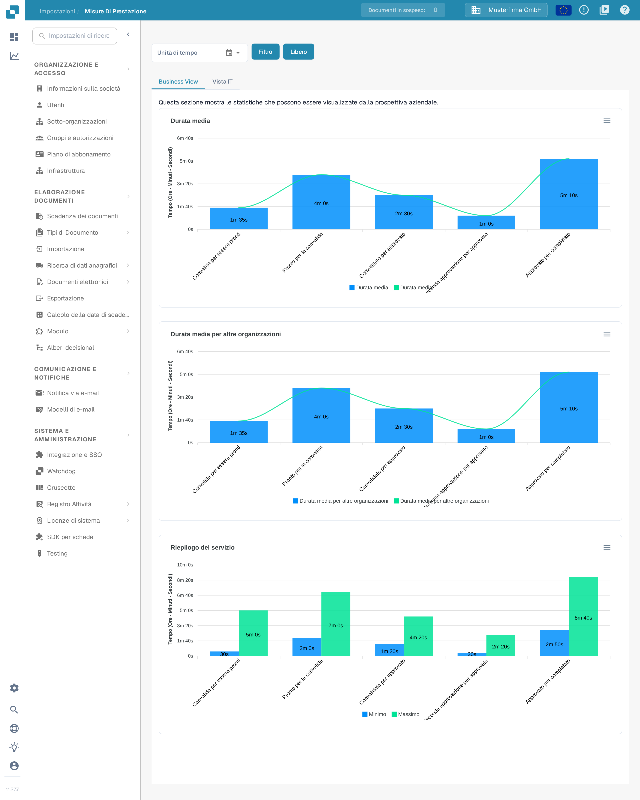

# Misure di prestazione

<figure><figcaption>
La pagina Misure di prestazione si apre sulla scheda Business View. I valori mostrati provengono da un'organizzazione di esempio sintetica e nella tua organizzazione saranno diversi.
</figcaption></figure>

**Misure di prestazione** mostra quanto tempo i documenti trascorrono in ogni fase di elaborazione e con quale frequenza viene eseguito ogni servizio. Usala per rispondere a domande come «Qual è la fase più lenta dopo la convalida?» oppure «Come è cambiato il nostro volume di elaborazione nelle ultime settimane?».

## Come accedervi

La pagina Misure di prestazione non ha una voce nella barra laterale delle Impostazioni. Aprila in uno di questi modi:

1. **Mappa del Sito**: clicca sull'icona della lente in fondo alla barra laterale sinistra, digita «Prestazione» nel campo di ricerca e clicca sulla voce **Misure di prestazione** sotto **Impostazioni avanzate**. Vedi [Mappa del Sito](../end-user-and-partner-section/end-user-section/sitemap.md).
2. **Ricerca Rapida Globale**: premi <kbd>Ctrl</kbd> + <kbd>K</kbd> (oppure <kbd>Cmd</kbd> + <kbd>K</kbd> su Mac) in qualsiasi punto dell'app, digita «Prestazione» e apri la voce con <kbd>Invio</kbd>. Vedi [Ricerca Rapida Globale](../end-user-and-partner-section/end-user-section/global-quick-search.md).
3. Direttamente tramite l'indirizzo `/settings/performance-metrics`. Il vecchio indirizzo `/performance_report` apre ancora la stessa pagina.

La pagina richiede i diritti di amministratore. I valori mostrati provengono da un'organizzazione di esempio sintetica e nella tua organizzazione saranno diversi.

## Filtri

I filtri sopra le schede definiscono il periodo e — nella scheda Vista IT — i servizi di cui vuoi vedere i numeri.

| Filtro | Descrizione |
|--------|-------------|
| **Unità di tempo** | Scegli il periodo: **Ultimi 7 giorni**, **Ultimi 30 giorni** oppure **Selezionare l'intervallo di tempo** per un periodo personalizzato. Per un periodo personalizzato, clicca sull'icona del calendario, scegli il primo e l'ultimo giorno, quindi conferma con **Ok**. |
| **Microservizio** | Visibile solo nella scheda **Vista IT**. Scegli un singolo servizio (per esempio OCR) per vedere solo i suoi numeri. Lascia vuoto per vedere tutti i servizi. |
| **Gruppi di tempo (solo per frequenza)** | Visibile solo nella scheda **Vista IT**. Raggruppa il grafico Frequenza del processo per ora, giorno, settimana o mese. |
| **Filtro** | Applica i filtri selezionati e ridisegna i grafici. |
| **Libero** | Rimuove tutti i filtri e mostra di nuovo la vista predefinita. |

I grafici non si aggiornano da soli quando cambi un filtro — clicca **Filtro** dopo aver impostato la selezione.

## Business View

La scheda **Business View** risponde alla domanda aziendale: quanto tempo attende un documento in ogni fase di elaborazione? Mostra tre grafici:

| Grafico | Descrizione |
|---------|-------------|
| **Durata media** | Tempo medio per fase nella tua organizzazione, da **Convalida per essere pronti** (dalla convalida allo stato Pronto) attraverso **Pronto per la convalida**, **Convalidato per approvato** e **Seconda approvazione per approvato**, fino a **Approvato per completato** (dall'approvazione al completamento). |
| **Durata media per altre organizzazioni** | Le stesse fasi per altre organizzazioni, così puoi confrontare le tue durate con le loro. |
| **Riepilogo del servizio** | Tempo più breve (**Minimo**) e più lungo (**Massimo**) per fase — utile per individuare i valori anomali. |

I tempi sono mostrati in ore, minuti e secondi. Sono valori medi — un singolo documento può essere più veloce o più lento.

## Vista IT

<figure><figcaption>
La Vista IT scompone gli stessi dati per servizio. Usa il filtro Microservizio per concentrarti su un singolo servizio.
</figcaption></figure>

La scheda **Vista IT** risponde alla domanda tecnica: quale servizio usa quanto tempo e con quale frequenza? Mostra tre grafici:

| Grafico | Descrizione |
|---------|-------------|
| **Durata media** | Tempo medio di elaborazione per servizio: **OCR**, **Classificazione**, **Estrazione** ed **Esportazione**. |
| **Frequenza del processo** | Quanti documenti ha elaborato ogni servizio nel periodo selezionato, raggruppati secondo l'impostazione **Gruppi di tempo**. |
| **Riepilogo del servizio** | Tempo di elaborazione più breve (**Minimo**) e più lungo (**Massimo**) per servizio — utile per individuare i valori anomali. |

Ogni grafico ha un menu di download (Download SVG, Download PNG, Download CSV) in alto a destra, così puoi esportare un grafico per un report o per un caso di assistenza.

## Suggerimenti

* Inizia dalla **Business View** per vedere dove i documenti attendono più a lungo; passa alla **Vista IT** per vedere quale servizio lo causa.
* Un tempo lungo in **Convalida per essere pronti** o **Convalidato per approvato** di solito indica un carico di lavoro manuale (documenti in attesa dei revisori), mentre tempi lunghi di OCR o Estrazione indicano un'elaborazione lato sistema.
* Se un grafico non mostra dati, amplia il periodo in **Unità di tempo** oppure clicca **Libero** e riprova.

## Pagine correlate

* [Dashboard di Analisi](analytics-dashboard.md) — tempi di elaborazione dettagliati per documento, fornitore e tipo di documento.
* [Registro attività](settings/log-settings/README.md) — il registro eventi sottostante, con filtri ed esportazione.
* [Pagina dei report](report-page.md) — numero di documenti, campi modificati e statistiche di esportazione.
