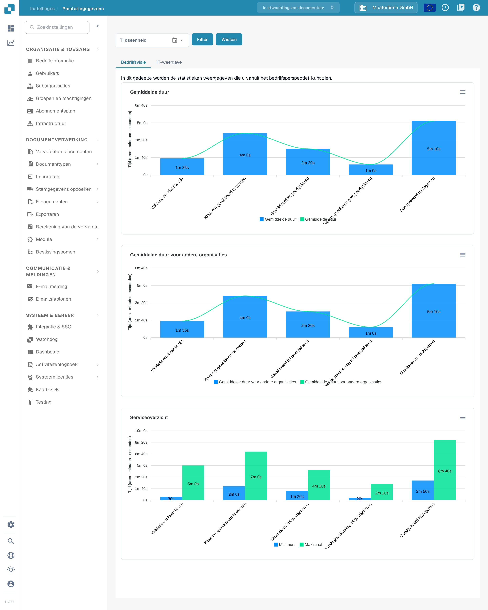

# Prestatiegegevens

<figure><figcaption>
De pagina Prestatiegegevens opent op het tabblad Bedrijfsvisie. De getoonde cijfers komen uit een synthetische voorbeeldorganisatie en wijken af in uw organisatie.
</figcaption></figure>

**Prestatiegegevens** laat zien hoe lang documenten in elke verwerkingsstap doorbrengen en hoe vaak elke service draait. Gebruik de pagina om vragen te beantwoorden zoals "Welke stap is na de validatie het langzaamst?" of "Hoe is ons verwerkingsvolume de afgelopen weken veranderd?"

## Toegang

Prestatiegegevens heeft geen eigen item in de zijbalk van Instellingen. Open de pagina op een van deze manieren:

1. **Sitemap**: klik op het vergrootglaspictogram onderaan de linkerzijbalk, typ "Prestatie" in het zoekveld en klik op de vermelding **Prestatiegegevens** onder **Instellingen — Geavanceerd**. Zie [Sitemap](../end-user-and-partner-section/end-user-section/sitemap.md).
2. **Globaal zoeken**: druk ergens in de app op **Ctrl+K** (of **Cmd+K** op een Mac), typ "Prestatie" en open de vermelding met **Enter**. Zie [Globale Snelzoek](../end-user-and-partner-section/end-user-section/global-quick-search.md).
3. Direct via het adres `/settings/performance-metrics`. Het oudere adres `/performance_report` opent dezelfde pagina.

De pagina vereist beheerdersrechten. De getoonde cijfers komen uit een synthetische voorbeeldorganisatie en wijken af in uw organisatie.

## Filters

De filters boven de tabbladen bepalen de periode en — op het tabblad IT-weergave — de services waarvan u de cijfers wilt zien.

| Filter | Beschrijving |
|--------|-------------|
| **Tijdseenheid** | Kies de periode: **Laatste 7 dagen**, **Laatste 30 dagen** of **Selecteer tijdsbereik** voor een aangepaste periode. Klik voor een aangepaste periode op het kalenderpictogram, kies de eerste en de laatste dag en bevestig met **Ok**. |
| **Microservice** | Alleen op het tabblad **IT-weergave**. Kies één service (bijvoorbeeld OCR) om alleen de cijfers daarvan te zien. Laat het veld leeg om alle services te zien. |
| **Tijdsgroepen (alleen voor frequentie)** | Alleen op het tabblad **IT-weergave**. Groepeert de grafiek Procesfrequentie per uur, dag, week of maand. |
| **Filter** | Past de gekozen filters toe en tekent de grafieken opnieuw. |
| **Wissen** | Verwijdert alle filters en toont weer de standaardweergave. |

De grafieken worden niet automatisch bijgewerkt wanneer u een filter wijzigt — klik daarna op **Filter**.

## Bedrijfsvisie

Het tabblad **Bedrijfsvisie** beantwoordt de bedrijfsvraag: hoe lang wacht een document bij elke verwerkingsstap? Het toont drie grafieken:

| Grafiek | Beschrijving |
|---------|-------------|
| **Gemiddelde duur** | Gemiddelde tijd per stap in uw organisatie, van **Validatie om klaar te zijn** via **Klaar om gevalideerd te worden**, **Gevalideerd tot goedgekeurd** en **Tweede goedkeuring tot goedgekeurd** tot **Goedgekeurd tot Afgerond**. |
| **Gemiddelde duur voor andere organisaties** | Dezelfde stappen voor andere organisaties, zodat u uw duur met die van hen kunt vergelijken. |
| **Serviceoverzicht** | Kortste (**Minimum**) en langste (**Maximaal**) tijd per stap — handig om uitschieters te vinden. |

Tijden worden weergegeven in uren, minuten en seconden. Het zijn gemiddelden — één document kan sneller of langzamer zijn.

## IT-weergave

<figure><figcaption>
De IT-weergave splitst dezelfde gegevens uit per service. Gebruik het filter Microservice om u op één service te richten.
</figcaption></figure>

Het tabblad **IT-weergave** beantwoordt de technische vraag: welke service gebruikt hoeveel tijd en hoe vaak? Het toont drie grafieken:

| Grafiek | Beschrijving |
|---------|-------------|
| **Gemiddelde duur** | Gemiddelde verwerkingstijd per service: **OCR**, **Classificatie**, **Extractie** en **Exporteren**. |
| **Procesfrequentie** | Hoeveel documenten elke service in de gekozen periode heeft verwerkt, gegroepeerd volgens de instelling **Tijdsgroepen**. |
| **Serviceoverzicht** | Kortste (**Minimum**) en langste (**Maximaal**) verwerkingstijd per service — handig om uitschieters te vinden. |

Elke grafiek heeft rechtsboven een downloadmenu (Download SVG, Download PNG, Download CSV), zodat u een grafiek kunt exporteren voor een rapport of een supportcase.

## Tips

* Begin met de **Bedrijfsvisie** om te zien waar documenten het langst wachten; schakel over naar de **IT-weergave** om te zien welke service dat veroorzaakt.
* Een lange tijd bij **Validatie om klaar te zijn** of **Gevalideerd tot goedgekeurd** wijst meestal op handmatig werk (documenten wachten op beoordelaars), terwijl lange OCR- of extractietijden wijzen op verwerking aan de systeemkant.
* Als een grafiek geen gegevens toont, kies dan een ruimere **Tijdseenheid** of klik op **Wissen** en probeer het opnieuw.

## Gerelateerde pagina's

* [Analyse-dashboard](analytics-dashboard.md) — gedetailleerde verwerkingstijden per document, leverancier en documenttype.
* [Activiteitenlogboek](settings/log-settings/README.md) — het onderliggende gebeurtenislogboek met filters en export.
* [Rapport Pagina](report-page.md) — documentaantallen, gewijzigde velden en exportstatistieken.
