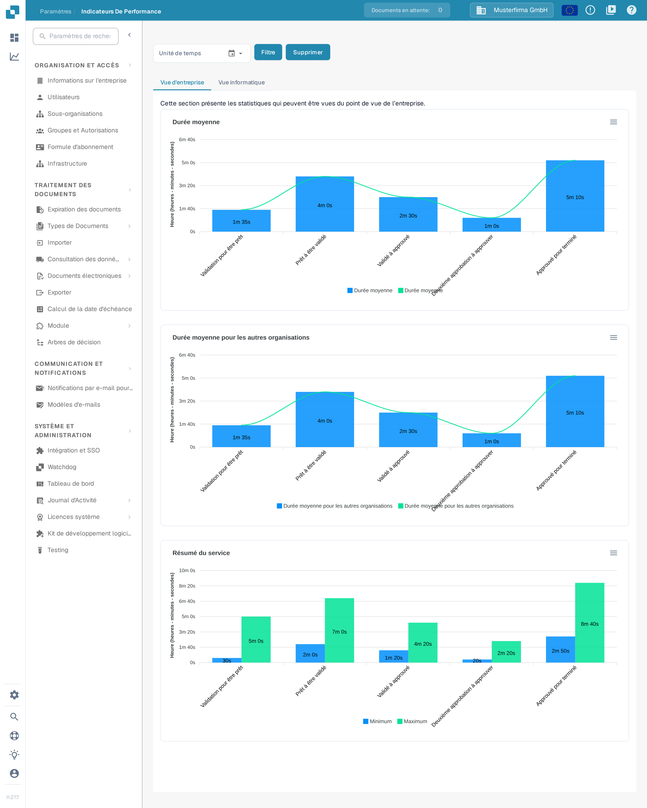
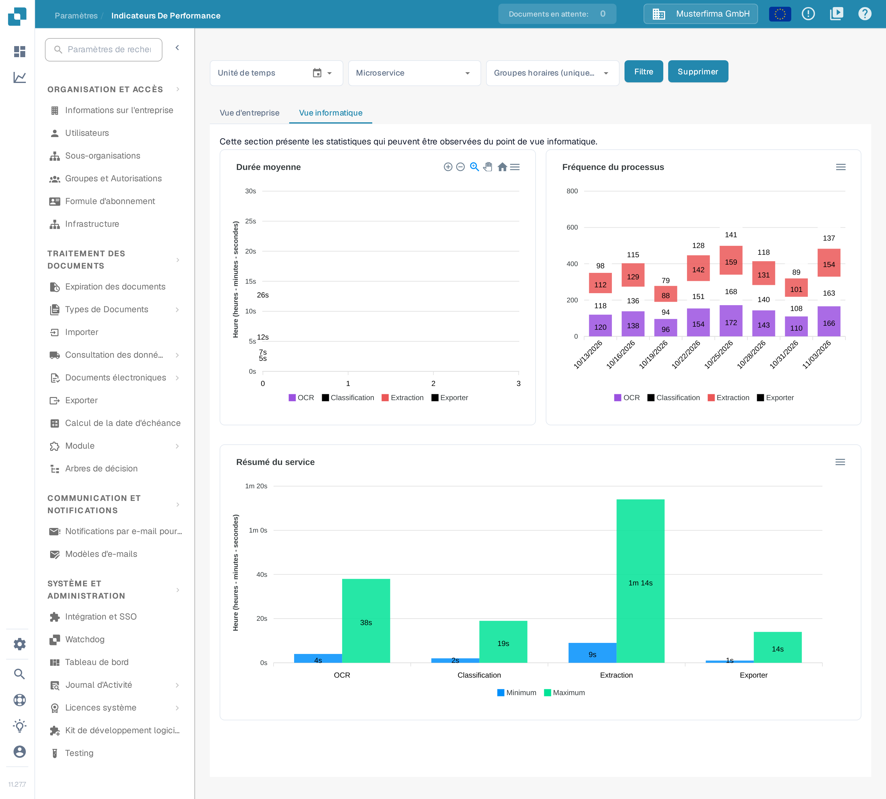

# Indicateurs de performance

<figure><figcaption>
La page Indicateurs de performance s’ouvre sur l’onglet Vue d’entreprise. Les chiffres affichés proviennent d’une organisation d’exemple synthétique et diffèrent dans la vôtre.
</figcaption></figure>

**Indicateurs de performance** montre combien de temps les documents passent à chaque étape de traitement et à quelle fréquence chaque service s’exécute. Utilisez-la pour répondre à des questions telles que « Quelle étape est la plus lente après la validation ? » ou « Comment notre volume de traitement a-t-il évolué au cours des dernières semaines ? »

## Comment y accéder

Indicateurs de performance n’a pas d’entrée dans la barre latérale des paramètres. Ouvrez la page de l’une des manières suivantes :

1. **Plan du Site** : cliquez sur l’icône de loupe en bas de la barre latérale gauche, saisissez « Performance » dans le champ de recherche, puis cliquez sur l’entrée **Indicateurs de performance** sous **Paramètres — Avancé**. Voir [Plan du Site](../end-user-and-partner-section/end-user-section/sitemap.md).
2. **Recherche Rapide Globale** : appuyez sur **Ctrl+K** (ou **Cmd+K** sur un Mac) n’importe où dans l’application, saisissez « Performance », puis ouvrez l’entrée avec **Entrée**. Voir [Recherche Rapide Globale](../end-user-and-partner-section/end-user-section/global-quick-search.md).
3. Directement via l’adresse `/settings/performance-metrics`. L’ancienne adresse `/performance_report` ouvre toujours la même page.

La page nécessite des droits d’administrateur. Les chiffres affichés proviennent d’une organisation d’exemple synthétique et diffèrent dans la vôtre.

## Filtres

Les filtres situés au-dessus des onglets définissent la période et — dans l’onglet Vue informatique — les services dont vous souhaitez voir les chiffres.

| Filtre | Description |
|--------|-------------|
| **Unité de temps** | Choisissez la période : **7 derniers jours**, **Les 30 derniers jours**, ou **Sélectionnez la plage horaire** pour une période personnalisée. Pour une période personnalisée, cliquez sur l’icône de calendrier, choisissez le premier et le dernier jour, puis confirmez avec **Ok**. |
| **Microservice** | Affiché uniquement dans l’onglet **Vue informatique**. Choisissez un seul service (par exemple OCR) pour n’afficher que ses chiffres. Laissez le champ vide pour voir tous les services. |
| **Groupes horaires (uniquement pour la fréquence)** | Affiché uniquement dans l’onglet **Vue informatique**. Regroupe le graphique Fréquence du processus par heure (**1 heure**), par jour (**1 jour**), par semaine (**1 semaine**) ou par mois (**1 mois**). |
| **Filtre** | Applique les filtres sélectionnés et redessine les graphiques. |
| **Supprimer** | Supprime tous les filtres et rétablit la vue par défaut. |

Les graphiques ne se mettent pas à jour d’eux-mêmes lorsque vous modifiez un filtre : cliquez ensuite sur **Filtre**.

## Vue d’entreprise

L’onglet **Vue d’entreprise** répond à la question métier : combien de temps un document attend-il à chaque étape de traitement ? Il affiche trois graphiques :

| Graphique | Description |
|-----------|-------------|
| **Durée moyenne** | Durée moyenne par étape dans votre organisation, de **Validation pour être prêt** à **Prêt à être validé**, **Validé à approuvé**, **Deuxième approbation à approuver**, jusqu’à **Approuvé pour terminé**. |
| **Durée moyenne pour les autres organisations** | Les mêmes étapes pour les autres organisations, afin de comparer vos durées aux leurs. |
| **Résumé du service** | Durée la plus courte (**Minimum**) et la plus longue (**Maximum**) par étape — utile pour repérer les valeurs aberrantes. |

Les durées sont affichées en heures, minutes et secondes. Ce sont des valeurs moyennes : un document isolé peut être plus rapide ou plus lent.

## Vue informatique

<figure><figcaption>
La Vue informatique détaille les mêmes données par service. Utilisez le filtre Microservice pour vous concentrer sur un seul service.
</figcaption></figure>

L’onglet **Vue informatique** répond à la question technique : quel service consomme combien de temps et à quelle fréquence ? Il affiche trois graphiques :

| Graphique | Description |
|-----------|-------------|
| **Durée moyenne** | Durée moyenne de traitement par service : **OCR**, **Classification**, **Extraction** et **Exporter**. |
| **Fréquence du processus** | Nombre de documents traités par chaque service sur la période sélectionnée, regroupés selon le réglage **Groupes horaires**. |
| **Résumé du service** | Durée de traitement la plus courte (**Minimum**) et la plus longue (**Maximum**) par service — utile pour repérer les valeurs aberrantes. |

Chaque graphique dispose d’un menu de téléchargement en haut à droite (Download SVG, Download PNG, Download CSV), qui vous permet d’exporter un graphique pour un rapport ou un dossier de support. Ces trois entrées du menu sont encore affichées en anglais dans l’interface française.

## Conseils

* Commencez par la **Vue d’entreprise** pour voir où les documents attendent le plus longtemps ; passez ensuite à la **Vue informatique** pour identifier le service responsable.
* Une durée élevée pour **Validation pour être prêt** ou **Validé à approuvé** indique généralement une charge de travail manuelle (documents en attente de réviseurs), tandis que des durées OCR ou Extraction élevées pointent vers un traitement côté système.
* Si un graphique n’affiche aucune donnée, élargissez la période **Unité de temps** ou cliquez sur **Supprimer** et réessayez.

## Pages liées

* [Tableau de bord analytique](analytics-dashboard.md) — durées de traitement détaillées par document, fournisseur et type de document.
* [Journal d’activité](settings/log-settings/README.md) — le journal d’événements sous-jacent, avec filtres et export.
* [Page de rapport](report-page.md) — nombres de documents, champs modifiés et statistiques d’export.
