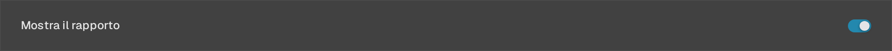
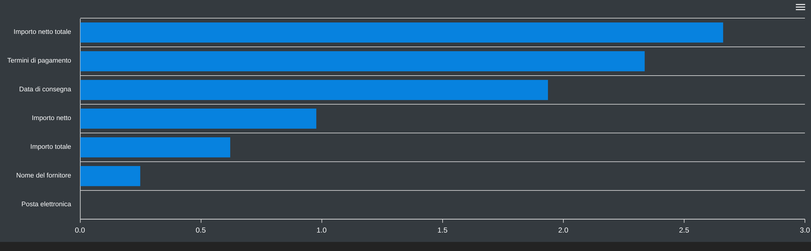
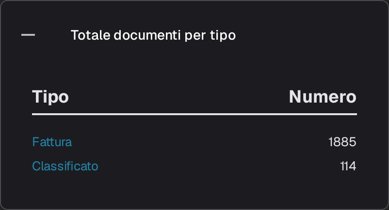
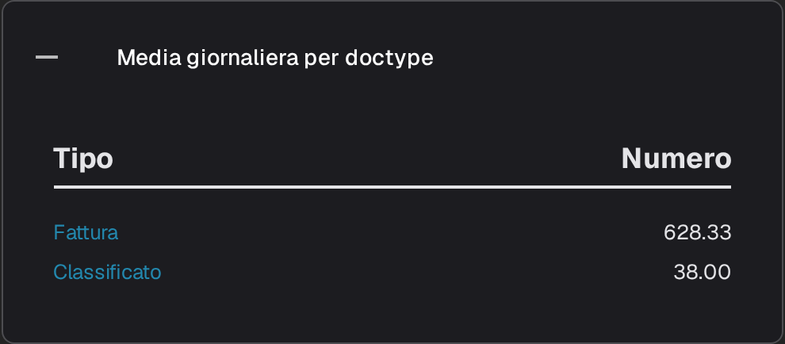
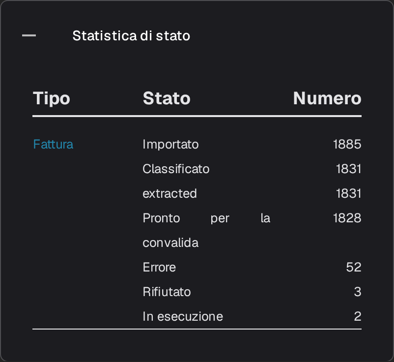
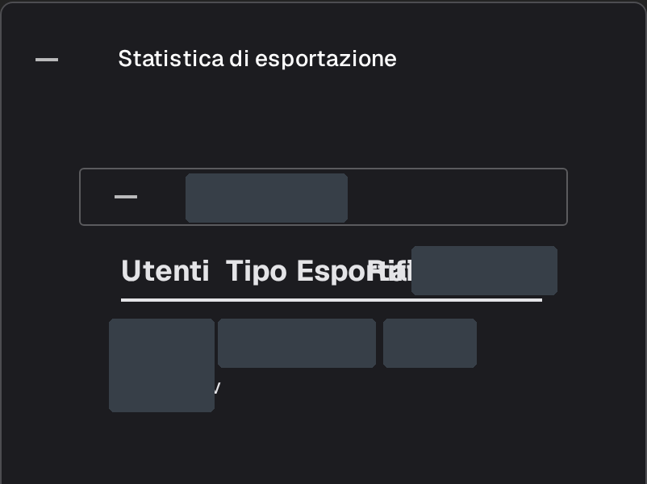

# Pagina dei report

La pagina **Rapporto** riassume l’andamento dei documenti in DocBits durante un periodo: quanti ne sono arrivati, quanto è durata l’elaborazione, quali campi sono stati corretti e qual è stata la loro destinazione finale. È pensata per amministratori e responsabili di team che vogliono una visione d’insieme dell’acquisizione e della convalida, non del singolo documento.



## Attivare la pagina Rapporto

La pagina si abilita tramite l’apposita impostazione del modulo. Attivala una sola volta per l’organizzazione:

1. Vai su **Impostazioni → Modulo** e apri il gruppo **Integrazione dei documenti**.
2. Nella scheda **Tipo di documento**, attiva **Mostra il rapporto**.
3. La voce **Rapporto** compare quindi nella barra laterale per gli utenti dell’organizzazione.

<figure><figcaption>
L’interruttore Mostra il rapporto.
</figcaption></figure>

## Aprire la pagina Rapporto

Seleziona l’icona del grafico nella barra laterale. La pagina si apre con il filtro temporale, gli indicatori principali del periodo e le statistiche sui campi.

<figure><figcaption>
La voce <strong>Rapporto</strong> nella barra laterale.
</figcaption></figure>

## Scegliere il periodo

Il filtro **Unità di tempo** nella parte superiore della pagina imposta il periodo per tutti gli indicatori e le sezioni sottostanti. Offre **Ultimi 7 giorni**, **Ultimi 30 giorni** e **Selezionare l’intervallo di tempo**; quest’ultima opzione apre un calendario in cui scegliere una data di inizio e una di fine.

<figure><figcaption>
Opzioni di Unità di tempo: Ultimi 7 giorni, Ultimi 30 giorni e Selezionare l’intervallo di tempo. L’intestazione e la navigazione dell’applicazione sono fuori dall’immagine.
</figcaption></figure>

## Gli indicatori accanto al filtro

<figure><figcaption>
<strong>Unità di tempo</strong>, <strong>Nuovi documenti</strong>, <strong>Tempo medio del sistema</strong> e il pulsante di download.
</figcaption></figure>

- **Nuovi documenti** indica quanti documenti sono stati importati nel periodo selezionato.
- **Tempo medio del sistema** indica il tempo medio, in secondi, impiegato da DocBits per elaborare un documento in quel periodo.
- Il pulsante di download a destra della riga esporta il report come file Excel (XLSX) per il periodo selezionato.

## Campi modificati

Il grafico **Campi modificati** indica quante volte ciascun campo è stato corretto manualmente nel periodo selezionato, con una barra per campo, così da individuare facilmente i campi che il team modifica più spesso. Il punto interrogativo accanto al titolo spiega cosa conteggia il grafico. Se non sono presenti dati per il periodo selezionato, al posto delle barre compare il messaggio «Non sono stati trovati inserimenti di dati nel rispettivo intervallo di tempo.»

<figure><figcaption>
Il messaggio che compare quando non sono disponibili dati per il periodo selezionato.
</figcaption></figure>

Usa il menu nell’angolo in alto a destra del grafico per scaricare il diagramma in formato **SVG**, **PNG** o **CSV**.

## Altre sezioni del report

Sotto il grafico sono presenti quattro schede. Sono chiuse per impostazione predefinita; seleziona l’intestazione di una scheda per aprirne la tabella e selezionala di nuovo per chiuderla.

1. **Totale documenti per tipo** elenca ogni tipo di documento con le colonne **Tipo** e **Numero**. Un tipo che include sottotipi di documento mostra un **+** per visualizzare il dettaglio del totale.
2. **Media giornaliera per doctype** presenta lo stesso elenco come media giornaliera per tipo di documento.
3. **Statistica di stato** suddivide i documenti per stato di elaborazione, con le colonne **Tipo**, **Stato** e **Numero**.
4. **Statistica di esportazione** elenca inizialmente le organizzazioni dell’account; espandi un’organizzazione per vedere i formati di esportazione utilizzati, con le colonne **Utenti**, **Tipo** ed **Esportato**.

<figure><figcaption>
<strong>Totale documenti per tipo</strong>.
</figcaption></figure>

<figure><figcaption>
<strong>Media giornaliera per doctype</strong>.
</figcaption></figure>

<figure><figcaption>
<strong>Statistica di stato</strong>.
</figcaption></figure>

<figure><figcaption>
Statistica di esportazione con la sezione di un’organizzazione esistente espansa. I nomi delle organizzazioni e i valori delle righe sono mascherati; l’immagine mostra statistiche esistenti.
</figcaption></figure>
