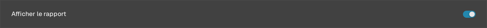
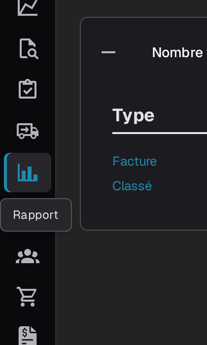
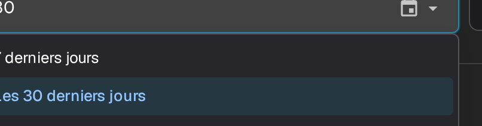
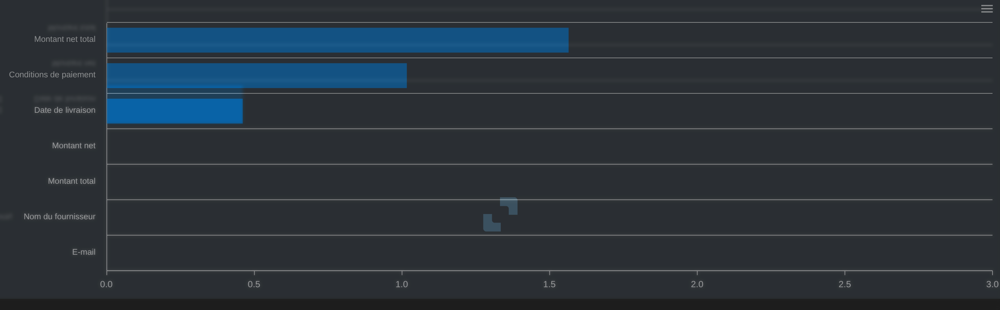
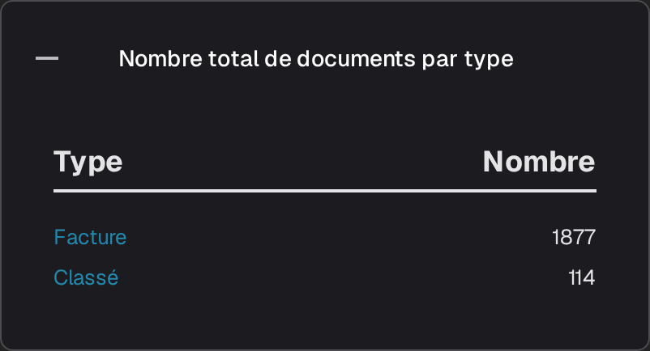
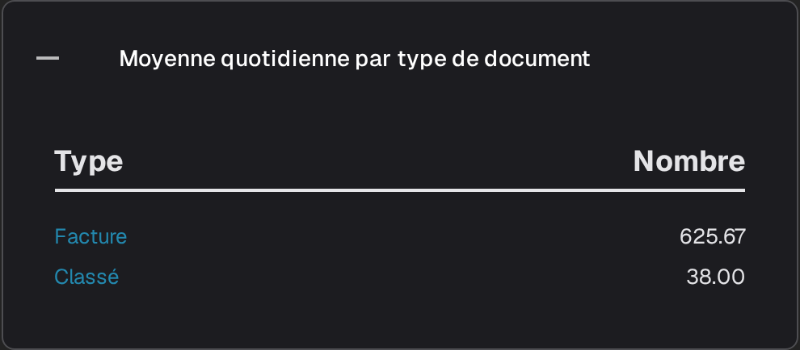
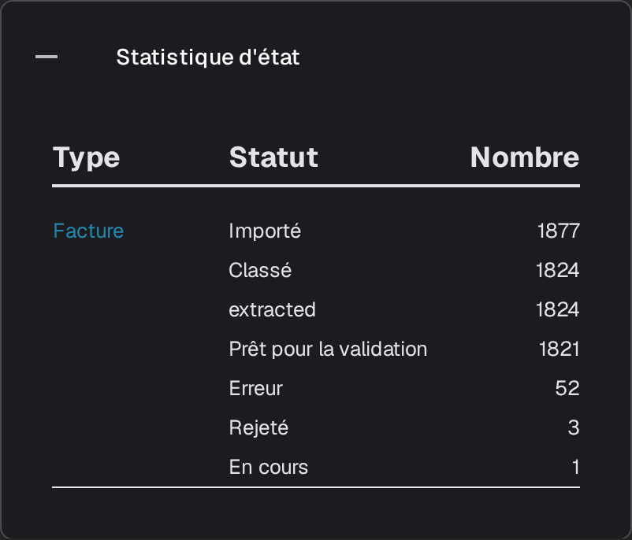
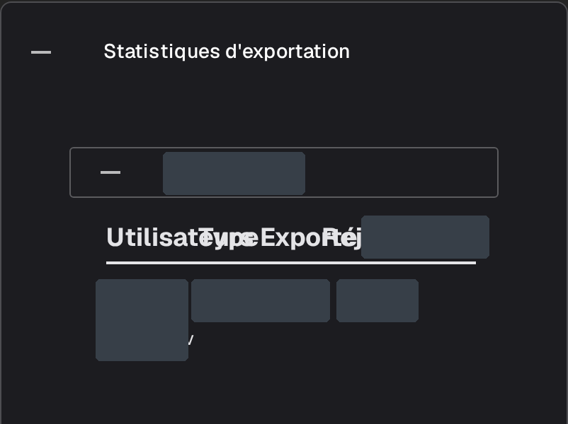

# Page de rapport

La page **Rapport** résume le traitement des documents dans DocBits au cours d’une période : nombre de documents reçus, durée de traitement, champs corrigés par les utilisateurs et destination finale des documents. Elle s’adresse aux administrateurs et aux responsables d’équipe qui suivent globalement la réception et la validation des documents, et non un document particulier.



## Activer la page Rapport

L’affichage de cette page dépend d’un module. Activez-le une seule fois pour l’organisation :

1. Accédez à **Paramètres → Module** et ouvrez le groupe **Intégration de documents**.
2. Dans la carte **Type de document**, activez l’option **Afficher le rapport**.
3. L’entrée **Rapport** apparaît alors dans la barre latérale pour les utilisateurs de l’organisation.

<figure><figcaption>
L’interrupteur Afficher le rapport.
</figcaption></figure>

## Ouvrir la page Rapport

Sélectionnez l’icône représentant un graphique dans la barre latérale. La page s’ouvre avec le filtre de période, les chiffres clés de la période et les statistiques de champs.

<figure><figcaption>
L’entrée <strong>Rapport</strong> dans la barre latérale.
</figcaption></figure>

## Choisir la période

Le filtre **Unité de temps**, en haut de la page, définit la période pour tous les indicateurs et toutes les sections ci-dessous. Il propose **7 derniers jours**, **Les 30 derniers jours** et **Sélectionnez la plage horaire**, qui ouvre un calendrier dans lequel vous choisissez une date de début et une date de fin.

<figure><figcaption>
Options d’Unité de temps : 7 derniers jours, Les 30 derniers jours et Sélectionnez la plage horaire. L’en-tête et la navigation de l’application sont hors image.
</figcaption></figure>

## Les indicateurs à côté du filtre

<figure><figcaption>
<strong>Unité de temps</strong>, <strong>Nouveaux documents</strong>, <strong>Temps système moyen</strong> et le bouton de téléchargement.
</figcaption></figure>

- **Nouveaux documents** indique le nombre de documents importés au cours de la période sélectionnée.
- **Temps système moyen** indique le temps moyen, en secondes, nécessaire à DocBits pour traiter un document au cours de cette période.
- Le bouton de téléchargement à droite de la ligne exporte le rapport sous forme de fichier Excel (XLSX) pour la période sélectionnée.

## Champs modifiés

La section **Champs modifiés** indique combien de fois chaque champ a été corrigé manuellement au cours de la période sélectionnée. Lorsque des données sont disponibles, le graphique présente une barre par champ, ce qui permet de repérer facilement les champs que votre équipe modifie le plus. Le point d’interrogation à côté du titre explique ce que compte le graphique.

<figure><figcaption>
La section <strong>Champs modifiés</strong> affiche le message « Aucune donnée n'a été trouvée dans la période concernée. » ; aucune barre n’est affichée. Ce message apparaît lorsqu’aucun champ n’a été corrigé pendant la période sélectionnée.
</figcaption></figure>

Utilisez le menu dans le coin supérieur droit du graphique pour télécharger celui-ci au format **SVG**, **PNG** ou **CSV**.

## Sections supplémentaires du rapport

Sous le graphique se trouvent quatre cartes. Elles sont repliées par défaut ; sélectionnez l’en-tête d’une carte pour afficher son tableau, puis sélectionnez-le à nouveau pour la replier.

1. **Nombre total de documents par type** répertorie chaque type de document avec les colonnes **Type** et **Nombre**, cette dernière indiquant le nombre de documents. Un type qui comporte des sous-types de documents affiche un **+** permettant de ventiler ce total.
2. **Moyenne quotidienne par type de document** présente la même liste sous forme de moyenne quotidienne pour chaque type de document.
3. **Statistique d'état** répartit les documents par statut de traitement, avec les colonnes **Type**, **Statut** et **Nombre**.
4. **Statistiques d'exportation** répertorie d’abord les organisations de votre compte ; développez-en une pour voir les formats d’exportation utilisés, avec les colonnes **Utilisateurs**, **Type** et **Exporté**.

<figure><figcaption>
<strong>Nombre total de documents par type</strong>.
</figcaption></figure>

<figure><figcaption>
<strong>Moyenne quotidienne par type de document</strong>.
</figcaption></figure>

<figure><figcaption>
<strong>Statistique d'état</strong>.
</figcaption></figure>

<figure><figcaption>
<strong>Statistiques d'exportation</strong> avec une organisation existante développée. Les noms des organisations et les valeurs des lignes sont masqués ; cette image présente des statistiques existantes.
</figcaption></figure>
