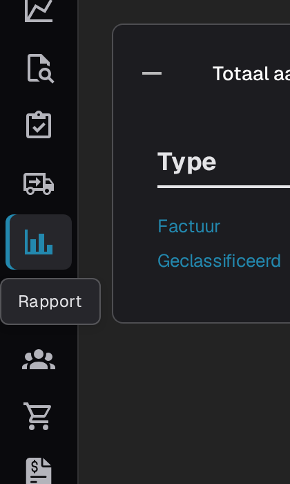
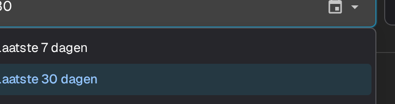
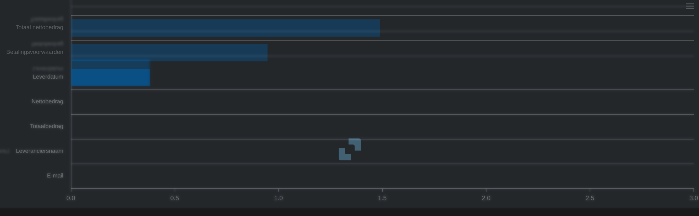
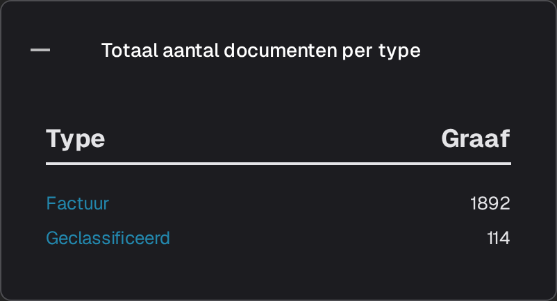
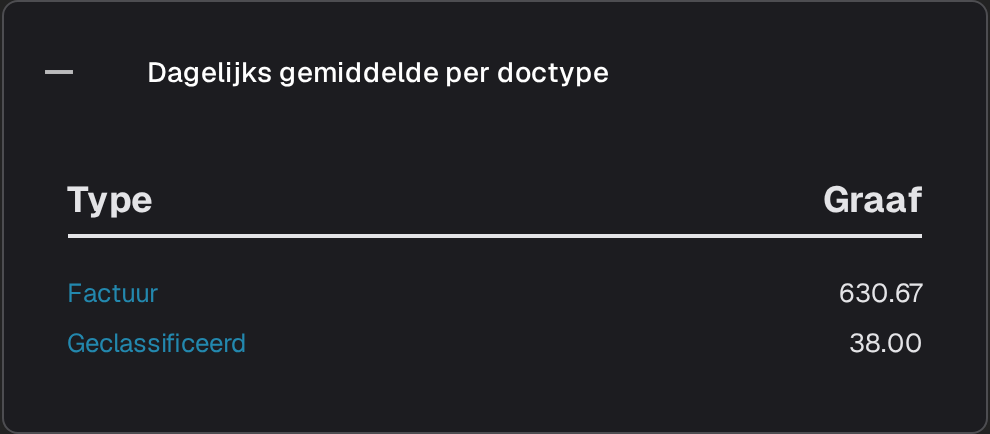
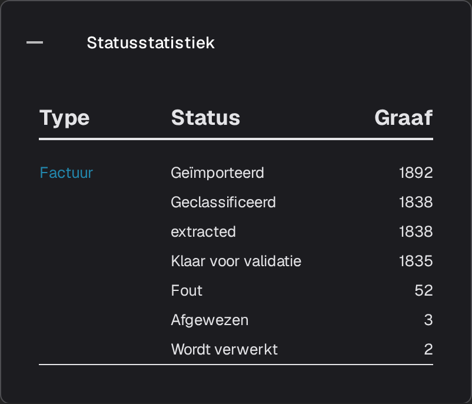
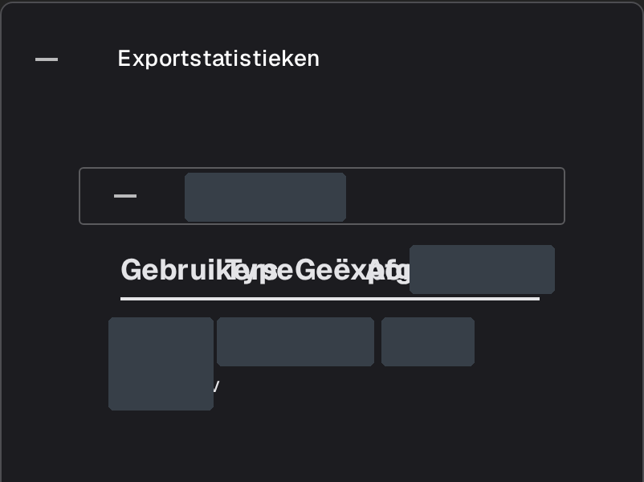

# Rapport Pagina

De pagina **Rapport** geeft een overzicht van de documentstroom in DocBits gedurende een bepaalde periode: hoeveel documenten er binnenkwamen, hoe lang de verwerking duurde, welke velden handmatig zijn gecorrigeerd en waar de documenten uiteindelijk terechtkwamen. De pagina is bedoeld voor beheerders en teamleiders die het intake- en validatiewerk als geheel willen bekijken, niet een afzonderlijk document.



## De pagina Rapport inschakelen

De pagina wordt met een moduleschakelaar beheerd. Schakel deze eenmalig in voor de organisatie:

1. Ga naar **Instellingen → Module** en open de groep **Documentintegratie**.
2. Schakel op de kaart **Documenttype** de optie **Rapport weergeven** in.
3. Het item **Rapport** verschijnt vervolgens in de zijbalk voor de gebruikers van de organisatie.

<figure><figcaption>
De schakelaar <strong>Rapport weergeven</strong>.
</figcaption></figure>

## De pagina Rapport openen

Selecteer het grafiekpictogram in de zijbalk. De pagina wordt geopend met het tijdfilter, de kerncijfers van de periode en de veldstatistieken.

<figure><figcaption>
Het item <strong>Rapport</strong> in de zijbalk.
</figcaption></figure>

## Het tijdsbestek kiezen

Met het filter **Tijdseenheid** bovenaan de pagina bepaalt u de periode voor alle cijfers en onderdelen eronder. U kunt kiezen uit **Laatste 7 dagen**, **Laatste 30 dagen** en **Selecteer tijdsbereik**. Met de laatste optie opent u een kalender waarin u een begin- en einddatum kiest.

<figure><figcaption>
Opties voor <strong>Tijdseenheid</strong>: <strong>Laatste 7 dagen</strong>, <strong>Laatste 30 dagen</strong> en <strong>Selecteer tijdsbereik</strong>. De applicatieheader en de navigatie vallen buiten de afbeelding.
</figcaption></figure>

## De cijfers naast het filter

<figure><figcaption>
<strong>Tijdseenheid</strong>, <strong>Nieuwe documenten</strong>, <strong>Gemiddelde systeemtijd</strong> en de downloadknop.
</figcaption></figure>

- **Nieuwe documenten** geeft aan hoeveel documenten er in de geselecteerde periode zijn geïmporteerd.
- **Gemiddelde systeemtijd** geeft aan hoeveel tijd in seconden DocBits in die periode gemiddeld nodig had om een document te verwerken.
- Met de downloadknop rechts in de rij exporteert u het rapport voor de geselecteerde periode als Excel-bestand (XLSX).

## Gewijzigde velden

De grafiek **Gewijzigde velden** telt hoe vaak elk veld in de geselecteerde periode handmatig is gecorrigeerd. Wanneer er gegevens beschikbaar zijn, krijgt elk veld een eigen balk, zodat u direct ziet welke velden uw team het vaakst bewerkt. Het vraagteken naast de kop legt uit wat de grafiek telt.

<figure><figcaption>
De kaart <strong>Gewijzigde velden</strong> zonder gegevens voor het geselecteerde tijdsbestek.
</figcaption></figure>

De kaart is leeg omdat er voor het geselecteerde tijdsbestek geen gegevens over handmatig gewijzigde velden beschikbaar zijn; daarom ziet u de melding **Er zijn geen gegevensitems gevonden in het betreffende tijdsbestek.** en geen balken.

Gebruik het menu rechtsboven in de grafiek om het diagram zelf te downloaden als **SVG**, **PNG** of **CSV**.

## Aanvullende rapportonderdelen

Onder de grafiek staan vier kaarten. Deze zijn standaard samengevouwen. Selecteer een kop om de bijbehorende tabel te openen en selecteer de kop opnieuw om deze te sluiten.

1. **Totaal aantal documenten per type** geeft elk documenttype weer met de kolommen **Type** en **Graaf**. Bij een type met subdocumenttypen staat een **+** waarmee u het aantal kunt uitsplitsen.
2. **Dagelijks gemiddelde per doctype** toont dezelfde lijst als een dagelijks gemiddelde per documenttype.
3. **Statusstatistiek** splitst de documenten uit op verwerkingsstatus, met de kolommen **Type**, **Status** en **Graaf**.
4. **Exportstatistieken** geeft eerst de organisaties van uw account weer. Vouw een organisatie uit om te zien welke exportformaten zijn gebruikt, met de kolommen **Gebruikers**, **Type** en **Geëxporteerd**.

<figure><figcaption>
<strong>Totaal aantal documenten per type</strong>.
</figcaption></figure>

<figure><figcaption>
<strong>Dagelijks gemiddelde per doctype</strong>.
</figcaption></figure>

<figure><figcaption>
<strong>Statusstatistiek</strong>.
</figcaption></figure>

<figure><figcaption>
<strong>Exportstatistieken</strong> met een uitgevouwen gedeelte voor een bestaande organisatie. Organisatienamen en rijwaarden zijn gemaskeerd; de afbeelding toont bestaande statistieken.
</figcaption></figure>
