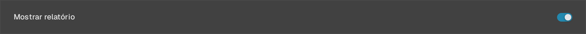
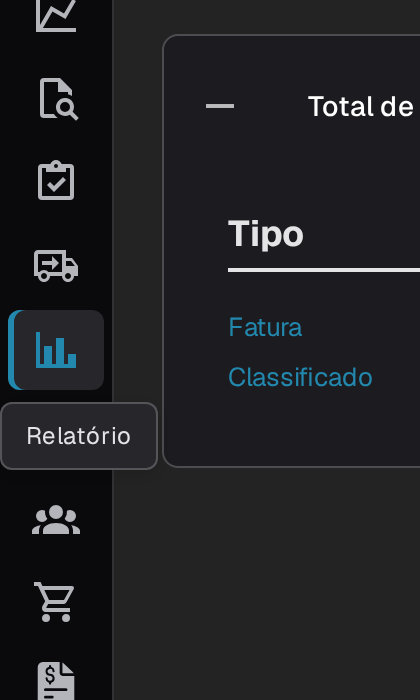
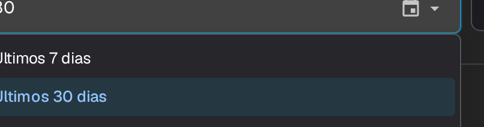
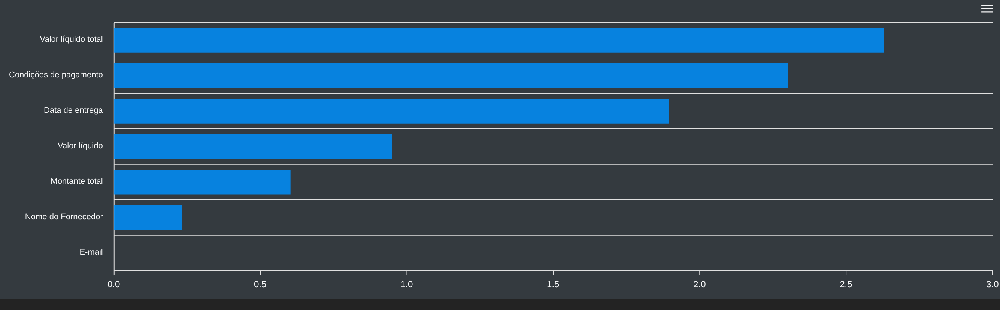
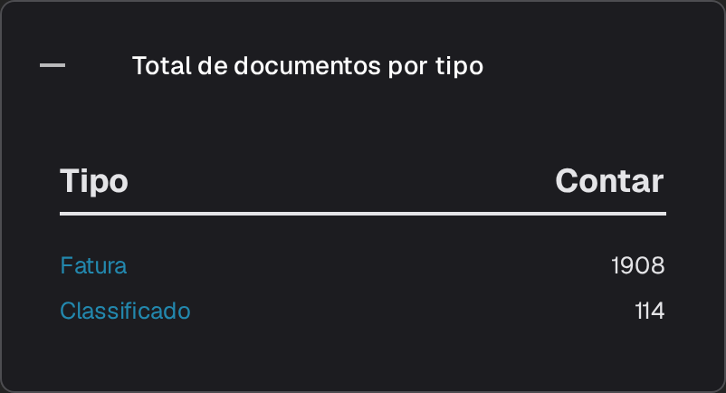
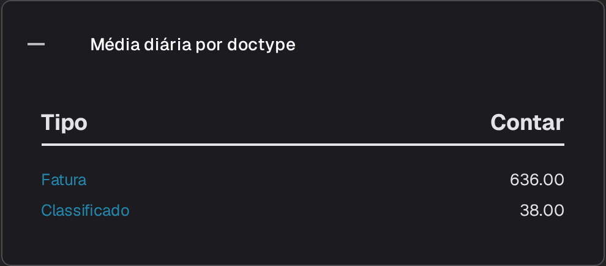
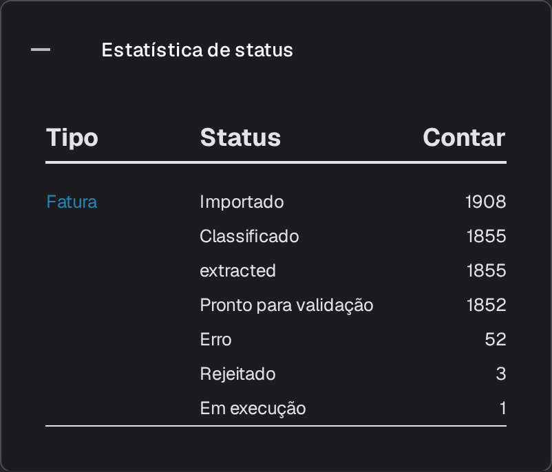
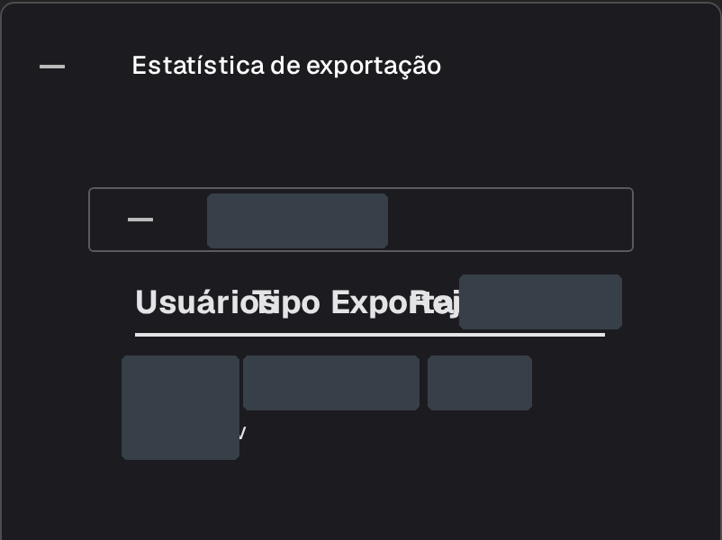

# Página de Relatórios

A **Página de Relatórios** resume o percurso dos documentos no DocBits durante um período: quantos foram recebidos, quanto tempo demorou o processamento, que campos foram corrigidos e qual foi o destino dos documentos. Destina-se a administradores e responsáveis de equipa que analisam globalmente o trabalho de receção e validação, e não um documento individual.



## Ativar a Página de Relatórios

A página é controlada por um interruptor de módulo. Ative-a uma vez para a organização:

1. Aceda a **Configurações → Módulo** e abra o grupo **Integração de Documentos**.
2. No cartão **Tipo de documento**, ative **Mostrar relatório**.
3. A entrada **Relatorio** passa então a aparecer na barra lateral para os utilizadores da organização.

<figure><figcaption>
O interruptor <strong>Mostrar relatório</strong>.
</figcaption></figure>

## Abrir a Página de Relatórios

Selecione o ícone de gráfico **Relatorio** na barra lateral. A página abre com o filtro de período, os principais valores do período e as estatísticas dos campos.

<figure><figcaption>
A entrada <strong>Relatorio</strong> na barra lateral.
</figcaption></figure>

## Escolher o período

O filtro **Unidade de tempo** no topo da página define o período de todos os valores e secções abaixo. Disponibiliza **Últimos 7 dias**, **Últimos 30 dias** e **Selecione o intervalo de tempo**; esta última opção abre um calendário onde pode escolher a data de início e a data de fim.

<figure><figcaption>
Opções de <strong>Unidade de tempo</strong>: <strong>Últimos 7 dias</strong>, <strong>Últimos 30 dias</strong> e <strong>Selecione o intervalo de tempo</strong>. O cabeçalho e a navegação da aplicação estão fora da imagem.
</figcaption></figure>

## Os valores junto ao filtro

<figure><figcaption>
<strong>Unidade de tempo</strong>, <strong>Novos Documentos</strong>, <strong>Tempo médio do sistema</strong> e o botão de transferência.
</figcaption></figure>

- **Novos Documentos** mostra quantos documentos foram importados no período selecionado.
- **Tempo médio do sistema** mostra o tempo médio, em segundos, que o DocBits demorou a processar um documento nesse período.
- O botão de transferência, à direita da linha, exporta o relatório como um ficheiro Excel (XLSX) para o período selecionado.

## Campos alterados

O gráfico **Campos alterados** conta quantas vezes cada campo foi corrigido manualmente no período selecionado, permitindo identificar facilmente os campos que a equipa mais edita. O ponto de interrogação junto ao título explica o que o gráfico conta. Quando existem correções manuais no período selecionado, o gráfico apresenta uma barra por campo; se não existirem dados, apresenta uma mensagem de período sem dados.

<figure><figcaption>
A mensagem apresentada em <strong>Campos alterados</strong> quando não existem dados no período selecionado.
</figcaption></figure>

Utilize o menu no canto superior direito do gráfico para transferir o diagrama em **SVG**, **PNG** ou **CSV**.

## Secções adicionais do relatório

Abaixo do gráfico existem quatro cartões. Estão fechados por predefinição; selecione um cabeçalho para abrir a respetiva tabela e selecione-o novamente para a fechar.

1. **Total de documentos por tipo** lista cada tipo de documento com o respetivo **Tipo** e o número de documentos em **Contar**. Um tipo que tenha subtipos de documento apresenta um sinal **+** para desagregar esse total.
2. **Média diária por doctype** apresenta a mesma lista como uma média diária por tipo de documento.
3. **Estatística de status** desagrega os documentos por estado de processamento, com as colunas **Tipo**, **Status** e **Contar**.
4. **Estatística de exportação** lista primeiro as organizações da sua conta; expanda uma para ver os formatos de exportação utilizados, com as colunas **Usuários**, **Tipo** e **Exportado**.

<figure><figcaption>
<strong>Total de documentos por tipo</strong>.
</figcaption></figure>

<figure><figcaption>
<strong>Média diária por doctype</strong>.
</figcaption></figure>

<figure><figcaption>
<strong>Estatística de status</strong>.
</figcaption></figure>

<figure><figcaption>
<strong>Estatística de exportação</strong> com uma organização existente expandida. Os nomes das organizações e os valores das linhas estão mascarados; a imagem mostra estatísticas existentes.
</figcaption></figure>
