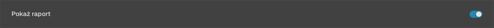
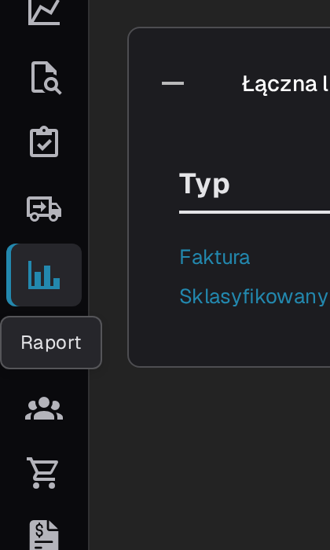
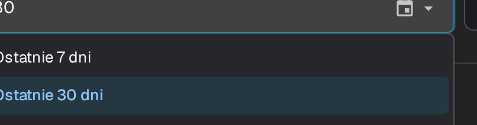
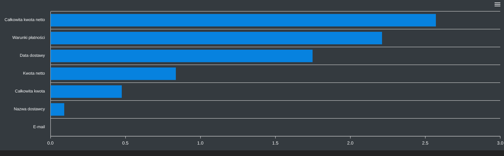
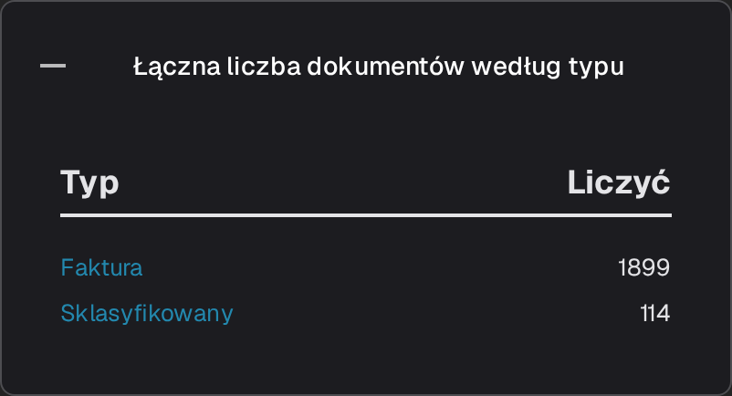
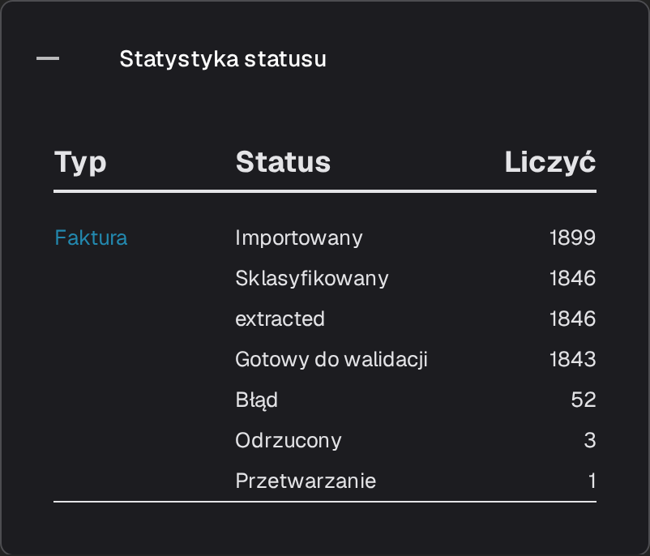
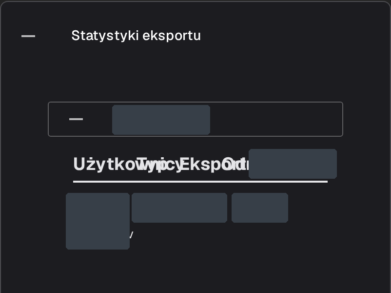

# Strona Raportu

Strona **Raport** podsumowuje, jak dokumenty przechodziły przez DocBits w wybranym okresie: ile dokumentów napłynęło, jak długo trwało ich przetwarzanie, które pola użytkownicy poprawiali i gdzie dokumenty ostatecznie trafiły. Jest przeznaczona dla administratorów i kierowników zespołów, którzy analizują całość pracy związanej z przyjmowaniem i walidacją dokumentów, a nie pojedynczy dokument.



## Włącz stronę Raportu

Strona jest aktywowana za pomocą przełącznika modułu. Włącz go raz dla organizacji:

1. Przejdź do **Ustawienia → Moduł** i otwórz grupę **Integracja dokumentów**.
2. Na karcie **Typ dokumentu** włącz opcję **Pokaż raport**.
3. Pozycja **Raport** pojawi się wtedy na pasku bocznym użytkowników organizacji.

<figure><figcaption>
Przełącznik Pokaż raport.
</figcaption></figure>

## Otwórz stronę Raportu

Wybierz ikonę wykresu na pasku bocznym. Strona otworzy się z filtrem czasu, kluczowymi wskaźnikami wybranego okresu i statystykami pól.

<figure><figcaption>
Pozycja <strong>Raport</strong> na pasku bocznym.
</figcaption></figure>

## Wybierz zakres czasu

Filtr **Jednostka czasu** u góry strony określa okres dla wszystkich poniższych wskaźników i sekcji. Oferuje opcje **Ostatnie 7 dni**, **Ostatnie 30 dni** oraz **Wybierz zakres czasu**, która otwiera kalendarz umożliwiający wybranie daty początkowej i końcowej.

<figure><figcaption>
Opcje filtra Jednostka czasu: Ostatnie 7 dni, Ostatnie 30 dni i Wybierz zakres czasu. Nagłówek i nawigacja aplikacji znajdują się poza obrazem.
</figcaption></figure>

## Wskaźniki obok filtra

<figure><figcaption>
<strong>Jednostka czasu</strong>, <strong>Nowe dokumenty</strong>, <strong>Średni czas systemowy</strong> i przycisk pobierania.
</figcaption></figure>

- **Nowe dokumenty** pokazuje liczbę dokumentów zaimportowanych w wybranym okresie.
- **Średni czas systemowy** pokazuje średni czas w sekundach, jakiego DocBits potrzebował na przetworzenie dokumentu w tym okresie.
- Przycisk pobierania po prawej stronie wiersza eksportuje raport do pliku Excel (XLSX) dla wybranego okresu.

## Zmienione pola

Wykres **Zmienione pola** zlicza, jak często poszczególne pola były ręcznie poprawiane w wybranym okresie. Gdy dane są dostępne, każdy słupek odpowiada jednemu polu, dzięki czemu łatwo zauważyć pola najczęściej edytowane przez zespół. Znak zapytania obok nagłówka wyjaśnia, co zlicza wykres. Komunikat „Nie znaleziono żadnych wpisów danych w odpowiednim przedziale czasowym.” oznacza, że dla wybranego okresu nie ma danych o ręcznych zmianach pól do wyświetlenia.

<figure><figcaption>
Sekcja <strong>Zmienione pola</strong> z komunikatem o braku danych dla wybranego okresu; słupki nie są wyświetlane.
</figcaption></figure>

Użyj menu w prawym górnym rogu wykresu, aby pobrać sam wykres w formacie **SVG**, **PNG** lub **CSV**.

## Dodatkowe sekcje raportu

Poniżej wykresu znajdują się cztery karty. Są one domyślnie zwinięte; wybierz nagłówek, aby rozwinąć tabelę, i wybierz go ponownie, aby ją zwinąć.

1. **Łączna liczba dokumentów według typu** wyświetla każdy typ dokumentu w kolumnie **Typ** oraz liczbę dokumentów w kolumnie **Liczyć**. Typ z podtypami dokumentów ma znak **+**, który umożliwia wyświetlenie szczegółowego podziału tej liczby.
2. **Średnia dzienna na typ dokumentu** przedstawia tę samą listę jako średnią dzienną dla każdego typu dokumentu.
3. **Statystyka statusu** przedstawia dokumenty według statusu przetwarzania, w kolumnach **Typ**, **Status** i **Liczyć**.
4. **Statystyki eksportu** najpierw wyświetla organizacje Twojego konta; rozwiń jedną z nich, aby zobaczyć użyte formaty eksportu w kolumnach **Użytkownicy**, **Typ** i **Eksportowano**.

<figure><figcaption>
<strong>Łączna liczba dokumentów według typu</strong>.
</figcaption></figure>

<figure><figcaption>
<strong>Średnia dzienna na typ dokumentu</strong>.
</figcaption></figure>

<figure><figcaption>
<strong>Statystyka statusu</strong>.
</figcaption></figure>

<figure><figcaption>
Statystyki eksportu z rozwiniętą sekcją istniejącej organizacji. Nazwy organizacji i wartości wierszy są zamaskowane; obraz przedstawia istniejące statystyki.
</figcaption></figure>
