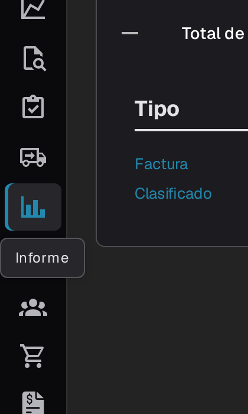
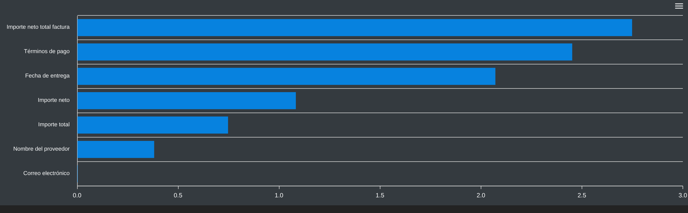
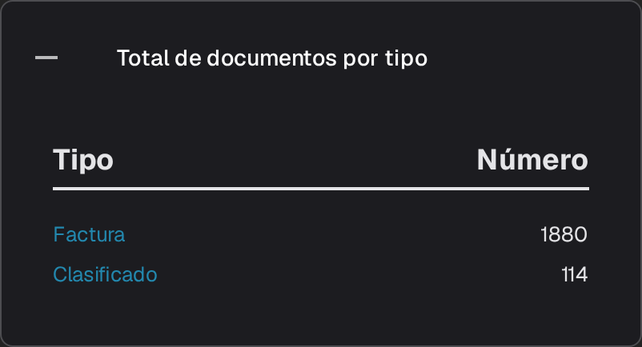
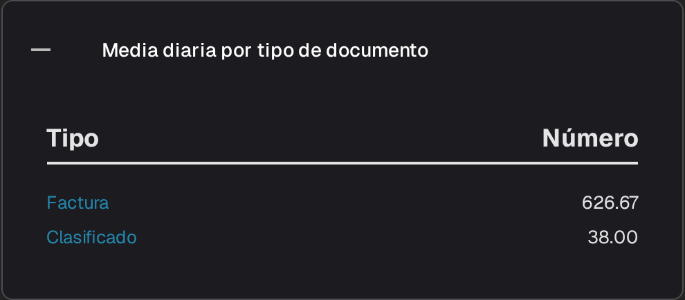
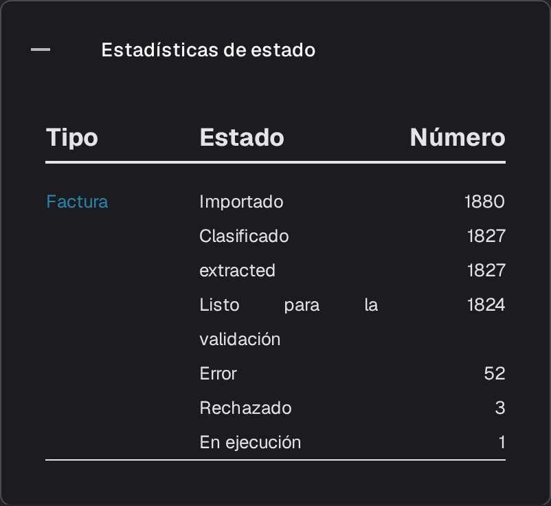
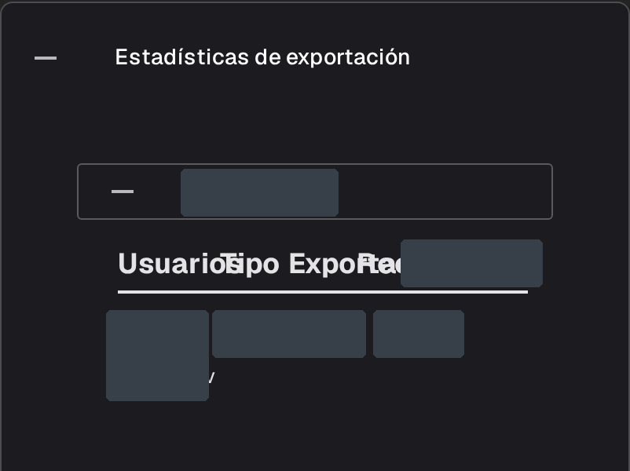

# Página de informes

La página **Informe** resume el recorrido de los documentos por DocBits durante un periodo: cuántos llegaron, cuánto duró su procesamiento, qué campos corrigieron los usuarios y dónde acabaron. Está pensada para administradores y responsables de equipo que analizan en conjunto el trabajo de recepción y validación, no un documento concreto.



## Activar la página de informes

La página se activa mediante un interruptor de módulo. Actívela una vez para la organización:

1. Vaya a **Configuración → Módulo** y abra el grupo **Integración de documentos**.
2. En la tarjeta **Tipo de Documento**, active **Mostrar informe**.
3. A continuación, la entrada **Informe** aparece en la barra lateral para los usuarios de la organización.

<figure><figcaption>
El interruptor Mostrar informe.
</figcaption></figure>

## Abrir la página de informes

Seleccione el icono de gráfico de la barra lateral. La página se abre con el filtro de tiempo, las cifras clave del periodo y las estadísticas de campos.

<figure><figcaption>
La entrada <strong>Informe</strong> de la barra lateral.
</figcaption></figure>

## Seleccionar el periodo

El filtro **Unidad de tiempo**, situado en la parte superior de la página, define el periodo de todas las cifras y secciones situadas debajo. Ofrece **Últimos 7 días**, **Últimos 30 días** y **Seleccionar intervalo de tiempo**; esta última opción abre un calendario en el que puede elegir una fecha de inicio y una de fin.

<figure><figcaption>
Opciones de Unidad de tiempo: Últimos 7 días, Últimos 30 días y Seleccionar intervalo de tiempo. El encabezado y la navegación de la aplicación quedan fuera de la imagen.
</figcaption></figure>

## Las cifras junto al filtro

<figure><figcaption>
<strong>Unidad de tiempo</strong>, <strong>Nuevos documentos</strong>, <strong>Tiempo medio del sistema</strong> y el botón de descarga.
</figcaption></figure>

- **Nuevos documentos** muestra cuántos documentos se importaron en el periodo seleccionado.
- **Tiempo medio del sistema** muestra el tiempo medio en segundos que DocBits necesitó para procesar un documento en ese periodo.
- El botón de descarga situado a la derecha de la fila exporta el informe como un archivo de Excel (XLSX) correspondiente al periodo seleccionado.

## Campos cambiados

El gráfico **Campos cambiados** cuenta cuántas veces se corrigió manualmente cada campo en el periodo seleccionado. Cuando hay correcciones manuales en ese periodo, aparece una barra por campo, lo que permite identificar fácilmente los campos que más edita su equipo; si no hay datos, la sección muestra un mensaje en lugar de barras. El signo de interrogación junto al encabezado explica qué cuenta el gráfico.

<figure><figcaption>
Mensaje de periodo sin datos en <strong>Campos cambiados</strong>.
</figcaption></figure>

Utilice el menú de la esquina superior derecha del gráfico para descargar el diagrama en formato **SVG**, **PNG** o **CSV**.

## Otras secciones del informe

Debajo del gráfico hay cuatro tarjetas. Están contraídas de forma predeterminada; seleccione un encabezado para abrir su tabla y vuelva a seleccionarlo para cerrarla.

1. **Total de documentos por tipo** presenta cada tipo de documento en la columna **Tipo** y su cantidad de documentos en **Número**. Si un tipo tiene subtipos de documento, muestra un signo **+** que permite desglosar el total.
2. **Media diaria por tipo de documento** muestra la misma lista con la media diaria de cada tipo de documento.
3. **Estadísticas de estado** desglosa los documentos por estado de procesamiento, con las columnas **Tipo**, **Estado** y **Número**.
4. **Estadísticas de exportación** primero enumera las organizaciones de su cuenta; expanda una para ver los formatos de exportación utilizados, con las columnas **Usuarios**, **Tipo** y **Exportado**.

<figure><figcaption>
<strong>Total de documentos por tipo</strong>.
</figcaption></figure>

<figure><figcaption>
<strong>Media diaria por tipo de documento</strong>.
</figcaption></figure>

<figure><figcaption>
<strong>Estadísticas de estado</strong>.
</figcaption></figure>

<figure><figcaption>
Estadísticas de exportación con una sección de organización expandida. Los nombres de las organizaciones y los valores de las filas están enmascarados; la imagen muestra estadísticas existentes.
</figcaption></figure>
