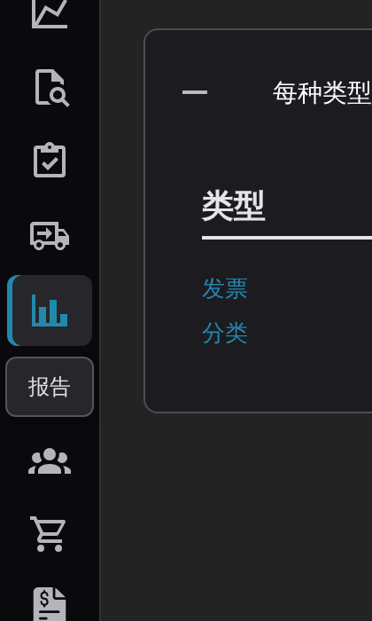
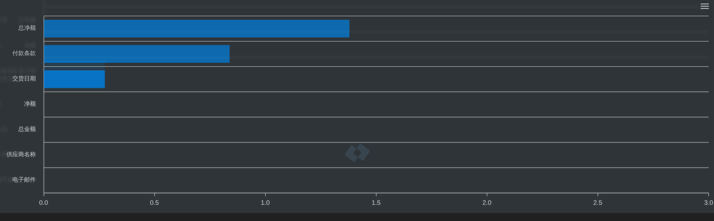
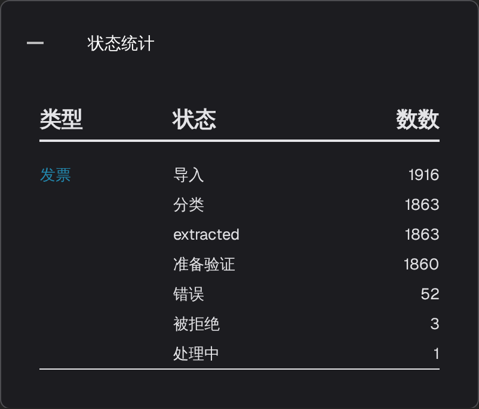
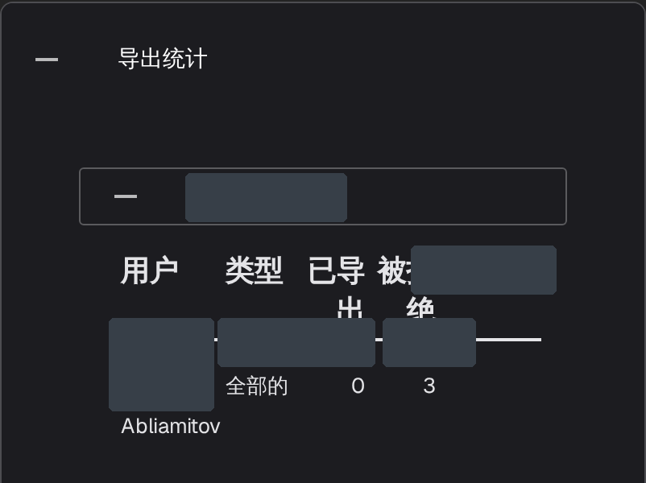

# 报告页面

**报告**页面汇总了所选期间内文档在 DocBits 中的流转情况：收到了多少文档、处理耗时多久、哪些字段经过人工更正，以及文档最终的去向。该页面面向需要整体了解文档接收和验证工作的管理员与团队负责人，而非用于查看单个文档。



## 启用报告页面

该页面由模块开关控制，只需为组织开启一次：

1. 前往 **设置 → 模块**，展开 **文档集成** 分组。
2. 在 **文档类型** 卡片中，开启 **显示报告**。
3. 随后，该组织的用户会在侧边栏中看到 **报告** 入口。

<figure><figcaption>
“显示报告”开关。
</figcaption></figure>

## 打开报告页面

选择侧边栏中的图表图标。页面打开后，会显示时间筛选器、所选期间的关键指标和字段统计。

<figure><figcaption>
侧边栏中的 <strong>报告</strong> 入口。
</figcaption></figure>

## 选择时间范围

页面顶部的 **时间单位** 筛选器会为下方所有数字和板块统一设置统计期间。它提供 **过去 7 天**、**过去 30 天** 和 **选择时间范围** 三个选项；选择最后一项会打开日历，供您选择开始日期和结束日期。

<figure><figcaption>
“时间单位”选项：过去 7 天、过去 30 天和选择时间范围。应用页头和导航不在图片内。
</figcaption></figure>

## 筛选器旁的指标

<figure><figcaption>
<strong>时间单位</strong>、<strong>新文件</strong>、<strong>平均系统时间</strong>和下载按钮。
</figcaption></figure>

- **新文件** 显示所选期间导入的文档数量。
- **平均系统时间** 显示 DocBits 在该期间处理一份文档所需的平均时间，单位为秒。
- 该行右侧的下载按钮可将所选期间的报告导出为 Excel 文件（XLSX）。

## 已更改的字段

**已更改的字段**图表统计所选期间内每个字段被人工更正的次数；有数据时，每个字段对应一根柱形，便于快速找出团队最常编辑的字段。标题旁边的问号说明了图表的统计内容。如果所选期间没有可统计的字段更改记录，图表区域会显示“在相应的时间范围内未找到数据条目。”

<figure><figcaption>
“已更改的字段”图表的空状态及右上角的图表菜单。
</figcaption></figure>

使用图表右上角的菜单，可将图表本身下载为 **SVG**、**PNG** 或 **CSV**。

## 其他报告板块

图表下方有四张卡片，默认均为折叠状态。选择卡片标题可展开表格，再次选择即可将其折叠。

1. **每种类型的文档总数** 列出各文档类型，表格包含 **类型** 和 **数数** 两列。如果某种类型包含子文档类型，其条目会显示 **+**，用于展开数量明细。
2. **每个文档类型的每日平均值** 显示相同的文档类型列表，但数值为各文档类型的每日平均值。
3. **状态统计** 按处理状态细分文档，表格包含 **类型**、**状态** 和 **数数** 三列。
4. **导出统计** 先列出您账户中的组织；展开一个组织，即可查看使用了哪些导出格式，表格包含 **用户**、**类型** 和 **已导出** 三列。

<figure><figcaption>
<strong>每种类型的文档总数</strong>。
</figcaption></figure>

<figure><figcaption>
<strong>每个文档类型的每日平均值</strong>。
</figcaption></figure>

<figure><figcaption>
<strong>状态统计</strong>。
</figcaption></figure>

<figure><figcaption>
“导出统计”中展开了一个现有组织，组织名称和行值已遮罩；图中展示的是现有统计数据。
</figcaption></figure>
