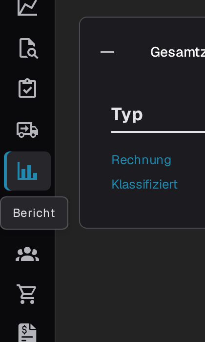
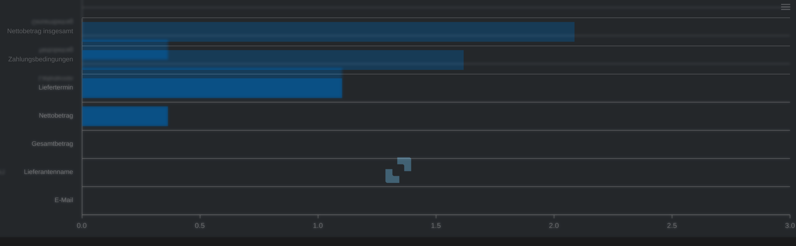
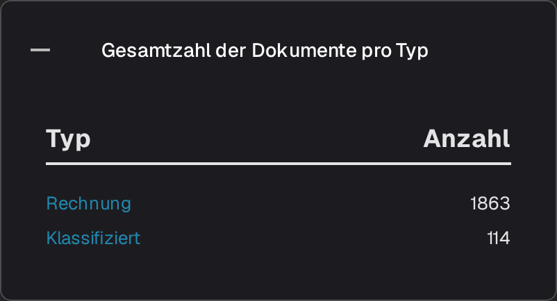
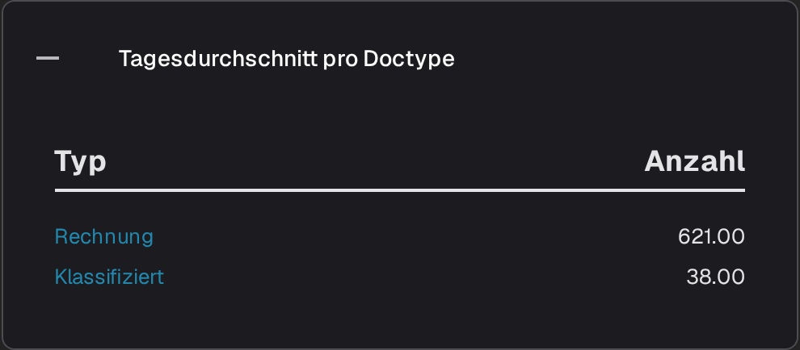
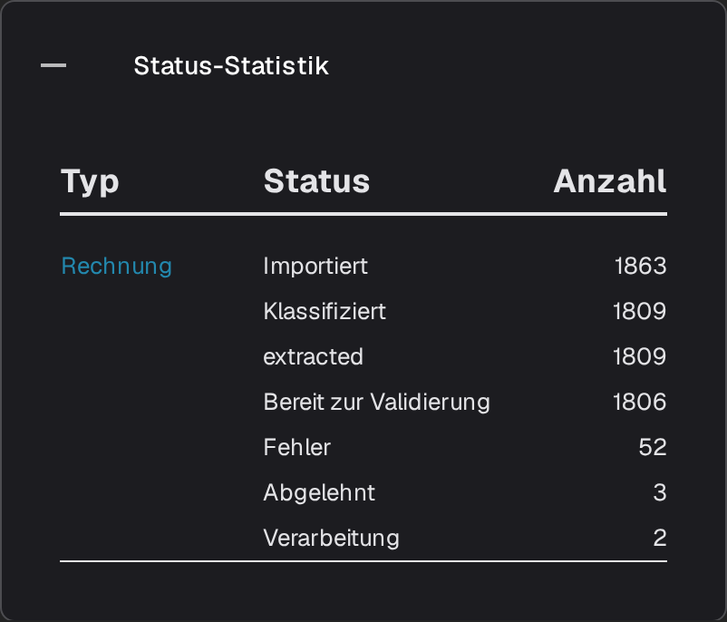
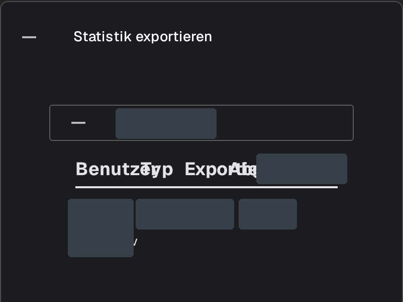

# Berichtsseite

Die **Berichtsseite** gibt einen Überblick darüber, wie Dokumente in einem bestimmten Zeitraum durch DocBits verarbeitet wurden: wie viele eingegangen sind, wie lange die Verarbeitung dauerte, welche Felder manuell korrigiert wurden und welchen Status die Dokumente schließlich erreichten. Sie richtet sich an Administratoren und Teamleiter, die die Eingangs- und Validierungsprozesse insgesamt betrachten möchten, nicht ein einzelnes Dokument.



## Berichtsseite aktivieren

Die Seite wird über einen Modulschalter aktiviert. Schalten Sie sie einmal für die Organisation ein:

1. Öffnen Sie **Einstellungen → Module** und wählen Sie die Gruppe **Dokumentenintegration** aus.
2. Aktivieren Sie in der Karte **Dokumenttyp** die Option **Bericht anzeigen**.
3. Anschließend wird den Benutzern der Organisation der Eintrag **Bericht** in der Seitenleiste angezeigt.

<figure><figcaption>
Der Schalter Bericht anzeigen.
</figcaption></figure>

## Berichtsseite öffnen

Wählen Sie das Diagrammsymbol in der Seitenleiste aus. Die Seite öffnet sich mit dem Zeitfilter, den Kennzahlen des Zeitraums und den Feldstatistiken.

<figure><figcaption>
Der Eintrag <strong>Bericht</strong> in der Seitenleiste.
</figcaption></figure>

## Zeitraum auswählen

Der Filter **Zeiteinheit** oben auf der Seite legt den Zeitraum für alle Kennzahlen und Bereiche darunter fest. Zur Auswahl stehen **Letzte 7 Tage**, **Letzte 30 Tage** und **Zeitbereich wählen**. Über die letzte Option öffnen Sie einen Kalender, in dem Sie ein Start- und ein Enddatum auswählen.

<figure><figcaption>
Optionen der Zeiteinheit: Letzte 7 Tage, Letzte 30 Tage und Zeitbereich wählen. Kopfzeile und Navigation der Anwendung sind nicht im Bild enthalten.
</figcaption></figure>

## Die Kennzahlen neben dem Filter

<figure><figcaption>
<strong>Zeiteinheit</strong>, <strong>Neue Dokumente</strong>, <strong>Durchschnittliche Systemzeit</strong> und die Download-Schaltfläche.
</figcaption></figure>

- **Neue Dokumente** zeigt, wie viele Dokumente im ausgewählten Zeitraum importiert wurden.
- **Durchschnittliche Systemzeit** gibt die durchschnittliche Zeit in Sekunden an, die DocBits in diesem Zeitraum für die Verarbeitung eines Dokuments benötigt hat.
- Mit der Download-Schaltfläche rechts in der Zeile exportieren Sie den Bericht für den ausgewählten Zeitraum als Excel-Datei (XLSX).

## Geänderte Felder

Das Diagramm **Geänderte Felder** zählt, wie häufig jedes Feld im ausgewählten Zeitraum manuell korrigiert wurde. Für jedes Feld wird ein Balken angezeigt, sodass Sie die am häufigsten bearbeiteten Felder Ihres Teams leicht erkennen. Das Fragezeichen neben der Überschrift erklärt, welche Änderungen das Diagramm zählt. Wurden im ausgewählten Zeitraum keine manuellen Korrekturen vorgenommen, erscheint statt der Balken die Meldung **Keine Dateneinträge im entsprechenden Zeitrahmen gefunden.**

<figure><figcaption>
Wie häufig jedes Feld manuell geändert wurde.
</figcaption></figure>

Über das Menü oben rechts im Diagramm laden Sie das Diagramm selbst im Format **SVG**, **PNG** oder **CSV** herunter.

## Weitere Berichtsbereiche

Unter dem Diagramm befinden sich vier Karten. Sie sind standardmäßig eingeklappt. Wählen Sie eine Überschrift aus, um die Tabelle zu öffnen, und wählen Sie sie erneut aus, um sie zu schließen.

1. **Gesamtzahl der Dokumente pro Typ** listet jeden Dokumenttyp mit den Spalten **Typ** und **Anzahl** auf. Bei Typen mit Unterdokumenttypen können Sie die Anzahl über **+** aufschlüsseln.
2. **Tagesdurchschnitt pro Doctype** zeigt dieselbe Liste als täglichen Durchschnitt pro Dokumenttyp.
3. **Status-Statistik** schlüsselt die Dokumente nach Verarbeitungsstatus auf; die Tabelle enthält die Spalten **Typ**, **Status** und **Anzahl**.
4. **Statistik exportieren** listet zunächst die Organisationen Ihres Kontos auf. Klappen Sie eine Organisation auf, um die verwendeten Exportformate anzuzeigen. Die Tabelle enthält die Spalten **Benutzer**, **Typ** und **Exportiert**.

<figure><figcaption>
<strong>Gesamtzahl der Dokumente pro Typ</strong>.
</figcaption></figure>

<figure><figcaption>
<strong>Tagesdurchschnitt pro Doctype</strong>.
</figcaption></figure>

<figure><figcaption>
<strong>Status-Statistik</strong>.
</figcaption></figure>

<figure><figcaption>
Die Karte Statistik exportieren mit einem aufgeklappten Bereich für eine bestehende Organisation. Organisationsnamen und Zeilenwerte sind unkenntlich gemacht; das Bild zeigt vorhandene Statistiken.
</figcaption></figure>
