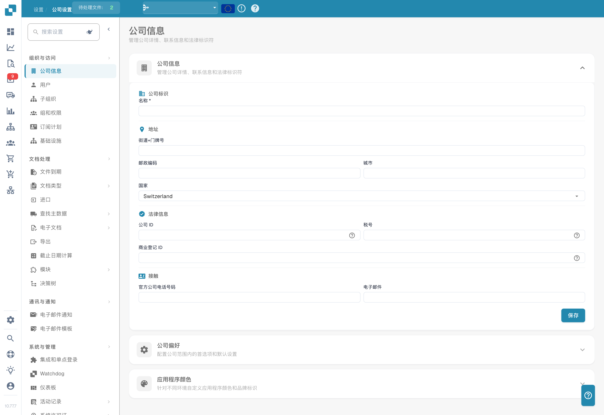

# 设置

需要某个设置的帮助？请参阅[通过 Settings Assistant 查找文档](settings-assistant/README.md)。

## 视频教程：设置总览与模块


DocBits 中的设置总览与模块


视频展示了设置总览的五个分组、搜索和快速链接，以及三个模块页面各自控制的内容。演示视频使用英语。

<figure><figcaption>
组织设置，识别性数据已隐藏。显示的国家是已配置的值。
</figcaption></figure>

**Settings** 区域是配置 DocBits 的中心位置，分为五个主要部分：

## 1. 组织与访问

管理公司资料，并控制谁能访问什么。

* **Company Information**：输入公司名称、地址、税号和其他法律标识。
* **Users**：添加、编辑或停用用户账户，并分配角色（Admin、System Admin）。
* **Sub-Organizations**：为多主体配置创建和管理子组织。
* **Groups and Permissions**：定义用户组，并为每个组配置细粒度权限。

## 2. 文档处理

配置文档的导入、处理和导出方式。

* **Documents Expiry**：设置文档自动删除规则（例如 48 小时后删除、1 周后删除等）。
* **Document Types**：定义并配置 DocBits 处理的文档类型（Invoices、Orders、Delivery Notes 等），包括字段、表格列、脚本等。
* **Import**：设置文档进入 DocBits 的方式——通过电子邮件（IMAP/Office 365）、FTP 或文件上传。配置文件类型和页数限制。
* **Rule Management**：定义发票与订单核对时的冲突解决规则，包括容差设置和审批工作流。
* **OCR Settings**：配置光学字符识别质量阈值、E-Text 使用、AI OCR 版本和表格提取行为。
* **Classification and Extraction**：设置文档拆分、金额格式、表格提取方法、分类规则和 AI 模型。
* **Lookup Master Data**：配置抽取数据如何与 ERP 系统的主数据（例如供应商账户、采购订单）进行校验。
* **List of Values**：创建和管理用于下拉列表和数据校验的预定义值列表。
* **Export**：配置处理后的文档如何以及发送到哪里——通过 Webhook、SFTP、SMB 或 Infor 集成（IDM、ION、M3、LN）。
* **Module**：启用或停用可选功能，例如 PO Dashboard、Auto Accounting、Supplier Portal、Workflow Builder、QR-Code Extraction 等。
* **Decision Trees**：使用可视化设计器构建基于规则的决策逻辑。支持多种策略（Unique、First、Priority、Collect 等）。
* **Agent Setup**：创建和管理自动化代理及通信渠道，用于自动化文档处理工作流。

## 3. 通信与通知

控制 DocBits 如何与用户通信以及如何处理收到的电子邮件。

* **Email Notification**：为文档处理事件和状态变更配置电子邮件提醒。
* **Email Templates**：创建和管理可重复使用的通知邮件模板，按文档类型组织。
* **Email Ingestion**：配置收到的电子邮件如何自动分类并转换为文档。包含分类、字段抽取、处理、发件人管理和训练规则，按文档类型组织（Orders、Invoices、Quotes、Delivery Notes、COA、PO Confirm）。

## 4. 系统与管理

监控系统状态、管理集成并维护安全。

* **Integration & SSO**：为外部集成配置 API 密钥，并使用身份提供商设置 Single Sign-On (SSO)。
* **Watchdog**：设置 Watchdog 服务，以从本地目录自动导入文档。
* **Dashboard**：自定义仪表板行为——筛选器、导出设置、操作权限和状态显示选项。
* **Activity Logging**：查看实时系统事件日志，可按严重级别（Debug、Info、Warning、Error）、时间范围和服务筛选。
* **Analytics**：访问详细的分析仪表板，包括 Logs Analytics、Auth Security 监控和带 Real User Monitoring (RUM) 的 API Metrics。
* **Access Audit**：启用并查看审计轨迹，记录组织内的所有 Create、Update 和 Delete 操作，用于合规与安全。
* **System Licenses**：查看和管理 API 许可证信息及其使用情况。
* **Cache Management**：为 Received Delivery、Purchase Order 和 Task/Notification 缓存配置自动清理间隔（TTL）。
* **Fulltext Search Settings**：配置对文档和数据的全文搜索（需要启用 Fulltext Search 模块）。
* **Appearance**：自定义组织的颜色、圆角、密度和字体——整个应用在浅色和深色模式下都遵循该主题。

## 5. 供应商设置

配置 Supplier Portal 并管理与供应商相关的工作流。

* **Supplier General Settings**：设置供应商门户邀请字段，配置工作流状态（Not Invited、Open、Pending Registration、Approved、Rejected），并管理审批设置。
* **Email Templates**：创建和管理专门用于供应商沟通的邮件模板。
* **Supplier Layout**：自定义 Supplier Portal 的布局和外观。
* **Export Configuration**：配置供应商数据如何导出到外部系统。
* **Supplier Group**：创建和管理供应商组，以便对供应商进行分类和整理。
* **User and Supplier Group Mapping**：将内部用户关联到特定供应商组，以控制可见性和访问权限。
