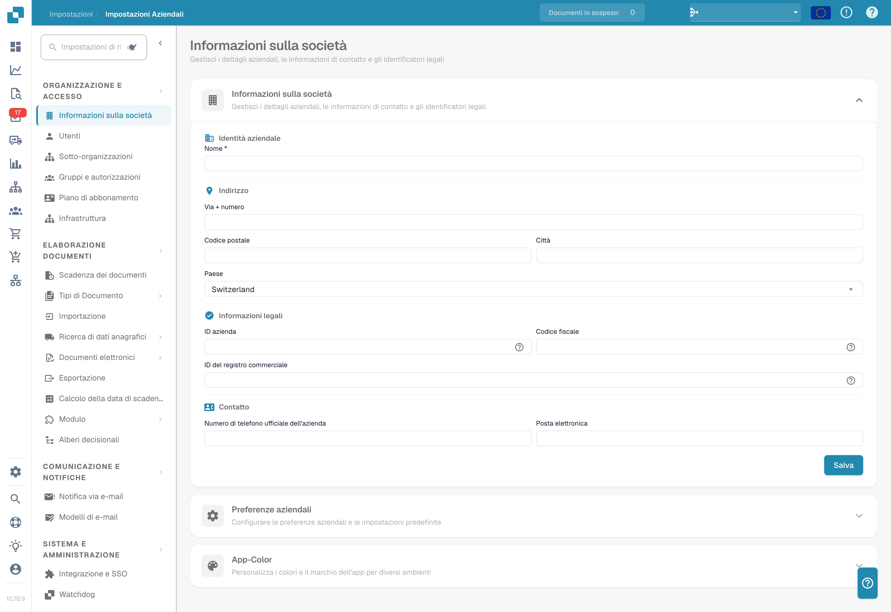

# Impostazioni

Serve aiuto su un'impostazione? Vedi [Trovare la documentazione con il Settings Assistant](settings-assistant/README.md).

## Video tutorial: panoramica delle Impostazioni e dei moduli


Panoramica delle Impostazioni e dei moduli in DocBits


Il video mostra i cinque gruppi della panoramica delle Impostazioni, la ricerca e i collegamenti rapidi, e cosa controllano le tre pagine dei moduli.

<figure><figcaption>
Impostazioni dell'organizzazione con i valori identificativi nascosti. Il paese mostrato è un valore configurato.
</figcaption></figure>

L'area **Settings** è il punto centrale per configurare DocBits. È organizzata in cinque sezioni principali:

## 1. Organizzazione e accesso

Gestisci il profilo aziendale e controlla chi può accedere a cosa.

* **Company Information**: Inserisci ragione sociale, indirizzo, partita IVA e altri identificativi legali.
* **Users**: Aggiungi, modifica o disattiva account utente e assegna ruoli (Admin, System Admin).
* **Sub-Organizations**: Crea e gestisci sub-organizzazioni per configurazioni multi-società.
* **Groups and Permissions**: Definisci gruppi di utenti e configura permessi granulari per ogni gruppo.

## 2. Elaborazione dei documenti

Configura come i documenti vengono importati, elaborati ed esportati.

* **Documents Expiry**: Imposta regole di eliminazione automatica dei documenti (ad esempio eliminazione dopo 48 ore, 1 settimana e così via).
* **Document Types**: Definisci e configura i tipi di documento elaborati da DocBits (Invoices, Orders, Delivery Notes e altri), inclusi campi, colonne di tabella, script e altro.
* **Import**: Configura come i documenti entrano in DocBits — via email (IMAP/Office 365), FTP o caricamento di file. Configura i tipi di file e i limiti di pagina.
* **Rule Management**: Definisci regole di risoluzione dei conflitti per la riconciliazione fattura-ordine, incluse tolleranze e flussi di approvazione.
* **OCR Settings**: Configura le soglie di qualità del riconoscimento ottico dei caratteri, l'uso di E-Text, la versione di AI OCR e il comportamento dell'estrazione tabelle.
* **Classification and Extraction**: Imposta separazione dei documenti, formato degli importi, metodi di estrazione tabelle, regole di classificazione e modelli AI.
* **Lookup Master Data**: Configura come i dati estratti vengono validati rispetto ai dati anagrafici del tuo ERP (ad esempio conti fornitori, ordini di acquisto).
* **List of Values**: Crea e gestisci elenchi di valori predefiniti usati nei menu a discesa e nella validazione dei dati.
* **Export**: Configura come e dove vengono inviati i documenti elaborati — tramite Webhook, SFTP, SMB o integrazioni Infor (IDM, ION, M3, LN).
* **Module**: Attiva o disattiva funzioni opzionali come PO Dashboard, Auto Accounting, Supplier Portal, Workflow Builder, QR-Code Extraction e altre.
* **Decision Trees**: Costruisci logica decisionale basata su regole con un designer visuale. Supporta più policy (Unique, First, Priority, Collect e altre).
* **Agent Setup**: Crea e gestisci agenti di automazione e canali di comunicazione per flussi di elaborazione documenti automatizzati.

## 3. Comunicazione e notifiche

Controlla come DocBits comunica con gli utenti e gestisce le email in ingresso.

* **Email Notification**: Configura avvisi email per eventi di elaborazione documenti e cambi di stato.
* **Email Templates**: Crea e gestisci modelli email riutilizzabili per le notifiche, organizzati per tipo di documento.
* **Email Ingestion**: Configura come le email in ingresso vengono classificate automaticamente e convertite in documenti. Include regole per classificazione, estrazione dei campi, elaborazione, gestione dei mittenti e addestramento — organizzate per tipo di documento (Orders, Invoices, Quotes, Delivery Notes, COA, PO Confirm).

## 4. Sistema e amministrazione

Monitora la salute del sistema, gestisci le integrazioni e mantieni la sicurezza.

* **Integration & SSO**: Configura le chiavi API per le integrazioni esterne e imposta il Single Sign-On (SSO) con i provider di identità.
* **Watchdog**: Imposta il servizio Watchdog per l'import automatico dei documenti da directory locali.
* **Dashboard**: Personalizza il comportamento della dashboard — filtri, impostazioni di export, permessi sulle azioni e opzioni di visualizzazione degli stati.
* **Activity Logging**: Consulta i log degli eventi di sistema in tempo reale, filtrati per gravità (Debug, Info, Warning, Error), intervallo di tempo e servizio.
* **Analytics**: Accedi a dashboard analitiche dettagliate, tra cui Logs Analytics, il monitoraggio Auth Security e API Metrics con Real User Monitoring (RUM).
* **Access Audit**: Attiva e consulta le tracce di audit che registrano tutte le azioni Create, Update e Delete della tua organizzazione per conformità e sicurezza.
* **System Licenses**: Consulta e gestisci le informazioni sulle licenze API e il loro utilizzo.
* **Cache Management**: Configura intervalli automatici (TTL) per svuotare le cache Received Delivery, Purchase Order e Task/Notification.
* **Fulltext Search Settings**: Configura la ricerca full-text su documenti e dati (richiede che il modulo Fulltext Search sia attivo).
* **Appearance**: Personalizza colori, raggio degli angoli, densità e carattere dell'organizzazione — l'intera app segue questo tema in modalità chiara e scura.

## 5. Impostazioni fornitori

Configura il Supplier Portal e gestisci i flussi di lavoro legati ai fornitori.

* **Supplier General Settings**: Imposta i campi di invito del portale fornitori, configura gli stati del flusso (Not Invited, Open, Pending Registration, Approved, Rejected) e gestisci le impostazioni di approvazione.
* **Email Templates**: Crea e gestisci modelli email specifici per la comunicazione con i fornitori.
* **Supplier Layout**: Personalizza layout e aspetto del Supplier Portal.
* **Export Configuration**: Configura come i dati dei fornitori vengono esportati verso sistemi esterni.
* **Supplier Group**: Crea e gestisci gruppi di fornitori per classificare e organizzare i fornitori.
* **User and Supplier Group Mapping**: Collega utenti interni a specifici gruppi di fornitori per controllare visibilità e accesso.
