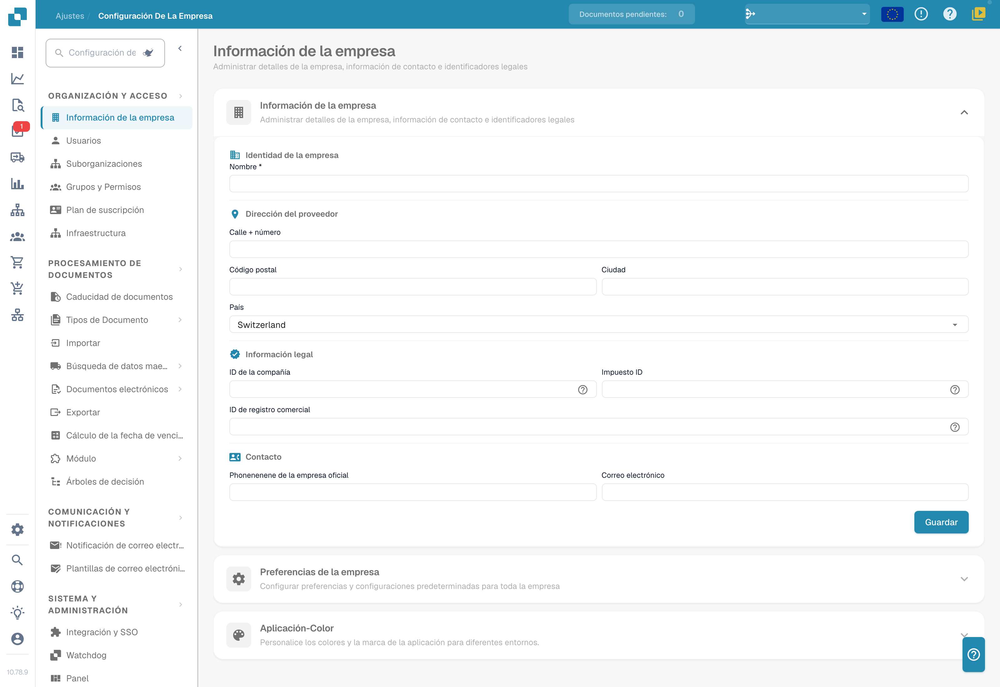

# Configuración

¿Necesita ayuda con una opción? Consulte [Encontrar documentación con el Settings Assistant](settings-assistant/README.md).

## Videotutorial: vista general de Configuración y módulos


Vista general de Configuración y módulos en DocBits


El vídeo muestra los cinco grupos de la vista general de Configuración, la búsqueda y los accesos rápidos, y qué controlan las tres páginas de módulos.

<figure><figcaption>
Ajustes de la organización con los valores identificativos ocultos. El país mostrado es un valor configurado.
</figcaption></figure>

El área **Settings** es su punto central para configurar DocBits. Está organizada en cinco secciones principales:

## 1. Organización y acceso

Gestione el perfil de su empresa y controle quién puede acceder a qué.

* **Company Information**: Introduzca el nombre de la empresa, la dirección, el NIF y otros identificadores legales.
* **Users**: Añada, edite o desactive cuentas de usuario y asigne roles (Admin, System Admin).
* **Sub-Organizations**: Cree y gestione suborganizaciones para configuraciones con varias sociedades.
* **Groups and Permissions**: Defina grupos de usuarios y configure permisos detallados para cada grupo.

## 2. Procesamiento de documentos

Configure cómo se importan, procesan y exportan los documentos.

* **Documents Expiry**: Defina reglas de eliminación automática de documentos (por ejemplo, eliminar tras 48 horas, 1 semana, etc.).
* **Document Types**: Defina y configure los tipos de documento que procesa DocBits (Invoices, Orders, Delivery Notes, etc.), incluidos campos, columnas de tabla, scripts y más.
* **Import**: Configure cómo entran los documentos en DocBits: por correo (IMAP/Office 365), FTP o carga de archivos. Configure tipos de archivo y límites de páginas.
* **Rule Management**: Defina reglas de resolución de conflictos para la conciliación de facturas con pedidos, incluidas tolerancias y flujos de aprobación.
* **OCR Settings**: Configure los umbrales de calidad del reconocimiento óptico de caracteres, el uso de E-Text, la versión de AI OCR y el comportamiento de la extracción de tablas.
* **Classification and Extraction**: Configure la separación de documentos, el formato de importes, los métodos de extracción de tablas, las reglas de clasificación y los modelos de IA.
* **Lookup Master Data**: Configure cómo se validan los datos extraídos con los datos maestros de su ERP (por ejemplo, cuentas de proveedor, pedidos).
* **List of Values**: Cree y gestione listas de valores predefinidas para menús desplegables y la validación de datos.
* **Export**: Configure cómo y adónde se envían los documentos procesados: mediante Webhook, SFTP, SMB o integraciones con Infor (IDM, ION, M3, LN).
* **Module**: Active o desactive funciones opcionales como PO Dashboard, Auto Accounting, Supplier Portal, Workflow Builder, QR-Code Extraction y más.
* **Decision Trees**: Cree lógica de decisión basada en reglas con un diseñador visual. Admite varias políticas (Unique, First, Priority, Collect, etc.).
* **Agent Setup**: Cree y gestione agentes de automatización y canales de comunicación para flujos de procesamiento automatizado de documentos.

## 3. Comunicación y notificaciones

Controle cómo se comunica DocBits con los usuarios y cómo procesa el correo entrante.

* **Email Notification**: Configure alertas por correo para eventos de procesamiento de documentos y cambios de estado.
* **Email Templates**: Cree y gestione plantillas de correo reutilizables para notificaciones, organizadas por tipo de documento.
* **Email Ingestion**: Configure cómo se clasifican automáticamente los correos entrantes y se convierten en documentos. Incluye reglas de clasificación, extracción de campos, procesamiento, gestión de remitentes y entrenamiento, organizadas por tipo de documento (Orders, Invoices, Quotes, Delivery Notes, COA, PO Confirm).

## 4. Sistema y administración

Supervise el estado del sistema, gestione integraciones y mantenga la seguridad.

* **Integration & SSO**: Configure claves de API para integraciones externas y configure Single Sign-On (SSO) con proveedores de identidad.
* **Watchdog**: Configure el servicio Watchdog para la importación automática de documentos desde directorios locales.
* **Dashboard**: Personalice el comportamiento del panel: filtros, ajustes de exportación, permisos de acciones y opciones de visualización de estados.
* **Activity Logging**: Consulte los registros de eventos del sistema en tiempo real, filtrados por gravedad (Debug, Info, Warning, Error), intervalo de tiempo y servicio.
* **Analytics**: Acceda a paneles analíticos detallados, incluidos Logs Analytics, la monitorización de Auth Security y API Metrics con Real User Monitoring (RUM).
* **Access Audit**: Active y revise las pistas de auditoría que registran todas las acciones Create, Update y Delete de su organización para cumplimiento y seguridad.
* **System Licenses**: Consulte y gestione la información sobre licencias de API y su uso.
* **Cache Management**: Configure intervalos automáticos (TTL) para vaciar las cachés de Received Delivery, Purchase Order y Task/Notification.
* **Fulltext Search Settings**: Configure la búsqueda de texto completo en sus documentos y datos (requiere que el módulo Fulltext Search esté activado).
* **Appearance**: Personalice los colores, el radio de esquina, la densidad y la fuente de la organización: toda la aplicación sigue este tema en modo claro y oscuro.

## 5. Ajustes de proveedores

Configure el Supplier Portal y gestione los flujos relacionados con proveedores.

* **Supplier General Settings**: Configure los campos de invitación del portal de proveedores, los estados del flujo (Not Invited, Open, Pending Registration, Approved, Rejected) y los ajustes de aprobación.
* **Email Templates**: Cree y gestione plantillas de correo específicas para la comunicación con proveedores.
* **Supplier Layout**: Personalice el diseño y la apariencia del Supplier Portal.
* **Export Configuration**: Configure cómo se exportan los datos de proveedores a sistemas externos.
* **Supplier Group**: Cree y gestione grupos de proveedores para clasificar y organizar sus proveedores.
* **User and Supplier Group Mapping**: Vincule usuarios internos a grupos de proveedores concretos para controlar la visibilidad y el acceso.
