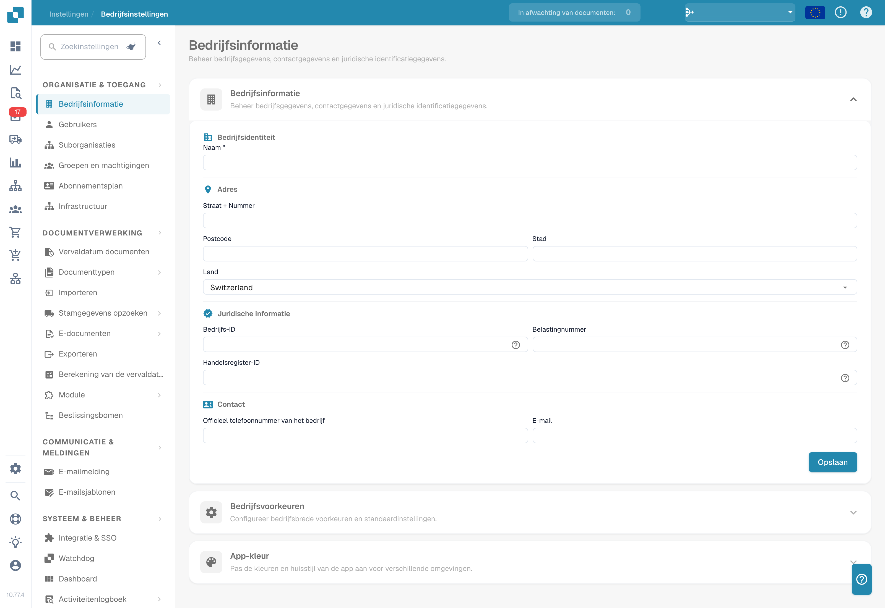

# Instellingen

Hulp nodig bij een instelling? Zie [Documentatie vinden met de Settings Assistant](settings-assistant/README.md).

## Videotutorial: Instellingenoverzicht en modules


Instellingenoverzicht en modules in DocBits


De video toont de vijf groepen van het Instellingenoverzicht, de zoekfunctie en snelkoppelingen en wat de drie modulepagina's regelen.

<figure><figcaption>
Organisatie-instellingen met afgeschermde identificatiegegevens. Het getoonde land is een ingestelde waarde.
</figcaption></figure>

Het gedeelte **Settings** is uw centrale punt voor het configureren van DocBits. Het is ingedeeld in vijf hoofdonderdelen:

## 1. Organisatie & Toegang

Beheer het profiel van uw bedrijf en bepaal wie waartoe toegang heeft.

* **Company Information**: Voer de bedrijfsnaam, het adres, het btw-nummer en andere juridische identificatiegegevens in.
* **Users**: Voeg gebruikersaccounts toe, bewerk of deactiveer ze en wijs rollen toe (Admin, System Admin).
* **Sub-Organizations**: Maak en beheer suborganisaties voor opstellingen met meerdere entiteiten.
* **Groups and Permissions**: Definieer gebruikersgroepen en stel fijnmazige machtigingen per groep in.

## 2. Documentverwerking

Stel in hoe documenten worden geïmporteerd, verwerkt en geëxporteerd.

* **Documents Expiry**: Stel regels in voor het automatisch verwijderen van documenten (bijv. verwijderen na 48 uur, 1 week, enz.).
* **Document Types**: Definieer en configureer de documenttypen die DocBits verwerkt (Invoices, Orders, Delivery Notes, enz.), inclusief velden, tabelkolommen, scripts en meer.
* **Import**: Stel in hoe documenten in DocBits komen — via e-mail (IMAP/Office 365), FTP of bestandsupload. Configureer bestandstypen en paginalimieten.
* **Rule Management**: Definieer regels voor conflictoplossing bij het afstemmen van facturen op bestelorders, inclusief tolerantie-instellingen en goedkeuringsworkflows.
* **OCR Settings**: Configureer kwaliteitsdrempels voor optische tekenherkenning, gebruik van E-Text, de AI-OCR-versie en het gedrag van tabelextractie.
* **Classification and Extraction**: Stel documentsplitsing, bedragnotatie, methoden voor tabelextractie, classificatieregels en AI-modellen in.
* **Lookup Master Data**: Stel in hoe geëxtraheerde gegevens worden gevalideerd tegen stamgegevens uit uw ERP-systeem (bijv. leveranciersrekeningen, bestelorders).
* **List of Values**: Maak en beheer vooraf gedefinieerde waardelijsten voor dropdowns en gegevensvalidatie.
* **Export**: Stel in hoe en waar verwerkte documenten worden naartoe gestuurd — via Webhook, SFTP, SMB of Infor-integraties (IDM, ION, M3, LN).
* **Module**: Schakel optionele functies in of uit, zoals PO Dashboard, Auto Accounting, Supplier Portal, Workflow Builder, QR-Code Extraction en meer.
* **Decision Trees**: Bouw regelgebaseerde beslissingslogica met een visuele designer. Ondersteunt meerdere policies (Unique, First, Priority, Collect, enz.).
* **Agent Setup**: Maak en beheer automatiseringsagenten en communicatiekanalen voor geautomatiseerde documentverwerkingsworkflows.

## 3. Communicatie & Meldingen

Bepaal hoe DocBits met gebruikers communiceert en inkomende e-mail verwerkt.

* **Email Notification**: Configureer e-mailmeldingen voor gebeurtenissen in de documentverwerking en statuswijzigingen.
* **Email Templates**: Maak en beheer herbruikbare e-mailsjablonen voor meldingen, geordend per documenttype.
* **Email Ingestion**: Stel in hoe inkomende e-mail automatisch wordt geclassificeerd en omgezet in documenten. Bevat regels voor classificatie, veldextractie, verwerking, afzenderbeheer en training — geordend per documenttype (Orders, Invoices, Quotes, Delivery Notes, COA, PO Confirm).

## 4. Systeem & Beheer

Bewaak de systeemstatus, beheer integraties en houd de beveiliging op orde.

* **Integration & SSO**: Configureer API-sleutels voor externe integraties en stel Single Sign-On (SSO) met identiteitsproviders in.
* **Watchdog**: Stel de Watchdog-service in voor automatische documentimport uit lokale mappen.
* **Dashboard**: Pas het gedrag van het dashboard aan — filters, exportinstellingen, actiemachtigingen en opties voor statusweergave.
* **Activity Logging**: Bekijk realtime systeemgebeurtenislogboeken, gefilterd op ernst (Debug, Info, Warning, Error), tijdsbereik en service.
* **Analytics**: Open gedetailleerde analysedashboards, waaronder Logs Analytics, Auth Security-bewaking en API Metrics met Real User Monitoring (RUM).
* **Access Audit**: Schakel audit trails in en beoordeel ze; ze volgen alle Create-, Update- en Delete-acties in uw organisatie voor compliance en beveiliging.
* **System Licenses**: Bekijk en beheer informatie over API-licenties en het gebruik ervan.
* **Cache Management**: Stel automatische intervallen (TTL) in voor het leegmaken van de caches voor Received Delivery, Purchase Order en Task/Notification.
* **Fulltext Search Settings**: Configureer volledige-tekstzoekfuncties over uw documenten en gegevens (vereist dat de module Fulltext Search is ingeschakeld).
* **Appearance**: Pas de kleuren, hoekradius, dichtheid en het lettertype van de organisatie aan — de hele app volgt dit thema in lichte en donkere modus.

## 5. Leveranciersinstellingen

Configureer het Supplier Portal en beheer leveranciersgerelateerde workflows.

* **Supplier General Settings**: Stel de uitnodigingsvelden van het leveranciersportaal in, configureer workflowstatussen (Not Invited, Open, Pending Registration, Approved, Rejected) en beheer de goedkeuringsinstellingen.
* **Email Templates**: Maak en beheer e-mailsjablonen speciaal voor communicatie met leveranciers.
* **Supplier Layout**: Pas de lay-out en weergave van het Supplier Portal aan.
* **Export Configuration**: Stel in hoe leveranciersgegevens naar externe systemen worden geëxporteerd.
* **Supplier Group**: Maak en beheer leveranciersgroepen om uw leveranciers te categoriseren en te ordenen.
* **User and Supplier Group Mapping**: Koppel interne gebruikers aan specifieke leveranciersgroepen om zichtbaarheid en toegang te sturen.
