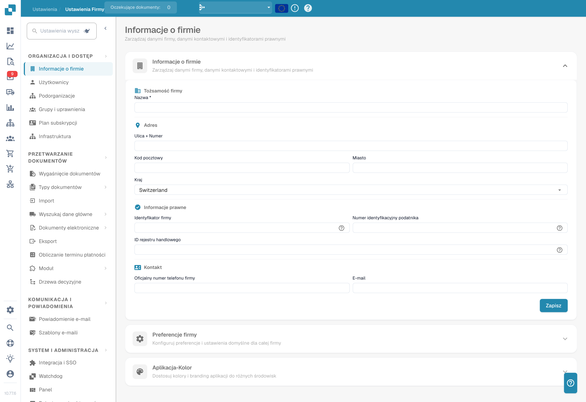

# Ustawienia

Potrzebujesz pomocy z ustawieniem? Zobacz [Znajdowanie dokumentacji za pomocą Settings Assistant](settings-assistant/README.md).

## Samouczek wideo: przegląd Ustawień i modułów


Przegląd ustawień i modułów w DocBits


Film pokazuje pięć grup przeglądu Ustawień, wyszukiwanie i szybkie linki oraz to, czym sterują trzy strony modułów.

<figure><figcaption>
Ustawienia organizacji z ukrytymi danymi identyfikującymi. Wyświetlany kraj jest skonfigurowaną wartością.
</figcaption></figure>

Obszar **Settings** to centralne miejsce konfiguracji DocBits. Jest podzielony na pięć głównych sekcji:

## 1. Organizacja i dostęp

Zarządzaj profilem firmy i kontroluj, kto ma do czego dostęp.

* **Company Information**: Wprowadź nazwę firmy, adres, NIP i inne identyfikatory prawne.
* **Users**: Dodawaj, edytuj i dezaktywuj konta użytkowników oraz przypisuj role (Admin, System Admin).
* **Sub-Organizations**: Twórz podorganizacje i zarządzaj nimi w konfiguracjach z wieloma podmiotami.
* **Groups and Permissions**: Definiuj grupy użytkowników i konfiguruj szczegółowe uprawnienia dla każdej grupy.

## 2. Przetwarzanie dokumentów

Konfiguruj sposób importowania, przetwarzania i eksportowania dokumentów.

* **Documents Expiry**: Ustaw reguły automatycznego usuwania dokumentów (np. usuwanie po 48 godzinach, 1 tygodniu itd.).
* **Document Types**: Definiuj i konfiguruj typy dokumentów przetwarzane przez DocBits (Invoices, Orders, Delivery Notes itd.), wraz z polami, kolumnami tabel, skryptami i innymi elementami.
* **Import**: Skonfiguruj, jak dokumenty trafiają do DocBits — przez e-mail (IMAP/Office 365), FTP lub przesyłanie plików. Skonfiguruj typy plików i limity stron.
* **Rule Management**: Zdefiniuj reguły rozwiązywania konfliktów przy uzgadnianiu faktur z zamówieniami, w tym tolerancje i przepływy zatwierdzania.
* **OCR Settings**: Skonfiguruj progi jakości optycznego rozpoznawania znaków, korzystanie z E-Text, wersję AI OCR i zachowanie ekstrakcji tabel.
* **Classification and Extraction**: Skonfiguruj dzielenie dokumentów, format kwot, metody ekstrakcji tabel, reguły klasyfikacji i modele AI.
* **Lookup Master Data**: Skonfiguruj sprawdzanie wyodrębnionych danych względem danych podstawowych z Twojego systemu ERP (np. konta dostawców, zamówienia).
* **List of Values**: Twórz listy predefiniowanych wartości używanych w listach rozwijanych i walidacji danych i zarządzaj nimi.
* **Export**: Skonfiguruj, jak i gdzie wysyłane są przetworzone dokumenty — przez Webhook, SFTP, SMB lub integracje Infor (IDM, ION, M3, LN).
* **Module**: Włączaj lub wyłączaj opcjonalne funkcje, takie jak PO Dashboard, Auto Accounting, Supplier Portal, Workflow Builder, QR-Code Extraction i inne.
* **Decision Trees**: Buduj logikę decyzyjną opartą na regułach w wizualnym projektancie. Obsługuje wiele polityk (Unique, First, Priority, Collect itd.).
* **Agent Setup**: Twórz agentów automatyzacji i kanały komunikacji dla zautomatyzowanych przepływów przetwarzania dokumentów i zarządzaj nimi.

## 3. Komunikacja i powiadomienia

Kontroluj, jak DocBits komunikuje się z użytkownikami i przetwarza przychodzące e-maile.

* **Email Notification**: Skonfiguruj powiadomienia e-mail dla zdarzeń przetwarzania dokumentów i zmian statusu.
* **Email Templates**: Twórz wielokrotnego użytku szablony e-mail dla powiadomień i zarządzaj nimi, uporządkowane według typu dokumentu.
* **Email Ingestion**: Skonfiguruj automatyczną klasyfikację przychodzących e-maili i konwersję na dokumenty. Zawiera reguły klasyfikacji, ekstrakcji pól, przetwarzania, zarządzania nadawcami i uczenia — uporządkowane według typu dokumentu (Orders, Invoices, Quotes, Delivery Notes, COA, PO Confirm).

## 4. System i administracja

Monitoruj kondycję systemu, zarządzaj integracjami i dbaj o bezpieczeństwo.

* **Integration & SSO**: Skonfiguruj klucze API dla integracji zewnętrznych i ustaw Single Sign-On (SSO) z dostawcami tożsamości.
* **Watchdog**: Skonfiguruj usługę Watchdog do automatycznego importu dokumentów z katalogów lokalnych.
* **Dashboard**: Dostosuj zachowanie pulpitu — filtry, ustawienia eksportu, uprawnienia do akcji i opcje wyświetlania statusów.
* **Activity Logging**: Przeglądaj dzienniki zdarzeń systemowych w czasie rzeczywistym, filtrowane według wagi (Debug, Info, Warning, Error), zakresu czasu i usługi.
* **Analytics**: Korzystaj ze szczegółowych pulpitów analitycznych, w tym Logs Analytics, monitorowania Auth Security i API Metrics z Real User Monitoring (RUM).
* **Access Audit**: Włączaj i przeglądaj ścieżki audytu rejestrujące wszystkie akcje Create, Update i Delete w organizacji na potrzeby zgodności i bezpieczeństwa.
* **System Licenses**: Przeglądaj informacje o licencjach API i ich wykorzystaniu oraz zarządzaj nimi.
* **Cache Management**: Skonfiguruj automatyczne interwały (TTL) czyszczenia pamięci podręcznych Received Delivery, Purchase Order i Task/Notification.
* **Fulltext Search Settings**: Skonfiguruj wyszukiwanie pełnotekstowe w dokumentach i danych (wymaga włączonego modułu Fulltext Search).
* **Appearance**: Dostosuj kolory, promień narożników, gęstość i czcionkę organizacji — cała aplikacja stosuje ten motyw w trybie jasnym i ciemnym.

## 5. Ustawienia dostawców

Skonfiguruj Supplier Portal i zarządzaj przepływami związanymi z dostawcami.

* **Supplier General Settings**: Skonfiguruj pola zaproszeń portalu dostawców, statusy przepływu (Not Invited, Open, Pending Registration, Approved, Rejected) i ustawienia zatwierdzania.
* **Email Templates**: Twórz szablony e-mail przeznaczone do komunikacji z dostawcami i zarządzaj nimi.
* **Supplier Layout**: Dostosuj układ i wygląd Supplier Portal.
* **Export Configuration**: Skonfiguruj eksport danych dostawców do systemów zewnętrznych.
* **Supplier Group**: Twórz grupy dostawców i zarządzaj nimi, aby kategoryzować i porządkować dostawców.
* **User and Supplier Group Mapping**: Przypisz użytkowników wewnętrznych do określonych grup dostawców, aby kontrolować widoczność i dostęp.
