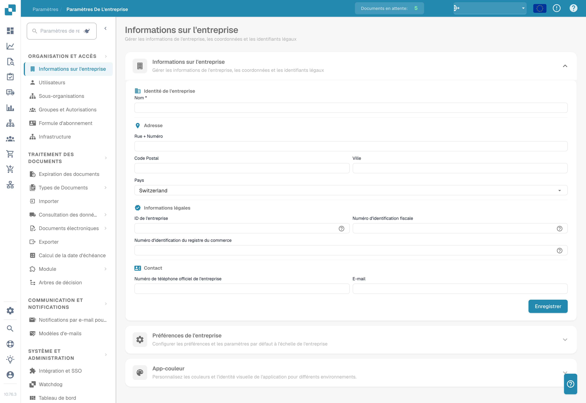

# Paramètres

Besoin d'aide sur un paramètre ? Voir [Trouver la documentation avec le Settings Assistant](settings-assistant/README.md).

## Tutoriel vidéo : vue d'ensemble des Paramètres et modules


Vue d'ensemble des Paramètres et modules dans DocBits


La vidéo montre les cinq groupes de la vue d'ensemble des Paramètres, la recherche et les liens rapides, ainsi que ce que contrôlent les trois pages de modules.

<figure><figcaption>
Paramètres de l'organisation avec les valeurs identifiantes masquées. Le pays affiché est une valeur configurée.
</figcaption></figure>

La zone **Settings** est votre point central pour configurer DocBits. Elle est organisée en cinq sections principales :

## 1. Organisation et accès

Gérez le profil de votre entreprise et contrôlez qui peut accéder à quoi.

* **Company Information** : Saisissez le nom de l'entreprise, l'adresse, le numéro fiscal et d'autres identifiants légaux.
* **Users** : Ajoutez, modifiez ou désactivez des comptes utilisateurs et attribuez des rôles (Admin, System Admin).
* **Sub-Organizations** : Créez et gérez des sous-organisations pour les configurations multi-entités.
* **Groups and Permissions** : Définissez des groupes d'utilisateurs et configurez des permissions détaillées pour chaque groupe.

## 2. Traitement des documents

Configurez la manière dont les documents sont importés, traités et exportés.

* **Documents Expiry** : Définissez des règles de suppression automatique des documents (par exemple, suppression après 48 heures, 1 semaine, etc.).
* **Document Types** : Définissez et configurez les types de documents traités par DocBits (Invoices, Orders, Delivery Notes, etc.), y compris les champs, les colonnes de tableau, les scripts et plus encore.
* **Import** : Configurez l'entrée des documents dans DocBits — par e-mail (IMAP/Office 365), FTP ou téléversement de fichiers. Configurez les types de fichiers et les limites de pages.
* **Rule Management** : Définissez des règles de résolution des conflits pour le rapprochement facture-commande, y compris les tolérances et les workflows d'approbation.
* **OCR Settings** : Configurez les seuils de qualité de la reconnaissance optique de caractères, l'usage de l'E-Text, la version d'AI OCR et le comportement de l'extraction de tableaux.
* **Classification and Extraction** : Configurez la séparation des documents, le format des montants, les méthodes d'extraction de tableaux, les règles de classification et les modèles d'IA.
* **Lookup Master Data** : Configurez la validation des données extraites par rapport aux données de référence de votre ERP (par exemple, comptes fournisseurs, commandes d'achat).
* **List of Values** : Créez et gérez des listes de valeurs prédéfinies utilisées dans les listes déroulantes et la validation des données.
* **Export** : Configurez comment et où les documents traités sont envoyés — via Webhook, SFTP, SMB ou les intégrations Infor (IDM, ION, M3, LN).
* **Module** : Activez ou désactivez des fonctions optionnelles comme PO Dashboard, Auto Accounting, Supplier Portal, Workflow Builder, QR-Code Extraction et plus encore.
* **Decision Trees** : Construisez une logique de décision basée sur des règles avec un designer visuel. Prend en charge plusieurs policies (Unique, First, Priority, Collect, etc.).
* **Agent Setup** : Créez et gérez des agents d'automatisation et des canaux de communication pour les workflows de traitement automatisé des documents.

## 3. Communication et notifications

Contrôlez la manière dont DocBits communique avec les utilisateurs et traite les e-mails entrants.

* **Email Notification** : Configurez des alertes e-mail pour les événements de traitement des documents et les changements de statut.
* **Email Templates** : Créez et gérez des modèles d'e-mail réutilisables pour les notifications, organisés par type de document.
* **Email Ingestion** : Configurez la classification automatique des e-mails entrants et leur transformation en documents. Comprend des règles de classification, d'extraction de champs, de traitement, de gestion des expéditeurs et d'entraînement — organisées par type de document (Orders, Invoices, Quotes, Delivery Notes, COA, PO Confirm).

## 4. Système et administration

Surveillez la santé du système, gérez les intégrations et maintenez la sécurité.

* **Integration & SSO** : Configurez les clés d'API pour les intégrations externes et mettez en place le Single Sign-On (SSO) avec des fournisseurs d'identité.
* **Watchdog** : Configurez le service Watchdog pour l'import automatique de documents depuis des répertoires locaux.
* **Dashboard** : Personnalisez le comportement du tableau de bord — filtres, paramètres d'export, permissions d'action et options d'affichage des statuts.
* **Activity Logging** : Consultez les journaux d'événements système en temps réel, filtrés par gravité (Debug, Info, Warning, Error), plage horaire et service.
* **Analytics** : Accédez à des tableaux de bord analytiques détaillés, dont Logs Analytics, la surveillance Auth Security et API Metrics avec Real User Monitoring (RUM).
* **Access Audit** : Activez et consultez les pistes d'audit qui suivent toutes les actions Create, Update et Delete de votre organisation pour la conformité et la sécurité.
* **System Licenses** : Consultez et gérez les informations sur les licences d'API et leur utilisation.
* **Cache Management** : Configurez les intervalles de vidage automatique (TTL) des caches Received Delivery, Purchase Order et Task/Notification.
* **Fulltext Search Settings** : Configurez la recherche plein texte sur vos documents et données (nécessite que le module Fulltext Search soit activé).
* **Appearance** : Personnalisez les couleurs, le rayon d'angle, la densité et la police de l'organisation — toute l'application suit ce thème en mode clair et sombre.

## 5. Paramètres fournisseurs

Configurez le Supplier Portal et gérez les workflows liés aux fournisseurs.

* **Supplier General Settings** : Configurez les champs d'invitation du portail fournisseurs, les statuts de workflow (Not Invited, Open, Pending Registration, Approved, Rejected) et les paramètres d'approbation.
* **Email Templates** : Créez et gérez des modèles d'e-mail spécifiques à la communication avec les fournisseurs.
* **Supplier Layout** : Personnalisez la mise en page et l'apparence du Supplier Portal.
* **Export Configuration** : Configurez la manière dont les données fournisseurs sont exportées vers des systèmes externes.
* **Supplier Group** : Créez et gérez des groupes de fournisseurs pour catégoriser et organiser vos fournisseurs.
* **User and Supplier Group Mapping** : Associez des utilisateurs internes à des groupes de fournisseurs spécifiques pour contrôler la visibilité et l'accès.
