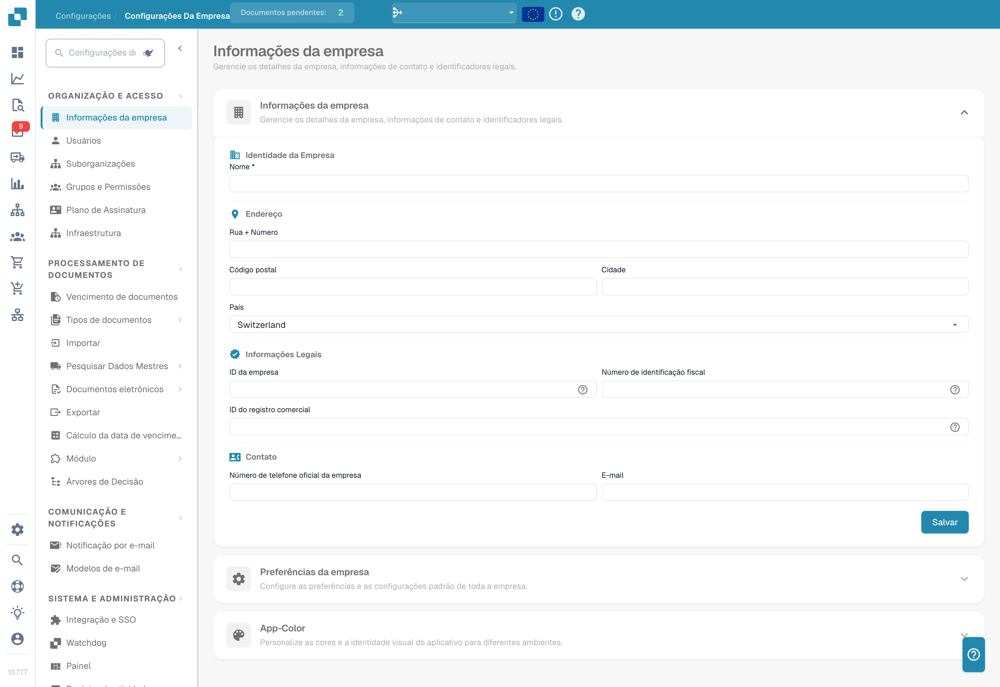

# Configurações

Precisa de ajuda com uma definição? Consulte [Encontrar documentação com o Settings Assistant](settings-assistant/README.md).

## Vídeo tutorial: visão geral das Configurações e módulos


Visão geral das configurações e módulos no DocBits


O vídeo mostra os cinco grupos da visão geral das Configurações, a pesquisa e os atalhos, e o que as três páginas de módulos controlam.

<figure><figcaption>
Definições da organização com dados identificativos ocultos. O país apresentado é um valor configurado.
</figcaption></figure>

A área **Settings** é o seu centro de controlo para configurar o DocBits. Está organizada em cinco secções principais:

## 1. Organização e Acesso

Faça a gestão do perfil da sua empresa e controle quem pode aceder a quê.

* **Company Information**: Introduza o nome da empresa, o endereço, o NIF e outros identificadores legais.
* **Users**: Adicione, edite ou desative contas de utilizador e atribua funções (Admin, System Admin).
* **Sub-Organizations**: Crie e faça a gestão de sub-organizações para configurações com várias entidades.
* **Groups and Permissions**: Defina grupos de utilizadores e configure permissões detalhadas para cada grupo.

## 2. Processamento de documentos

Configure como os documentos são importados, processados e exportados.

* **Documents Expiry**: Defina regras de eliminação automática de documentos (por exemplo, eliminar após 48 horas, 1 semana, etc.).
* **Document Types**: Defina e configure os tipos de documento que o DocBits processa (Invoices, Orders, Delivery Notes, etc.), incluindo campos, colunas de tabela, scripts e mais.
* **Import**: Configure como os documentos entram no DocBits — por e-mail (IMAP/Office 365), FTP ou carregamento de ficheiros. Configure tipos de ficheiro e limites de páginas.
* **Rule Management**: Defina regras de resolução de conflitos para a reconciliação de faturas com encomendas, incluindo tolerâncias e fluxos de aprovação.
* **OCR Settings**: Configure os limites de qualidade do reconhecimento ótico de caracteres, o uso de E-Text, a versão de AI OCR e o comportamento da extração de tabelas.
* **Classification and Extraction**: Configure a separação de documentos, o formato de valores, os métodos de extração de tabelas, as regras de classificação e os modelos de IA.
* **Lookup Master Data**: Configure como os dados extraídos são validados face aos dados mestres do seu ERP (por exemplo, contas de fornecedor, encomendas).
* **List of Values**: Crie e faça a gestão de listas de valores predefinidos usadas nas listas pendentes e na validação de dados.
* **Export**: Configure como e para onde são enviados os documentos processados — por Webhook, SFTP, SMB ou integrações Infor (IDM, ION, M3, LN).
* **Module**: Ative ou desative funcionalidades opcionais como PO Dashboard, Auto Accounting, Supplier Portal, Workflow Builder, QR-Code Extraction e mais.
* **Decision Trees**: Crie lógica de decisão baseada em regras com um designer visual. Suporta várias policies (Unique, First, Priority, Collect, etc.).
* **Agent Setup**: Crie e faça a gestão de agentes de automatização e canais de comunicação para fluxos de processamento automatizado de documentos.

## 3. Comunicação e notificações

Controle como o DocBits comunica com os utilizadores e processa os e-mails recebidos.

* **Email Notification**: Configure alertas por e-mail para eventos de processamento de documentos e alterações de estado.
* **Email Templates**: Crie e faça a gestão de modelos de e-mail reutilizáveis para notificações, organizados por tipo de documento.
* **Email Ingestion**: Configure como os e-mails recebidos são classificados automaticamente e convertidos em documentos. Inclui regras de classificação, extração de campos, processamento, gestão de remetentes e treino — organizadas por tipo de documento (Orders, Invoices, Quotes, Delivery Notes, COA, PO Confirm).

## 4. Sistema e administração

Monitorize o estado do sistema, faça a gestão das integrações e mantenha a segurança.

* **Integration & SSO**: Configure chaves de API para integrações externas e configure o Single Sign-On (SSO) com fornecedores de identidade.
* **Watchdog**: Configure o serviço Watchdog para a importação automática de documentos a partir de diretórios locais.
* **Dashboard**: Personalize o comportamento do painel — filtros, definições de exportação, permissões de ações e opções de apresentação de estados.
* **Activity Logging**: Consulte registos de eventos do sistema em tempo real, filtrados por gravidade (Debug, Info, Warning, Error), intervalo de tempo e serviço.
* **Analytics**: Aceda a painéis analíticos detalhados, incluindo Logs Analytics, monitorização de Auth Security e API Metrics com Real User Monitoring (RUM).
* **Access Audit**: Ative e reveja trilhos de auditoria que registam todas as ações Create, Update e Delete na sua organização para conformidade e segurança.
* **System Licenses**: Consulte e faça a gestão das informações sobre licenças de API e do seu uso.
* **Cache Management**: Configure intervalos automáticos (TTL) para limpar as caches Received Delivery, Purchase Order e Task/Notification.
* **Fulltext Search Settings**: Configure a pesquisa de texto integral nos seus documentos e dados (requer que o módulo Fulltext Search esteja ativo).
* **Appearance**: Personalize as cores, o raio dos cantos, a densidade e o tipo de letra da organização — toda a aplicação segue este tema em modo claro e escuro.

## 5. Definições de fornecedores

Configure o Supplier Portal e faça a gestão dos fluxos relacionados com fornecedores.

* **Supplier General Settings**: Configure os campos de convite do portal de fornecedores, os estados do fluxo (Not Invited, Open, Pending Registration, Approved, Rejected) e as definições de aprovação.
* **Email Templates**: Crie e faça a gestão de modelos de e-mail específicos para a comunicação com fornecedores.
* **Supplier Layout**: Personalize o layout e a aparência do Supplier Portal.
* **Export Configuration**: Configure como os dados dos fornecedores são exportados para sistemas externos.
* **Supplier Group**: Crie e faça a gestão de grupos de fornecedores para categorizar e organizar os seus fornecedores.
* **User and Supplier Group Mapping**: Associe utilizadores internos a grupos de fornecedores específicos para controlar a visibilidade e o acesso.
