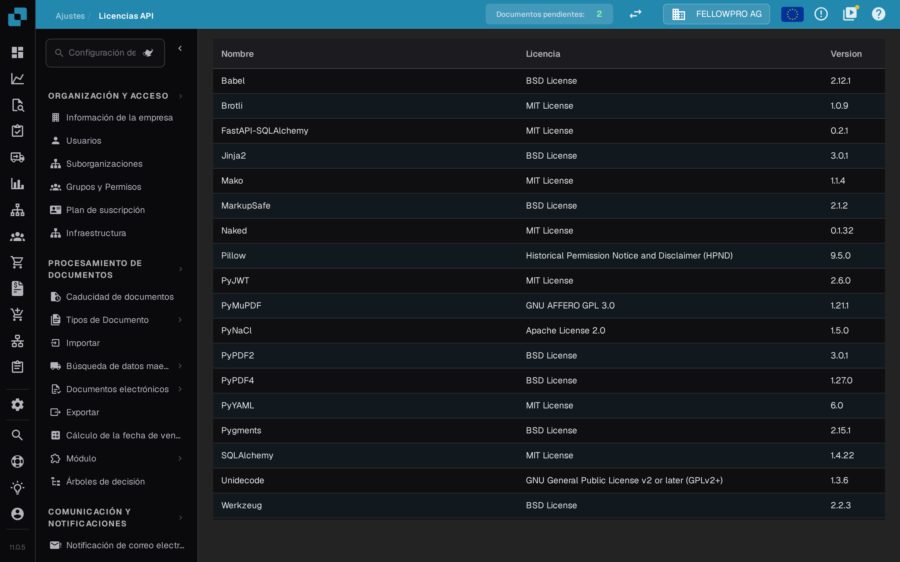

# Licencias del sistema

<figure><figcaption>
La página <strong>Licencias API</strong> en los ajustes.
</figcaption></figure>

La encontrará en los **Ajustes**, en el grupo **Sistema y administración**, dentro de **Licencias del sistema**; la página se titula **Licencias API**.

La página **Licencias API** de los ajustes lista todos los paquetes de software de terceros que utiliza DocBits con su **Nombre**, su **Licencia** y su **Versión**. La página es de solo lectura y sirve para el cumplimiento y la transparencia: consúltela para ver qué licencias de código abierto utiliza su instalación de DocBits.
