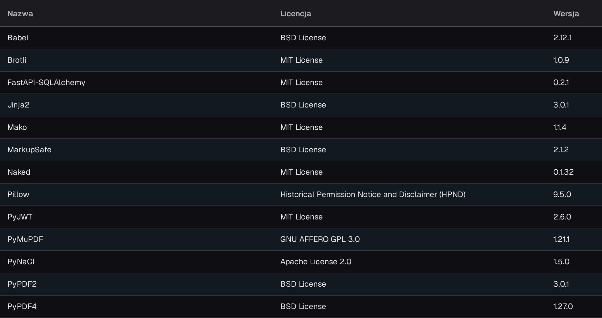

# Licencje API

<figure><figcaption>
Widoczny fragment tabeli na stronie Licencje API z kolumnami Nazwa, Licencja i Wersja. Nagłówek aplikacji i nawigacja znajdują się poza obrazem.
</figcaption></figure>

Strona **Licencje API** przedstawia wszystkie pakiety oprogramowania firm trzecich używane przez DocBits w tabeli z kolumnami **Nazwa**, **Licencja** i **Wersja**. Strona jest tylko do odczytu i służy zapewnieniu zgodności oraz przejrzystości: możesz na niej sprawdzić, jakie licencje open source obejmują pakiety używane w Twojej instalacji DocBits.

Aby ją otworzyć, wybierz **Ustawienia**, a następnie w grupie **SYSTEM I ADMINISTRACJA** pozycję **Licencje systemowe**. Sama strona ma tytuł **Licencje API**.
