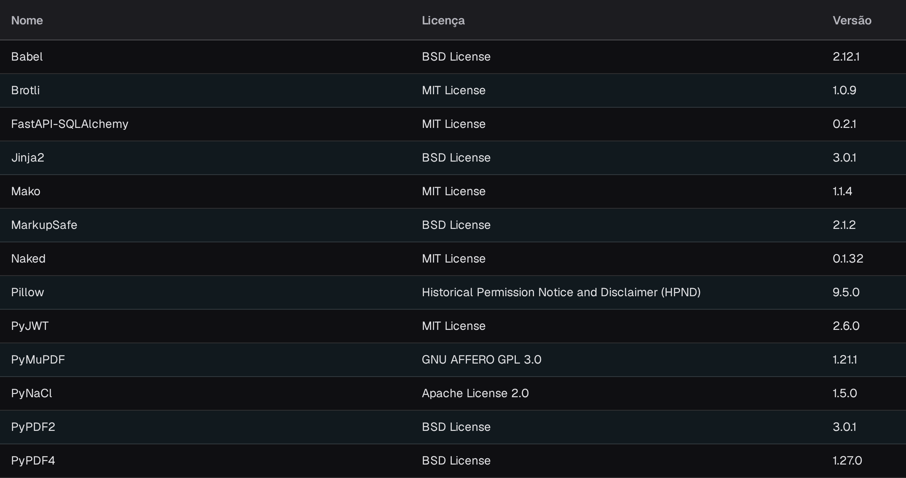

# Licenças do Sistema

<figure><figcaption>
Parte visível da tabela de Licenças De API, com as colunas Nome, Licença e Versão. O cabeçalho e o menu de navegação da aplicação ficam fora da imagem.
</figcaption></figure>

A página **Licenças De API** apresenta todos os pacotes de software de terceiros utilizados pelo DocBits, indicando o **Nome**, a **Licença** e a **Versão** de cada pacote. Trata-se de uma página apenas de leitura, disponibilizada para efeitos de conformidade e transparência: utilize-a para verificar as licenças de código aberto utilizadas pela sua instalação do DocBits.

Pode encontrá-la em **Configurações**, no grupo **SISTEMA E ADMINISTRAÇÃO**, em **Licenças do Sistema**; o título apresentado na página é **Licenças De API**.
