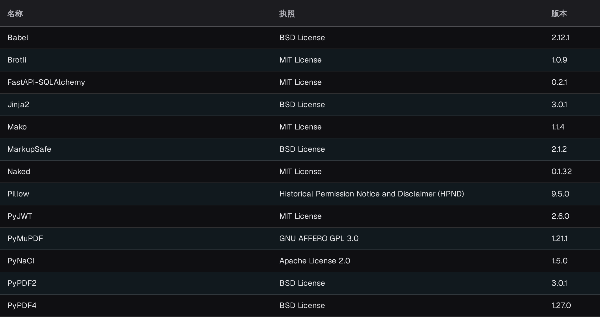

# 系统许可证

<figure><figcaption>
API 许可证表格的可见部分，包含“名称”“执照”和“版本”列。应用页头和导航不在图片范围内。
</figcaption></figure>

**API 许可证**页面列出 DocBits 使用的所有第三方软件包，以及每个软件包的**名称**、**执照**和**版本**。此页面为只读页面，用于满足合规要求并提高信息透明度：您可以通过它查看当前 DocBits 安装使用了哪些开源许可证。

您可以在**设置**的**系统与管理**组下找到**系统许可证**；页面本身的标题为 **API 许可证**。
