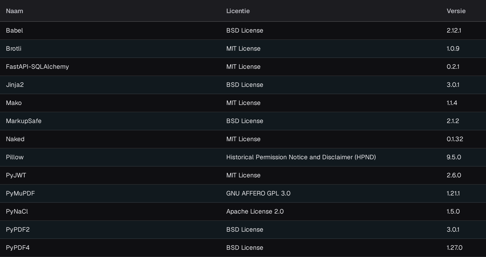

# API-Licenties

<figure><figcaption>
Zichtbaar gedeelte van de tabel API-Licenties met Naam, Licentie en Versie. De koptekst en navigatie van de applicatie vallen buiten de afbeelding.
</figcaption></figure>

De pagina **API-Licenties** bevat een overzicht van alle softwarepakketten van derden die door DocBits worden gebruikt, met de **Naam**, de **Licentie** en de **Versie** van elk pakket. De pagina is alleen-lezen en is bedoeld voor naleving en transparantie: gebruik de pagina om te controleren welke opensourcelicenties uw DocBits-installatie gebruikt.

U vindt deze pagina via **Instellingen** in de groep **SYSTEEM & BEHEER** onder **Systeemlicenties**; de pagina zelf heet **API-Licenties**.
