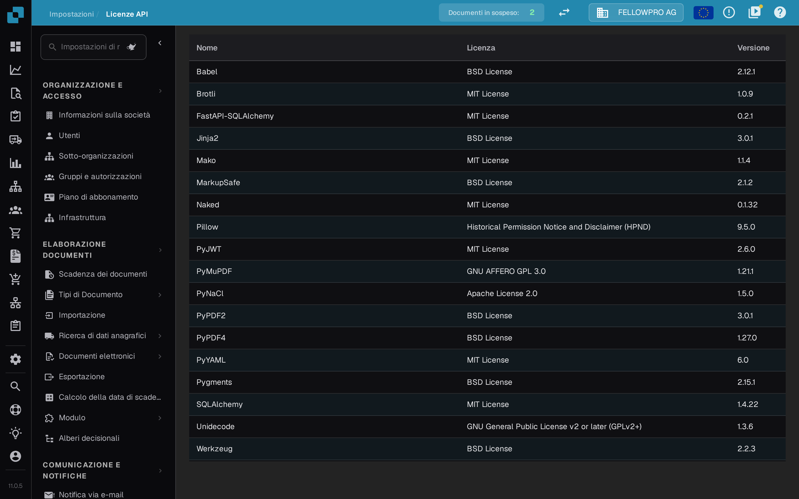

# Licenze di sistema

<figure><figcaption>
La pagina <strong>Licenze API</strong> nelle impostazioni.
</figcaption></figure>

La pagina si trova in **Impostazioni**, nel gruppo **Sistema e amministrazione**, sotto **Licenze di sistema**; il titolo della pagina è **Licenze API**.

La pagina **Licenze API** nelle impostazioni elenca tutti i pacchetti software di terze parti usati da DocBits con **Nome**, **Licenza** e **Versione**. La pagina è in sola lettura e serve per conformità e trasparenza: consultala per verificare quali licenze open source utilizza la tua installazione di DocBits.
