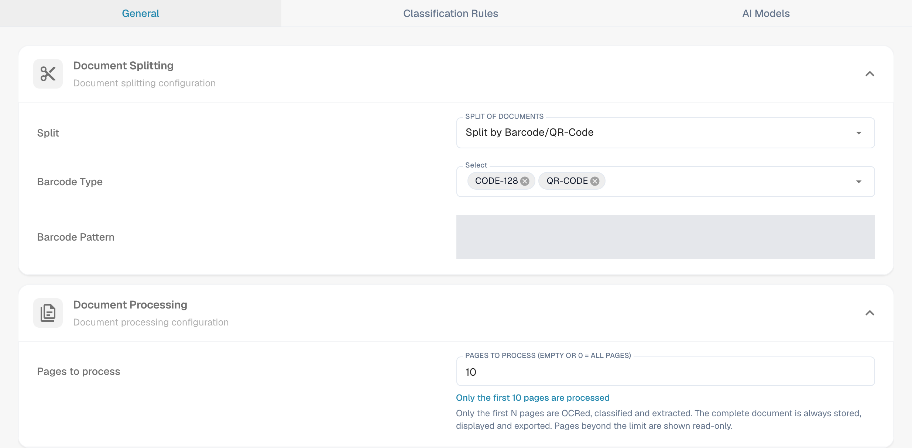
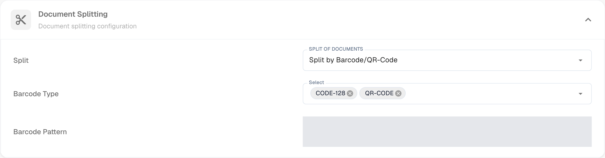
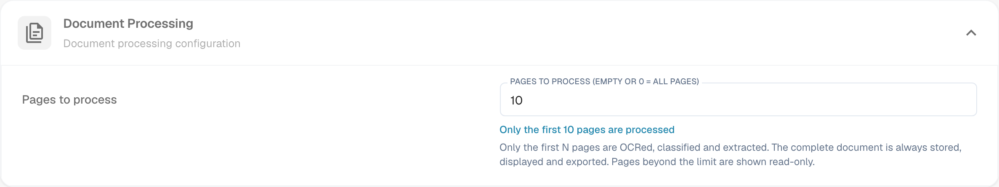
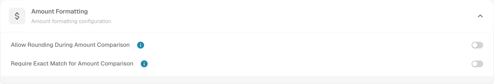
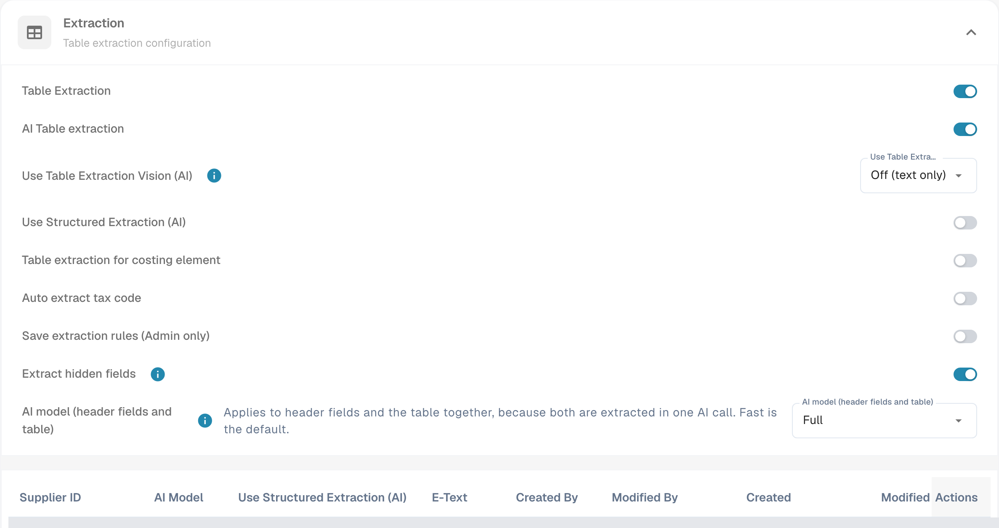
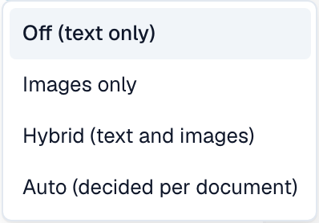
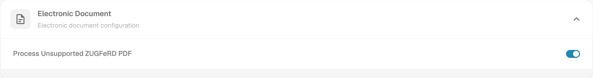
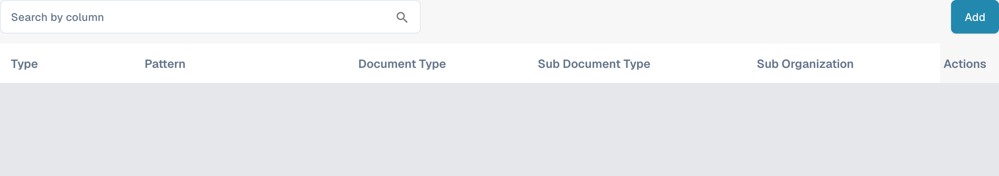
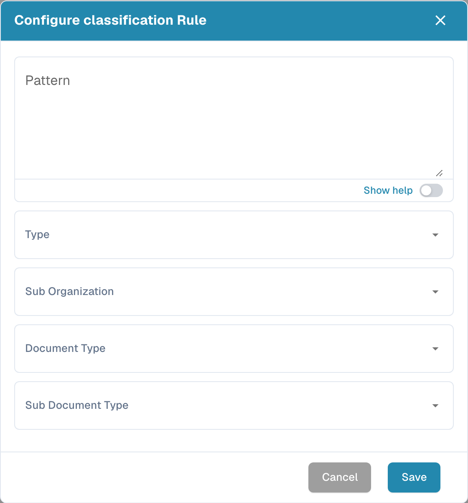
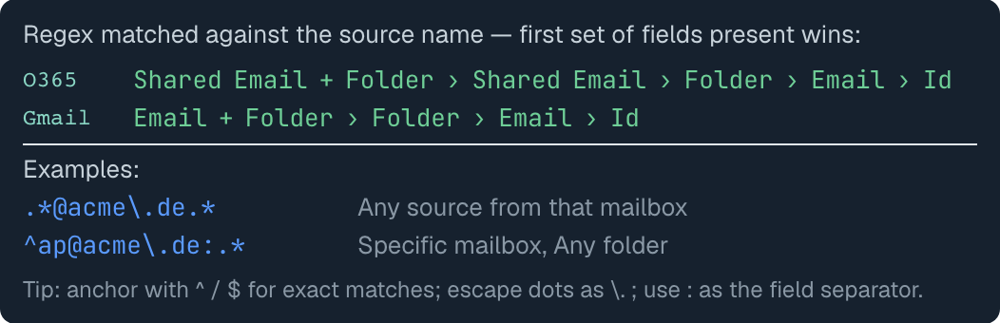

# Classification et extraction

[AI Table](../../../../end-user-and-partner-section/end-user-section/ai-table/README.md) · [Structured Output pour les tableaux](../../../../end-user-and-partner-section/end-user-section/ai-table/structured-output.md)

## Quel paramètre agit à quelle étape du processus ?

<figure><figcaption>
Affichez séparément le type de document, la source de données et le chemin d'extraction. Le schéma est schématique ; les paramètres actifs de votre organisation déterminent le comportement réel.
</figcaption></figure>

La classification répond à la question **« De quel type de document s'agit-il ? »**. L'extraction répond à la question **« Quelles valeurs contient-il ? »**. Les paramètres de cette page agissent à différents points du traitement et ne doivent pas être compris comme un seul interrupteur IA.

1. **Préparer l'entrée :** pour les PDF, le texte existant ou l'OCR peut être utilisé ; les documents électroniques pris en charge peuvent fournir des valeurs structurées. Une division activée peut séparer un document entrant selon le code-barres ou les critères QR configurés.
2. **Déterminer le type de document :** les règles de classification et les modèles attribuent aux documents un type et, si nécessaire, un sous-type. Cette affectation doit être distinguée de l'extraction ultérieure des champs et des tableaux.
3. **Extraire les valeurs :** les tableaux peuvent suivre différents chemins selon la configuration et les règles enregistrées applicables. Les champs d'en-tête ont leurs propres indicateurs de source. Le modèle d'IA sélectionné n'explique donc pas à lui seul chaque ligne ni chaque valeur de champ.
4. **Suivre le résultat :** dans l'écran de validation, vérifiez quel onglet de tableau contient les lignes et quel indicateur de source possède un champ d'en-tête. Si une étape de traitement manque, lisez les journaux du document avant de modifier des paramètres.

### Distinguer le chemin des règles et le chemin de l'IA

Des règles de tableau enregistrées appropriées peuvent déterminer l'extraction de tableau pour le modèle ou le fournisseur concerné. Sans règles adaptées, le chemin IA peut être utilisé lorsque l'extraction de tableau IA est activée. Des colonnes individuelles peuvent avoir leurs propres options IA. Une source IA pour un champ d'en-tête ne signifie pas que le tableau entier provient de l'IA.

Le guide de diagnostic [Quel chemin d'extraction a été utilisé ?](../../../../overview-and-basics/faq/document-processing/which-extraction-path-was-used.md) explique les onglets, les identifiants de source et les journaux. La page [Modèle d'IA](ai-model.md) explique la norme de l'organisation et les dérogations liées aux modèles.

<figure><figcaption>
General contient les paramètres de traitement. AI Models est visible ici parce que le module est activé ; ses modèles de classification personnalisés sont distincts du sélecteur de niveau d'extraction. Le motif de code-barres enregistré est masqué.
</figcaption></figure>
<!-- Shared English screenshot, do not re-shoot: public_docs/.gitbook/assets/dbdc-193-general-overview-en-20261030.png -->

## Vue d'ensemble

Dans les paramètres **Classification and Extraction**, vous pouvez :

* Contrôler comment les documents téléversés sont **divisés** et combien de pages sont traitées
* Configurer le **formatage des montants** pour la comparaison des montants
* Configurer l'**extraction de tableaux**, y compris le modèle d'IA utilisé par fournisseur
* Activer ou désactiver le traitement des fichiers **ZUGFeRD** non pris en charge
* Définir des **règles de classification** qui attribuent automatiquement un type de document
* Consulter les **AI Models** et leurs libellés entraînés

La page comporte **General** et **Classification Rules**, plus **AI Models** lorsque le module des modèles et libellés est activé pour votre organisation. Les modèles de classification personnalisés et les libellés dans **AI Models** sont distincts du sélecteur de niveau d'extraction sous **General → Extraction**.

| Onglet | Contenu |
|---|---|
| General | Document Splitting, Document Processing, Amount Formatting, Table Extraction, Electronic Document |
| Classification Rules | Règles regex qui classifient les documents selon le nom de source |
| AI Models | Modèles entraînés sur mesure avec leurs libellés, types de document et priorité |

## Accéder aux paramètres de classification et d'extraction

Allez dans **Settings → Document Types → Classification and Extraction**.

## General

L'onglet **General** regroupe les paramètres en sections repliables. La plupart des contrôles s'enregistrent dès que leur valeur change. Un **Barcode Pattern** non vide modifié utilise son action de validation/**Save**, et un changement de version de l'extraction de tableaux demande une confirmation. Vérifiez l'organisation et le comportement attendu avant de modifier un contrôle.

### Document Splitting

**Split** détermine si un document téléversé est divisé en plusieurs documents lorsqu'un code-barres apparaît sur l'une de ses pages. La liste déroulante propose :

* **Do not split uploaded documents** – le réglage par défaut ; le document est traité comme un seul fichier.
* **Split by Barcode/QR-Code** – le document est divisé à chaque code-barres détecté.

<figure><figcaption>
Vérifiez la méthode de division et les types de codes-barres avant de les modifier. Le motif propre à l'organisation est masqué ; aucune valeur n'a été modifiée.
</figcaption></figure>
<!-- Shared English screenshot, do not re-shoot: public_docs/.gitbook/assets/dbdc-193-document-splitting-en-20261030.png -->

Lorsque **Split by Barcode/QR-Code** est sélectionné, deux champs supplémentaires apparaissent :

* **Barcode Type** – un ou plusieurs types de codes-barres à détecter, par exemple *CODE-128* ou *QR-CODE*.
* **Barcode Pattern** – une regex à laquelle la valeur du code-barres doit correspondre pour déclencher la division. Laissez le champ vide pour diviser sur n'importe quel code-barres des types sélectionnés. Le motif est validé avant d'être enregistré ; une expression invalide est signalée immédiatement.

Après une division réussie, le document parent est supprimé et les pages continuent sous forme de documents distincts qui partagent le même lot.

<figure><figcaption>
Exemple avec le motif <code>^INV\\d{6}$</code> : les codes des feuilles 3 et 6 correspondent et chacun démarre un nouveau document, le code de la feuille 4 ne correspond pas et ne divise rien, et l'élastique représente le lot que partagent les documents obtenus.
</figcaption></figure>

### Document Processing

**Pages to process** limite le nombre de pages océrisées, classifiées et extraites par document.

<figure><figcaption>
Cet exemple a une limite de 10 pages traitées. Le champ explique que vide ou 0 signifie toutes les pages ; la valeur affichée n'a pas été modifiée.
</figcaption></figure>
<!-- Shared English screenshot, do not re-shoot: public_docs/.gitbook/assets/dbdc-193-document-processing-en-20261030.png -->

* Vide ou **0** signifie que toutes les pages sont traitées.
* Un nombre *N* limite l'OCR, la classification et l'extraction aux *N* premières pages. Le document complet est toujours stocké, affiché et exporté ; les pages au-delà de la limite sont affichées en lecture seule.

### Amount Formatting

Deux interrupteurs contrôlent la comparaison des montants avec les données de base et les bons de commande.

<figure><figcaption>
Les deux interrupteurs de comparaison des montants sont désactivés dans cet exemple. Vérifiez la politique attendue avant de modifier l'un des deux.
</figcaption></figure>
<!-- Shared English screenshot, do not re-shoot: public_docs/.gitbook/assets/dbdc-193-amount-formatting-en-20261030.png -->

* **Allow Rounding During Amount Comparison** – lorsqu'il est activé, une tolérance de ±0,5 est admise. Lorsqu'il est désactivé, ±0,05 s'applique.
* **Require Exact Match for Amount Comparison** – lorsqu'il est activé, les montants doivent correspondre exactement, sans aucune tolérance. Lorsqu'il est désactivé, ±0,05 s'applique.

Un seul des deux interrupteurs peut être actif à la fois ; activer l'un désactive l'autre.

### Table Extraction


**Prérequis pour une extraction de tableaux fonctionnelle**

* Le type de document dispose de **colonnes de tableau** (Settings → Document Processing → Document Types → [Table Columns](../../global-settings/document-types/table-columns/README.md)). Sans colonnes, il n'y a rien dans quoi extraire.
* **Table Extraction** ou **AI Table Extraction** est activé ci-dessous, pour toute l'organisation.
* Le document contient du texte lisible : l'OCR a été exécuté, ou l'E-Text est utilisé pour les PDF nativement numériques ([OCR Settings](../ocr-settings.md)).
* L'entraînement et les modèles d'IA sont définis **par fournisseur**. Un tableau entraîné ne s'applique qu'aux documents du fournisseur sur lequel il a été entraîné.


Vous pouvez extraire des tableaux des documents en activant soit **Table Extraction**, soit **AI Table Extraction**. Un tableau entraîné (qu'il soit basé sur l'IA ou manuel) est toujours lié à un fournisseur précis.

<figure><figcaption>
Le sélecteur de niveau d'extraction se trouve dans General → Extraction. L'en-tête du tableau des dérogations fournisseur est affiché en dessous ; les données de lignes existantes sont masquées et aucun paramètre n'a été modifié.
</figcaption></figure>
<!-- Shared English screenshot, do not re-shoot: public_docs/.gitbook/assets/dbdc-193-table-extraction-en-20261030.png -->

**Table Extraction :** active l'extraction de tableaux basée sur des règles. Les tableaux sont entraînés par fournisseur sur l'écran de validation (*Go to table extraction view*).\
En savoir plus sur l'entraînement [ici](../../../setup/document-training/training-line-fields-table-training/defining-tables-and-columns.md).

**AI Table Extraction :** utilise l'IA pour extraire le tableau de n'importe quel fournisseur sans entraînement. Si les résultats pour un fournisseur ne sont pas assez précis, entraînez le tableau de ce fournisseur ; les règles enregistrées prennent alors le pas sur l'IA pour ce fournisseur.

**Use Table Extraction Vision (AI) :** choisissez l'entrée de l'extraction de tableaux par IA dans une liste déroulante à quatre modes. Il s'agit d'une sélection de mode, et non d'un interrupteur marche/arrêt distinct. Changer le mode sélectionné enregistre immédiatement le paramètre :

* **Off (text only)** – Seul le texte OCR est utilisé.
* **Images only** – Seule l'image de la page est lue.
* **Hybrid (text and images)** – La couche de texte et l'image de la page sont combinées dans la même requête.
* **Auto (decided per document)** – DocBits choisit, pour chaque document, l'entrée texte seule ou hybride.

<figure><figcaption>
Les quatre modes d'entrée dans le menu Dev anglais actuel. Le menu a été ouvert puis fermé sans sélectionner un autre mode ; aucune extraction n'a été lancée.
</figcaption></figure>
<!-- Shared English screenshot, do not re-shoot: public_docs/.gitbook/assets/dbdc-3-four-vision-options-en-20261031.png -->

**Use Structured Extraction (AI) :** l'interrupteur définit la valeur par défaut de l'organisation pour la sortie structurée. Les colonnes demandées dépendent de la sélection Use AI à trois états ; les dérogations de modèle et l'entraînement fournisseur comptent aussi. Lisez le [guide complet de configuration, d'aperçu et d'exemple](../../../../end-user-and-partner-section/end-user-section/ai-table/structured-output.md) pour Structured Output for Tables.

**Table Extraction for Costing Element :** lorsque cette option est activée, DocBits peut extraire les éléments de coût des tableaux au niveau des lignes et les classer en conséquence.\
Explication détaillée disponible [ici](table-extraction-for-costing-element.md).

**Auto Extract Tax Code :** lorsque cette option est activée, le système remplit automatiquement le champ **Tax Code** sur l'écran de validation, à condition qu'un champ de code fiscal soit configuré.\
Plus d'informations sur ce paramètre [ici](auto-extract-tax-code.md).

**Save extraction rules (Admin only) :** seuls les administrateurs peuvent cliquer sur *Save Rules* dans l'entraînement de tableau. Activez cette option lorsque des utilisateurs enregistrent régulièrement des règles qui cassent l'extraction d'un fournisseur.

**Extract hidden fields :** les champs marqués comme masqués dans les paramètres de champ sont également extraits. Utilisez cette option lorsqu'une valeur est nécessaire à une règle ou à un export mais ne doit pas être affichée sur l'écran de validation.

**AI Model :** définit le modèle de l'organisation pour l'extraction des champs et des tableaux. Le menu propose Full, Fast, Nexus, Nexus Flash, Auto et Auto Nexus. Vérifiez la disponibilité, la qualité, la durée d'exécution et le coût avec des documents représentatifs. Un niveau n'est pas toujours le plus précis ou le plus rapide pour chaque document. Les dérogations de modèle peuvent remplacer le paramètre de l'organisation. Le tableau sous le sélecteur montre :

* Quels **fournisseurs** utilisent quel modèle d'IA
* S'ils utilisent l'extraction structurée (IA) et l'E-Text
* Des options pour supprimer une entrée et ainsi réinitialiser le fournisseur au réglage par défaut

Ce paramètre est expliqué en détail [ici](ai-model.md).

#### Pourquoi le tableau est-il différent d'un fournisseur à l'autre ?

Le traitement des tableaux dépend des règles et paramètres enregistrés dans le contexte du fournisseur ou du modèle concerné :

* **Règles enregistrées** (entraînement de tableau) : position du tableau et mappage de ses colonnes sur la mise en page de ce fournisseur.
* **Étiquettes de tableau IA et règles de formatage** : indications que l'utilisateur a enregistrées pour le tableau IA de ce fournisseur.
* **Modèle d'IA spécifique au modèle :** la sélection effectuée sur l'écran de validation est enregistrée par organisation et par modèle d'extraction courant. Elle ne modifie pas automatiquement tous les modèles du même fournisseur. Sans dérogation, le paramètre d'organisation applicable est utilisé.

Ainsi, le fournisseur A, qui dispose de règles enregistrées, affiche un tableau déterministe dans l'onglet *Extracted table* de l'écran de validation, tandis que le fournisseur B, sans règles, obtient le *AI Extracted table*. Pour que le fournisseur B se comporte comme A, entraînez une fois le tableau de B. Pour réinitialiser un fournisseur, supprimez ses règles sur l'écran de validation ou réinitialisez ses données d'entraînement dans le tableau AI Model.

#### Clés de préférence

Chaque interrupteur de cette section est stocké sous forme de préférence d'organisation. Utilisez la clé lorsque vous définissez la valeur via l'API (`/preferences/set_preference`), un script ou le DocBits MCP (`get_preference` / `set_preference`).

| Paramètre (libellé dans l'interface) | Clé de préférence | Valeurs |
|---|---|---|
| Split | `SPLIT_DOCUMENT_ON_BARCODE` | `true` / `false` |
| Barcode Type | `SPLIT_DOCUMENT_BARCODE_TYPE` | liste des noms de types de codes-barres |
| Barcode Pattern | `SPLIT_DOCUMENT_BARCODE_PATTERN` | chaîne regex |
| Pages to process | `RESTRICT_TO_PAGES` | nombre ; vide ou `0` = toutes les pages |
| Allow Rounding During Amount Comparison | `AMOUNTS_ROUNDING` | `true` / `false` |
| Require Exact Match for Amount Comparison | `AMOUNTS_NO_ROUNDING` | `true` / `false` |
| Table Extraction | `TABLE_EXTRACTION_SETTING` | `true` / `false` |
| AI Table extraction | `USE_AI_TABLE_EXTRACTION` | `true` / `false` |
| Use Table Extraction Vision (AI) | `TABLE_EXTRACTION_VISION_MODE` | `off`, `vision`, `hybrid`, `auto` ; si non défini, la préférence héritée détermine le mode |
| Use Table Extraction Vision (AI) – legacy switch | `TABLE_EXTRACTION_USE_VISION` | `true` / `false` ; équivaut en pratique à `vision` |
| Use Structured Extraction (AI) | `USE_STRUCTURED_EXTRACTION` | `true` / `false` |
| Table extraction for costing element | `CHARGES_TABLE_EXTRACTION` | `true` / `false` |
| Auto extract tax code | `AUTO_EXTRACT_TAX_CODE` | `true` / `false` |
| Save extraction rules (Admin only) | `ONLY_ADMIN_CAN_SAVE_RULES` | `true` / `false` |
| Extract hidden fields | `EXTRACT_HIDDEN_FIELDS` | `true` / `false` |
| AI Model | `AI_MODEL` | `gpt-6-sol` (Full), `gpt-6-luna` (Fast), `qwen3.8-max` (Nexus), `glm-5.3-flash` (Nexus Flash), `auto` (Auto), `auto-nexus` (Auto Nexus) |
| Table extraction version (confirmation dialog) | `TBL_EXT_VERSION` | chaîne de version |
| OCR Settings → Use AI data for tables if available | `USE_AI_DATA_FOR_TABLE` | `true` / `false` |
| OCR Settings → Use E-Text if available | `USE_ETEXT_IF_AVAILABLE` | `true` / `false` |

Remarques :

* Les préférences booléennes sont stockées sous forme des chaînes `true` / `false`. Une clé non définie utilise la valeur par défaut de ce paramètre ; l'interface affiche **Extract hidden fields** comme activé lorsqu'il n'est pas défini. Ne partez pas du principe que toute clé absente signifie false. Si vous envoyez `1` ou `0`, DocBits stocke `true` / `false`.
* `AI_MODEL` non défini signifie **Fast**.
* `TABLE_EXTRACTION_VISION_MODE` non défini est résolu à partir de l'ancien interrupteur `TABLE_EXTRACTION_USE_VISION` : `true` donne `vision`, toute autre valeur donne `off`.
* La modification d'une clé prend effet pour les documents traités ensuite. Redémarrez un document pour le réextraire avec le nouveau paramètre.
* Les dérogations de modèle diffèrent des préférences d'organisation. Le guide AI Model explique la portée exacte.

### Electronic Document

**Process Unsupported ZUGFeRD PDF :** si cette option est activée, les versions **ZUGFeRD** non prises en charge sont traitées comme des PDF standard et le XML intégré est ignoré.

La liste des versions **ZUGFeRD** prises en charge se trouve [ici](../../global-settings/document-types/edi/zugferd/README.md).

<figure><figcaption>
Electronic Document contient l'option pour les PDF ZUGFeRD non pris en charge. L'état affiché correspond à un paramètre existant ; aucun traitement de document n'a été effectué pour cette capture.
</figcaption></figure>
<!-- Shared English screenshot, do not re-shoot: public_docs/.gitbook/assets/dbdc-193-electronic-document-en-20261030.png -->

## Classification Rules

L'onglet **Classification Rules** liste les règles qui attribuent automatiquement un type de document pendant le traitement. Chaque règle compare un **motif regex** au nom de source du document et, en cas de correspondance, définit le type de document et éventuellement un sous-type de document.

Basculez vers cet onglet en cliquant sur **Classification Rules** en haut de la page.

<figure><figcaption>
Recherchez des règles existantes ou choisissez Add pour préparer une règle. Les lignes de règles existantes sont masquées ; il ne s'agit pas d'un exemple de liste vide.
</figcaption></figure>
<!-- Shared English screenshot, do not re-shoot: public_docs/.gitbook/assets/dbdc-193-rules-list-en-20261030.png -->

Le tableau contient une ligne par règle, avec les colonnes suivantes :

* **Type** – où le motif est appliqué. Deux types existent : **Barcode** et **E-Mail**.
* **Pattern** – la regex enregistrée pour la règle.
* **Document Type** – le type de document attribué lorsque le motif correspond.
* **Sub Document Type** – le sous-type de document attribué lorsque le motif correspond.
* **Sub Organization** – la sous-organisation à laquelle la règle est limitée. Vide signifie que la règle s'applique à toutes les sous-organisations.
* **Actions** – le menu de ligne avec *Edit* et *Delete*.

Le champ de recherche au-dessus du tableau filtre toutes les colonnes, y compris les libellés affichés des colonnes de liste déroulante.

### Ajouter une nouvelle règle de classification

1.  Cliquez sur **Add** au-dessus du tableau.

    <figure><figcaption>
Add ouvre ce formulaire de règle vide. Vérifiez le motif et le type cible avant Save ; Cancel le ferme sans créer de règle.
</figcaption></figure>
    <!-- Shared English screenshot, do not re-shoot: public_docs/.gitbook/assets/dbdc-193-rule-add-en-20261030.png -->
2. Renseignez les champs :
   * **Pattern** (obligatoire) – la regex que la règle recherche.
   * **Type** (obligatoire) – **Barcode** ou **E-Mail**. Cela détermine le nom de source auquel le motif est comparé.
   * **Sub Organization** *(facultatif)* – limite la règle à une seule sous-organisation.
   * **Document Type** – le type de document attribué lorsque le motif correspond.
   * **Sub Document Type** *(facultatif)* – un type plus spécifique ; la liste dépend du type de document sélectionné. Changer le type de document efface le sous-type de document.
3.  Cliquez sur **Save**.

La boîte de dialogue valide le motif avant l'enregistrement. Un motif déjà utilisé par une autre règle est refusé avec *Pattern already exists* ; un motif vide est refusé avec le message de champ obligatoire.

#### Aide sur les motifs

L'interrupteur **Show help** sous le champ de motif ouvre une référence intégrée présentant les formats de nom de source auxquels le motif est comparé :

* **O365** – `Shared Email + Folder › Shared Email › Folder › Email › Id`
* **Gmail** – `Email + Folder › Folder › Email › Id`

<figure><figcaption>
Show help explique quel nom de source la regex compare. La référence et les exemples sont affichés sans saisir ni enregistrer de règle.
</figcaption></figure>
<!-- Shared English screenshot, do not re-shoot: public_docs/.gitbook/assets/dbdc-193-rule-pattern-help-en-20261030.png -->

Exemples donnés dans le panneau :

* `.*@acme\.de.*` – n'importe quelle source de cette boîte aux lettres
* `^ap@acme\.de:.*` – une boîte aux lettres précise, n'importe quel dossier

Astuce : ancrez avec `^` / `$` pour des correspondances exactes, échappez les points avec `\.`, et utilisez `:` comme séparateur de champs. Le premier ensemble de champs présent dans le nom de source l'emporte.

Si vous utilisez le type **E-Mail**, le motif est comparé aux noms de boîte aux lettres et de dossier du courrier importé, et non au contenu du document.

### Modifier une règle de classification

1.  Cliquez sur les trois points dans la colonne **Actions** de la règle à modifier.
2.  Sélectionnez **Edit**. La boîte de dialogue s'ouvre avec les valeurs actuelles de la règle.
3. Modifiez le motif, le type, la sous-organisation, le type de document ou le sous-type de document.
4.  Cliquez sur **Save**.

La même validation que lors de l'ajout s'applique : le motif ne doit être ni vide ni identique à celui d'une autre règle.

### Supprimer une règle de classification

1. Cliquez sur les trois points dans la colonne **Actions**.
2. Sélectionnez **Delete**.

La règle est retirée immédiatement de la liste. Supprimer une règle ne modifie pas les documents déjà classifiés avec elle.

## AI Models

L'onglet **AI Models** affiche les modèles entraînés sur mesure disponibles pour la classification des documents et leurs libellés. Il n'apparaît que lorsque le module des modèles et libellés est activé pour votre organisation.

<figure><figcaption>
AI Models est un onglet facultatif pour les modèles de classification personnalisés et les libellés. Dans cette organisation, la lecture réussie de la liste n'a renvoyé aucun modèle ; cela ne décrit pas le paramètre de niveau d'extraction.
</figcaption></figure>
<!-- Shared English screenshot, do not re-shoot: public_docs/.gitbook/assets/dbdc-193-ai-models-empty-en-20261030.png -->

Si aucun modèle personnalisé n'est disponible pour l'organisation, l'onglet affiche *No Record Found!*.

### Modèles

Chaque modèle est une entrée dépliable avec :

* Le **nom du modèle** et un badge **Default** sur le modèle utilisé lorsque rien d'autre ne s'applique.
* Le nombre de **libellés** entraînés pour ce modèle.
* Par modèle, une fois déplié : **Type**, **First page only** et **Version**.

Sous ces informations sont listés les libellés du modèle.

### Libellés

Les libellés sont ce que le modèle apprend. Chaque libellé associe un motif reconnu par le modèle à un type de document.

* **Name** – le nom du libellé.
* **Next model** – un modèle qui poursuit le traitement de la sortie de ce libellé.
* **DOC TYPE** – le type de document attribué par le libellé.
* **Sub Document Type** – un type plus spécifique pour le libellé.
* **Priority** – l'ordre dans lequel les libellés sont évalués ; les nombres les plus bas d'abord.

Le champ de recherche au-dessus du tableau des libellés filtre les libellés du modèle sélectionné.

### Modifier un libellé

Cliquez sur l'icône de crayon d'une ligne de libellé pour ouvrir la boîte de dialogue de modification. Elle propose **Next model** et **Document Type** ; renseignez l'un des deux, car la boîte de dialogue exige soit un modèle suivant, soit un type de document. Cliquez sur **Save** pour appliquer la modification.

## Pages connexes

* [Modèle d'IA](ai-model.md) – les six niveaux d'extraction et comment un fournisseur obtient son propre modèle
* [Extraction automatique du code fiscal](auto-extract-tax-code.md)
* [Extraction de tableaux pour le calcul des coûts](table-extraction-for-costing-element.md)
* [OCR Settings](../ocr-settings.md)

<figure><figcaption>
Contrôles actuels d'extraction. Structured Output est désactivé dans cette configuration existante, aucun aperçu de schéma n'est donc affiché. Aucun paramètre d'extraction n'a été modifié.
</figcaption></figure>
