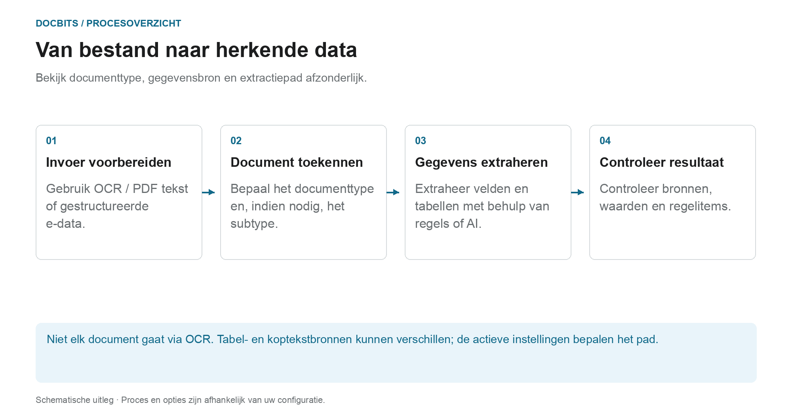

# Classificatie en extractie

[AI Table](../../../../end-user-and-partner-section/end-user-section/ai-table/README.md) · [Structured Output voor tabellen](../../../../end-user-and-partner-section/end-user-section/ai-table/structured-output.md)

## Welke instelling werkt bij welke processtap?

<figure><figcaption>
Bekijk documenttype, gegevensbron en extractiepad afzonderlijk. Het diagram is schematisch; de actieve instellingen van je organisatie bepalen het werkelijke gedrag.
</figcaption></figure>

Classificatie beantwoordt de vraag **“Wat voor soort document is dit?”**. Extractie beantwoordt **“Welke waarden bevat het?”**. De instellingen op deze pagina beïnvloeden verschillende punten in de verwerking en mogen niet als één enkele AI-schakelaar worden opgevat.

1. **Invoer voorbereiden:** Voor PDF's kan bestaande tekst of OCR worden gebruikt; ondersteunde elektronische documenten kunnen gestructureerde waarden leveren. Een geactiveerde splitsing kan een binnenkomend document scheiden op basis van de geconfigureerde barcode- of QR-criteria.
2. **Documenttype bepalen:** Classificatieregels en -modellen wijzen documenten toe aan een type en, indien nodig, een subtype. Deze toewijzing is te onderscheiden van de latere veld- en tabelextractie.
3. **Waarden extraheren:** Tabellen kunnen verschillende paden volgen, afhankelijk van de configuratie en de geldende opgeslagen regels. Kopvelden hebben hun eigen bronindicatoren. Het geselecteerde AI-model alleen verklaart dus niet elke rij- of veldwaarde.
4. **Het resultaat volgen:** Controleer in het validatiescherm welk tabeltabblad de rijen bevat en welke bronindicator een kopveld heeft. Ontbreekt een verwerkingsstap, lees dan de documentlogboeken voordat je instellingen wijzigt.

### Onderscheid tussen regelpad en AI-pad

Geschikte opgeslagen tabelregels kunnen de tabelextractie voor het betreffende sjabloon of de betreffende leverancier bepalen. Zonder geschikte regels kan het AI-pad worden gebruikt wanneer AI-tabelextractie is geactiveerd. Afzonderlijke kolommen kunnen eigen AI-opties hebben. Een AI-bron voor een kopveld betekent niet dat de hele tabel uit de AI komt.

De diagnosehandleiding [Welk extractiepad is gebruikt?](../../../../overview-and-basics/faq/document-processing/which-extraction-path-was-used.md) legt tabbladen, bronaanduidingen en protocollen uit. De pagina [AI model](ai-model.md) legt de organisatiestandaard en de sjabloongebonden afwijkingen uit.

<figure><figcaption>
General bevat de verwerkingsinstellingen. AI Models is hier zichtbaar omdat de module is ingeschakeld; de aangepaste classificatiemodellen staan los van de selectie van de extractielaag. Het opgeslagen barcodepatroon is verborgen.
</figcaption></figure>
<!-- English source image: dbdc-193-general-overview-en-20261030.png -->

## Overzicht

In de instellingen **Classification and Extraction** kun je:

* Bepalen hoe geüploade documenten worden **gesplitst** en hoeveel pagina's worden verwerkt
* **Bedragopmaak** configureren voor de vergelijking van bedragen
* **Tabelextractie** instellen, inclusief het AI-model per leverancier
* De verwerking van niet-ondersteunde **ZUGFeRD**-bestanden in- of uitschakelen
* **Classificatieregels** definiëren die automatisch een documenttype toewijzen
* De **AI Models** en hun getrainde labels bekijken

De pagina heeft **General** en **Classification Rules**, plus **AI Models** wanneer de module voor modellen en labels voor je organisatie is ingeschakeld. Aangepaste classificatiemodellen en labels in **AI Models** staan los van de selectie van de extractielaag onder **General → Extraction**.

| Tab | Inhoud |
|---|---|
| General | Document Splitting, Document Processing, Amount Formatting, Table Extraction, Electronic Document |
| Classification Rules | Regex-regels die documenten op bronnaam classificeren |
| AI Models | Aangepast getrainde modellen met hun labels, documenttypen en prioriteit |

## De instellingen Classificatie en extractie openen

Ga naar **Settings → Document Types → Classification and Extraction**.

## General

Het tabblad **General** groepeert de instellingen in uitklapbare secties. De meeste bedieningselementen slaan op wanneer hun waarde verandert. Een gewijzigd, niet-leeg **Barcode Pattern** gebruikt de bijbehorende validatie en **Save**, en een wijziging van de tabelextractieversie moet worden bevestigd. Controleer de organisatie en het beoogde gedrag voordat je een instelling wijzigt.

### Document Splitting

**Split** bepaalt of een geüpload document in meerdere documenten wordt gesplitst wanneer op een van de pagina's een barcode voorkomt. De keuzelijst biedt:

* **Do not split uploaded documents** – de standaard; het document wordt als één bestand verwerkt.
* **Split by Barcode/QR-Code** – het document wordt bij elke gedetecteerde barcode gesplitst.

<figure><figcaption>
Controleer de splitsingsmethode en de barcodetypen voordat je ze wijzigt. Het organisatiespecifieke patroon is verborgen; er is geen waarde gewijzigd.
</figcaption></figure>
<!-- English source image: dbdc-193-document-splitting-en-20261030.png -->

Wanneer **Split by Barcode/QR-Code** is geselecteerd, verschijnen er twee velden bij:

* **Barcode Type** – een of meer barcodetypen om te detecteren, bijvoorbeeld *CODE-128* of *QR-CODE*.
* **Barcode Pattern** – een regex waaraan de barcodewaarde moet voldoen voordat de splitsing wordt gestart. Laat het veld leeg om op elke barcode van de geselecteerde typen te splitsen. Het patroon wordt gevalideerd voordat het wordt opgeslagen; een ongeldige expressie wordt direct gemeld.

Na een geslaagde splitsing wordt het bovenliggende document verwijderd en gaan de pagina's verder als afzonderlijke documenten die dezelfde batch delen.

<figure><figcaption>
Voorbeeld met het patroon <code>^INV\d{6}$</code>: de codes op vel 3 en vel 6 komen overeen en starten elk een nieuw document, de code op vel 4 komt niet overeen en splitst niets, en het elastiek staat voor de batch die de ontstane documenten delen.
</figcaption></figure>

### Document Processing

**Pages to process** beperkt hoeveel pagina's per document worden ge-OCR'd, geclassificeerd en geëxtraheerd.

<figure><figcaption>
Dit voorbeeld heeft een limiet van 10 verwerkte pagina's. Het veld legt uit dat leeg of 0 alle pagina's betekent; de getoonde waarde is niet gewijzigd.
</figcaption></figure>
<!-- English source image: dbdc-193-document-processing-en-20261030.png -->

* Leeg of **0** betekent dat alle pagina's worden verwerkt.
* Een getal *N* beperkt OCR, classificatie en extractie tot de eerste *N* pagina's. Het volledige document wordt nog steeds opgeslagen, weergegeven en geëxporteerd; pagina's boven de limiet worden alleen-lezen getoond.

### Amount Formatting

Twee schakelaars bepalen hoe bedragen worden vergeleken met stamgegevens en inkooporders.

<figure><figcaption>
De twee schakelaars voor bedragvergelijking staan in dit voorbeeld uit. Controleer het beoogde beleid voordat je een van beide omzet.
</figcaption></figure>
<!-- English source image: dbdc-193-amount-formatting-en-20261030.png -->

* **Allow Rounding During Amount Comparison** – indien ingeschakeld is een tolerantie van ±0.5 toegestaan. Indien uitgeschakeld geldt ±0.05.
* **Require Exact Match for Amount Comparison** – indien ingeschakeld moeten bedragen exact overeenkomen, met een tolerantie van nul. Indien uitgeschakeld geldt ±0.05.

Slechts één van de twee schakelaars kan tegelijk actief zijn; het inschakelen van de ene schakelt de andere uit.

### Table Extraction


**Voorwaarden voor een werkende tabelextractie**

* Het documenttype heeft **tabelkolommen** (Settings → Document Processing → Document Types → [Table Columns](../../global-settings/document-types/table-columns/README.md)). Zonder kolommen is er niets om in te extraheren.
* **Table Extraction** of **AI Table Extraction** is hieronder ingeschakeld, voor de hele organisatie.
* Het document heeft leesbare tekst: OCR is uitgevoerd, of E-Text wordt gebruikt voor digitaal aangemaakte PDF's ([OCR Settings](../ocr-settings.md)).
* Training en AI-modellen zijn **per leverancier**. Een getrainde tabel geldt alleen voor documenten van de leverancier waarop ze is getraind.


Je kunt tabellen uit documenten extraheren door **Table Extraction** of **AI Table Extraction** in te schakelen. Een getrainde tabel (of die nu AI-gebaseerd of handmatig is) is altijd gekoppeld aan een specifieke leverancier.

<figure><figcaption>
De selectie van de extractielaag staat in General → Extraction. De kop van de tabel met leveranciersafwijkingen staat hieronder; bestaande rijgegevens zijn verborgen en er is geen instelling gewijzigd.
</figcaption></figure>
<!-- English source image: dbdc-193-table-extraction-en-20261030.png -->

**Table Extraction:** Activeert regelgebaseerde tabelextractie. Tabellen worden per leverancier getraind op het validatiescherm (*Go to table extraction view*).\
Meer informatie over trainen vind je [hier](../../../setup/document-training/training-line-fields-table-training/defining-tables-and-columns.md).

**AI Table Extraction:** Gebruikt AI om de tabel van elke leverancier zonder training te extraheren. Zijn de resultaten voor één leverancier niet nauwkeurig genoeg, train dan de tabel van die leverancier; de opgeslagen regels krijgen voor die leverancier dan voorrang op de AI.

**Use Table Extraction Vision (AI):** Kies de invoer voor AI-tabelextractie uit een keuzelijst met vier modi. Dit is een moduskeuze en geen aparte aan/uit-schakelaar. Het wijzigen van de geselecteerde modus slaat de instelling direct op:

* **Off (text only)** – Alleen OCR-tekst wordt gebruikt.
* **Images only** – Alleen de pagina-afbeelding wordt gelezen.
* **Hybrid (text and images)** – Tekstlaag en pagina-afbeelding worden in dezelfde aanvraag gecombineerd.
* **Auto (decided per document)** – DocBits kiest per document voor alleen tekst of voor hybride invoer.

<figure><figcaption>
De vier invoermodi in het huidige Engelse Dev-menu. Het menu is geopend en gesloten zonder een andere modus te selecteren; er is geen extractie uitgevoerd.
</figcaption></figure>
<!-- English source image: dbdc-3-four-vision-options-en-20261031.png -->

**Use Structured Extraction (AI):** De schakelaar bepaalt de standaard voor gestructureerde uitvoer van de organisatie. De gevraagde kolommen hangen af van de keuze in drie standen onder Use AI; sjabloonafwijkingen en leverancierstraining spelen ook mee. Lees de volledige [handleiding voor configuratie, voorbeeld en praktijkvoorbeeld](../../../../end-user-and-partner-section/end-user-section/ai-table/structured-output.md) voor Structured Output for Tables.

**Table Extraction for Costing Element:** Indien ingeschakeld kan DocBits kostenelementen op regelniveau uit tabellen extraheren en deze dienovereenkomstig classificeren.\
Een gedetailleerde uitleg vind je [hier](table-extraction-for-costing-element.md).

**Auto Extract Tax Code:** Indien ingeschakeld vult het systeem automatisch het veld **Tax Code** op het validatiescherm, mits er een belastingcodeveld is geconfigureerd.\
Meer informatie over deze instelling vind je [hier](auto-extract-tax-code.md).

**Save extraction rules (Admin only):** Alleen beheerders kunnen in de tabeltraining op *Save Rules* klikken. Schakel dit in wanneer gebruikers steeds regels opslaan die de extractie van een leverancier verstoren.

**Extract hidden fields:** Velden die in de veldinstellingen als verborgen zijn gemarkeerd, worden ook geëxtraheerd. Gebruik dit wanneer een waarde nodig is voor een regel of een export, maar niet op het validatiescherm mag verschijnen.

**AI Model:** Stelt het organisatiemodel in voor veld- en tabelextractie. Het menu biedt Full, Fast, Nexus, Nexus Flash, Auto en Auto Nexus. Controleer beschikbaarheid, kwaliteit, looptijd en kosten met representatieve documenten. Een laag is niet voor elk document de meest nauwkeurige of de snelste. Sjabloonafwijkingen kunnen de organisatie-instelling vervangen. De tabel onder de selector toont:

* Welke **leveranciers** welk AI-model gebruiken
* Of ze gestructureerde extractie (AI) en E-Text gebruiken
* Opties om een regel te verwijderen en de leverancier zo naar de standaard terug te zetten

Deze instelling wordt in detail uitgelegd [hier](ai-model.md).

#### Waarom ziet de tabel er per leverancier anders uit?

Tabelverwerking hangt af van de opgeslagen regels en instellingen in de context van de betreffende leverancier of het betreffende sjabloon:

* **Opgeslagen regels** (tabeltraining): positie van de tabel en de koppeling van de kolommen op de lay-out van die leverancier.
* **AI-tabeltags en opmaakregels**: aanwijzingen die de gebruiker voor de AI-tabel van die leverancier heeft opgeslagen.
* **Sjabloonspecifiek AI-model:** De keuze op het validatiescherm wordt per organisatie en per huidig extractiesjabloon opgeslagen. Die wijzigt niet automatisch elk sjabloon van dezelfde leverancier. Zonder afwijking geldt de toepasselijke organisatie-instelling.

Leverancier A met opgeslagen regels toont dus een deterministische tabel in het tabblad *Extracted table* van het validatiescherm, terwijl leverancier B zonder regels de *AI Extracted table* krijgt. Om leverancier B zich als A te laten gedragen, train je de tabel van B één keer. Om een leverancier te resetten, verwijder je de regels op het validatiescherm of reset je de trainingsgegevens in de tabel van AI Model.

#### Voorkeurssleutels

Elke schakelaar in deze sectie wordt opgeslagen als organisatievoorkeur. Gebruik de sleutel wanneer je de waarde instelt via de API (`/preferences/set_preference`), een script of de DocBits MCP (`get_preference` / `set_preference`).

| Instelling (UI-label) | Voorkeurssleutel | Waarden |
|---|---|---|
| Split | `SPLIT_DOCUMENT_ON_BARCODE` | `true` / `false` |
| Barcode Type | `SPLIT_DOCUMENT_BARCODE_TYPE` | lijst met namen van barcodetypen |
| Barcode Pattern | `SPLIT_DOCUMENT_BARCODE_PATTERN` | regex-string |
| Pages to process | `RESTRICT_TO_PAGES` | getal; leeg of `0` = alle pagina's |
| Allow Rounding During Amount Comparison | `AMOUNTS_ROUNDING` | `true` / `false` |
| Require Exact Match for Amount Comparison | `AMOUNTS_NO_ROUNDING` | `true` / `false` |
| Table Extraction | `TABLE_EXTRACTION_SETTING` | `true` / `false` |
| AI Table extraction | `USE_AI_TABLE_EXTRACTION` | `true` / `false` |
| Use Table Extraction Vision (AI) | `TABLE_EXTRACTION_VISION_MODE` | `off`, `vision`, `hybrid`, `auto`; zonder waarde bepaalt de oude voorkeur de modus |
| Use Table Extraction Vision (AI) – legacy switch | `TABLE_EXTRACTION_USE_VISION` | `true` / `false`; betekent in de praktijk `vision` |
| Use Structured Extraction (AI) | `USE_STRUCTURED_EXTRACTION` | `true` / `false` |
| Table extraction for costing element | `CHARGES_TABLE_EXTRACTION` | `true` / `false` |
| Auto extract tax code | `AUTO_EXTRACT_TAX_CODE` | `true` / `false` |
| Save extraction rules (Admin only) | `ONLY_ADMIN_CAN_SAVE_RULES` | `true` / `false` |
| Extract hidden fields | `EXTRACT_HIDDEN_FIELDS` | `true` / `false` |
| AI Model | `AI_MODEL` | `gpt-6-sol` (Full), `gpt-6-luna` (Fast), `qwen3.8-max` (Nexus), `glm-5.3-flash` (Nexus Flash), `auto` (Auto), `auto-nexus` (Auto Nexus) |
| Table extraction version (confirmation dialog) | `TBL_EXT_VERSION` | versiestring |
| OCR Settings → Use AI data for tables if available | `USE_AI_DATA_FOR_TABLE` | `true` / `false` |
| OCR Settings → Use E-Text if available | `USE_ETEXT_IF_AVAILABLE` | `true` / `false` |

Opmerkingen:

* Booleaanse voorkeuren worden als de strings `true` / `false` opgeslagen. Een sleutel die niet is ingesteld, gebruikt de standaard van die instelling; de UI toont **Extract hidden fields** als aan zolang de sleutel niet is ingesteld. Ga er niet van uit dat elke ontbrekende sleutel false betekent. Stuur je `1` of `0`, dan slaat DocBits `true` / `false` op.
* Een niet-ingestelde `AI_MODEL` betekent **Fast**.
* Een niet-ingestelde `TABLE_EXTRACTION_VISION_MODE` wordt afgeleid van de oude schakelaar `TABLE_EXTRACTION_USE_VISION`: `true` wordt `vision`, al het andere `off`.
* Een gewijzigde sleutel geldt voor documenten die daarna worden verwerkt. Start een document opnieuw om het met de nieuwe instelling opnieuw te extraheren.
* Sjabloonafwijkingen verschillen van organisatievoorkeuren. De AI Model-handleiding legt de exacte reikwijdte uit.

### Electronic Document

**Process Unsupported ZUGFeRD PDF:** Indien ingeschakeld worden niet-ondersteunde **ZUGFeRD**-versies als standaard-PDF's verwerkt en wordt de ingebedde XML genegeerd.

De lijst met ondersteunde **ZUGFeRD**-versies vind je [hier](../../global-settings/document-types/edi/zugferd/README.md).

<figure><figcaption>
Electronic Document bevat de optie voor niet-ondersteunde ZUGFeRD-PDF's. De getoonde stand is een bestaande instelling; er is voor deze opname geen documentverwerking uitgevoerd.
</figcaption></figure>
<!-- English source image: dbdc-193-electronic-document-en-20261030.png -->

## Classification Rules

Het tabblad **Classification Rules** toont de regels die tijdens de verwerking automatisch een documenttype toewijzen. Elke regel vergelijkt een **regex-patroon** met de bronnaam van het document en stelt bij een treffer het documenttype en optioneel een subdocumenttype in.

Schakel naar het tabblad door boven aan de pagina op **Classification Rules** te klikken.

<figure><figcaption>
Zoek bestaande regels of kies Add om een regel voor te bereiden. Bestaande regelrijen zijn verborgen; dit is geen voorbeeld van een lege lijst.
</figcaption></figure>
<!-- English source image: dbdc-193-rules-list-en-20261030.png -->

De tabel heeft één rij per regel, met deze kolommen:

* **Type** – waar het patroon wordt toegepast. Er zijn twee typen: **Barcode** en **E-Mail**.
* **Pattern** – de regex die voor de regel is opgeslagen.
* **Document Type** – het documenttype dat wordt toegewezen wanneer het patroon overeenkomt.
* **Sub Document Type** – het subdocumenttype dat wordt toegewezen wanneer het patroon overeenkomt.
* **Sub Organization** – de suborganisatie waartoe de regel beperkt is. Leeg betekent dat de regel voor alle suborganisaties geldt.
* **Actions** – het rijenmenu met *Edit* en *Delete*.

Het zoekveld boven de tabel filtert alle kolommen, inclusief de weergegeven labels van de keuzelijstkolommen.

### Een nieuwe classificatieregel toevoegen

1.  Klik boven de tabel op **Add**.

    <figure><figcaption>
Add opent dit lege regelformulier. Controleer het patroon en het doeltype vóór Save; Cancel sluit het venster zonder een regel aan te maken.
</figcaption></figure>
    <!-- English source image: dbdc-193-rule-add-en-20261030.png -->
2. Vul de velden in:
   * **Pattern** (verplicht) – de regex waarnaar de regel zoekt.
   * **Type** (verplicht) – **Barcode** of **E-Mail**. Dit bepaalt tegen welke bronnaam het patroon wordt vergeleken.
   * **Sub Organization** *(optioneel)* – beperkt de regel tot één suborganisatie.
   * **Document Type** – het documenttype dat wordt toegewezen wanneer het patroon overeenkomt.
   * **Sub Document Type** *(optioneel)* – een specifieker type; de lijst hangt af van het geselecteerde documenttype. Het wijzigen van het documenttype wist het subdocumenttype.
3.  Klik op **Save**.

Het dialoogvenster valideert het patroon voordat het opslaat. Een patroon dat al door een andere regel wordt gebruikt, wordt geweigerd met *Pattern already exists*; een leeg patroon wordt geweigerd met de melding over het verplichte veld.

#### Patroonhulp

De schakelaar **Show help** onder het patroonveld opent een inline naslagwerk met de indelingen van de bronnaam waartegen het patroon wordt vergeleken:

* **O365** – `Shared Email + Folder › Shared Email › Folder › Email › Id`
* **Gmail** – `Email + Folder › Folder › Email › Id`

<figure><figcaption>
Show help legt uit tegen welke bronnaam de regex wordt vergeleken. Het naslagwerk en de voorbeelden worden getoond zonder een regel in te voeren of op te slaan.
</figcaption></figure>
<!-- English source image: dbdc-193-rule-pattern-help-en-20261030.png -->

Voorbeelden uit het paneel:

* `.*@acme\.de.*` – elke bron uit die mailbox
* `^ap@acme\.de:.*` – een specifieke mailbox, elke map

Tip: veranker met `^` / `$` voor exacte overeenkomsten, escape punten als `\.`, en gebruik `:` als scheidingsteken tussen velden. De eerste set velden die in de bronnaam voorkomt, wint.

Gebruik je het type **E-Mail**, dan wordt het patroon vergeleken met de mailbox- en mapnamen van de geïmporteerde mail, niet met de inhoud van het document.

### Een classificatieregel bewerken

1.  Klik op de drie puntjes in de kolom **Actions** van de regel die je wilt wijzigen.
2.  Selecteer **Edit**. Het dialoogvenster opent met de huidige waarden van de regel.
3. Breng je wijzigingen aan in het patroon, het type, de suborganisatie, het documenttype of het subdocumenttype.
4.  Klik op **Save**.

Dezelfde validatie geldt als bij het toevoegen van een regel: het patroon mag niet leeg zijn en mag niet het patroon van een andere regel dupliceren.

### Een classificatieregel verwijderen

1. Klik op de drie puntjes in de kolom **Actions**.
2. Selecteer **Delete**.

De regel wordt direct uit de lijst verwijderd. Het verwijderen van een regel verandert niets aan documenten die er al mee zijn geclassificeerd.

## AI Models

Het tabblad **AI Models** toont de aangepast getrainde modellen die beschikbaar zijn voor documentclassificatie en hun labels. Het verschijnt alleen wanneer de module voor modellen en labels voor je organisatie is ingeschakeld.

<figure><figcaption>
AI Models is een optioneel tabblad voor aangepaste classificatiemodellen en labels. In deze organisatie leverde de geslaagde lijstopvraag geen modellen op; dat zegt niets over de instelling van de extractielaag.
</figcaption></figure>
<!-- English source image: dbdc-193-ai-models-empty-en-20261030.png -->

Is er geen aangepast model voor de organisatie beschikbaar, dan toont het tabblad *No Record Found!*.

### Models

Elk model is een uitklapbare regel met:

* De **modelnaam** en een badge **Default** bij het model dat wordt gebruikt wanneer niets anders van toepassing is.
* Het aantal **labels** dat voor dat model is getraind.
* Per model, na uitklappen: **Type**, **First page only** en **Version**.

Onder die informatie staan de labels van het model.

### Labels

Labels zijn wat het model leert. Elk label koppelt een patroon dat het model herkent aan een documenttype.

* **Name** – de naam van het label.
* **Next model** – een model dat de uitvoer van dit label verder verwerkt.
* **DOC TYPE** – het documenttype dat het label toewijst.
* **Sub Document Type** – een specifieker type voor het label.
* **Priority** – de volgorde waarin de labels worden beoordeeld; lagere nummers eerst.

Het zoekveld boven de labeltabel filtert de labels van het geselecteerde model.

### Een label bewerken

Klik op het penpictogram in een labelrij om het bewerkingsvenster te openen. Het biedt **Next model** en **Document Type**; stel een van beide in, want het venster vereist of een volgend model of een documenttype. Klik op **Save** om de wijziging toe te passen.

## Gerelateerde pagina's

* [AI Model](ai-model.md) – de zes extractielagen en hoe een leverancier een eigen model krijgt
* [Auto Extract Tax Code](auto-extract-tax-code.md)
* [Table Extraction for Costing Element](table-extraction-for-costing-element.md)
* [OCR Settings](../ocr-settings.md)

<figure><figcaption>
Huidige extractie-instellingen. Structured Output staat uit in deze bestaande configuratie; daarom wordt geen schemavoorbeeld getoond. Er is geen extractie-instelling gewijzigd.
</figcaption></figure>
