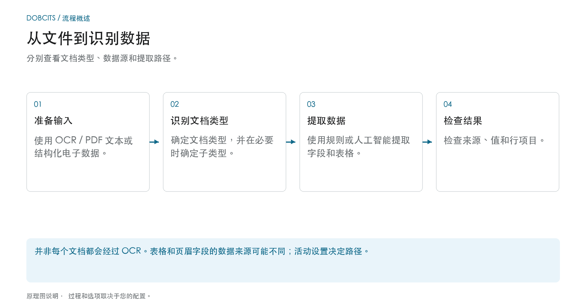

# 分类与提取

[AI Table](../../../../end-user-and-partner-section/end-user-section/ai-table/README.md) · [Structured Output for Tables](../../../../end-user-and-partner-section/end-user-section/ai-table/structured-output.md)

## 哪个设置作用于哪个处理步骤？

<figure><figcaption>
分别查看文档类型、数据源和提取路径。该图是示意性的；您组织的活动设置决定实际行为。
</figcaption></figure>

分类回答的是**“这是什么类型的文档？”**这个问题。提取回答的是**“它包含哪些值？”**。本页上的设置影响处理过程中的不同环节，不应把它们理解为一个统一的 AI 开关。

1. **准备输入：** 对于 PDF，可以使用已有的文本或 OCR；受支持的电子文档可以提供结构化值。已启用的拆分可以根据配置的条形码或二维码条件，把收到的文档分开。
2. **确定文档类型：** 分类规则和模型把文档归入某个类型，并在必要时归入某个子类型。这一归类要与后续的字段和表格提取区分开来。
3. **提取值：** 表格可能根据配置和适用的已保存规则走不同路径。标题字段有自己的来源标示。因此，仅凭所选的 AI 模型并不能解释每一行或每一个字段值。
4. **追踪结果：** 在验证界面中，检查包含这些行的表格选项卡是哪一个，以及某个标题字段的来源标示是什么。如果缺少某个处理步骤，请在更改设置之前阅读文档日志。

### 区分规则路径与 AI 路径

合适的已保存表格规则可以决定相应模板或供应商的表格提取。在没有合适规则的情况下，如果已启用 AI 表格提取，就可以走 AI 路径。个别列可以有自己的 AI 选项。某个标题字段来自 AI，并不意味着整张表格都来自 AI。

[使用了哪条提取路径？](../../../../overview-and-basics/faq/document-processing/which-extraction-path-was-used.md) 这份诊断指南解释了选项卡、来源标识和协议。页面 [AI 模型](ai-model.md) 说明了组织标准以及与模板相关的覆盖设置。

<figure><figcaption>
General 包含处理设置。此处能看到 AI Models，是因为该模块已启用；它的自定义分类模型与提取层级选择器是相互独立的。已存储的条形码模式已被遮盖。
</figcaption></figure>
<!-- English source image: dbdc-193-general-overview-en-20261030.png -->

## 概述

在**分类与提取**设置中，您可以：

* 控制上传的文档如何被**拆分**，以及处理多少页
* 为金额比较配置**金额格式**
* 设置**表格提取**，包括每个供应商使用的 AI 模型
* 切换是否处理不受支持的 **ZUGFeRD** 文件
* 定义可自动分配文档类型的**分类规则**
* 查看 **AI Models** 及其训练过的标签

该页面包含 **General** 和 **Classification Rules**，当您的组织启用了模型与标签模块时还包含 **AI Models**。**AI Models** 中的自定义分类模型和标签与 **General → Extraction** 下的提取层级选择器相互独立。

| 选项卡 | 内容 |
|---|---|
| General | Document Splitting、Document Processing、Amount Formatting、Table Extraction、Electronic Document |
| Classification Rules | 按来源名称对文档分类的正则规则 |
| AI Models | 带标签、文档类型和优先级的自定义训练模型 |

## 访问分类与提取设置

前往 **Settings → Document Types → Classification and Extraction**。

## General

**General** 选项卡把设置分为可折叠的区块。大多数控件在值发生变化时即保存。更改后的非空 **Barcode Pattern** 使用其验证/**Save** 操作，而表格提取版本变更需要确认。编辑控件前，请先了解组织情况与预期行为。

### Document Splitting

**Split** 决定当上传文档的某一页出现条形码时，是否将其拆分为多个文档。下拉列表提供：

* **Do not split uploaded documents** – 默认值；文档作为一个文件处理。
* **Split by Barcode/QR-Code** – 在每个检测到的条形码处拆分文档。

<figure><figcaption>
更改拆分方式和条形码类型前请先核对。组织专用的模式已被遮盖；未更改任何值。
</figcaption></figure>
<!-- English source image: dbdc-193-document-splitting-en-20261030.png -->

选择 **Split by Barcode/QR-Code** 时，会再出现两个字段：

* **Barcode Type** – 要检测的一种或多种条形码类型，例如 *CODE-128* 或 *QR-CODE*。
* **Barcode Pattern** – 条形码值在触发拆分前必须匹配的正则表达式。留空则对所选类型的任意条形码拆分。该模式在存储前会经过验证；无效的表达式会立即报告。

拆分成功后，父文档会被删除，各页作为独立文档继续处理，并共享同一个批次。

<figure><figcaption>
以模式 <code>^INV\d{6}$</code> 为例：第 3 张和第 6 张纸上的条形码匹配，各自开始一份新文档；第 4 张纸上的条形码不匹配，不会拆分；橡皮筋代表拆分后各文档共享的批次。
</figcaption></figure>

### Document Processing

**Pages to process** 限制每份文档被 OCR、分类和提取的页数。

<figure><figcaption>
此示例的限制为处理 10 页。该字段说明留空或填 0 表示所有页面；显示的值未被更改。
</figcaption></figure>
<!-- English source image: dbdc-193-document-processing-en-20261030.png -->

* 留空或填 **0** 表示处理所有页面。
* 数字 *N* 将 OCR、分类和提取限制在前 *N* 页。完整文档仍会被保存、显示和导出；超出限制的页面以只读方式显示。

### Amount Formatting

两个开关控制金额如何与主数据和采购订单进行比较。

<figure><figcaption>
此示例中两个金额比较开关均为关闭状态。更改任一开关前请先核对预期的策略。
</figcaption></figure>
<!-- English source image: dbdc-193-amount-formatting-en-20261030.png -->

* **Allow Rounding During Amount Comparison** – 启用时允许 ±0.5 的容差。禁用时为 ±0.05。
* **Require Exact Match for Amount Comparison** – 启用时金额必须完全一致，零容差。禁用时为 ±0.05。

两个开关同时只能有一个处于启用状态；启用其中一个会禁用另一个。

### Table Extraction


**表格提取正常工作所需的前提**

* 文档类型具有**表格列**（Settings → Document Processing → Document Types → [Table Columns](../../global-settings/document-types/table-columns/README.md)）。没有列就没有可提取的目标。
* 下文中为整个组织启用了 **Table Extraction** 或 **AI Table Extraction**。
* 文档具有可读文本：已运行 OCR，或对原生数字 PDF 使用 E-Text（[OCR Settings](../ocr-settings.md)）。
* 训练和 AI 模型是**按供应商**的。已训练的表格仅适用于其训练时所基于的供应商的文档。


您可以通过启用 **Table Extraction** 或 **AI Table Extraction** 来从文档中提取表格。已训练的表格（无论基于 AI 还是手动训练）始终与特定供应商绑定。

<figure><figcaption>
提取层级选择器位于 General → Extraction 内。下方显示供应商覆盖表的表头；现有行数据已被遮盖，未更改任何设置。
</figcaption></figure>
<!-- English source image: dbdc-193-table-extraction-en-20261030.png -->

**Table Extraction：** 启用基于规则的表格提取。表格在验证界面（*Go to table extraction view*）按供应商训练。\
在此了解有关训练的更多信息： [here](../../../setup/document-training/training-line-fields-table-training/defining-tables-and-columns.md)。

**AI Table Extraction：** 使用 AI 提取任何供应商的表格，无需训练。如果某个供应商的结果不够准确，请训练该供应商的表格；此后已保存的规则对该供应商优先于 AI。

**Use Table Extraction Vision (AI)：** 通过四模式下拉列表选择 AI 表格提取的输入。这是模式选择，而不是单独的开关。更改所选模式会立即保存该设置：

* **Off (text only)** – 仅使用 OCR 文本。
* **Images only** – 仅读取页面图像。
* **Hybrid (text and images)** – 在同一请求中组合文本层和页面图像。
* **Auto (decided per document)** – DocBits 为每份文档选择仅文本或混合输入。

<figure><figcaption>
当前英文 Dev 菜单中的四种输入模式。该菜单被打开并关闭，未选择其他模式；未运行任何提取。
</figcaption></figure>
<!-- English source image: dbdc-3-four-vision-options-en-20261031.png -->

**Use Structured Extraction (AI)：** 该开关设置组织的结构化输出默认值。请求的列取决于三态 Use AI 选择；模板覆盖和供应商训练也有影响。请阅读完整的 [Structured Output for Tables 配置、预览与示例指南](../../../../end-user-and-partner-section/end-user-section/ai-table/structured-output.md)。

**Table Extraction for Costing Element：** 启用后，DocBits 可以在行项目层面从表格中提取成本要素并相应分类。\
详细说明见 [here](table-extraction-for-costing-element.md)。

**Auto Extract Tax Code：** 启用后，只要配置了税码字段，系统就会在验证界面上自动填写 **Tax Code** 字段。\
有关此设置的更多信息见 [here](auto-extract-tax-code.md)。

**Save extraction rules (Admin only)：** 只有管理员可以在表格训练中点击 *Save Rules*。当用户不断保存破坏某供应商提取的规则时，请启用此项。

**Extract hidden fields：** 字段设置中标记为隐藏的字段也会被提取。当某个值需要用于规则或导出，但不应在验证界面上显示时使用此项。

**AI Model：** 设置用于字段和表格提取的组织模型。菜单提供 Full、Fast、Nexus、Nexus Flash、Auto 和 Auto Nexus。请用有代表性的文档检查可用性、质量、运行时间和成本。某个层级并不总是对每份文档都最准确或最快。模板覆盖可以取代组织设置。选择器下方的表格显示：

* 哪些**供应商**使用哪个 AI 模型
* 它们是否使用结构化提取（AI）和 E-Text
* 删除某个条目、从而把该供应商重置为默认值的选项

此设置详见 [here](ai-model.md)。

#### 为什么每个供应商的表格看起来不同？

表格处理取决于相关供应商或模板上下文中已保存的规则和设置：

* **已保存的规则**（表格训练）：表格位置及其列在该供应商版式上的映射。
* **AI 表格标签和格式规则**：用户为该供应商 AI 表格保存的提示。
* **模板专属 AI 模型：** 在验证界面上做出的选择按组织和当前提取模板保存。它不会自动更改同一供应商的所有模板。没有覆盖时，使用适用的组织设置。

因此，具有已保存规则的供应商 A 会在验证界面的 *Extracted table* 选项卡中显示确定性表格，而没有规则的供应商 B 会得到 *AI Extracted table*。要让供应商 B 表现得像 A，请训练一次 B 的表格。要重置某个供应商，请在验证界面上删除其规则，或在 AI Model 表中重置其训练数据。

#### 偏好键

本节的每个开关都会作为组织偏好保存。当您通过 API（`/preferences/set_preference`）、脚本或 DocBits MCP（`get_preference` / `set_preference`）设置该值时，请使用对应的键。

| 设置（UI 标签） | 偏好键 | 值 |
|---|---|---|
| Split | `SPLIT_DOCUMENT_ON_BARCODE` | `true` / `false` |
| Barcode Type | `SPLIT_DOCUMENT_BARCODE_TYPE` | 条形码类型名称的列表 |
| Barcode Pattern | `SPLIT_DOCUMENT_BARCODE_PATTERN` | 正则字符串 |
| Pages to process | `RESTRICT_TO_PAGES` | 数字；空或 `0` = 所有页面 |
| Allow Rounding During Amount Comparison | `AMOUNTS_ROUNDING` | `true` / `false` |
| Require Exact Match for Amount Comparison | `AMOUNTS_NO_ROUNDING` | `true` / `false` |
| Table Extraction | `TABLE_EXTRACTION_SETTING` | `true` / `false` |
| AI Table extraction | `USE_AI_TABLE_EXTRACTION` | `true` / `false` |
| Use Table Extraction Vision (AI) | `TABLE_EXTRACTION_VISION_MODE` | `off`、`vision`、`hybrid`、`auto`；未设置时由旧版偏好决定模式 |
| Use Table Extraction Vision (AI) – 旧版开关 | `TABLE_EXTRACTION_USE_VISION` | `true` / `false`；实际含义为 `vision` |
| Use Structured Extraction (AI) | `USE_STRUCTURED_EXTRACTION` | `true` / `false` |
| Table extraction for costing element | `CHARGES_TABLE_EXTRACTION` | `true` / `false` |
| Auto extract tax code | `AUTO_EXTRACT_TAX_CODE` | `true` / `false` |
| Save extraction rules (Admin only) | `ONLY_ADMIN_CAN_SAVE_RULES` | `true` / `false` |
| Extract hidden fields | `EXTRACT_HIDDEN_FIELDS` | `true` / `false` |
| AI Model | `AI_MODEL` | `gpt-6-sol`（Full）、`gpt-6-luna`（Fast）、`qwen3.8-max`（Nexus）、`glm-5.3-flash`（Nexus Flash）、`auto`（Auto）、`auto-nexus`（Auto Nexus） |
| Table extraction version（确认对话框） | `TBL_EXT_VERSION` | 版本字符串 |
| OCR Settings → Use AI data for tables if available | `USE_AI_DATA_FOR_TABLE` | `true` / `false` |
| OCR Settings → Use E-Text if available | `USE_ETEXT_IF_AVAILABLE` | `true` / `false` |

备注：

* 布尔偏好以字符串 `true` / `false` 保存。未设置的键使用该设置的默认值；未设置时，界面上 **Extract hidden fields** 显示为开启。不要假定每个缺失的键都表示 false。如果发送 `1` 或 `0`，DocBits 会保存 `true` / `false`。
* `AI_MODEL` 未设置表示 **Fast**。
* `TABLE_EXTRACTION_VISION_MODE` 未设置时，由旧版 `TABLE_EXTRACTION_USE_VISION` 开关决定：`true` 解析为 `vision`，其他情况解析为 `off`。
* 更改某个键后，对之后处理的文档生效。重新启动文档即可用新设置重新提取。
* 模板覆盖与组织偏好不同。AI Model 指南说明了确切的作用范围。

### Electronic Document

**Process Unsupported ZUGFeRD PDF：** 如果启用，不受支持的 **ZUGFeRD** 版本将作为标准 PDF 处理，嵌入的 XML 会被忽略。

受支持的 **ZUGFeRD** 版本列表见 [here](../../global-settings/document-types/edi/zugferd/README.md)。

<figure><figcaption>
Electronic Document 包含针对不受支持 ZUGFeRD PDF 的选项。其显示状态是现存的设置；本次截图未执行任何文档处理。
</figcaption></figure>
<!-- English source image: dbdc-193-electronic-document-en-20261030.png -->

## Classification Rules

**Classification Rules** 选项卡列出了在处理过程中自动分配文档类型的规则。每条规则把**正则模式**与文档的来源名称进行匹配，匹配时设置文档类型，并可选地设置子文档类型。

点击页面顶部的 **Classification Rules** 切换到该选项卡。

<figure><figcaption>
搜索现有规则，或选择 Add 准备创建规则。现有规则行已被遮盖；这不是空列表示例。
</figcaption></figure>
<!-- English source image: dbdc-193-rules-list-en-20261030.png -->

表格每条规则一行，包含以下列：

* **Type** – 模式应用在哪里。有两种类型：**Barcode** 和 **E-Mail**。
* **Pattern** – 为该规则存储的正则表达式。
* **Document Type** – 模式匹配时分配的文档类型。
* **Sub Document Type** – 模式匹配时分配的子文档类型。
* **Sub Organization** – 规则所限定的子组织。留空表示规则适用于所有子组织。
* **Actions** – 包含 *Edit* 和 *Delete* 的行菜单。

表格上方的搜索字段会筛选所有列，包括下拉列的显示标签。

### 添加新分类规则

1.  点击表格上方的 **Add**。

    <figure><figcaption>
Add 会打开这个空白的规则表单。Save 之前请检查模式和目标类型；Cancel 会关闭它而不创建规则。
</figcaption></figure>
    <!-- English source image: dbdc-193-rule-add-en-20261030.png -->
2. 填写各字段：
   * **Pattern**（必填）– 规则要查找的正则表达式。
   * **Type**（必填）– **Barcode** 或 **E-Mail**。它决定模式与哪个来源名称匹配。
   * **Sub Organization** *（可选）* – 将规则限定到一个子组织。
   * **Document Type** – 模式匹配时分配的文档类型。
   * **Sub Document Type** *（可选）* – 更具体的类型；列表取决于所选的文档类型。更改文档类型会清除子文档类型。
3.  点击 **Save**。

对话框在保存前验证模式。已被其他规则使用的模式会被拒绝并提示 *Pattern already exists*；空模式会被拒绝并给出必填字段消息。

#### 模式帮助

模式字段下方的 **Show help** 开关会打开一份内联参考，说明模式所匹配的来源名称格式：

* **O365** – `Shared Email + Folder › Shared Email › Folder › Email › Id`
* **Gmail** – `Email + Folder › Folder › Email › Id`

<figure><figcaption>
Show help 说明该正则会匹配哪个来源名称。参考内容和示例仅作展示，未输入或保存任何规则。
</figcaption></figure>
<!-- English source image: dbdc-193-rule-pattern-help-en-20261030.png -->

面板中给出的示例：

* `.*@acme\.de.*` – 来自该邮箱的任意来源
* `^ap@acme\.de:.*` – 特定邮箱，任意文件夹

提示：使用 `^` / `$` 锚定以实现精确匹配，用 `\.` 转义点，用 `:` 作为字段分隔符。来源名称中出现的第一组字段生效。

如果使用 **E-Mail** 类型，模式与所导入邮件的邮箱和文件夹名称匹配，而不是与文档内容匹配。

### 编辑分类规则

1.  点击要更改的规则 **Actions** 列中的三个点。
2.  选择 **Edit**。对话框会打开并显示该规则的当前值。
3. 更改模式、类型、子组织、文档类型或子文档类型。
4.  点击 **Save**。

验证规则与添加规则时相同：模式不能为空，也不能与其他规则的模式重复。

### 删除分类规则

1. 点击 **Actions** 列中的三个点。
2. 选择 **Delete**。

规则会立即从列表中移除。删除规则不会更改已经用它分类过的文档。

## AI Models

**AI Models** 选项卡显示可用于文档分类的自定义训练模型及其标签。只有当您的组织启用了模型与标签模块时才会显示。

<figure><figcaption>
AI Models 是用于自定义分类模型和标签的可选选项卡。在本组织中，其成功的列表读取未返回任何模型；这并不描述提取层级设置。
</figcaption></figure>
<!-- English source image: dbdc-193-ai-models-empty-en-20261030.png -->

如果该组织没有可用的自定义模型，选项卡会显示 *No Record Found!*。

### 模型

每个模型都是一个可展开的条目，包含：

* **模型名称**，以及在没有其他模型适用时所使用的模型上的 **Default** 徽标。
* 为该模型训练的**标签**数量。
* 展开后，每个模型还会显示：**Type**、**First page only** 和 **Version**。

在这些信息下方，列出该模型的标签。

### 标签

标签是模型学习的内容。每个标签把模型识别的一种模式映射到一个文档类型。

* **Name** – 标签的名称。
* **Next model** – 继续处理该标签输出的模型。
* **DOC TYPE** – 该标签分配的文档类型。
* **Sub Document Type** – 该标签更具体的类型。
* **Priority** – 标签的评估顺序；数字小的先评估。

标签表上方的搜索字段会筛选所选模型的标签。

### 编辑标签

点击标签行上的铅笔图标打开编辑对话框。对话框提供 **Next model** 和 **Document Type**；请设置其中一项，因为对话框要求要么有下一个模型，要么有文档类型。点击 **Save** 应用更改。

## 相关页面

* [AI Model](ai-model.md) – 六个提取层级以及某个供应商如何获得自己的模型
* [Auto Extract Tax Code](auto-extract-tax-code.md)
* [Table Extraction for Costing Element](table-extraction-for-costing-element.md)
* [OCR Settings](../ocr-settings.md)

<figure><figcaption>
当前提取控件。此现存配置中 Structured Output 为关闭，因此不显示架构预览。未更改任何提取设置。
</figcaption></figure>
