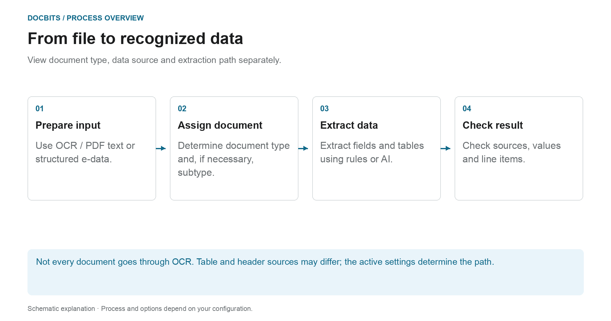
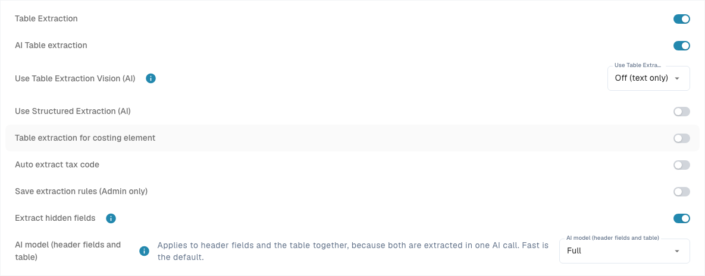

# Classification and Extraction

[AI Table](../../../../end-user-and-partner-section/end-user-section/ai-table/README.md) · [Structured Output dla tabel](../../../../end-user-and-partner-section/end-user-section/ai-table/structured-output.md)

## Które ustawienie działa na którym etapie procesu?

<figure><figcaption>
Typ dokumentu, źródło danych i ścieżkę ekstrakcji rozpatruj osobno. Diagram jest schematyczny; o rzeczywistym zachowaniu decydują aktywne ustawienia Twojej organizacji.
</figcaption></figure>
<!-- English source image: process-extraction-en-20261028.png -->

Klasyfikacja odpowiada na pytanie **„Co to za dokument?”**. Ekstrakcja odpowiada na pytanie **„Jakie wartości zawiera?”**. Ustawienia na tej stronie wpływają na różne punkty przetwarzania i nie należy ich rozumieć jako pojedynczego przełącznika AI.

1. **Przygotuj dane wejściowe:** W przypadku plików PDF można użyć istniejącego tekstu lub OCR; obsługiwane dokumenty elektroniczne mogą dostarczyć wartości strukturalne. Aktywowany podział może rozdzielić przychodzący dokument na podstawie skonfigurowanych kryteriów kodu kreskowego lub QR.
2. **Określ typ dokumentu:** Reguły klasyfikacji i modele przypisują dokumenty do typu, a w razie potrzeby do podtypu. To przypisanie należy odróżnić od późniejszej ekstrakcji pól i tabel.
3. **Wyodrębnij wartości:** Tabele mogą podążać różnymi ścieżkami w zależności od konfiguracji i obowiązujących zapisanych reguł. Pola nagłówka mają własne wskaźniki źródła. Sam wybrany model AI nie wyjaśnia więc wartości każdego wiersza lub pola.
4. **Prześledź wynik:** Na ekranie walidacji sprawdź, która zakładka tabeli zawiera wiersze i jaki wskaźnik źródła ma pole nagłówka. Jeśli brakuje etapu przetwarzania, przed zmianą ustawień przeczytaj dzienniki dokumentu.

### Rozróżnij ścieżkę reguły od ścieżki AI

Odpowiednie zapisane reguły tabel mogą określać ekstrakcję tabeli dla danego szablonu lub dostawcy. Bez odpowiednich reguł można użyć ścieżki AI, gdy ekstrakcja tabeli AI jest aktywna. Poszczególne kolumny mogą mieć własne opcje AI. Źródło AI dla pola nagłówka nie oznacza, że cała tabela pochodzi z AI.

Przewodnik diagnostyczny [Która ścieżka ekstrakcji została wykorzystana?](../../../../overview-and-basics/faq/document-processing/which-extraction-path-was-used.md) objaśnia zakładki, identyfikatory źródeł i protokoły. Strona [AI model](ai-model.md) objaśnia standard organizacji i nadpisania związane z szablonami.

<figure><figcaption>
General zawiera ustawienia przetwarzania. AI Models jest tutaj widoczne, ponieważ moduł jest włączony; jego własne modele klasyfikacji są oddzielone od selektora poziomu ekstrakcji. Zapisany wzorzec kodu kreskowego jest ukryty.
</figcaption></figure>
<!-- English source image: dbdc-193-general-overview-en-20261030.png -->

## Przegląd

W ustawieniach **Classification and Extraction** możesz:

* Sterować tym, jak przesyłane dokumenty są **dzielone** i ile stron jest przetwarzanych
* Konfigurować **formatowanie kwot** na potrzeby porównywania kwot
* Skonfigurować **ekstrakcję tabeli**, w tym model AI używany dla poszczególnych dostawców
* Przełączać przetwarzanie nieobsługiwanych plików **ZUGFeRD**
* Definiować **reguły klasyfikacji**, które automatycznie przypisują typ dokumentu
* Przeglądać **AI Models** i ich wytrenowane etykiety

Strona ma zakładki **General** i **Classification Rules**, a także **AI Models**, gdy moduł modeli i etykiet jest włączony dla Twojej organizacji. Własne modele klasyfikacji i etykiety w **AI Models** są oddzielone od selektora poziomu ekstrakcji w **General → Extraction**.

| Zakładka | Zawartość |
|---|---|
| General | Document Splitting, Document Processing, Amount Formatting, Table Extraction, Electronic Document |
| Classification Rules | Reguły regex, które klasyfikują dokumenty po nazwie źródła |
| AI Models | Własne wytrenowane modele z ich etykietami, typami dokumentów i priorytetem |

## Dostęp do ustawień Classification and Extraction

Przejdź do **Settings → Document Types → Classification and Extraction**.

## General

Zakładka **General** grupuje ustawienia w zwijane sekcje. Większość kontrolek zapisuje się po zmianie wartości. Zmieniony, niepusty **Barcode Pattern** korzysta ze swojej akcji walidacji/**Save**, a zmiana wersji ekstrakcji tabeli wymaga potwierdzenia. Przed edycją kontrolki sprawdź organizację i zamierzone zachowanie.

### Document Splitting

**Split** decyduje, czy przesyłany dokument jest dzielony na kilka dokumentów, gdy na jednej z jego stron pojawi się kod kreskowy. Lista rozwijana oferuje:

* **Do not split uploaded documents** – ustawienie domyślne; dokument jest przetwarzany jako jeden plik.
* **Split by Barcode/QR-Code** – dokument jest dzielony przy każdym wykrytym kodzie kreskowym.

<figure><figcaption>
Przed zmianą sprawdź metodę podziału i typy kodów kreskowych. Wzorzec właściwy dla organizacji jest ukryty; nie zmieniono żadnej wartości.
</figcaption></figure>
<!-- English source image: dbdc-193-document-splitting-en-20261030.png -->

Gdy wybrano **Split by Barcode/QR-Code**, pojawiają się dwa kolejne pola:

* **Barcode Type** – jeden lub więcej typów kodów kreskowych do wykrycia, na przykład *CODE-128* lub *QR-CODE*.
* **Barcode Pattern** – wyrażenie regularne, które musi pasować do wartości kodu kreskowego, zanim podział zostanie uruchomiony. Pozostaw je puste, aby dzielić przy dowolnym kodzie wybranych typów. Wzorzec jest walidowany przed zapisaniem; niepoprawne wyrażenie jest zgłaszane natychmiast.

Po udanym podziale dokument nadrzędny zostaje usunięty, a strony są dalej przetwarzane jako osobne dokumenty, które współdzielą ten sam batch.

<figure><figcaption>
Przykład ze wzorcem <code>^INV\d{6}$</code>: kody na arkuszach 3 i 6 pasują i każdy z nich rozpoczyna nowy dokument, kod na arkuszu 4 nie pasuje i niczego nie dzieli, a gumka recepturka oznacza batch, który współdzielą powstałe dokumenty.
</figcaption></figure>

### Document Processing

**Pages to process** ogranicza, ile stron jest poddawanych OCR, klasyfikacji i ekstrakcji na dokument.

<figure><figcaption>
W tym przykładzie limit to 10 przetwarzanych stron. Pole wyjaśnia, że pusta wartość lub 0 oznacza wszystkie strony; wyświetlana wartość nie została zmieniona.
</figcaption></figure>
<!-- English source image: dbdc-193-document-processing-en-20261030.png -->

* Pusta wartość lub **0** oznacza, że przetwarzane są wszystkie strony.
* Liczba *N* ogranicza OCR, klasyfikację i ekstrakcję do pierwszych *N* stron. Cały dokument jest nadal przechowywany, wyświetlany i eksportowany; strony poza limitem są pokazywane w trybie tylko do odczytu.

### Amount Formatting

Dwa przełączniki kontrolują, jak kwoty są porównywane z danymi podstawowymi i zamówieniami zakupu.

<figure><figcaption>
W tym przykładzie oba przełączniki porównywania kwot są wyłączone. Przed zmianą któregokolwiek z nich sprawdź zamierzoną politykę.
</figcaption></figure>
<!-- English source image: dbdc-193-amount-formatting-en-20261030.png -->

* **Allow Rounding During Amount Comparison** – po włączeniu dozwolona jest tolerancja ±0.5. Po wyłączeniu obowiązuje ±0.05.
* **Require Exact Match for Amount Comparison** – po włączeniu kwoty muszą się zgadzać dokładnie, z zerową tolerancją. Po wyłączeniu obowiązuje ±0.05.

Tylko jeden z dwóch przełączników może być aktywny jednocześnie; włączenie jednego wyłącza drugi.

### Table Extraction


**Warunki wstępne działającej ekstrakcji tabeli**

* Typ dokumentu ma **kolumny tabeli** (Settings → Document Processing → Document Types → [Table Columns](../../global-settings/document-types/table-columns/README.md)). Bez kolumn nie ma do czego wyodrębniać.
* Poniżej włączona jest opcja **Table Extraction** lub **AI Table Extraction**, dla całej organizacji.
* Dokument ma czytelny tekst: wykonano OCR albo dla plików PDF utworzonych cyfrowo używany jest E-Text ([OCR Settings](../ocr-settings.md)).
* Szkolenie i modele AI działają **dla każdego dostawcy osobno**. Wytrenowana tabela dotyczy tylko dokumentów dostawcy, na którym została wytrenowana.


Tabele z dokumentów możesz wyodrębniać, włączając opcję **Table Extraction** lub **AI Table Extraction**. Wytrenowana tabela (oparta na AI lub ręczna) jest zawsze powiązana z konkretnym dostawcą.

<figure><figcaption>
Selektor poziomu ekstrakcji znajduje się w General → Extraction. Poniżej pokazano nagłówek tabeli nadpisań dostawców; dane istniejących wierszy są ukryte i nie zmieniono żadnego ustawienia.
</figcaption></figure>
<!-- English source image: dbdc-193-table-extraction-en-20261030.png -->

**Table Extraction:** Włącza ekstrakcję tabeli opartą na regułach. Tabele trenuje się dla każdego dostawcy na ekranie walidacji (*Go to table extraction view*).\
Więcej o szkoleniu [tutaj](../../../setup/document-training/training-line-fields-table-training/defining-tables-and-columns.md).

**AI Table Extraction:** Wykorzystuje AI do wyodrębnienia tabeli dowolnego dostawcy bez szkolenia. Jeśli wyniki dla jednego dostawcy nie są wystarczająco dokładne, wytrenuj tabelę tego dostawcy; zapisane reguły mają wtedy pierwszeństwo przed AI dla tego dostawcy.

**Use Table Extraction Vision (AI):** Wybierz dane wejściowe dla ekstrakcji tabeli AI z listy z czterema trybami. To wybór trybu, a nie osobny przełącznik włącz/wyłącz. Zmiana wybranego trybu zapisuje ustawienie natychmiast:

* **Off (text only)** – Używany jest tylko tekst z OCR.
* **Images only** – Odczytywany jest wyłącznie obraz strony.
* **Hybrid (text and images)** – Warstwa tekstowa i obraz strony są łączone w tym samym żądaniu.
* **Auto (decided per document)** – DocBits wybiera dla każdego dokumentu sam tekst albo wejście hybrydowe.

<figure><figcaption>
Cztery tryby wejścia w bieżącym menu Dev w wersji angielskiej. Menu zostało otwarte i zamknięte bez wybierania innego trybu; nie uruchomiono żadnej ekstrakcji.
</figcaption></figure>
<!-- English source image: dbdc-3-four-vision-options-en-20261031.png -->

**Use Structured Extraction (AI):** Przełącznik ustawia domyślne zachowanie organizacji dla wyniku strukturalnego. Żądane kolumny zależą od trzystanowego wyboru Use AI; znaczenie mają też nadpisania szablonu i szkolenie dostawcy. Przeczytaj pełny [przewodnik po konfiguracji, podglądzie i przykładzie](../../../../end-user-and-partner-section/end-user-section/ai-table/structured-output.md) dla Structured Output for Tables.

**Table Extraction for Costing Element:** Po włączeniu DocBits może wyodrębniać elementy kosztowe z tabel na poziomie pozycji i odpowiednio je klasyfikować.\
Szczegółowe wyjaśnienie [tutaj](table-extraction-for-costing-element.md).

**Auto Extract Tax Code:** Po włączeniu system automatycznie wypełnia pole **Tax Code** na ekranie Validation, pod warunkiem że pole kodu podatkowego jest skonfigurowane.\
Więcej informacji o tym ustawieniu [tutaj](auto-extract-tax-code.md).

**Save extraction rules (Admin only):** Tylko administratorzy mogą kliknąć *Save Rules* w szkoleniu tabeli. Włącz tę opcję, gdy użytkownicy zapisują reguły, które psują ekstrakcję dostawcy.

**Extract hidden fields:** Pola oznaczone jako ukryte w ustawieniach pól są również wyodrębniane. Użyj tej opcji, gdy wartość jest potrzebna dla reguły lub eksportu, ale nie powinna być pokazywana na ekranie walidacji.

**AI Model:** Ustawia model organizacji dla ekstrakcji pól i tabel. Menu oferuje Full, Fast, Nexus, Nexus Flash, Auto i Auto Nexus. Sprawdź dostępność, jakość, czas działania i koszt na reprezentatywnych dokumentach. Poziom nie zawsze jest najdokładniejszy lub najszybszy dla każdego dokumentu. Nadpisania szablonów mogą zastąpić ustawienie organizacji. Tabela pod selektorem pokazuje:

* Którzy **dostawcy** używają którego modelu AI
* Czy używają ekstrakcji strukturalnej (AI) i E-Text
* Opcje usunięcia wpisu i zresetowania w ten sposób dostawcy do wartości domyślnej

To ustawienie jest szczegółowo opisane [tutaj](ai-model.md).

#### Dlaczego tabela wygląda inaczej u każdego dostawcy?

Przetwarzanie tabeli zależy od zapisanych reguł i ustawień w kontekście odpowiedniego dostawcy lub szablonu:

* **Zapisane reguły** (szkolenie tabeli): położenie tabeli i mapowanie jej kolumn w układzie tego dostawcy.
* **Tagi tabeli AI i reguły formatowania**: wskazówki zapisane przez użytkownika dla tabeli AI tego dostawcy.
* **Model AI właściwy dla szablonu:** Wybór dokonany na ekranie walidacji jest zapisywany dla organizacji i bieżącego szablonu ekstrakcji. Nie zmienia automatycznie każdego szablonu tego samego dostawcy. Bez nadpisania używane jest obowiązujące ustawienie organizacji.

Dlatego dostawca A z zapisanymi regułami pokazuje deterministyczną tabelę w zakładce *Extracted table* na ekranie walidacji, a dostawca B bez reguł otrzymuje *AI Extracted table*. Aby dostawca B zachowywał się jak A, wytrenuj raz tabelę dostawcy B. Aby zresetować dostawcę, usuń jego reguły na ekranie walidacji albo zresetuj jego dane szkoleniowe w tabeli AI Model.

#### Klucze preferencji

Każdy przełącznik w tej sekcji jest zapisywany jako preferencja organizacji. Użyj klucza, gdy ustawiasz wartość przez API (`/preferences/set_preference`), skrypt lub DocBits MCP (`get_preference` / `set_preference`).

| Ustawienie (etykieta w interfejsie) | Klucz preferencji | Wartości |
|---|---|---|
| Split | `SPLIT_DOCUMENT_ON_BARCODE` | `true` / `false` |
| Barcode Type | `SPLIT_DOCUMENT_BARCODE_TYPE` | lista nazw typów kodów kreskowych |
| Barcode Pattern | `SPLIT_DOCUMENT_BARCODE_PATTERN` | ciąg wyrażenia regularnego |
| Pages to process | `RESTRICT_TO_PAGES` | liczba; puste lub `0` = wszystkie strony |
| Allow Rounding During Amount Comparison | `AMOUNTS_ROUNDING` | `true` / `false` |
| Require Exact Match for Amount Comparison | `AMOUNTS_NO_ROUNDING` | `true` / `false` |
| Table Extraction | `TABLE_EXTRACTION_SETTING` | `true` / `false` |
| AI Table extraction | `USE_AI_TABLE_EXTRACTION` | `true` / `false` |
| Use Table Extraction Vision (AI) | `TABLE_EXTRACTION_VISION_MODE` | `off`, `vision`, `hybrid`, `auto`; gdy nie ustawiono, tryb wyznacza starsza preferencja |
| Use Table Extraction Vision (AI) – starszy przełącznik | `TABLE_EXTRACTION_USE_VISION` | `true` / `false`; w praktyce oznacza `vision` |
| Use Structured Extraction (AI) | `USE_STRUCTURED_EXTRACTION` | `true` / `false` |
| Table extraction for costing element | `CHARGES_TABLE_EXTRACTION` | `true` / `false` |
| Auto extract tax code | `AUTO_EXTRACT_TAX_CODE` | `true` / `false` |
| Save extraction rules (Admin only) | `ONLY_ADMIN_CAN_SAVE_RULES` | `true` / `false` |
| Extract hidden fields | `EXTRACT_HIDDEN_FIELDS` | `true` / `false` |
| AI Model | `AI_MODEL` | `gpt-6-sol` (Full), `gpt-6-luna` (Fast), `qwen3.8-max` (Nexus), `glm-5.3-flash` (Nexus Flash), `auto` (Auto), `auto-nexus` (Auto Nexus) |
| Table extraction version (okno potwierdzenia) | `TBL_EXT_VERSION` | ciąg wersji |
| OCR Settings → Use AI data for tables if available | `USE_AI_DATA_FOR_TABLE` | `true` / `false` |
| OCR Settings → Use E-Text if available | `USE_ETEXT_IF_AVAILABLE` | `true` / `false` |

Uwagi:

* Preferencje logiczne są zapisywane jako ciągi `true` / `false`. Klucz, który nie został ustawiony, używa wartości domyślnej tego ustawienia; w interfejsie **Extract hidden fields** jest pokazane jako włączone, gdy nie ustawiono wartości. Nie zakładaj, że każdy brakujący klucz oznacza fałsz. Jeśli wyślesz `1` lub `0`, DocBits zapisze `true` / `false`.
* Nieustawiony `AI_MODEL` oznacza **Fast**.
* Nieustawiony `TABLE_EXTRACTION_VISION_MODE` jest wyznaczany ze starszego przełącznika `TABLE_EXTRACTION_USE_VISION`: `true` daje `vision`, każda inna wartość daje `off`.
* Zmiana klucza obowiązuje dla dokumentów przetwarzanych później. Uruchom dokument ponownie, aby wyodrębnić go z nowym ustawieniem.
* Nadpisania szablonów różnią się od preferencji organizacji. Przewodnik po modelu AI wyjaśnia dokładny zakres.

### Electronic Document

**Process Unsupported ZUGFeRD PDF:** Po włączeniu nieobsługiwane wersje **ZUGFeRD** będą przetwarzane jako standardowe pliki PDF, a osadzony XML będzie ignorowany.

Listę obsługiwanych wersji **ZUGFeRD** znajdziesz [tutaj](../../global-settings/document-types/edi/zugferd/README.md).

<figure><figcaption>
Electronic Document zawiera opcję dla nieobsługiwanych plików PDF ZUGFeRD. Wyświetlany stan to istniejące ustawienie; na potrzeby tego zrzutu nie przetwarzano żadnego dokumentu.
</figcaption></figure>
<!-- English source image: dbdc-193-electronic-document-en-20261030.png -->

## Classification Rules

Zakładka **Classification Rules** zawiera listę reguł, które automatycznie przypisują typ dokumentu podczas przetwarzania. Każda reguła dopasowuje **wzorzec regex** do nazwy źródła dokumentu i w razie dopasowania ustawia typ dokumentu, a opcjonalnie także podtyp dokumentu.

Przełącz na tę zakładkę, klikając **Classification Rules** na górze strony.

<figure><figcaption>
Wyszukaj istniejące reguły albo wybierz Add, aby przygotować regułę. Wiersze istniejących reguł są ukryte; to nie jest przykład pustej listy.
</figcaption></figure>
<!-- English source image: dbdc-193-rules-list-en-20261030.png -->

Tabela ma jeden wiersz na regułę, z następującymi kolumnami:

* **Type** – gdzie wzorzec jest stosowany. Istnieją dwa typy: **Barcode** i **E-Mail**.
* **Pattern** – wyrażenie regularne zapisane w regule.
* **Document Type** – typ dokumentu przypisywany, gdy wzorzec pasuje.
* **Sub Document Type** – podtyp dokumentu przypisywany, gdy wzorzec pasuje.
* **Sub Organization** – podorganizacja, do której reguła jest ograniczona. Puste pole oznacza, że reguła dotyczy wszystkich podorganizacji.
* **Actions** – menu wiersza z akcjami *Edit* i *Delete*.

Pole wyszukiwania nad tabelą filtruje wszystkie kolumny, łącznie z etykietami wyświetlanymi w kolumnach list rozwijanych.

### Dodawanie nowej reguły klasyfikacji

1.  Kliknij **Add** nad tabelą.

    <figure><figcaption>
Add otwiera ten pusty formularz reguły. Przed kliknięciem Save sprawdź wzorzec i docelowy typ; Cancel zamyka okno bez tworzenia reguły.
</figcaption></figure>
<!-- English source image: dbdc-193-rule-add-en-20261030.png -->
2. Wypełnij pola:
   * **Pattern** (wymagane) – wyrażenie regularne, którego szuka reguła.
   * **Type** (wymagane) – **Barcode** lub **E-Mail**. Decyduje, z którą nazwą źródła wzorzec jest porównywany.
   * **Sub Organization** *(opcjonalnie)* – ogranicza regułę do jednej podorganizacji.
   * **Document Type** – typ dokumentu przypisywany, gdy wzorzec pasuje.
   * **Sub Document Type** *(opcjonalnie)* – bardziej szczegółowy typ; lista zależy od wybranego typu dokumentu. Zmiana typu dokumentu czyści podtyp dokumentu.
3.  Kliknij **Save**.

Okno waliduje wzorzec przed zapisaniem. Wzorzec używany już przez inną regułę jest odrzucany z komunikatem *Pattern already exists*; pusty wzorzec jest odrzucany komunikatem o polu wymaganym.

#### Pomoc dotycząca wzorca

Przełącznik **Show help** pod polem wzorca otwiera wbudowaną ściągawkę z formatami nazw źródła, z którymi wzorzec jest porównywany:

* **O365** – `Shared Email + Folder › Shared Email › Folder › Email › Id`
* **Gmail** – `Email + Folder › Folder › Email › Id`

<figure><figcaption>
Show help wyjaśnia, z którą nazwą źródła porównywane jest wyrażenie regularne. Ściągawka i przykłady są wyświetlane bez wpisywania i zapisywania reguły.
</figcaption></figure>
<!-- English source image: dbdc-193-rule-pattern-help-en-20261030.png -->

Przykłady podane w panelu:

* `.*@acme\.de.*` – dowolne źródło z tej skrzynki
* `^ap@acme\.de:.*` – konkretna skrzynka, dowolny folder

Wskazówka: zakotwicz wzorzec znakami `^` / `$`, aby dopasowanie było dokładne, escapuj kropki jako `\.` i używaj `:` jako separatora pól. Wygrywa pierwszy zestaw pól obecny w nazwie źródła.

Jeśli używasz typu **E-Mail**, wzorzec jest porównywany z nazwami skrzynki i folderu importowanego maila, a nie z treścią dokumentu.

### Edycja reguły klasyfikacji

1.  Kliknij trzy kropki w kolumnie **Actions** reguły, którą chcesz zmienić.
2.  Wybierz **Edit**. Okno otwiera się z bieżącymi wartościami reguły.
3. Wprowadź zmiany we wzorcu, typie, podorganizacji, typie dokumentu lub podtypie dokumentu.
4.  Kliknij **Save**.

Obowiązuje ta sama walidacja co przy dodawaniu reguły: wzorzec nie może być pusty i nie może powielać wzorca innej reguły.

### Usuwanie reguły klasyfikacji

1. Kliknij trzy kropki w kolumnie **Actions**.
2. Wybierz **Delete**.

Reguła zostaje natychmiast usunięta z listy. Usunięcie reguły nie zmienia dokumentów, które zostały już sklasyfikowane.

## AI Models

Zakładka **AI Models** pokazuje własne wytrenowane modele dostępne dla klasyfikacji dokumentów oraz ich etykiety. Pojawia się tylko wtedy, gdy moduł modeli i etykiet jest włączony dla Twojej organizacji.

<figure><figcaption>
AI Models to opcjonalna zakładka dla własnych modeli klasyfikacji i etykiet. W tej organizacji udane odczytanie listy nie zwróciło żadnych modeli; nie opisuje to ustawienia poziomu ekstrakcji.
</figcaption></figure>
<!-- English source image: dbdc-193-ai-models-empty-en-20261030.png -->

Jeśli dla organizacji nie jest dostępny żaden własny model, zakładka pokazuje *No Record Found!*.

### Modele

Każdy model to rozwijany wpis z:

* **nazwą modelu** oraz plakietką **Default** przy modelu używanym, gdy nic innego nie ma zastosowania.
* liczbą **etykiet** wytrenowanych dla tego modelu.
* po rozwinięciu, dla każdego modelu: **Type**, **First page only** i **Version**.

Pod tymi informacjami wymienione są etykiety modelu.

### Etykiety

Etykiety to elementy, których uczy się model. Każda etykieta mapuje rozpoznawany wzorzec na typ dokumentu.

* **Name** – nazwa etykiety.
* **Next model** – model, który kontynuuje przetwarzanie wyniku tej etykiety.
* **DOC TYPE** – typ dokumentu przypisywany przez etykietę.
* **Sub Document Type** – bardziej szczegółowy typ dla etykiety.
* **Priority** – kolejność, w jakiej etykiety są oceniane; niższe numery pierwsze.

Pole wyszukiwania nad tabelą etykiet filtruje etykiety wybranego modelu.

### Edycja etykiety

Kliknij ikonę pióra w wierszu etykiety, aby otworzyć okno edycji. Oferuje ono **Next model** i **Document Type**; ustaw jedno z nich, ponieważ okno wymaga modelu następnego albo typu dokumentu. Kliknij **Save**, aby zastosować zmianę.

## Powiązane strony

* [AI Model](ai-model.md) – sześć poziomów ekstrakcji i sposób, w jaki dostawca dostaje własny model
* [Auto Extract Tax Code](auto-extract-tax-code.md)
* [Table Extraction for Costing Element](table-extraction-for-costing-element.md)
* [OCR Settings](../ocr-settings.md)

<figure><figcaption>
Bieżące kontrolki ekstrakcji. Structured Output jest w tej istniejącej konfiguracji wyłączony, dlatego nie jest pokazywany podgląd schematu. Nie zmieniono żadnego ustawienia ekstrakcji.
</figcaption></figure>
<!-- English source image: structured-output-settings-en-20261104.png -->
