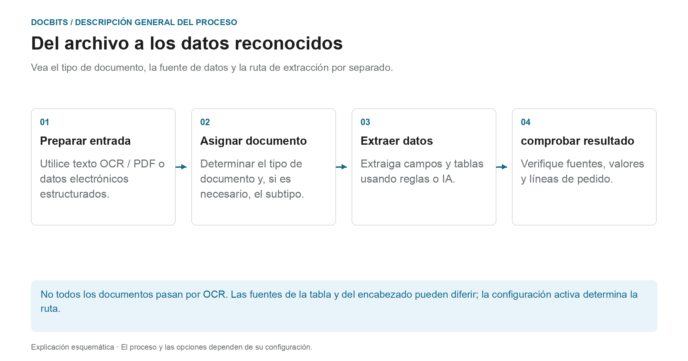

# Clasificación y extracción

[AI Table](../../../../end-user-and-partner-section/end-user-section/ai-table/README.md) · [Structured Output para tablas](../../../../end-user-and-partner-section/end-user-section/ai-table/structured-output.md)

## ¿Qué ajuste actúa en qué paso del proceso?

<figure><figcaption>
Vea por separado el tipo de documento, la fuente de datos y la ruta de extracción. El diagrama es esquemático; el comportamiento real lo determinan los ajustes activos de su organización.
</figcaption></figure>

La clasificación responde a la pregunta **“¿Qué tipo de documento es este?”**. La extracción responde **“¿Qué valores contiene?”**. Los ajustes de esta página afectan a distintos puntos del procesamiento y no deben entenderse como un único interruptor de IA.

1. **Preparar la entrada:** en los PDF se puede usar el texto existente o el OCR; los documentos electrónicos compatibles pueden aportar valores estructurados. Una división activada puede separar un documento entrante según el código de barras o los criterios QR configurados.
2. **Determinar el tipo de documento:** las reglas de clasificación y los modelos asignan los documentos a un tipo y, si es necesario, a un subtipo. Esta asignación debe distinguirse de la posterior extracción de campos y tablas.
3. **Extraer los valores:** las tablas pueden seguir rutas distintas según la configuración y las reglas guardadas aplicables. Los campos de cabecera tienen sus propios indicadores de origen. Por tanto, el modelo de IA seleccionado por sí solo no explica cada fila ni cada valor de campo.
4. **Trazar el resultado:** en la pantalla de validación, compruebe qué pestaña de tabla contiene las filas y qué indicador de origen tiene un campo de cabecera. Si falta un paso de procesamiento, lea los logs del documento antes de cambiar ajustes.

### Distinguir entre ruta de reglas y ruta de IA

Las reglas de tabla guardadas adecuadas pueden determinar la extracción de la tabla para la plantilla o el proveedor correspondiente. Sin reglas adecuadas, se puede usar la ruta de IA cuando la extracción de tablas por IA está activada. Las columnas individuales pueden tener sus propias opciones de IA. Que un campo de cabecera tenga una fuente de IA no significa que toda la tabla provenga de la IA.

La guía de diagnóstico [¿Qué ruta de extracción se utilizó?](../../../../overview-and-basics/faq/document-processing/which-extraction-path-was-used.md) explica pestañas, identificadores de origen y protocolos. La página [AI model](ai-model.md) explica el estándar de la organización y las anulaciones relacionadas con la plantilla.

<figure><figcaption>
General contiene los ajustes de procesamiento. AI Models es visible aquí porque el módulo está habilitado; sus modelos de clasificación personalizados son independientes del selector de nivel de extracción. El patrón de código de barras guardado está oculto.
</figcaption></figure>

## Descripción general

En los ajustes de **Classification and Extraction** puede:

* Controlar cómo se **dividen** los documentos cargados y cuántas páginas se procesan
* Configurar el **formato de importes** para la comparación de importes
* Configurar la **extracción de tablas**, incluido el modelo de IA utilizado por proveedor
* Activar o desactivar el procesamiento de archivos **ZUGFeRD** no compatibles
* Definir **reglas de clasificación** que asignan un tipo de documento automáticamente
* Revisar los **AI Models** y sus etiquetas entrenadas

La página tiene **General** y **Classification Rules**, además de **AI Models** cuando el módulo de modelos y etiquetas está habilitado para su organización. Los modelos de clasificación personalizados y las etiquetas de **AI Models** son independientes del selector de nivel de extracción de **General → Extraction**.

| Pestaña | Contenido |
|---|---|
| General | Document Splitting, Document Processing, Amount Formatting, Table Extraction, Electronic Document |
| Classification Rules | Reglas regex que clasifican documentos por nombre de origen |
| AI Models | Modelos entrenados a medida con sus etiquetas, tipos de documento y prioridad |

## Acceder a los ajustes de Classification and Extraction

Vaya a **Settings → Document Types → Classification and Extraction**.

## General

La pestaña **General** agrupa los ajustes en secciones plegables. La mayoría de los controles se guardan cuando cambia su valor. Un **Barcode Pattern** no vacío y modificado utiliza su acción de validación/**Save**, y un cambio de versión de la extracción de tablas requiere confirmación. Revise la organización y el comportamiento previsto antes de editar un control.

### Document Splitting

**Split** decide si un documento cargado se divide en varios documentos cuando aparece un código de barras en una de sus páginas. El desplegable ofrece:

* **Do not split uploaded documents** – el valor predeterminado; el documento se procesa como un solo archivo.
* **Split by Barcode/QR-Code** – el documento se divide en cada código de barras detectado.

<figure><figcaption>
Revise el método de división y los tipos de código de barras antes de cambiarlos. El patrón específico de la organización está oculto; no se ha modificado ningún valor.
</figcaption></figure>

Cuando se selecciona **Split by Barcode/QR-Code**, aparecen dos campos más:

* **Barcode Type** – uno o varios tipos de código de barras que se deben detectar, por ejemplo *CODE-128* o *QR-CODE*.
* **Barcode Pattern** – una regex que el valor del código de barras debe cumplir para que se active la división. Déjelo vacío para dividir con cualquier código de barras de los tipos seleccionados. El patrón se valida antes de guardarse; una expresión no válida se notifica de inmediato.

Tras una división correcta, el documento principal se elimina y las páginas continúan como documentos independientes que comparten el mismo lote.

<figure><figcaption>
Ejemplo con el patrón <code>^INV\d{6}$</code>: los códigos de las hojas 3 y 6 coinciden y cada uno inicia un documento nuevo, el código de la hoja 4 no coincide y no divide nada, y la banda elástica representa el lote que comparten los documentos resultantes.
</figcaption></figure>

### Document Processing

**Pages to process** limita cuántas páginas se someten a OCR, se clasifican y se extraen por documento.

<figure><figcaption>
Este ejemplo tiene un límite de 10 páginas procesadas. El campo explica que vacío o 0 significa todas las páginas; el valor mostrado no se ha modificado.
</figcaption></figure>

* Vacío o **0** significa que se procesan todas las páginas.
* Un número *N* limita el OCR, la clasificación y la extracción a las primeras *N* páginas. El documento completo se sigue almacenando, mostrando y exportando; las páginas que superan el límite se muestran en modo de solo lectura.

### Amount Formatting

Dos interruptores controlan cómo se comparan los importes con los datos maestros y los pedidos.

<figure><figcaption>
Los dos interruptores de comparación de importes aparecen desactivados en este ejemplo. Inspeccione la política prevista antes de cambiar cualquiera de los dos.
</figcaption></figure>

* **Allow Rounding During Amount Comparison** – si está activado, se permite una tolerancia de ±0.5. Si está desactivado, se aplica ±0.05.
* **Require Exact Match for Amount Comparison** – si está activado, los importes deben coincidir exactamente, con tolerancia cero. Si está desactivado, se aplica ±0.05.

Solo uno de los dos interruptores puede estar activo a la vez; activar uno desactiva el otro.

### Table Extraction


**Requisitos para que la extracción de tablas funcione**

* El tipo de documento tiene **columnas de tabla** (Settings → Document Processing → Document Types → [Table Columns](../../global-settings/document-types/table-columns/README.md)). Sin columnas no hay dónde extraer.
* **Table Extraction** o **AI Table Extraction** está activado más abajo, para toda la organización.
* El documento tiene texto legible: se ejecutó el OCR, o se usa E-Text en los PDF generados digitalmente ([OCR Settings](../ocr-settings.md)).
* El entrenamiento y los modelos de IA son **por proveedor**. Una tabla entrenada solo se aplica a los documentos del proveedor con el que se entrenó.


Puede extraer tablas de los documentos activando **Table Extraction** o **AI Table Extraction**. Una tabla entrenada (ya sea basada en IA o manual) siempre está vinculada a un proveedor concreto.

<figure><figcaption>
El selector de nivel de extracción está dentro de General → Extraction. La cabecera de la tabla de anulación por proveedor se muestra debajo; los datos de las filas existentes están ocultos y no se ha cambiado ningún ajuste.
</figcaption></figure>

**Table Extraction:** activa la extracción de tablas basada en reglas. Las tablas se entrenan por proveedor en la pantalla de validación (*Go to table extraction view*).\
Más información sobre el entrenamiento [aquí](../../../setup/document-training/training-line-fields-table-training/defining-tables-and-columns.md).

**AI Table Extraction:** usa IA para extraer la tabla de cualquier proveedor sin entrenamiento. Si los resultados de un proveedor no son lo bastante precisos, entrene la tabla de ese proveedor; las reglas guardadas tienen entonces prioridad sobre la IA para ese proveedor.

**Use Table Extraction Vision (AI):** elija la entrada para la extracción de tablas por IA en un desplegable de cuatro modos. Se trata de una selección de modo, no de un interruptor de encendido/apagado aparte. Cambiar el modo seleccionado guarda el ajuste de inmediato:

* **Off (text only)** – solo se utiliza el texto del OCR.
* **Images only** – solo se lee la imagen de la página.
* **Hybrid (text and images)** – la capa de texto y la imagen de la página se combinan en la misma solicitud.
* **Auto (decided per document)** – DocBits elige la entrada de solo texto o híbrida para cada documento.

<figure><figcaption>
Los cuatro modos de entrada en el menú English Dev actual. El menú se abrió y se cerró sin seleccionar otro modo; no se ejecutó ninguna extracción.
</figcaption></figure>

**Use Structured Extraction (AI):** el interruptor establece el valor predeterminado de salida estructurada de la organización. Las columnas solicitadas dependen de la selección de tres estados de Use AI; las anulaciones de plantilla y el entrenamiento del proveedor también influyen. Lea la [guía completa de configuración, vista previa y ejemplo](../../../../end-user-and-partner-section/end-user-section/ai-table/structured-output.md) para Structured Output para tablas.

**Table Extraction for Costing Element:** si está activado, DocBits puede extraer elementos de coste de las tablas a nivel de línea y clasificarlos en consecuencia.\
Explicación detallada disponible [aquí](table-extraction-for-costing-element.md).

**Auto Extract Tax Code:** si está activado, el sistema rellena automáticamente el campo **Tax Code** en la pantalla de validación, siempre que haya un campo de código de impuestos configurado.\
Más información sobre este ajuste [aquí](auto-extract-tax-code.md).

**Save extraction rules (Admin only):** solo los administradores pueden hacer clic en *Save Rules* en el entrenamiento de tablas. Actívelo cuando los usuarios guarden una y otra vez reglas que rompen la extracción de un proveedor.

**Extract hidden fields:** también se extraen los campos marcados como ocultos en los ajustes de campos. Úselo cuando un valor sea necesario para una regla o una exportación pero no deba mostrarse en la pantalla de validación.

**AI Model:** establece el modelo de la organización para la extracción de campos y tablas. El menú ofrece Full, Fast, Nexus, Nexus Flash, Auto y Auto Nexus. Compruebe disponibilidad, calidad, tiempo de ejecución y coste con documentos representativos. Un nivel no siempre es el más preciso o el más rápido para cada documento. Las anulaciones de plantilla pueden sustituir el ajuste de la organización. La tabla situada debajo del selector muestra:

* Qué **proveedores** utilizan qué modelo de IA
* Si utilizan la extracción estructurada (IA) y E-Text
* Opciones para eliminar una entrada y restablecer así el proveedor al valor predeterminado

Este ajuste se explica en detalle [aquí](ai-model.md).

#### ¿Por qué la tabla es distinta según el proveedor?

El procesamiento de tablas depende de las reglas y los ajustes guardados en el contexto del proveedor o la plantilla correspondiente:

* **Reglas guardadas** (entrenamiento de tablas): posición de la tabla y asignación de sus columnas en el layout de ese proveedor.
* **Etiquetas de tabla AI y reglas de formato**: indicaciones que el usuario guardó para la tabla AI de ese proveedor.
* **Modelo de IA específico de la plantilla:** la selección realizada en la pantalla de validación se guarda por organización y plantilla de extracción actual. No cambia automáticamente todas las plantillas del mismo proveedor. Sin una anulación, se utiliza el ajuste de organización aplicable.

Así, el proveedor A con reglas guardadas muestra una tabla determinista en la pestaña *Extracted table* de la pantalla de validación, mientras que el proveedor B sin reglas recibe la *AI Extracted table*. Para que el proveedor B se comporte como A, entrene una vez la tabla de B. Para restablecer un proveedor, elimine sus reglas en la pantalla de validación o restablezca sus datos de entrenamiento en la tabla AI Model.

#### Claves de preferencia

Cada interruptor de esta sección se guarda como una preferencia de la organización. Utilice la clave cuando establezca el valor a través de la API (`/preferences/set_preference`), un script o el DocBits MCP (`get_preference` / `set_preference`).

| Ajuste (etiqueta en la interfaz) | Clave de preferencia | Valores |
|---|---|---|
| Split | `SPLIT_DOCUMENT_ON_BARCODE` | `true` / `false` |
| Barcode Type | `SPLIT_DOCUMENT_BARCODE_TYPE` | lista de nombres de tipos de código de barras |
| Barcode Pattern | `SPLIT_DOCUMENT_BARCODE_PATTERN` | cadena regex |
| Pages to process | `RESTRICT_TO_PAGES` | número; vacío o `0` = todas las páginas |
| Allow Rounding During Amount Comparison | `AMOUNTS_ROUNDING` | `true` / `false` |
| Require Exact Match for Amount Comparison | `AMOUNTS_NO_ROUNDING` | `true` / `false` |
| Table Extraction | `TABLE_EXTRACTION_SETTING` | `true` / `false` |
| AI Table extraction | `USE_AI_TABLE_EXTRACTION` | `true` / `false` |
| Use Table Extraction Vision (AI) | `TABLE_EXTRACTION_VISION_MODE` | `off`, `vision`, `hybrid`, `auto`; cuando no está definida, la preferencia anterior determina el modo |
| Use Table Extraction Vision (AI) – legacy switch | `TABLE_EXTRACTION_USE_VISION` | `true` / `false`; en la práctica significa `vision` |
| Use Structured Extraction (AI) | `USE_STRUCTURED_EXTRACTION` | `true` / `false` |
| Table extraction for costing element | `CHARGES_TABLE_EXTRACTION` | `true` / `false` |
| Auto extract tax code | `AUTO_EXTRACT_TAX_CODE` | `true` / `false` |
| Save extraction rules (Admin only) | `ONLY_ADMIN_CAN_SAVE_RULES` | `true` / `false` |
| Extract hidden fields | `EXTRACT_HIDDEN_FIELDS` | `true` / `false` |
| AI Model | `AI_MODEL` | `gpt-6-sol` (Full), `gpt-6-luna` (Fast), `qwen3.8-max` (Nexus), `glm-5.3-flash` (Nexus Flash), `auto` (Auto), `auto-nexus` (Auto Nexus) |
| Table extraction version (confirmation dialog) | `TBL_EXT_VERSION` | cadena de versión |
| OCR Settings → Use AI data for tables if available | `USE_AI_DATA_FOR_TABLE` | `true` / `false` |
| OCR Settings → Use E-Text if available | `USE_ETEXT_IF_AVAILABLE` | `true` / `false` |

Notas:

* Las preferencias booleanas se guardan como las cadenas `true` / `false`. Una clave no definida utiliza el valor predeterminado de ese ajuste; la interfaz muestra **Extract hidden fields** como activado cuando no está definida. No suponga que toda clave ausente significa false. Si envía `1` o `0`, DocBits guarda `true` / `false`.
* `AI_MODEL` sin definir significa **Fast**.
* Un `TABLE_EXTRACTION_VISION_MODE` sin definir se resuelve a partir del interruptor anterior `TABLE_EXTRACTION_USE_VISION`: `true` se resuelve como `vision`, cualquier otro valor como `off`.
* Cambiar una clave surte efecto en los documentos procesados a partir de ese momento. Reinicie un documento para volver a extraerlo con el nuevo ajuste.
* Las anulaciones de plantilla difieren de las preferencias de la organización. La guía de AI Model explica el alcance exacto.

### Electronic Document

**Process Unsupported ZUGFeRD PDF:** si está activado, las versiones de **ZUGFeRD** no compatibles se procesan como PDF estándar y el XML incrustado se ignora.

La lista de versiones de **ZUGFeRD** compatibles se encuentra [aquí](../../global-settings/document-types/edi/zugferd/README.md).

<figure><figcaption>
Electronic Document contiene la opción para PDF ZUGFeRD no compatibles. Su estado mostrado es un ajuste existente; no se realizó ningún procesamiento de documentos para esta captura.
</figcaption></figure>

## Classification Rules

La pestaña **Classification Rules** lista las reglas que asignan un tipo de documento automáticamente durante el procesamiento. Cada regla compara un **patrón regex** con el nombre de origen del documento y, si coincide, establece el tipo de documento y opcionalmente un subtipo de documento.

Cambie a la pestaña haciendo clic en **Classification Rules** en la parte superior de la página.

<figure><figcaption>
Busque reglas existentes o elija Add para preparar una regla. Las filas de reglas existentes están ocultas; este no es un ejemplo de lista vacía.
</figcaption></figure>

La tabla tiene una fila por regla con estas columnas:

* **Type** – dónde se aplica el patrón. Existen dos tipos: **Barcode** y **E-Mail**.
* **Pattern** – la regex guardada para la regla.
* **Document Type** – el tipo de documento que se asigna cuando el patrón coincide.
* **Sub Document Type** – el subtipo de documento que se asigna cuando el patrón coincide.
* **Sub Organization** – la suborganización a la que se limita la regla. Vacío significa que la regla se aplica a todas las suborganizaciones.
* **Actions** – el menú de la fila con *Edit* y *Delete*.

El campo de búsqueda situado encima de la tabla filtra todas las columnas, incluidas las etiquetas mostradas de las columnas de desplegable.

### Añadir una nueva regla de clasificación

1.  Haga clic en **Add** encima de la tabla.

    <figure><figcaption>
Add abre este formulario de regla vacío. Compruebe el patrón y el tipo de destino antes de Save; Cancel lo cierra sin crear ninguna regla.
</figcaption></figure>
2. Rellene los campos:
   * **Pattern** (obligatorio) – la regex que busca la regla.
   * **Type** (obligatorio) – **Barcode** o **E-Mail**. Esto decide contra qué nombre de origen se compara el patrón.
   * **Sub Organization** *(opcional)* – limita la regla a una suborganización.
   * **Document Type** – el tipo de documento que se asigna cuando el patrón coincide.
   * **Sub Document Type** *(opcional)* – un tipo más específico; la lista depende del tipo de documento seleccionado. Cambiar el tipo de documento borra el subtipo de documento.
3.  Haga clic en **Save**.

El diálogo valida el patrón antes de guardar. Un patrón que ya utiliza otra regla se rechaza con *Pattern already exists*; un patrón vacío se rechaza con el mensaje de campo obligatorio.

#### Ayuda del patrón

El interruptor **Show help** situado debajo del campo de patrón abre una referencia en línea con los formatos de nombre de origen contra los que se compara el patrón:

* **O365** – `Shared Email + Folder › Shared Email › Folder › Email › Id`
* **Gmail** – `Email + Folder › Folder › Email › Id`

<figure><figcaption>
Show help explica contra qué nombre de origen se compara la regex. La referencia y los ejemplos se muestran sin introducir ni guardar ninguna regla.
</figcaption></figure>

Ejemplos incluidos en el panel:

* `.*@acme\.de.*` – cualquier origen de ese buzón
* `^ap@acme\.de:.*` – un buzón concreto, cualquier carpeta

Consejo: ancle con `^` / `$` para coincidencias exactas, escape los puntos como `\.` y use `:` como separador de campos. Prevalece el primer conjunto de campos presente en el nombre de origen.

Si utiliza el tipo **E-Mail**, el patrón se compara con los nombres de buzón y carpeta del correo importado, no con el contenido del documento.

### Editar una regla de clasificación

1.  Haga clic en los tres puntos de la columna **Actions** de la regla que desea cambiar.
2.  Seleccione **Edit**. El diálogo se abre con los valores actuales de la regla.
3. Realice sus cambios en el patrón, el tipo, la suborganización, el tipo de documento o el subtipo de documento.
4.  Haga clic en **Save**.

Se aplica la misma validación que al añadir una regla: el patrón no puede estar vacío ni duplicar el patrón de otra regla.

### Eliminar una regla de clasificación

1. Haga clic en los tres puntos de la columna **Actions**.
2. Seleccione **Delete**.

La regla se elimina de la lista de inmediato. Eliminar una regla no cambia los documentos que ya se clasificaron con ella.

## AI Models

La pestaña **AI Models** muestra los modelos entrenados a medida disponibles para la clasificación de documentos y sus etiquetas. Solo aparece cuando el módulo de modelos y etiquetas está habilitado para su organización.

<figure><figcaption>
AI Models es una pestaña opcional para modelos de clasificación personalizados y etiquetas. En esta organización su lectura correcta de la lista no devolvió modelos; esto no describe el ajuste de nivel de extracción.
</figcaption></figure>

Si no hay ningún modelo personalizado disponible para la organización, la pestaña muestra *No Record Found!*.

### Modelos

Cada modelo es una entrada expandible con:

* El **nombre del modelo** y una insignia **Default** en el modelo que se utiliza cuando no se aplica ningún otro.
* El número de **etiquetas** entrenadas para ese modelo.
* Por modelo, una vez expandido: **Type**, **First page only** y **Version**.

Debajo de esa información se listan las etiquetas del modelo.

### Etiquetas

Las etiquetas son lo que aprende el modelo. Cada etiqueta asigna un patrón que el modelo reconoce a un tipo de documento.

* **Name** – el nombre de la etiqueta.
* **Next model** – un modelo que continúa procesando la salida de esta etiqueta.
* **DOC TYPE** – el tipo de documento que asigna la etiqueta.
* **Sub Document Type** – un tipo más específico para la etiqueta.
* **Priority** – el orden en que se evalúan las etiquetas; primero los números más bajos.

El campo de búsqueda situado encima de la tabla de etiquetas filtra las etiquetas del modelo seleccionado.

### Editar una etiqueta

Haga clic en el icono del lápiz de una fila de etiqueta para abrir el diálogo de edición. Ofrece **Next model** y **Document Type**; establezca uno de los dos, ya que el diálogo requiere o un modelo siguiente o un tipo de documento. Haga clic en **Save** para aplicar el cambio.

## Páginas relacionadas

* [AI Model](ai-model.md) – los seis niveles de extracción y cómo obtiene un proveedor su propio modelo
* [Auto Extract Tax Code](auto-extract-tax-code.md)
* [Table Extraction for Costing Element](table-extraction-for-costing-element.md)
* [OCR Settings](../ocr-settings.md)

<figure><figcaption>
Controles actuales de Extraction. Structured Output está desactivado en esta configuración existente, por lo que no se muestra ninguna vista previa del esquema. No se ha cambiado ningún ajuste de extracción.
</figcaption></figure>
